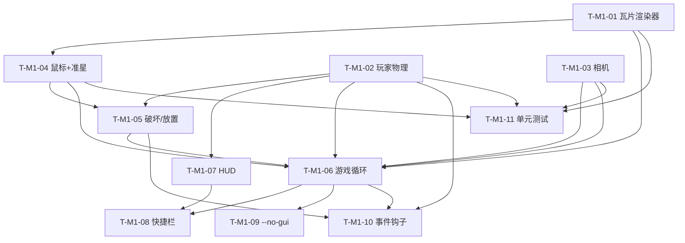
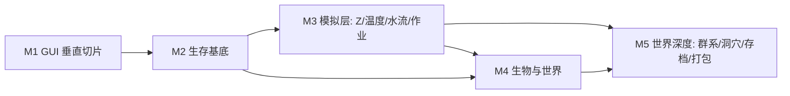

# 架构设计：我的世界复刻版（2D 瓦片 GUI 版）· `mc_clone_gui`

> 架构师：高见远（Gao）
> 范围：基于 `docs/prd_large.md` 的**系统架构设计 + 全里程碑任务分解**。
> **本文件只描述设计与分解，不写任何实现代码、不修改任何 .py 源码。**
> 演进基点：`D:\allin\example` 现有 2D 文字向 MC 地基（`geometry` / `noise` / `block_registry` / `block_world` / `terrain` / `text_world_renderer` / `input_realtime` / `main.py` / `data/blocks.default.json`）。
> 语言：中文。

---

## 0. 设计目标与约束摘要

| 项 | 结论 |
|---|---|
| 渲染路线 | **pygame-ce 2D 瓦片**（不引入 3D / OpenGL） |
| 瓦片尺寸 | **32px**（程序生成纯色块 + 可选 PNG 覆盖） |
| Z 层级 | **M1 `depth=1`**；M3 起启用 `depth>1`（数据结构已支持，无返工） |
| 模拟预算 | 模拟 tick ≤ **20Hz**，仅重算变化 chunk；瓦片渲染目标 **30–60 FPS** |
| 瞄准 | **M1 默认鼠标瞄准**，键盘 `J-K` 作降级保留 |
| 游戏循环 | **pygame.Clock + 固定步长累加器**；降 `allin_engine` 耦合，仅保留 `Serializable` / `JSONLoader` / `InputManager` 基类 |
| 默认世界 | **256 × 96**（M1 `depth=1`） |
| 坐标约定 | 继承地基：x 右、y 上、z 层；`屏幕第 r 行 ↔ world y = viewport.max_y - r`，`第 c 列 ↔ world x = viewport.min_x + c` |

> 本设计严格遵循 PRD §7 的 Q1–Q7 推荐默认值（见第 8 章正式采纳）。

---

## 1. 实现方案 + 框架选型

### 1.1 技术路线确认

- **渲染**：采用 **pygame-ce**（`>=2.5`）的 `pygame.Surface` + `blit` 做 2D 瓦片渲染。每个非空方块渲染为一个 `tile_size×tile_size` 的 `pygame.Surface`；瓦片 Surface 以 `block_id` 为键缓存（程序生成纯色块）。**不引入任何 3D / OpenGL / numpy**——纯 Python + pygame 足以驱动 256×96 世界、视口 80×24 瓦片的 30–60 FPS 渲染，且对 PyInstaller 打包友好。
- **输入**：复用现有 `input_realtime.RealtimeInputManager` / `PygameKeyStateSource`（键盘）。**新增 `MouseStateSource`** 提供鼠标位置与按键状态，并由 **`GUIInputManager(RealtimeInputManager)`** 组合键盘+鼠标（详见 §3）。为保持地基零改动，鼠标相关类放入**新建** `mouse_input.py`，不修改 `input_realtime.py`。
- **游戏循环**：**放弃** `allin_engine.core.game_loop.FixedTimestepLoop`，改用 **`pygame.time.Clock` + 固定步长累加器**（fixed dt = 1/60）。理由：减少引擎耦合、便于 PyInstaller 冻结、逻辑与渲染解耦。
- **事件系统**：**放弃** `allin_engine.core.event_bus.EventBus` / `EventTypes`，改用**轻量本地 `EventBus`**（新建 `event_bus.py`）。M1 仅做日志订阅；常量 `PLAYER_MOVED / BLOCK_BROKEN / BLOCK_PLACED / PLAYER_LANDED` 本地定义。
- **存档/数据**：`BlockWorld.to_dict/from_dict` 与 `BlockDef` 继续继承 `allin_engine.core.serializable.Serializable`；`BlockRegistry.from_json` 继续用 `allin_engine.utils.json_loader.JSONLoader`。这两基类 + `InputManager` 基类是 **仅保留** 的引擎依赖。

### 1.2 与 `allin_engine` 的依赖边界（关键结论）

| 能力 | 现状（地基） | M1 决策 |
|---|---|---|
| `core.serializable.Serializable` | `BlockDef` / `BlockWorld` 继承 | **保留**（存档/序列化基石） |
| `utils.json_loader.JSONLoader` | `BlockRegistry.from_json` 使用 | **保留** |
| `systems.input.InputManager` | `RealtimeInputManager` 基类 | **保留** |
| `core.game_loop.FixedTimestepLoop` | MVP 拟用 | **弃用** → 本地 `GameLoop`（pygame.Clock） |
| `core.event_bus.EventBus` / `EventTypes` | MVP 拟用 | **弃用** → 本地 `EventBus` |
| `systems/inventory.Inventory` | MVP 拟复用 | **弃用** → M2 自定义本地 `Inventory`（降耦合） |
| `core/ecs` | 未使用 | **不涉及** |

> **结论**：M1 对 `allin_engine` 的运行时依赖收敛为 **3 个基类**（`Serializable` / `JSONLoader` / `InputManager`）。`D:\allin\tools` 通过 `PYTHONPATH` 注入，不进 `requirements.txt`；为 PyInstaller 冻结时仅需把这 3 个基类模块打进包。

### 1.3 模块分层（M1）

```
render/显示层:  tile_world_renderer.py (TileWorldRenderer)  ·  hud.py (HUD)
entities/实体:  player.py (Player)
systems/系统:   camera.py (Camera)  ·  event_bus.py (EventBus)  ·  mouse_input.py (输入)
simulation:     （M1 无；M3 起 simulation/*）
ui:             hud.py（归显示层亦可）
io/入口:        main_gui.py (GameLoop + 入口 + --no-gui 降级)
worldgen:       （复用现有 terrain.py；M5 扩展 worldgen/*）
```

> 现有地基模块（`geometry` / `noise` / `block_registry` / `block_world` / `terrain` / `text_world_renderer` / `input_realtime`）**原样复用、不修改**。

### 1.4 为何不引入 numpy / OpenGL

- **OpenGL**：PRD 明令禁止 3D；2D 瓦片用 `Surface.blit` 足够，引入 OpenGL 会带来着色器/上下文/打包复杂度，得不偿失（见 PRD §3.3 对 Python 3D 克隆的反面教训）。
- **numpy**：M1 世界仅 256×96×1（≈2.4 万格），`dict` 稀疏存储 + 逐格遍历足够；引入 numpy 增加打包体积与确定性控制难度（numpy RNG 与 `random.Random` 不混用）。M3 若模拟热点成为瓶颈，再评估局部 numpy，且不破坏数据层接口。

---

## 2. 文件列表及相对路径

> 相对根：`D:\allin\example\`。**粗体 = M1 新建文件**；其余为 M2–M5 规划文件。

### 2.1 M1（GUI 垂直切片）新增文件

| 文件 | 职责 | 里程碑 |
|---|---|---|
| **`tile_world_renderer.py`** | `TileWorldRenderer`：pygame Surface 瓦片渲染；纯色块缓存；y 翻转映射；玩家叠加；准星高亮 | M1 |
| **`player.py`** | `Player(AABB2D)`：移动/重力/碰撞；`try_break`/`try_place`；快捷栏 `held_id`/`hotbar`；事件发射 | M1 |
| **`camera.py`** | `Camera`：视口跟随 + 边界钳制；`current_z` 预留字段（M3） | M1 |
| **`hud.py`** | `HUD`：顶部状态条 / 快捷栏 / 提示条绘制 | M1 |
| **`mouse_input.py`** | `MouseStateSource`（鼠标位置/按键）+ `GUIInputManager(RealtimeInputManager)`（组合键鼠） | M1 |
| **`event_bus.py`** | 轻量本地 `EventBus` + 事件类型常量（M1 仅日志） | M1 |
| **`main_gui.py`** | `GameLoop`（pygame.Clock 固定步长）；入口 `main()`；`--no-gui` 降级（复用 `text_world_renderer`）；配置常量 | M1 |

> 说明：`mouse_input.py` 与 `event_bus.py` 为保持地基零改动而单列；PRD §8.1 允许「新增 `MouseStateSource` 或扩展现有类」，本设计选「新增文件」以保留 `input_realtime.py` 不变。

### 2.2 M2–M5 规划文件（不新建于本轮）

| 文件 | 职责 | 里程碑 |
|---|---|---|
| `inventory.py` | 本地 `Inventory`（槽位 `{block_id, count}`），**不依赖** `allin_engine.systems.inventory` | M2 |
| `crafting.py` | 配方表（JSON 数据驱动）+ 合成逻辑 | M2 |
| `daynight.py` | 昼夜时间累加器 + 天空/背景色调 | M2 |
| `simulation/__init__.py` `simulation/temperature.py` | 温度场 + 扩散 | M3 |
| `simulation/fluid.py` | 水/岩浆元胞自动机 | M3 |
| `simulation/jobs.py` | 挖掘/建造作业队列 + 模拟 tick | M3 |
| `creatures/__init__.py` `creatures/entity.py` | 生物实体（`AABB2D` + HP + AI 状态） | M4 |
| `creatures/ai.py` | AI 状态机（idle/wander/flee/attack） | M4 |
| `creatures/spawn.py` | 刷怪规则（群系/时间/上限） | M4 |
| `worldgen/__init__.py` `worldgen/biome.py` | 群系噪声 + 调色板 | M5 |
| `worldgen/caves.py` | 3D 噪声开凿洞穴 + 矿脉分布 | M5 |
| `save_load.py` | 包装 `BlockWorld` 序列化 + 玩家/背包/时间/生物 | M5 |
| `build.spec` | PyInstaller 打包配置 | M5 |

### 2.3 复用（不修改）的地基文件

`geometry.py` · `noise.py` · `block_registry.py` · `block_world.py` · `terrain.py` · `text_world_renderer.py` · `input_realtime.py` · `main.py` · `data/blocks.default.json`

---

## 3. 数据结构和接口（类图 · Mermaid classDiagram）

> 仅列出 M1 关键类与接口签名；关系以 `--|>`（继承）、`..>`（依赖/调用）、`*--`（组合）标注。地基类 `AABB2D` / `BlockWorld` / `BlockRegistry` / `RealtimeInputManager` / `InputManager` 以引用形式出现。

```mermaid
classDiagram
    %% ===== 地基引用（不修改） =====
    class AABB2D {
        +min_x: int
        +min_y: int
        +max_x: int
        +max_y: int
        +width() int
        +height() int
        +contains(x,y) bool
        +intersects(o) bool
    }
    class BlockWorld {
        +width: int
        +height: int
        +depth: int
        +get(x,y,z) int
        +set(x,y,z,id) None
        +in_bounds(x,y,z) bool
        +bounds() AABB2D
        +to_dict() dict
    }
    class BlockRegistry {
        +get(id) BlockDef
        +get_by_name(n) BlockDef
        +load_defaults() None
    }
    class RealtimeInputManager {
        +is_down(key) bool
        +pressed_this_frame(key) bool
        +update() None
    }
    class InputManager

    %% ===== M1 新增 =====
    class TileWorldRenderer {
        -screen: pygame.Surface
        -registry: BlockRegistry
        -tile_size: int = 32
        -_tile_cache: dict~int,pygame.Surface~
        -_view_offset_x: int
        -_hud_top: int
        +__init__(screen, registry, tile_size=32)
        +render(world: BlockWorld, viewport: AABB2D, overlays=None) None
        +draw_player(player: Player) None
        +draw_highlight(tx: int, ty: int, viewport: AABB2D) None
        -_tile_surface(block_def) pygame.Surface
        -_world_to_screen(tx: int, ty: int, viewport: AABB2D) tuple~int,int~
    }
    class Player {
        +min_x: float
        +min_y: float
        +max_x: float
        +max_y: float
        +vx: float
        +vy: float
        +on_ground: bool
        +facing: int
        +held_id: int
        +hotbar: list~int~
        +selected_slot: int
        +width_f: float = 0.8
        +height_f: float = 1.8
        +__init__(x: float, y: float, registry: BlockRegistry)
        +update(dt: float, world: BlockWorld, input: GUIInputManager) None
        +try_break(world: BlockWorld, tx: int, ty: int) bool
        +try_place(world: BlockWorld, tx: int, ty: int) bool
        +select_slot(i: int) None
        -_move_and_collide(dt, world) None
    }
    class Camera {
        -viewport: AABB2D
        +current_z: int = 0
        +__init__(viewport: AABB2D)
        +follow(target: AABB2D) None
        +clamp_to(world_bounds: AABB2D) None
        +set_z(z: int) None
        +screen_center_to_world(mx, my) tuple~int,int~
    }
    class HUD {
        -screen: pygame.Surface
        +__init__(screen)
        +draw(player: Player, world: BlockWorld, fps: float, seed: int) None
        -_draw_top_bar(player, world, fps, seed) None
        -_draw_hotbar(player) None
        -_draw_hint_bar() None
    }
    class MouseStateSource {
        -_pos: tuple~int,int~
        -_down: set
        -_pressed: set
        +__init__()
        +poll() None
        +position() tuple~int,int~
        +is_down(button: int) bool
        +pressed_this_frame(button: int) bool
        +reset_frame() None
    }
    class GUIInputManager {
        -mouse: MouseStateSource
        +__init__(base: InputManager, key_source: PygameKeyStateSource, mouse: MouseStateSource)
        +mouse_down(button: int) bool
        +mouse_pressed(button: int) bool
        +mouse_pos() tuple~int,int~
        +update() None
    }
    class GameLoop {
        -screen: pygame.Surface
        -world: BlockWorld
        -player: Player
        -camera: Camera
        -renderer: TileWorldRenderer
        -hud: HUD
        -input: GUIInputManager
        -event_bus: EventBus
        -seed: int
        -fixed_dt: float = 1/60
        -fps_cap: int = 60
        +__init__(screen, world, player, camera, renderer, hud, input, event_bus, seed)
        +run() None
        -_update(dt: float) None
        -_render() None
    }
    class EventBus {
        -_subs: dict~str,list~
        +subscribe(etype: str, handler) None
        +emit(etype: str, **data) None
    }
    class EventTypes {
        +PLAYER_MOVED: str = "PLAYER_MOVED"
        +BLOCK_BROKEN: str = "BLOCK_BROKEN"
        +BLOCK_PLACED: str = "BLOCK_PLACED"
        +PLAYER_LANDED: str = "PLAYER_LANDED"
    }

    %% ===== 关系 =====
    Player --|> AABB2D
    GUIInputManager --|> RealtimeInputManager
    RealtimeInputManager --|> InputManager
    Camera *-- AABB2D : viewport

    GameLoop ..> Player : update dt
    GameLoop ..> Camera : follow/clamp
    GameLoop ..> TileWorldRenderer : render
    GameLoop ..> HUD : draw
    GameLoop ..> GUIInputManager : poll
    GameLoop ..> EventBus : emit
    GameLoop ..> MouseStateSource : read

    TileWorldRenderer ..> BlockRegistry : color/glyph
    TileWorldRenderer ..> BlockWorld : read tiles
    Player ..> BlockWorld : break/place
    Player ..> EventBus : emit
    Camera ..> AABB2D : clamp
    GUIInputManager ..> MouseStateSource : delegate
```



### 3.1 关键接口说明（工程师落地口径）

- **`TileWorldRenderer.render(world, viewport, overlays=None)`**
  - 遍历视口瓦片网格（列 `c`、行 `r`），按 §7 映射求 `world_x/world_y`，对非空方块 `_tile_surface(block_def)` 后 `blit` 到 `pixel = (view_offset_x + c*tile_size, hud_top + r*tile_size)`。
  - `air(0)` 不绘制（露出背景）；`water(4, transparent)` 用半透明 Surface。
  - `draw_player` 在玩家 AABB 对应像素位置叠加玩家色块；`draw_highlight` 在目标格叠加描边。
- **`Player(AABB2D)`**：`min_x/min_y` 兼作**浮点脚底（左下）坐标**（见 §7 约定：AABB2D 字段为 `int` 类型标注，但运行时存浮点，碰撞时用 `math.floor` 取整）。`update` 内做「先 x 后 y」的分轴扫掠碰撞，与 `solid` 方块相交则回退到格边并清零该轴速度；落地置 `on_ground=True`。
- **`Camera`**：`viewport` 为固定尺寸的世界坐标 `AABB2D`；`follow` 将视口中心对齐 `target` 中心；`clamp_to` 用 `AABB2D` 钳制避免越界；`current_z` 预留（M3 切换层）。
- **`MouseStateSource` / `GUIInputManager`**：`poll()` 读 `pygame.mouse.get_pos()` 与 `pygame.mouse.get_pressed()`；`GUIInputManager` 在 `RealtimeInputManager` 基础上增加 `mouse_*` 透传，`update()` 同时轮询键鼠并 `reset_frame()`。
- **`EventBus`**：`emit(etype, **data)` 同步调用订阅者；M1 仅接一个日志订阅者（见 §5 T-M1-10）。

---

## 4. 程序调用流程（时序图 · Mermaid sequenceDiagram）

### 4.1 M1 单帧流程 `GameLoop.run()`

```mermaid
sequenceDiagram
    autonumber
    participant Loop as GameLoop
    participant Input as GUIInputManager
    participant Mouse as MouseStateSource
    participant Player
    participant Camera
    participant World as BlockWorld
    participant Renderer as TileWorldRenderer
    participant HUD
    participant Bus as EventBus

    Loop->>Input: update()  %% 轮询键盘+鼠标
    Input->>Mouse: poll()
    Loop->>Player: update(dt, world, input)
    Player->>World: get(x,y,z)  %% 碰撞查询 solid
    Player->>Player: 重力/分轴移动/碰撞回退
    Player->>Bus: emit(PLAYER_MOVED, x,y,facing)
    alt 落到地面（on_ground 由 False→True）
        Player->>Bus: emit(PLAYER_LANDED, x,y)
    end
    Loop->>Camera: follow(player); clamp_to(world.bounds())
    Loop->>Renderer: render(world, camera.viewport)
    Renderer->>World: get(x,y,z)  %% 逐格
    Renderer->>Renderer: blit 瓦片 + draw_player
    Loop->>HUD: draw(player, world, fps, seed)
    Loop->>Loop: pygame.display.flip()
```

### 4.2 破坏 / 放置调用链

```mermaid
sequenceDiagram
    autonumber
    participant Loop as GameLoop
    participant Input as GUIInputManager
    participant Mouse as MouseStateSource
    participant Camera
    participant Player
    participant World as BlockWorld
    participant Bus as EventBus
    participant Renderer as TileWorldRenderer

    Loop->>Input: update()
    Input->>Mouse: position() / mouse_pressed(L/R)
    Player->>Camera: screen_center_to_world(mx,my)
    Camera-->>Player: (tx, ty)  %% 鼠标→世界格
    alt 左键刚按下（破坏）
        Player->>Player: try_break(world, tx, ty)
        Player->>World: in_bounds / set(tx,ty,0,AIR)
        World-->>Player: 写入成功
        Player->>Bus: emit(BLOCK_BROKEN, x=tx,y=ty,id)
    else 右键刚按下（放置）
        Player->>Player: try_place(world, tx, ty)
        Player->>World: 目标为空/水 且 不占玩家AABB?
        Player->>World: set(tx,ty,0,held_id)
        Player->>Bus: emit(BLOCK_PLACED, x=tx,y=ty,id=held_id)
    end
    Loop->>Renderer: render(...)  %% 下一帧反映变化
    Renderer->>Renderer: draw_highlight(tx,ty)
```

> 键盘降级（`J` 破坏 / `K` 放置）：目标格取 `player` 面朝方向紧邻一格（`facing` 决定 ±x），逻辑同 `try_break/try_place`。

---

## 5. 任务列表（有序、含依赖、按实现顺序）

### 5.1 M1 · GUI 垂直切片（拆到工程师可直接执行的最小单元）

> 每个任务标注：源文件、依赖、优先级。`foundation` 指现有 `D:\allin\example` 地基模块（已存在、不修改）。
> 通用配置常量（`TILE_SIZE=32`、`HUD_TOP=28`、`HUD_BOTTOM=48`、`VIEW_OFFSET_X=0`、`FIXED_DT=1/60`、`FPS_CAP=60`、`WORLD_W=256`、`WORLD_H=96`、`VIEWPORT_TILES=(80,24)`、`SEED=12345`）集中在 `main_gui.py` 顶部，供各任务引用。

#### T-M1-01 瓦片渲染器骨架（程序生成纯色块 + 视口 blit + y 翻转映射）
- **源文件**：`tile_world_renderer.py`（新建）
- **依赖**：无（复用 `block_registry`、`block_world`、`geometry`）
- **优先级**：P0
- **落地要点**：
  - `TileWorldRenderer(screen, registry, tile_size=32)`；`_tile_cache: dict[int, Surface]`。
  - `_tile_surface(block_def)`：按 §7 调色板生成 `tile_size×tile_size` 纯色 Surface，加浅/深 1px 边框做立体感；命中 `data/tiles/{name}.png` 则改用 PNG（M1 仅留钩子）。
  - `render(world, viewport, overlays=None)`：按公式 `world_y = viewport.max_y - r`、`world_x = viewport.min_x + c` 遍历视口，非空方块 `blit` 到 `(VIEW_OFFSET_X + c*tile_size, HUD_TOP + r*tile_size)`；`air` 跳过。
  - 验收：同视口渲染几何与 `TextWorldRenderer` 一致；80×24 场景 ≥30 FPS。

#### T-M1-02 玩家实体与物理（AABB 碰撞、重力、跳跃）
- **源文件**：`player.py`（新建）
- **依赖**：无（复用 `geometry`（AABB2D）、`block_world`、`block_registry`）
- **优先级**：P0
- **落地要点**：
  - `Player(AABB2D)`：`min_x/min_y` 为浮点脚底坐标；`width_f=0.8`、`height_f=1.8`；`hotbar=[STONE,DIRT,GRASS,SAND,WATER,AIR]`、`selected_slot=0`、`held_id=hotbar[0]`。
  - `update(dt, world, input)`：读 `A/D`/`←→` 设 `vx`；`Space/W/↑`（`pressed_this_frame`）给 `vy=JUMP_V`；每帧 `vy -= GRAVITY*dt`；分轴移动 + 与 `solid` 方块扫掠碰撞（见 §7 算法）；落地 `on_ground=True`。
  - 物理常数：`GRAVITY=30(tile/s²)`、`MOVE_SPEED=6(tile/s)`、`JUMP_V=15.0(tile/s)`。注：`JUMP_V` 由架构预案的 `≈9` 上调至 `15.0`——按 `h≈v²/2g` 理论跳跃约 3.75 格，QA 实测 **3.625 格**，以满足 PRD M1-R2「跳跃约 3–4 格」（详见 `player.py` 注释）。
  - 验收：不进 `solid`；站 `solid` 上 y 稳定；撞墙阻挡；跳跃 3–4 格回落。

#### T-M1-03 相机跟随 + 边界钳制
- **源文件**：`camera.py`（新建）
- **依赖**：无（复用 `geometry`）
- **优先级**：P0
- **落地要点**：
  - `Camera(viewport: AABB2D)`（`viewport` 尺寸固定 = `VIEWPORT_TILES`）。
  - `follow(target)`：视口中心对齐 `target` 中心（浮点居中，渲染取整）。
  - `clamp_to(world_bounds)`：用 `AABB2D` 把视口钳制进 `world.bounds()`。
  - `screen_center_to_world(mx,my)`：实现鼠标像素→世界格（公式见 §7），供 T-M1-04/T-M1-05 复用。
  - `current_z` 字段预留（M3）。
  - 验收：玩家居中随动；边界钳制正确。

#### T-M1-04 鼠标输入源 + 瞄准目标格计算 + 准星高亮
- **源文件**：`mouse_input.py`（新建）、`tile_world_renderer.py`（扩展 `draw_highlight`）
- **依赖**：T-M1-01（准星绘制入渲染器）、foundation `input_realtime`
- **优先级**：P0
- **落地要点**：
  - `MouseStateSource`：`poll()` 读 `pygame.mouse.get_pos()`/`get_pressed()`；`position()`、`is_down(b)`、`pressed_this_frame(b)`、`reset_frame()`。
  - `GUIInputManager(RealtimeInputManager)`：组合键鼠，`update()` 同时 `key_source.poll()`+`mouse.poll()`+`reset_frame()`；新增 `mouse_down/mouse_pressed/mouse_pos`。
  - 目标格：`Camera.screen_center_to_world(mx,my)` → `(tx,ty)`；`tile_world_renderer.draw_highlight(tx,ty,viewport)` 描边。
  - 键盘降级：`J/K` 取 `player.facing` 相邻格。
  - 验收：准星随鼠标移动；视觉可辨（M1-R7）。

#### T-M1-05 破坏 / 放置（边界保护、防卡死）
- **源文件**：`player.py`（扩展 `try_break`/`try_place`）、`event_bus.py`（常量引用）
- **依赖**：T-M1-02（Player）、T-M1-04（目标格）、foundation `block_world`
- **优先级**：P0
- **落地要点**：
  - `try_break(world, tx, ty) -> bool`：越界或目标格与玩家 AABB 相交则拒绝（防穿地/自埋）；否则 `world.set(tx,ty,0,AIR)`；成功 `emit(BLOCK_BROKEN)`。
  - `try_place(world, tx, ty) -> bool`：目标须为 `air(0)` 或 `water(4)` 且**不与玩家 AABB 相交**（防卡死）；`world.set(tx,ty,0,held_id)`；成功 `emit(BLOCK_PLACED)`。
  - 调用点：左键 `mouse_pressed(LEFT)` → `try_break`；右键 `mouse_pressed(RIGHT)` → `try_place`（由 `GameLoop._update` 或 `Player.update` 内分流，建议放 `GameLoop` 以便统一事件）。
  - 验收：挖置 0 且 `to_dict()` 改变；不可放玩家占用格；边界不穿地。

#### T-M1-06 游戏循环（pygame.Clock 固定步长）+ `main_gui` 入口
- **源文件**：`main_gui.py`（新建）、`event_bus.py`（新建）
- **依赖**：T-M1-01、T-M1-02、T-M1-03、T-M1-04、T-M1-05
- **优先级**：P0
- **落地要点**：
  - `event_bus.py`：`EventBus` + `EventTypes` 常量（M1 仅日志订阅者，见 T-M1-10）。
  - `GameLoop`：`pygame.time.Clock` + 累加器；`frame_time=clock.tick(FPS_CAP)/1000`；`while acc>=FIXED_DT: _update(FIXED_DT); acc-=FIXED_DT`；`_update` 内 `input.update()` → `player.update()` → `player` 键鼠交互（破坏/放置/切换）→ `camera.follow/clamp` → `event_bus.emit`；`_render` 内 `renderer.render` + `hud.draw` + `flip()`。
  - `main()`：解析 `--no-gui`；构造 `registry=BlockRegistry.from_json()`、`noise`、`TerrainGenerator(...).generate(WORLD_W,WORLD_H)`、`pygame.display.set_mode((VIEWPORT_TILES[0]*TILE_SIZE, WINDOW_H))`；组装并 `GameLoop(...).run()`。
  - 验收：每帧读 `GUIInputManager`；FPS 显示；逻辑/渲染解耦。

#### T-M1-07 HUD（坐标 / 手持 / FPS / 种子）
- **源文件**：`hud.py`（新建）
- **依赖**：T-M1-02（需 `player` 坐标/`held_id`）
- **优先级**：P0
- **落地要点**：
  - `HUD(screen).draw(player, world, fps, seed)`：顶部条 `_draw_top_bar`（XY/Z、手持方块名、FPS、种子）；`_draw_hotbar(player)`（1–6 槽 + 高亮 `selected_slot`）；`_draw_hint_bar()`（操作提示）。
  - 绘制于 `HUD_TOP` / `HUD_BOTTOM` 像素带，**不覆盖**主视口瓦片（主视口区域为 `[HUD_TOP, WINDOW_H-HUD_BOTTOM]`，见 §7）。
  - 验收：实时随状态更新；不遮挡主视口。

#### T-M1-08 快捷栏切换（1–6）
- **源文件**：`player.py`（扩展 `select_slot`）、`hud.py`（高亮）、`main_gui.py`（键位接线）
- **依赖**：T-M1-02、`T-M1-07`、T-M1-06
- **优先级**：P1
- **落地要点**：
  - `数字键 1–6`（`pressed_this_frame`）：`player.select_slot(n-1)` → `held_id=hotbar[selected_slot]`。
  - HUD 同步高亮当前槽；放置用 `held_id`。
  - 验收：切换后放置用新方块；HUD 显示当前手持（M1-R8）。

#### T-M1-09 `--no-gui` 降级保留（复用 `text_world_renderer`）
- **源文件**：`main_gui.py`（扩展 `main()` 的 `--no-gui` 分支）
- **依赖**：T-M1-06（入口结构）、foundation `text_world_renderer`/`terrain`/`main` 逻辑
- **优先级**：P1
- **落地要点**：
  - `--no-gui`：不创建 pygame 窗口；生成世界后用 `TextWorldRenderer(registry).render(world, viewport)` 打印（复用现有 ANSI 路径），循环可选退出。
  - 保持 `main.py` 原样不变；降级逻辑全部在 `main_gui.py`。
  - 验收：`--no-gui` 可运行并打印；无 pygame 渲染被误触发。

#### T-M1-10 事件总线钩子（仅日志）
- **源文件**：`event_bus.py`（扩展日志订阅者）、`player.py`/`main_gui.py`（确保 emit 调用点）
- **依赖**：T-M1-06（EventBus 已建）、T-M1-02（Player 发射）、T-M1-05（破坏/放置发射）
- **优先级**：P2
- **落地要点**：
  - `event_bus.subscribe(EVENT_*, logging.info)` 形式的日志订阅者（M1 仅打印/写日志）。
  - 确认调用点存在于：`player.update`（MOVED/LANDED）、`try_break`（BROKEN）、`try_place`（PLACED）。
  - 验收：订阅者可接收；调用点存在（M1-R11）。

#### T-M1-11 单元测试（核心：碰撞 / 目标格 / 相机钳制 / 瓦片映射一致性）
- **源文件**：`tests/test_m1_*.py`（新建，或 `D:\allin\example\tests\`）
- **依赖**：T-M1-01、T-M1-02、T-M1-03、T-M1-04（被测模块就绪）
- **优先级**：P0（质量门）
- **落地要点**：
  - 碰撞：玩家落入 `solid` 后 `on_ground` 且 y 稳定；撞墙被阻。
  - 目标格：`Camera.screen_center_to_world` 反算与 `TileWorldRenderer._world_to_screen` 互逆；鼠标居中时应瞄准玩家附近格。
  - 相机钳制：视口在世界角落被钳制不越界。
  - 瓦片映射一致性：`TileWorldRenderer` 与 `TextWorldRenderer` 对同一视口产生一致的非空格集合（几何一致，忽略颜色/字符差异）。
  - 验收：全部用例通过；CI 门槛。

### 5.2 M1 任务依赖图（Mermaid graph）



> 可并行起点：`T-M1-01`、`T-M1-02`、`T-M1-03` 互不依赖，建议并行开工；`T-M1-06` 为集成闸口。

---

## 6. 依赖包列表

| 依赖 | 类型 | 说明 |
|---|---|---|
| **pygame-ce** | **硬依赖（运行时）** | 渲染/输入/主循环；`>=2.5` |
| `allin_engine`（纯净版，`D:\allin\tools`） | **仅基类来源** | 运行期只需 `core/serializable.Serializable`、`utils/json_loader/JSONLoader`、`systems/input/InputManager` 三个基类；经 `PYTHONPATH` 注入，**不进** `requirements.txt` |
| Python 3.14 标准库 | 标准 | `json` / `math` / `random` / `dataclasses` / `argparse` / `os` / `sys` / `logging` / `time` |
| `PyInstaller` | **构建期** | 仅 M5 打包使用，不进运行时 |

**`requirements.txt`（已落地于 `D:\allin\example\requirements.txt`）**
```
# 运行时硬依赖
pygame-ce>=2.5

# allin_engine：仅作为 3 个基类来源（Serializable/JSONLoader/InputManager），
# 由 PYTHONPATH=D:/allin/tools 注入，不列入 pip 依赖。
# PyInstaller：仅 M5 构建期使用，单独 pip install pyinstaller，不进运行时。
```

> **不引入**：numpy、OpenGL、任何 3D 库（见 §1.4）。

---

## 7. 共享知识（跨文件约定）

1. **瓦片尺寸**：`TILE_SIZE = 32`（像素）。所有像素换算以它为单位。
2. **坐标映射（继承地基，全项目统一）**：
   - 屏幕瓦片行 `r` ↔ `world_y = viewport.max_y - r`
   - 屏幕瓦片列 `c` ↔ `world_x = viewport.min_x + c`
   - 屏幕像素：`px = VIEW_OFFSET_X + c * TILE_SIZE`，`py = HUD_TOP + r * TILE_SIZE`
   - 视口区域（主视口，不含 HUD 带）：`y ∈ [HUD_TOP, WINDOW_H - HUD_BOTTOM]`，`x ∈ [0, WINDOW_W]`。
3. **鼠标 → 世界格映射公式**（工程师直接套用）：
   ```python
   c = (mx - VIEW_OFFSET_X) // TILE_SIZE
   r = (my - HUD_TOP) // TILE_SIZE
   world_x = viewport.min_x + c
   world_y = viewport.max_y - r
   # 等价于 Camera.screen_center_to_world(mx, my)
   ```
4. **颜色调色板映射**（`BlockDef.color` 语义名 → RGB，用于瓦片生成）：
   | 语义名 | RGB | 备注 |
   |---|---|---|
   | `white` | `(240,240,240)` | air 不绘制 |
   | `gray` | `(130,130,130)` | stone |
   | `brown` | `(134,96,67)` | dirt |
   | `green` | `(80,170,70)` | grass |
   | `blue` | `(60,120,220)` | water（半透明 alpha≈150） |
   | `yellow` | `(224,200,90)` | sand |
   | `black` | `(20,20,20)` | 预留 |
   | `red` | `(200,60,60)` | 预留 |
   | `magenta` | `(180,80,180)` | 预留 |
   | `cyan` | `(80,200,200)` | 预留 |
   > 调色板在 `tile_world_renderer.py` 内 `_TILE_RGB` 常量集中定义；新增方块色名须在此登记。
5. **纯色块生成规则**：`base fill` + 左上 `lighter 1px` 高光 + 右下 `darker 1px` 阴影（立体感）；`transparent` 方块（water）用 `Surface.convert_alpha()` + `alpha`；`air` 不生成/不 blit。`block_id` → Surface 缓存于 `_tile_cache`，避免每帧重建。命中 `data/tiles/{block_def.name}.png` 则优先用 PNG（M1 仅留加载钩子）。
6. **确定性规则（继承地基）**：所有随机性**只来自 `random.Random(seed)`**；禁止全局 `random` / `time` / `os.urandom`。`PerlinNoise` 用 `Random(seed)` 建置换表。`TerrainGenerator.generate(seed,...)` 同 `(seed,W,H)` 产出逐格一致。
7. **事件类型常量**（本地 `EventTypes`）：`PLAYER_MOVED` / `BLOCK_BROKEN` / `BLOCK_PLACED` / `PLAYER_LANDED`。M1 仅日志订阅。
8. **AABB2D 浮点约定（重要）**：`Player` 继承 `AABB2D`（其字段类型标注为 `int`），但运行时**存浮点**脚底坐标；碰撞检测时对相交格用 `math.floor` 取整查询 `world.get`。不修改 `geometry.py`。
9. **Z 层级预留约定**：M1 所有 `world.get/set` 调用 `z=0`（默认）；涉及层的类（`Camera.current_z`、未来 `BlockWorld` 多层）保留 `z` 参数；M3 启用 `depth>1` 时无接口返工。
10. **HUD 像素带**：`HUD_TOP=28`、`HUD_BOTTOM=48`；`WINDOW_W = VIEWPORT_TILES[0]*TILE_SIZE = 2560`、`WINDOW_H = HUD_TOP + VIEWPORT_TILES[1]*TILE_SIZE + HUD_BOTTOM`（参考 `VIEWPORT_TILES=(80,24)` → `WINDOW_H≈820`）。窗口过大时可整体缩放或留边，映射公式不变。
11. **键位映射（M1）**：`A/←` 左、`D/→` 右、`Space/W/↑` 跳、`鼠标左键/J` 破坏、`鼠标右键/K` 放置、`1–6` 切换手持、`Esc` 暂停/退出、`F3` 调试覆盖层（M1-R10 占位）。
12. **物理常数（已固化，与 `player.py` 一致）**：`GRAVITY=30(tile/s²)`、`MOVE_SPEED=6(tile/s)`、`JUMP_V=15.0(tile/s)`。单位：速度 tile/s、加速度 tile/s²。`JUMP_V` 由预案 `≈9` 上调至 `15.0` 以满足 M1-R2，QA 实测跳跃 **3.625 格**（落回起点）。

---

## 8. 待明确事项的采纳默认值（PRD Q1–Q7 正式写入）

| # | 问题 | **采纳默认值** | 落地位置 |
|---|---|---|---|
| Q1 | GUI 瓦片尺寸 | **32px** | §7.1 `TILE_SIZE=32` |
| Q2 | tileset 来源 | **程序生成纯色块 + 可选 PNG 覆盖** | §7.5；`data/tiles/` 钩子 |
| Q3 | Z 层级是否 M1 启用 | **M1 `depth=1`；M3 起 `>1`** | §7.9 预留；`terrain` M3 扩展 |
| Q4 | 模拟层性能预算 | **模拟 tick ≤20Hz，仅重算变化 chunk；渲染 30–60 FPS** | M1 玩家更新用 `FIXED_DT=1/60`（轻量无热点）；M3 模拟层套 20Hz + dirty-chunk（见 M3 任务） |
| Q5 | M1 是否支持鼠标瞄准 | **是（默认）；`J-K` 降级** | T-M1-04 |
| Q6 | 游戏循环驱动 | **pygame.Clock + 固定步长累加器**；弃用引擎 `FixedTimestepLoop`/`EventBus` | T-M1-06 / §1.2 |
| Q7 | 默认世界尺寸 | **宽 256 × 高 96 × depth**（M1 depth=1；M3 8–16） | §7 `WORLD_W/H` |

### 8.1 工程层面追加固定约定

- **FPS 上限 `FPS_CAP=60`**（渲染解耦上限；瓦片目标 30–60）。
- **固定步长 `FIXED_DT=1/60`**（逻辑固定 dt；累加器消纳帧时间）。
- **M3 chunk 大小 `CHUNK_SIZE=16`**（沿用地基 `serialize_chunk` 尺寸；M3 模拟按 chunk 分片 + dirty 标记）。
- **种子默认值 `SEED=12345`**（与现有 `main.py` 一致，便于复现）。
- **视口瓦片数 `VIEWPORT_TILES=(80,24)`**（M1-R1 验收参考规模）。
- **存档目录约定**（M5）：`saves/{seed}/world.json`（具体由 `save_load.py` 定）。

---

## 9. M2–M5 粗粒度任务分组（路线图，非单元级）

> 仅给出分组级路线图与依赖；单元级拆分在各自里程碑启动时展开。依赖见 §9.1 路线图图。

### M2 · 生存基底（依赖 M1）
- **T-M2-A** 背包模型 `inventory.py`（`{block_id,count}`，挖入/放出；不依赖引擎 `Inventory`）
- **T-M2-B** 合成 `crafting.py` + `data/recipes.json`（确定性配方，C 开界面）
- **T-M2-C** 昼夜循环 `daynight.py`（时间累加器 + 天空色调 + HUD 时钟，可序列化）
- **T-M2-D** 生命/饥饿（`player.py` 扩展 HP=20/饥饿=0–20；归零扣血；死亡重生）
- **T-M2-E** 完整手持切换（滚轮 + 1–6，HUD 同步）
- **T-M2-F** 音效/天气占位（调用点日志）

### M3 · 模拟层（依赖 M2）
- **T-M3-A** 启用 `depth>1` 世界生成 + `Camera` Z 切换（`Z`/`Shift+Z`）
- **T-M3-B** 温度覆盖层 `simulation/temperature.py`（逐格温度场 + 岩浆扩散 + `T` 开关）
- **T-M3-C** 水流/岩浆 `simulation/fluid.py`（元胞自动机，`W` 开关）
- **T-M3-D** 作业系统 `simulation/jobs.py`（DF 式划定挖/建区，模拟 tick 按节拍完成）
- **T-M3-E** 性能预算（≤20Hz + dirty-chunk 仅重算变化）

### M4 · 生物与世界（依赖 M2、M3）
- **T-M4-A** 生物实体 `creatures/entity.py`（`AABB2D`+HP+AI 状态机）
- **T-M4-B** AI `creatures/ai.py`（idle/wander/flee/attack）
- **T-M4-C** 刷怪 `creatures/spawn.py`（群系/时间规则 + 上限）
- **T-M4-D** 战斗 + 掉落 + 简易寻路（`player` + `creatures` 联动）

### M5 · 世界深度（依赖 M3、M4）
- **T-M5-A** 生物群系 `worldgen/biome.py`（群系噪声 + 调色板）
- **T-M5-B** 洞穴 & 矿脉 `worldgen/caves.py`（3D 噪声开凿 + 矿按层分布）
- **T-M5-C** 存档/读档 `save_load.py`（复用 `BlockWorld.to_dict` + 玩家/背包/时间/生物；F5 存）
- **T-M5-D** PyInstaller `build.spec`（捆绑 `allin_engine` 基类 + 资源，双击即玩）
- **T-M5-E** 设置/菜单 + 多世界 + Modding(JSON 增方块) + 全中文本地化

### 9.1 全路线图依赖图（Mermaid graph）



---

## 10. 风险与开放点（架构层面）

1. **窗口尺寸**：2560×820 窗口在部分低分辨率屏需缩放；建议 `main_gui.py` 支持 `--scale` 或自动 `display.set_mode(..., pygame.RESIZABLE)`。M1 先按固定尺寸实现，缩放留钩子。
2. **浮点 AABB**：`Player` 复用 `AABB2D` 存浮点，需团队一致遵守 §7.8，避免后续模块误当整数。
3. **`allin_engine` 注入**：PyInstaller 冻结时需确保 3 个基类模块被打入；建议 M5 在 `build.spec` 显式 `hiddenimports`。
4. **性能**：M1 渲染逐格 `blit`（80×24≈1920 次/帧）在 60 FPS 下约 11.5 万 blit/s，pygame 可胜任；若卡顿，可改为「脏矩形」或预渲染整屏 Surface 缓存（仅玩家/变化格重绘）。M3 模拟层务必按 chunk + dirty 限制。
5. **确定性边界**：鼠标操作非确定（玩家输入），但**世界生成/模拟**须保持 `random.Random(seed)` 确定；存档序列化不依赖帧时序。

> 以上为架构层约定，实现细节由工程师在各自任务内落地。本文件为设计基线，后续里程碑启动时据此细化。
