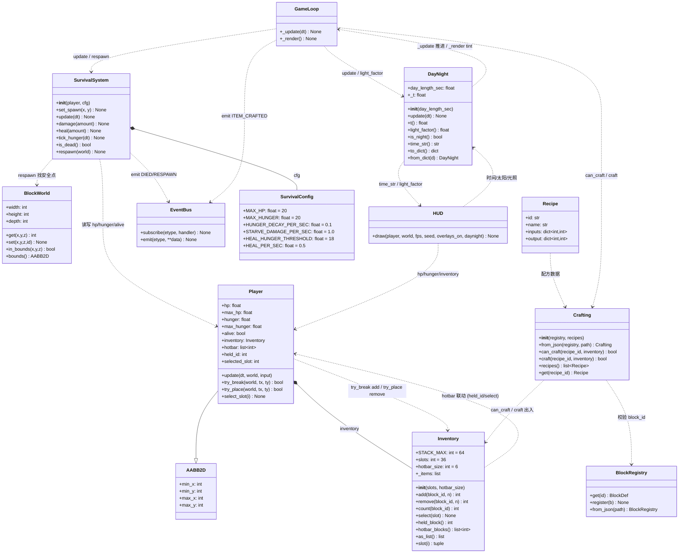
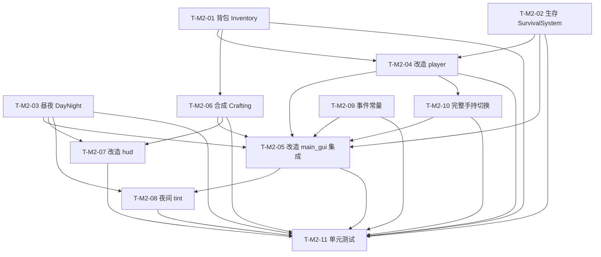

# 架构设计 · M2 生存基底（mc_clone_gui）

> 架构师：高见远（Gao）
> 范围：基于 `docs/prd_large.md` 的 **M2 系统架构设计 + 单元级任务分解**。
> **本文件只描述设计与分解，不写任何实现代码、不修改任何 .py 源码。**
> 演进基点：`D:\allin\example` 现有地基 + 已交付 M1（GUI 垂直切片，全量 96 passed）。
> 语言：中文。

---

## 0. 设计目标与约束摘要（继承 M1，扩展生存层）

| 项 | 结论 |
|---|---|
| 渲染路线 | pygame-ce 2D 瓦片（不引入 3D/OpenGL/numpy） |
| 瓦片尺寸 | 32px（沿用 M1） |
| 游戏循环 | pygame.Clock + 固定步长累加器（FIXED_DT=1/60，FPS_CAP=60），逻辑/渲染解耦（沿用 M1） |
| 坐标/物理/事件约定 | 全部继承 M1（`geometry`/`block_registry`/`block_world`/`event_bus` 已固化；GRAVITY=30/MOVE_SPEED=6/JUMP_V=15.0） |
| 地基（零改动、仅 import） | `geometry.py` `noise.py` `block_registry.py` `block_world.py` `terrain.py` `text_world_renderer.py` `input_realtime.py` `main.py` `data/blocks.default.json` |
| M1 文件（可改造） | `player.py` `main_gui.py` `hud.py` `camera.py` `tile_world_renderer.py` `mouse_input.py` `event_bus.py` |
| M2 新增依赖 | **无 pip 新增**（沿用 pygame-ce）；新增数据文件 `data/recipes.default.json`、`data/blocks.m2.json` |
| 确定性 | 仅 `random.Random(seed)`；世界生成同 M1；M2 逻辑（生存/背包/合成/昼夜）在 headless 下可断言 |
| 不破坏 M1 | 保留 M1 全部 96 用例绿；M2 对 M1 文件的改造均向后兼容（见 §1.3 / §9） |

> 本设计严格遵循 PRD §5 M2 章节（M2-R1~R9）与 M1 已固化决策；M2 粗粒度任务（architecture_gui.md §9 T-M2-A~F）在本文件 §5 拆到单元级。

---

## 1. M2 范围与依赖

### 1.1 M2 依赖 M1 的既有接口（复用，不改）

| 来源 | 复用的接口 / 字段 | M2 用途 |
|---|---|---|
| `player.py` · `Player` | `update(dt, world, input)`、`try_break/try_place`、`select_slot(i)`、`fx/fy`、`hotbar`、`held_id`、`selected_slot`、`on_ground`、`facing`、`width_f/height_f`、`registry`、`event_bus` | M2 在 `Player` 上**扩展** `hp/hunger/alive/inventory`，并把 `try_break/try_place` 与 `Inventory` 联动；`update` 签名**不变**（生存 tick 放在 `GameLoop` 层，保证 M1 物理测试零影响） |
| `main_gui.py` · `GameLoop` | `run()`、`_update(dt)`、`_render()`、`_handle_events()`、`_adjacent_cell()`；常量 `FIXED_DT/FPS_CAP/WINDOW_W/WINDOW_H/HUD_TOP/HUD_BOTTOM`；`spawn_player()`、`_build_world()`、`_surface_y()` | M2 在 `_update` 内新增：调用 `SurvivalSystem.update` / `DayNight.update`、死亡判定与重生、合成 overlay 开关；在 `_render` 内叠加夜间光照 tint；`spawn_player` 结果用于记录重生安全点 |
| `hud.py` · `HUD` | `draw(player, world, fps, seed, overlays_on=False)`、`_draw_top_bar/_draw_hotbar/_draw_hint_bar`、`_text()` | M2 扩展 `draw` 的入参（增加 `daynight` 可选）以绘制 HP/饥饿条、时间/太阳、合成 overlay、快捷栏计数 |
| `camera.py` · `Camera` | `viewport`、`follow()`、`clamp_to()`、`screen_to_world_cell()` | M2 不改；夜间 tint 由 `main_gui._render` 基于 `daynight.light_factor()` 叠加，不依赖相机改造 |
| `event_bus.py` · `EventBus/EventTypes` | `subscribe()`、`emit(etype, **data)` | M2 **扩展** `EventTypes` 常量（`PLAYER_DIED`/`PLAYER_RESPAWN`/`ITEM_CRAFTED`），机制不变 |
| `mouse_input.py` · `GUIInputManager/MouseStateSource` | `update()`、`mouse_pos()`、`mouse_pressed()`、`select_slot_pressed(i)`、`left/right/jump_pressed()` | M2 **扩展**鼠标滚轮捕获与 `E/Enter/↑/↓` 语义，供完整手持切换与合成 overlay 使用（详见 §9 集成点 1） |
| `tile_world_renderer.py` | `render(world, viewport, overlays=None)`、`draw_player`、`draw_highlight` | M2 **不修改**该文件；夜间光照通过在 `main_gui._render` 叠加黑色半透明覆盖层实现（见 T-M2-08） |

### 1.2 M2 新增模块 → 对 M1 的回调点

| M2 新增 | 回调 / 接入点（M1 侧） |
|---|---|
| `systems/survival.py` · `SurvivalSystem` | 在 `GameLoop._update` 中 `self.survival.update(dt)`；死亡时 `self.survival.respawn(world)`；通过 `player.event_bus` 发射 `PLAYER_DIED`/`PLAYER_RESPAWN` |
| `inventory.py` · `Inventory` | 由 `Player.__init__` 持有（`player.inventory`）；`try_break` → `inventory.add`、`try_place` → `inventory.remove`；`select_slot` 与 `inventory.select` 联动 |
| `daynight.py` · `DayNight` | 在 `GameLoop._update` 中 `self.daynight.update(dt)`；在 `GameLoop._render` 中读取 `daynight.light_factor()` / `time_str()` 供 HUD 与夜间 tint |
| `crafting.py` · `Crafting` | 在 `GameLoop._update` 的合成 overlay 态中 `crafting.can_craft/craft(inventory)`；成功后 `GameLoop` 经 `event_bus.emit(ITEM_CRAFTED)` |
| `data/blocks.m2.json` | 在 `main_gui._build_world` 中 `BlockRegistry.from_json("data/blocks.m2.json")`（先 load_defaults 再叠加新方块），为合成提供 `stone_brick(6)`/`glass(7)` 产物 id |

### 1.3 与 M1 的 3 个最关键集成点（设计基线）

1. **Player ↔ Inventory 双向联动（T-M2-04）**：`Player` 新增 `inventory` 字段（源真相为前 6 槽 = 快捷栏），`try_break/try_place` 与库存出入联动，`select_slot` 与 `inventory.select` 同步；为兼容 M1 放置测试，hotbar 6 槽初始预填 `STACK_MAX` 个可放置方块。
2. **GameLoop 循环串联生存/昼夜/重生/合成（T-M2-05）**：单帧 `_update` 顺序为 `Player.update → SurvivalSystem.update → DayNight.update → 死亡判定→respawn → 合成 overlay 处理`；`_render` 叠加夜间 tint。
3. **运行时新方块注册（data/blocks.m2.json，T-M2-06/T-M2-05）**：通过既有 `BlockRegistry.register`/`from_json` 公共 API 扩展 `stone_brick`/`glass`，**不改动** 地基 `block_registry.py` 与 `data/blocks.default.json`，使合成有真实产物。

---

## 2. 实现方案 + 模块划分

### 2.1 M2 新增文件（相对 `D:\allin\example\`）

| 文件 | 职责 | 关键接口 |
|---|---|---|
| `inventory.py` | 本地 `Inventory`：槽位数组 `[(block_id,count)]`，前 `hotbar_size` 槽 = 快捷栏；`add/remove/select/held_block/as_list`；与 `Player.hotbar` 联动 | `Inventory(slots=36, hotbar_size=6)`、`add(block_id,n)->int`、`remove(block_id,n)->int`、`select(slot)`、`held_block()->int`、`hotbar_blocks()->list[int]`、`as_list()->list`、`STACK_MAX=64` |
| `daynight.py` | `DayNight`：时间累加器 `t∈[0,1]`、昼夜长度、`light_factor()`（0..1）、`is_night()`、`time_str()`（HUD 时钟）、`to_dict/from_dict`（M2-R4 可序列化） | `DayNight(day_length_sec=DAY_LENGTH_SEC)`、`update(dt)`、`t`、`light_factor()`、`is_night()`、`time_str()`、`to_dict()` |
| `systems/__init__.py` | 空包标记，使 `systems.survival` 可导入 | — |
| `systems/survival.py` | `SurvivalSystem`：HP/饥饿衰减、受伤/治疗、饿伤、满饥饿回血、死亡判定、回到安全点重生；tick ≤ 主循环 dt | `SurvivalSystem(player, cfg)`、`update(dt)`、`damage(a)`、`heal(a)`、`tick_hunger(dt)`、`is_dead()`、`respawn(world)`、`set_spawn(x,y)` |
| `crafting.py` | `Crafting`：配方表（JSON 数据驱动）、`can_craft/do_craft`；`Recipe` 结构（输入栈→输出栈） | `Crafting(registry, recipes)`、`from_json(registry, path)`、`can_craft(recipe_id, inv)->bool`、`craft(recipe_id, inv)->bool`、`recipes`、`get(recipe_id)` |
| `data/recipes.default.json` | M2 合成配方（确定性，数据驱动，PRD M2-R3） | 见 §7.5 |
| `data/blocks.m2.json` | M2 新增方块定义（`stone_brick=6`、`glass=7`），经 `BlockRegistry.from_json` 叠加，**不改动** 地基 `blocks.default.json` | 见 §7.6 |
| `tests/test_m2_*.py` | M2 单元测试（headless；沿用 `tests/_testutil.py` 路径注入与 `TestRunner`） | 见 T-M2-11 |

### 2.2 M2 需改造的 M1 文件（标注改什么）

| 文件 | 改造点 |
|---|---|
| `player.py` | ① `__init__` 新增 `max_hp/hp/max_hunger/hunger/alive/inventory`，hotbar 6 槽预填；② `try_break` 成功 `inventory.add(broken_id,1)`；③ `try_place` 增加 `held_id==AIR` 拒绝与 `inventory.remove(held_id,1)` 消耗校验；④ `select_slot` 与 `inventory.select` 同步 `held_id`；⑤ 新增 `take_damage/heal/respawn` 薄封装（委托 `SurvivalSystem`，可选）；`update` 签名与物理逻辑**不变** |
| `main_gui.py` | ① `_build_world` 改用 `BlockRegistry.from_json("data/blocks.m2.json")`；② `GameLoop.__init__` 增加 `survival/daynight/crafting`，并在 `_run_gui` 构造时装配、`survival.set_spawn(spawn.x, spawn.y)`；③ `_update` 内串联 `survival.update`/`daynight.update`、死亡判定→`respawn`、合成 overlay 开关（`E`）与导航（`↑/↓/Enter`）；④ `_render` 叠加夜间 tint（基于 `daynight.light_factor()`）；⑤ 滚轮切换手持接线（`mouse_input.wheel_slot_delta`）；⑥ `--no-gui` 分支**不变**（仍复用 `main.py`） |
| `hud.py` | `draw` 增加可选 `daynight=None` 入参；`_draw_top_bar` 增加 HP/饥饿条与时间/太阳；`_draw_hotbar` 显示各槽计数与高亮当前槽；新增 `_draw_crafting_overlay(crafting, sel)`（当处于合成态时绘制） |
| `event_bus.py` | `EventTypes` 增加 `PLAYER_DIED`/`PLAYER_RESPAWN`/`ITEM_CRAFTED` 常量（机制不变） |
| `mouse_input.py` | `MouseStateSource.poll()` 用 `pygame.event.get(pygame.MOUSEWHEEL)` 过滤捕获滚轮（**不触动** 冻结的 `input_realtime.py`），新增 `wheel_delta()`；`GUIInputManager` 新增 `wheel_slot_delta()`、`craft_toggle_pressed()`（`E`）、`craft_confirm_pressed()`（`Enter`）、`craft_up_pressed()`/`craft_down_pressed()`（`↑/↓`） |

> **明确不改动**：`tile_world_renderer.py`（夜间 tint 在 `main_gui._render` 叠加）；`camera.py`；地基全部文件。

### 2.3 模块分层（M2 增量）

```
render/显示层:  tile_world_renderer.py (不变) · hud.py (扩展)
entities/实体:  player.py (扩展 hp/hunger/alive/inventory)
systems/系统:   camera.py (不变) · event_bus.py (扩展常量) · mouse_input.py (扩展滚轮/合成键)
survival 层:    systems/survival.py (SurvivalSystem) · inventory.py (Inventory)
world 模拟:     daynight.py (DayNight)
ui:             crafting.py (Crafting + data/recipes.default.json) · hud 合成 overlay
io/入口:        main_gui.py (GameLoop 串联) · data/blocks.m2.json (新方块)
```

---

## 3. 数据结构和接口（类图 · Mermaid classDiagram）

> M1 类（Player/GameLoop/HUD/Camera/EventBus/EventTypes/BlockWorld/BlockRegistry/GUIInputManager）以引用形式出现；M2 新增类显式给出签名。关系：`--|>` 继承、`*--` 组合、`..>` 依赖/调用。



---

## 4. 程序调用流程（时序图 · Mermaid sequenceDiagram）

### 4.1 M2 单帧 `_update`（生存/昼夜/死亡重生）

```mermaid
sequenceDiagram
    autonumber
    participant Loop as GameLoop
    participant Input as GUIInputManager
    participant Player
    participant Surv as SurvivalSystem
    participant Day as DayNight
    participant World as BlockWorld
    participant Bus as EventBus

    Loop->>Input: update()  %% 轮询键鼠（含滚轮/E/↑↓/Enter）
    Loop->>Player: update(dt, world, input)  %% 物理（签名不变）
    Player->>World: get/set（碰撞/挖放）
    Loop->>Surv: update(dt)  %% 饥饿衰减→饿伤 / 满饥饿回血
    Surv->>Player: hunger -= ; hp 受伤/治疗
    Loop->>Day: update(dt)  %% 时间累加
    Day-->>Loop: t / light_factor
    alt player.hp <= 0 且 player.alive
        Player->>Player: alive = False
        Surv->>Bus: emit(PLAYER_DIED, x,y)
        Loop->>Surv: respawn(world)  %% 回出生点、满血、alive=True
        Surv->>Player: fx/fy=spawn; hp=max_hp; alive=True
        Surv->>Bus: emit(PLAYER_RESPAWN, x,y)
    end
    Note over Loop: 合成 overlay 态见 4.2；否则继续挖放/切换
    Loop->>Loop: 挖/放（Player.try_break/try_place ↔ inventory）
    Loop->>Loop: 滚轮/1-6 切换手持（Player.select_slot）
```

### 4.2 合成交互调用链（E 开 overlay → 选配方 → 回车合成）

```mermaid
sequenceDiagram
    autonumber
    participant Loop as GameLoop
    participant Input as GUIInputManager
    participant Craft as Crafting
    participant Inv as Inventory
    participant Bus as EventBus

    Loop->>Input: craft_toggle_pressed()  %% E 键本帧刚按下
    alt 进入/退出合成 overlay
        Loop->>Loop: 切换 _crafting_mode; 记录 _craft_sel=0
    else 处于合成 overlay 且未暂停
        Input->>Loop: craft_up_pressed()/craft_down_pressed()  %% ↑/↓
        Loop->>Loop: _craft_sel ± 1（钳制到配方数）
        Input->>Loop: craft_confirm_pressed()  %% Enter
        Loop->>Craft: can_craft(recipes[_craft_sel].id, inv)
        alt 可合成
            Loop->>Craft: craft(recipe_id, inv)
            Craft->>Inv: remove(输入栈) → add(输出栈)
            Loop->>Bus: emit(ITEM_CRAFTED, id=输出, n=数量)
        end
    end
```

---

## 5. 任务列表（有序、含依赖、按实现顺序）

> 单元级拆分（工程师可直接执行）。每条标注：源文件、依赖、验收要点。
> 通用常量集中在 `main_gui.py` 顶部（沿用 M1），M2 新增常量见 §7。
> 集成闸口 = **T-M2-05**（main_gui 串联）；前置任务须先完成。

### T-M2-01 · 背包数据模型 `inventory.py` + 与 player.hotbar 联动契约
- **源文件**：`inventory.py`（新建）
- **依赖**：无（纯标准库；可 headless）
- **优先级**：P0
- **落地要点**：
  - `Inventory(slots=36, hotbar_size=6)`；`_items: list[Optional[tuple[int,int]]]`，每个 = `(block_id, count)`。
  - `add(block_id, n)`：先并入同 id 现有栈（不超过 `STACK_MAX`），余量入首个空槽；返回实际加入数（受 `STACK_MAX` 与空槽数限制）。
  - `remove(block_id, n)`：从同 id 栈扣减，返回实际移除数（不足则尽量移除并 return 实际值，`n>可用` 时 return 0 表示失败语义由调用方判断——建议 `remove` 返回实际移除数，调用方比较）。
  - `count(block_id)`、`select(slot)`（0..hotbar_size-1）、`held_block()`、`hotbar_blocks()`、`as_list()`、`slot(i)`。
  - 契约：`hotbar_blocks()` 返回前 `hotbar_size` 槽的 `block_id` 列表，供 `Player.hotbar` 同步。
- **验收**：`add` 超出 `STACK_MAX` 截断；`remove` 跨多栈正确；空槽复用；`as_list` 长度 = `slots`。

### T-M2-02 · 生命/饥饿系统 `systems/survival.py`
- **源文件**：`systems/__init__.py`（新建空包）、`systems/survival.py`（新建）
- **依赖**：无（仅类型标注 `Player`；运行时读 `player.hp/hunger/alive`）
- **优先级**：P0
- **落地要点**：
  - `SurvivalConfig`（dataclass）：`MAX_HP=20, MAX_HUNGER=20, HUNGER_DECAY_PER_SEC=0.1, STARVE_DAMAGE_PER_SEC=1.0, HEAL_HUNGER_THRESHOLD=18, HEAL_PER_SEC=0.5`（值见 §7.2）。
  - `SurvivalSystem(player, cfg)`：`update(dt)` 调 `tick_hunger(dt)`；`hunger<=0` → `damage(STARVE_DAMAGE_PER_SEC*dt)`；`hunger>=HEAL_HUNGER_THRESHOLD` 且 `hp<max_hp` → `heal(HEAL_PER_SEC*dt)`；`hp` 钳制 `[0,max_hp]`。
  - `damage(a)`/`heal(a)`：改 `player.hp`（钳制）；`is_dead()` → `player.hp<=0`。
  - `set_spawn(x,y)` 记录安全点；`respawn(world)`：将 `player` 的 `_fx/_fy` 设为出生点、`_sync_aabb()`、`hp=max_hp`、`hunger=max_hunger`、`alive=True`（背包保留）。
- **验收**：饥饿衰减到 0 后持续扣血；满饥饿缓慢回血；`respawn` 后 `hp==max_hp, alive==True`，位置回到出生点。

### T-M2-03 · 昼夜循环 `daynight.py`
- **源文件**：`daynight.py`（新建）
- **依赖**：无（纯标准库；可 headless）
- **优先级**：P0
- **落地要点**：
  - `DayNight(day_length_sec=DAY_LENGTH_SEC)`：`_t∈[0,1)`，`update(dt)` 累加 `dt/day_length_sec`（取模 1）。
  - `t()` 返回进度；`light_factor()` = `clamp(0.5 + 0.5*cos(2π*(t-0.5)), 0, 1)`（正午 t=0.5 → 1，午夜 t=0/1 → 0）；`is_night()` → `t<0.25 or t>=0.75`（夜段）；`time_str()` → `"HH:MM"`（t*24）。
  - `to_dict()` 返回 `{"t":_t,"day_length_sec":...}`；`from_dict(d)` 还原（M2-R4 可序列化）。
- **验收**：`update` 推进 `t`；`light_factor` ∈ [0,1] 且 `t=0.5`→~1、`t=0`→~0；`is_night` 在夜段为真；`to_dict/from_dict` 往返一致。

### T-M2-04 · 改造 `player.py`：接入 inventory/hp/hunger/alive + 重生钩子
- **源文件**：`player.py`（改造）
- **依赖**：T-M2-01（用 `Inventory`）、T-M2-02（survival 读取的字段契约）
- **优先级**：P0（M2 集成闸口前置）
- **落地要点**：
  - `__init__`：`self.max_hp=MAX_HP, self.hp=MAX_HP, self.max_hunger=MAX_HUNGER, self.hunger=MAX_HUNGER, self.alive=True`；`self.inventory = Inventory()` 且 hotbar 6 槽**预填** `(block_id, STACK_MAX)` 对应 `[STONE,DIRT,GRASS,SAND,WATER,AIR]`（AIR 槽置 `None`/空，表示空手）；保持 `self.hotbar=[STONE,DIRT,GRASS,SAND,WATER,AIR]`、`self.selected_slot=0`、`self.held_id=self.hotbar[0]`（兼容 M1 测试）。
  - `select_slot(i)`：`inventory.select(i)`；`self.held_id = inventory.held_block()`（AIR 槽返回 `AIR`）；`self.hotbar` 同步（block_id 不变，仅顺序）。
  - `try_break(world,tx,ty)`：成功时 `self.inventory.add(broken_id, 1)`（保持原事件发射与防护逻辑不变）。
  - `try_place(world,tx,ty)`：**新增** `if self.held_id == AIR: return False`；成功前 `if self.inventory.remove(self.held_id, 1) == 0: return False`（消耗 1；预填保证 M1 放置测试仍成功）；维持原防护与 `BLOCK_PLACED` 事件。
  - 新增薄封装 `take_damage(a)`/`heal(a)`/`respawn(world)`（委托 survival，便于 `GameLoop` 调用；可选，建议保留以减少耦合）。
  - **不变**：`update(dt, world, input)` 签名与物理逻辑（保证 M1 物理/落地/跳跃测试零影响）。
- **验收**：`try_break` 入包、`try_place` 消耗且空手/AIR 拒绝；选槽同步 `held_id`；M1 `test_m1_player.py` 全绿（预填使放置成功）。

### T-M2-05 · 改造 `main_gui.py`：循环串联 survival/daynight、死亡重生、合成开关、新方块注册
- **源文件**：`main_gui.py`（改造）
- **依赖**：T-M2-02、T-M2-03、T-M2-04、T-M2-06（craft 接线）、T-M2-09（事件常量）、T-M2-10（滚轮/E 输入）
- **优先级**：P0（**集成闸口**）
- **落地要点**：
  - `_build_world(seed)`：`registry = BlockRegistry.from_json(os.path.join(_THIS_DIR,"data","blocks.m2.json"))`（叠加 M2 新方块；不改用 foundation 的默认 json）。
  - `GameLoop.__init__` 增加 `survival, daynight, crafting` 入参；`_run_gui` 中构造并装配：`survival.set_spawn(player.fx, player.fy)`（出生点来自 `spawn_player`）。
  - `_update(dt)` 顺序（见 §4.1）：`player.update` → `survival.update(dt)` → `daynight.update(dt)` → 死亡判定（`if player.alive and player.hp<=0: player.alive=False; bus.emit(PLAYER_DIED,...); survival.respawn(world); bus.emit(PLAYER_RESPAWN,...)`）→ 合成 overlay 态处理（见 §4.2，调用 `crafting.can_craft/craft`，成功 `bus.emit(ITEM_CRAFTED,...)`）→ 原挖/放/切换逻辑（切换增加滚轮：`ds=input.wheel_slot_delta(); if ds: player.select_slot((player.selected_slot+ds)%len(player.hotbar))`）。
  - `--no-gui` 分支**不变**（仍 `import main`）。
  - 引入 M2 常量（见 §7）。
- **验收**：单帧依次推进生存/昼夜；HP=0 触发重生且游戏不崩；滚轮与 1-6 均切换手持；合成 overlay 按 E 开关、Enter 合成成功扣/加库存；`--no-gui` 仍返回 0。

### T-M2-06 · 合成 `crafting.py` + 配方表
- **源文件**：`crafting.py`（新建）、`data/recipes.default.json`（新建）
- **依赖**：T-M2-01（`Inventory` 出入）、T-M2-03 无
- **优先级**：P0
- **落地要点**：
  - `Recipe`：字段 `id, name, inputs: {block_id:count}, output: {block_id:count}`（PRD M2-R3 数据驱动）。
  - `Crafting(registry, recipes)`：`can_craft(recipe_id, inv)` → 库存是否含全部输入；`craft(recipe_id, inv)` → 先 `can_craft` 校验，再 `inv.remove` 各输入、`inv.add` 输出，返回 bool。
  - `from_json(registry, path)`：读取 `data/recipes.default.json`（结构见 §7.5）。
  - `recipes` / `get(recipe_id)` 供 HUD overlay 枚举。
  - 配方 id 引用运行时已注册的方块（含 `stone_brick=6`/`glass=7`，由 `blocks.m2.json` 注册）。
- **验收**：`can_craft` 库存不足返回 False；`craft` 成功则输入减少、输出增加且受 `STACK_MAX` 限制；配方 JSON 加载无误。

### T-M2-07 · 改造 `hud.py`：HP/饥饿条 + 时间/太阳 + 合成 overlay
- **源文件**：`hud.py`（改造）
- **依赖**：T-M2-04（读 `player.hp/hunger/inventory`）、T-M2-03（`daynight`）、T-M2-06（枚举配方）
- **优先级**：P1
- **落地要点**：
  - `draw(player, world, fps, seed, overlays_on=False, daynight=None)`：新增 `daynight` 可选入参（默认 None 时退化为 M1 行为，兼容）。
  - `_draw_top_bar`：增加 HP 条（`hp/max_hp` 红条）、饥饿条（`hunger/max_hunger` 黄条）、时间与太阳图标（来自 `daynight.time_str()` / `is_night()`）；坐标/手持/FPS/种子保留。
  - `_draw_hotbar`：展示各槽 `block_id` 名称 + 计数（`player.inventory.slot(i)` 的 count），高亮 `selected_slot`。
  - 新增 `_draw_crafting_overlay(crafting, sel, player)`：当 `GameLoop` 处于合成态时绘制文本列表（配方名 + 输入输出），高亮当前 `sel`，提示 `↑/↓ 选择 · Enter 合成 · E 退出`。
- **验收**：HUD 显示 HP/饥饿条与时间；合成 overlay 列出配方并高亮；M1 用 `draw(..., daynight=None)` 不报错（向后兼容）。

### T-M2-08 · 夜间光照 tint 叠加（main_gui._render）
- **源文件**：`main_gui.py`（改造 `_render`）；`tile_world_renderer.py` **不改**
- **依赖**：T-M2-03（读 `daynight.light_factor()`）、T-M2-05（已接入 daynight）
- **优先级**：P1
- **落地要点**：
  - 在 `_render` 中 `renderer.render` 与 `draw_player/draw_highlight` 之后，若 `daynight` 存在：`alpha = int((1 - daynight.light_factor()) * MAX_DARK_ALPHA)`；`overlay = pygame.Surface((WINDOW_W, WINDOW_H-HUD_TOP-HUD_BOTTOM))`；`overlay.set_alpha(alpha); overlay.fill((8,8,24))`；`screen.blit(overlay, (0, HUD_TOP))`（仅压暗视口区域，不压 HUD 带）。
  - HUD 在 tint 之后绘制（保持可读）——注意绘制顺序：tint 在水面/世界之上、HUD 之下；HUD 最后 `draw`（当前 `_render` 已是最后一步，tint 插入到 `draw_highlight` 之后、`hud.draw` 之前）。
- **验收**：夜间 `light_factor` 低 → 屏幕明显变暗；白昼 `light_factor≈1` → 几乎无 tint；HUD 始终可读。

### T-M2-09 · 事件常量扩展
- **源文件**：`event_bus.py`（改造 `EventTypes`）
- **依赖**：无
- **优先级**：P0
- **落地要点**：`EventTypes` 增加 `PLAYER_DIED="PLAYER_DIED"`、`PLAYER_RESPAWN="PLAYER_RESPAWN"`、`ITEM_CRAFTED="ITEM_CRAFTED"`；`EventBus` 机制与 `log_subscriber` 不变；`_run_gui` 中 `bus.subscribe` 这三类到 `log_subscriber`（M2 仅日志，如 M1）。
- **验收**：新增常量可用；现有 4 类事件订阅不受影响；M1 `test_m1_eventbus.py` 全绿。

### T-M2-10 · 完整手持切换（滚轮 + 1-6 + HUD 同步，复用 M1 T-M1-08）
- **源文件**：`mouse_input.py`（扩展滚轮/合成键）、`main_gui.py`（滚轮接线，见 T-M2-05）、`hud.py`（计数高亮，见 T-M2-07）、`player.py`（已 T-M2-04 联动）
- **依赖**：T-M2-04（`select_slot`/`hotbar` 已就绪）
- **优先级**：P1
- **落地要点**：
  - `MouseStateSource.poll()`：在原有读 `get_pos()/get_pressed()` 之后，增加 `for e in pygame.event.get(pygame.MOUSEWHEEL): self._wheel += e.y`（**仅过滤滚轮事件**，键盘事件仍由 `PygameKeyStateSource.poll()` 处理，不冲突、不改动冻结的 `input_realtime.py`）；`wheel_delta()` 返回累计 `self._wheel` 并清零。
  - `GUIInputManager`：新增 `wheel_slot_delta()`（返回 +1/-1，基于 `mouse.wheel_delta()` 符号）；`craft_toggle_pressed()`（键 `E`）、`craft_confirm_pressed()`（键 `Enter/Return`）、`craft_up_pressed()/craft_down_pressed()`（键 `↑/↓`）。`update()` 调用顺序不变（`key_source` 先 `reset_frame` 再 `poll`；`mouse` 同理；滚轮在 `mouse.poll` 内捕获）。
  - `main_gui._update`：滚轮 `ds=input.wheel_slot_delta()` → `player.select_slot((selected_slot+ds)%len(hotbar))`；保证滚轮与数字键一致（M2-R5）。
- **验收**：滚轮上/下切换手持且与 1-6 结果一致；HUD 高亮跟随；M1 测试不受影响（新增方法不影响既有）。

### T-M2-11 · M2 单元测试（headless，核心逻辑断言）
- **源文件**：`tests/test_m2_*.py`（新建，沿用 `tests/_testutil.py` / `run_tests.py` / `conftest.py`）
- **依赖**：T-M2-01 ~ T-M2-10 全部就绪
- **优先级**：P0（质量门）
- **落地要点**（每条 headless 可跑，不依赖显示）：
  - **饥饿→饿伤**：构造 `Player` + `SurvivalSystem`；连续 `update(dt)` 使 `hunger` 衰减到 0，断言之后 `hp` 持续下降。
  - **死亡重生**：把 `hp` 置 0 后 `respawn(world)`，断言 `hp==max_hp, alive==True`，且坐标回到 `set_spawn` 记录点（用确定性世界，避免落进 solid）。
  - **合成消耗/产出**：`crafting.craft` 成功 → 输入减少、输出增加且受 `STACK_MAX` 限制；库存不足 `can_craft` 返回 False。
  - **昼夜 light_factor**：`update` 推进后 `light_factor∈[0,1]`；`t=0.5`≈1、`t=0`≈0；`is_night` 在夜段为真；`to_dict/from_dict` 往返一致。
  - **库存 add/remove 上限**：`add` 超过 `STACK_MAX` 截断；`remove` 跨多栈正确；空槽复用。
  - **HP 边界**：`damage` 使 `hp` 不低于 0；`heal` 使 `hp` 不高于 `max_hp`；满饥饿回血仅当 `hunger>=阈值`。
  - **回归**：确认 M1 全量 96 用例仍绿（`python tests/run_tests.py` 或 `pytest`）。
- **验收**：以上用例全过；M1 回归无退化。

### 5.1 M2 任务依赖图（Mermaid graph）



> 可并行起点：`T-M2-01`、`T-M2-02`、`T-M2-03`、`T-M2-09` 互不依赖，建议并行开工；**T-M2-05 为集成闸口**，须等 02/03/04/06/09/10 完成后统一串联；`T-M2-11` 为质量门，收尾全量断言。

---

## 6. 依赖包列表

| 依赖 | 类型 | 说明 |
|---|---|---|
| **pygame-ce** | **硬依赖（运行时）** | 渲染/输入/主循环；`>=2.5`（沿用 M1，M2 不新增） |
| `alloy`（纯净版，`D:\allin\tools`） | **仅基类来源** | `Serializable`/`JSONLoader`/`InputManager`；M2 仍仅经 `PYTHONPATH` 注入，不进 pip |
| Python 3.14 标准库 | 标准 | `json`/`math`/`random`/`dataclasses`/`os`/`sys`/`logging`（无新增第三方） |
| `PyInstaller` | **构建期** | 仅 M5 使用，不进运行时 |

> **M2 不新增任何 pip 依赖**。新增数据文件 `data/recipes.default.json`、`data/blocks.m2.json` 沿用 `BlockRegistry`/`JSONLoader` 式 JSON 加载（与 M1 `blocks.default.json` 一致），不引入新库。

---

## 7. 共享知识（M2 新增跨文件约定）

### 7.1 M2 关键跨文件常量（建议在 `main_gui.py` 顶部集中定义，供各模块引用）

| 常量 | 值 | 说明 |
|---|---|---|
| `MAX_HP` | `20` | 生命上限（M2-R1） |
| `MAX_HUNGER` | `20` | 饥饿上限（M2-R1） |
| `HUNGER_DECAY_PER_SEC` | `0.1` | 饥饿每秒衰减（约 200s 从满到空） |
| `STARVE_DAMAGE_PER_SEC` | `1.0` | 饥饿=0 时每秒扣血 |
| `HEAL_HUNGER_THRESHOLD` | `18` | 饥饿 ≥ 此值才回血（M2-R7） |
| `HEAL_PER_SEC` | `0.5` | 满饥饿时每秒回血 |
| `DAY_LENGTH_SEC` | `600` | 一天 = 10 分钟（开放决策默认值，见 §8） |
| `MAX_DARK_ALPHA` | `160` | 夜间最暗覆盖层 alpha（0=无 tint，255=全黑）；实现采用 160，较预案 150 略强 |
| `STACK_MAX` | `64` | 单栈最大数量（`Inventory.STACK_MAX`） |
| `STONE_BRICK` | `6` | M2 新增方块 id（经 `blocks.m2.json` 注册） |
| `GLASS` | `7` | M2 新增方块 id（经 `blocks.m2.json` 注册） |
| `CRAFT_KEY` | `"E"` | 合成 overlay 开关键 |
| `CRAFT_CONFIRM_KEY` | `"Enter"` | 合成确认键 |

### 7.2 光照 tint 公式（跨文件统一，夜间调色）

- `light_factor = clamp(0.5 + 0.5*cos(2π*(t - 0.5)), 0, 1)`，其中 `t = daynight.t()`（0=午夜，0.5=正午）。
- 渲染覆盖层：`alpha = int((1 - light_factor) * MAX_DARK_ALPHA)`；`overlay.fill((8,8,24))`（夜蓝黑），仅叠加视口区域 `[HUD_TOP, WINDOW_H-HUD_BOTTOM]`，HUD 始终最后绘制保持可读。
- `is_night()` 真值区间：`t < 0.25 or t >= 0.75`（用于 HUD 太阳/月亮图标与可能的模拟扩展）。

### 7.3 重生安全点策略（跨文件约定）

- `SurvivalSystem.set_spawn(x, y)` 在 `GameLoop._run_gui` 中由 `spawn_player()` 结果写入（出生点 = 世界中心附近、高于水位的地表之上，沿用 M1 `spawn_player`/`_surface_y` 逻辑）。
- `respawn(world)`：将 `player._fx/_fy` 设为出生点并 `_sync_aabb()`；`hp=max_hp, hunger=max_hunger, alive=True`；**背包保留**（M2 不重置库存）。
- 安全点保证非 solid：因出生点来自 `spawn_player`（地表之上），天然非 solid；测试用确定性世界断言重生后不落进 `solid`。

### 7.4 事件常量（M2 新增，event_bus.EventTypes）

- `PLAYER_DIED = "PLAYER_DIED"`（HP 归零瞬间，由 `GameLoop` 经 `survival` 触发）
- `PLAYER_RESPAWN = "PLAYER_RESPAWN"`（重生完成）
- `ITEM_CRAFTED = "ITEM_CRAFTED"`（合成成功，携带 `id`/`n`）
- 订阅：M2 仅接 `log_subscriber`（与 M1 一致），为后续 HUD/统计预留。

### 7.5 配方表结构（`data/recipes.default.json`）

```json
[
  {"id": "stone_brick", "name": "石砖",
   "inputs":  {"1": 4},
   "output":  {"6": 1}},
  {"id": "glass", "name": "玻璃",
   "inputs":  {"5": 4},
   "output":  {"7": 1}},
  {"id": "sand_to_dirt_demo", "name": "沙→土(演示)",
   "inputs":  {"5": 1},
   "output":  {"2": 1}}
]
```

> 说明：键为 `block_id`（字符串），值在 M2 运行时经 `int()` 转为 `block_id`；`inputs/output` 的 id 必须已在注册表存在（`1/2/5` 来自默认，`6/7` 来自 `blocks.m2.json`）。配方数据驱动，新增配方只改 JSON。

### 7.6 M2 新方块（`data/blocks.m2.json`，**不改动** 地基 `blocks.default.json`）

```json
[
  {"id": 6, "name": "stone_brick", "glyph": "#", "color": "gray",
   "solid": true, "transparent": false, "props": {}},
  {"id": 7, "name": "glass", "glyph": "=", "color": "cyan",
   "solid": true, "transparent": true, "props": {}}
]
```

> 经由 `BlockRegistry.from_json("data/blocks.m2.json")`：内部先 `load_defaults()` 再叠加本文件条目（公共 API，不修改 `block_registry.py`）。`tile_world_renderer._TILE_RGB` 已含 `gray`/`cyan`，渲染无需改动。`glass` 设为 `solid + transparent`，水面/半透明按现有 transparent 逻辑处理。

### 7.7 背包 ↔ 快捷栏联动约定

- `Inventory` 前 `hotbar_size(6)` 槽 = 快捷栏，是手持切换与放置的唯一数据源。
- `Player.hotbar`（list[int]）与 `Player.held_id`（int）保持与 `inventory.hotbar_blocks()` / `inventory.held_block()` 同步（在 `select_slot` / 构造时同步），以兼容 M1 `main_gui`/`hud` 的既有读取。
- `try_break` → `inventory.add(broken_id, 1)`；`try_place` → 校验非 AIR 且 `inventory.remove(held_id, 1)` 成功；AIR 手持禁止放置。
- **初始预填**（兼容 M1 放置测试 + 保证可玩）：hotbar 6 槽预填 `(block_id, STACK_MAX)`，AIR 槽为空（`None`）。

---

## 8. 待明确事项的采纳默认值（M2 开放决策，逐条给默认值）

| # | 开放决策 | **采纳默认值** | 理由 |
|---|---|---|---|
| D1 | 昼夜长度 | **DAY_LENGTH_SEC = 600（10 分钟/天）** | 节奏适中，便于观察昼/夜渐变与测试；M2 为生存起点，后续可调 |
| D2 | 饥饿衰减率 | **0.1/s**（满→空约 200s） | 慢衰减更耐玩；测试用大 dt 或长步进即可覆盖到 0 |
| D3 | 饿伤率 | **STARVE_DAMAGE_PER_SEC = 1.0** | 饥饿耗尽后约 20s 致死，留足反应时间 |
| D4 | 满饥饿回血 | **阈值 18、速率 0.5/s** | 接近满饥饿才回血，符合生存张力（M2-R7） |
| D5 | 重生策略 | **记录出生点（spawn_player 结果），HP=0 立即在出生点重生；满血、保留背包** | 确定性、可测；不重置世界；M2-R6「出生点记忆」 |
| D6 | 合成 UI 形态 | **终端式 OVERLAY 文本列表**：`E` 开关，`↑/↓` 选择，`Enter` 合成 | 贴合 headless 可测与 ASCII 基因；不引入 GUI 网格复杂度（见 D7） |
| D7 | M2 是否做合成可视化网格 | **否**（M2 仅文本列表 overlay；可视化网格/拖拽留待后续里程碑） | 降低 M2 复杂度与风险；数据驱动已就绪，后续可换皮 |
| D8 | 新方块引入方式 | **运行时 `BlockRegistry.register` + `data/blocks.m2.json`，不改动地基 `block_registry.py`/`blocks.default.json`** | 受「地基零改动」约束；复用公共 API，使合成有真实产物（stone_brick/glass） |
| D9 | 初始背包 | **hotbar 6 槽预填 STACK_MAX 个可放置方块（STONE/DIRT/GRASS/SAND/WATER），AIR 槽空** | 兼容 M1 放置测试（`test_try_place_basic`/`test_player_emits_on_place` 仍成功）；保证开箱可玩 |
| D10 | 死亡是否真的「游戏结束」 | **否**（M2 直接重生；无游戏结束屏） | 对齐 M2-R6「重生且不崩」；失败惩罚仅为止损到出生点 |
| D11 | 音效/天气（M2-R8/R9） | **仅占位**：在 `try_break/try_place/jump` 与昼夜切换处留 `event_bus.emit` 或空函数调用点；不接入真实音频 | P2 占位，保持可扩展 |

---

## 9. 风险与开放点（M2 架构层）

1. **输入事件队列冲突（已解决设计）**：冻结的 `input_realtime.py` 中 `PygameKeyStateSource.poll()` 用 `pygame.event.get()` 清空整个事件队列（含 `MOUSEWHEEL`）。M2 滚轮切换需 `MOUSEWHEEL` → 已在 T-M2-10 设计：`MouseStateSource.poll()` 用 `pygame.event.get(pygame.MOUSEWHEEL)` **过滤**捕获滚轮（仅移除滚轮事件，键盘事件留给 key_source），不修改冻结文件。**这是 M1 需「适配」方能接 M2 的点之一（不改 M1 地基，只扩展 M1 的 `mouse_input.py`）。**
2. **M1 放置测试兼容（已解决设计）**：M2 `try_place` 改为消耗库存；若库存为空则放置失败，会破坏 M1 `test_try_place_basic`/`test_player_emits_on_place`。已用「hotbar 6 槽预填 STACK_MAX」解决（D9），M1 用例保持绿。
3. **事件常量扩展**：`PLAYER_DIED/PLAYER_RESPAWN/ITEM_CRAFTED` 为 M2 新增（T-M2-09）；不影响 M1 既有 4 类事件与 `EventBus` 机制。
4. **新方块注册入口**：`_run_gui` 的 `BlockRegistry.from_json()` 须改为加载 `data/blocks.m2.json`（T-M2-05），否则 stone_brick/glass 未注册、合成无产物；M1 测试仍用默认注册表（`load_defaults()`），不受影响。
5. **确定性边界**：M2 逻辑（生存/背包/合成/昼夜）不引入随机；世界生成仍仅 `random.Random(seed)`（沿用 M1）。`DayNight` 从 0 开始（或可由存档 `from_dict` 恢复），与帧时序无关。
6. **HUD 像素带不遮挡**：HP/饥饿条与时间并入顶部 `HUD_TOP` 带；合成 overlay 覆盖视口区域，不覆盖 HUD 带；夜间 tint 压暗视口但 HUD 最后绘制保持可读。
7. **性能**：生存/昼夜 tick 随主循环 `FIXED_DT`（1/60）推进，开销极小；合成 overlay 仅在开启时绘制文本列表，无热点。

> 以上为 M2 设计基线。实现细节由工程师在 T-M2-01~T-M2-11 各自落地；本文件为设计基线，M3 启动时据此细化模拟层。
