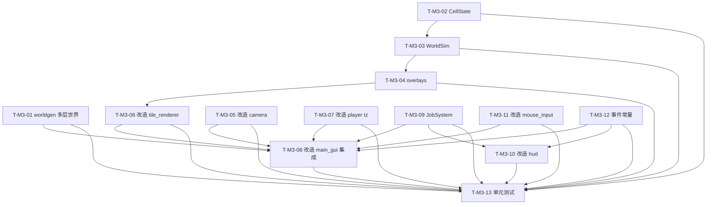

# 架构设计 · M3 模拟层（mc_clone_gui）

> 架构师：高见远（Gao）
> 范围：基于 `docs/prd_large.md`（M3 章节）+ `docs/architecture_gui.md` / `docs/architecture_m2.md`
> 的 **M3 系统架构设计 + 单元级任务分解**。
> **本文件只描述设计与分解，不写任何实现代码、不修改任何 .py 源码。**
> 演进基点：`<仓库根>/MC2` 现有地基（零改动、仅 import）+ 已交付 M1（96 测试）/ M2（52 测试）。
> 语言：中文。

---

## 0. 设计目标与约束摘要（继承 M1/M2，扩展模拟层）

| 项 | 结论 |
|---|---|
| 渲染路线 | pygame-ce 2D 瓦片（不引入 3D/OpenGL/numpy），沿用 M1 |
| 瓦片尺寸 | 32px（沿用 M1） |
| 游戏循环 | pygame.Clock + 固定步长累加器（FIXED_DT=1/60，FPS_CAP=60），逻辑/渲染解耦（沿用 M1） |
| 坐标/物理/事件约定 | 全部继承 M1（geometry/block_registry/block_world/event_bus 已固化；GRAVITY=30/MOVE_SPEED=6/JUMP_V=15.0） |
| **Z 层级启用** | 地基 `BlockWorld` 已支持 `depth>1`（稀疏 `(x,y,z)` 存储）；M3 用**新建 `worldgen/` 模块**生成多层，**绝不修改 `terrain.py`** |
| 模拟预算 | 模拟 tick ≤ **20Hz**，仅重算「脏 chunk」；瓦片渲染 30–60 FPS |
| 地基（零改动、仅 import） | geometry / noise / block_registry / block_world / terrain / text_world_renderer / input_realtime / main / data/blocks.default.json |
| M1/M2 文件（可改造，向后兼容） | camera / tile_world_renderer / player / main_gui / hud / mouse_input / event_bus |
| M3 新增 pip 依赖 | **无**（沿用 pygame-ce） |
| 确定性 | 仅 `random.Random(seed)` / `PerlinNoise(seed)`；世界生成/模拟 headless 可断言；不破坏 M1（96）+ M2（52）共 148 用例 |
| 不破坏 M1/M2 的硬约束 | `try_break/try_place` 签名加 `tz=0` 默认；`collect_tiles/render` 加 `z=0` 默认；`GameLoop.__init__` 新增 `world_sim=None, jobs=None` 可选；`--no-gui` 路径不动 |

> 本设计严格遵循 PRD §5 M3 章节（M3-R1~R8）与架构 M1/M2 已固化决策；M3 粗粒度任务（architecture_gui.md §9 T-M3-A~E）在本文件 §5 拆到单元级。

---

## 1. M3 范围与依赖

### 1.1 M3 依赖 M1/M2 的既有接口（复用，按改造方式接入）

| 来源 | 复用的接口 / 字段 | M3 用途 / 改造方式 |
|---|---|---|
| `camera.py` · `Camera` | `current_z`（预留）、`follow()`、`clamp_to()`、`screen_to_world_cell(mx,my)→(x,y)` | **改造**：`set_z(z, world_depth)` 真实生效并钳制；`clamp_z(world)`；`screen_to_world_cell` 仅返 2D，3D 目标 = `(x, y, current_z)`（瞄准层由调用方取 `current_z`） |
| `tile_world_renderer.py` · `TileWorldRenderer` | `render(world, viewport, overlays=None)`、`_iter_visible`、`collect_tiles`、`draw_player`、`draw_highlight`、`_tile_surface` | **改造**：`render` 增加 `z=0` 参数按层渲染；`overlays` 真正生效（叠加温度/水/岩浆 tint）；`_TILE_RGB` 新增 `lava` 色；`collect_tiles(world, viewport, z=0)` 保持旧签名兼容 |
| `player.py` · `Player` | `try_break(world, tx, ty)`、`try_place(world, tx, ty)`、`update`、`_is_solid`、`_overlaps_cell`、`_is_floor_cell` | **改造**：`try_break/try_place` 增加 `tz=0` 默认参数，所有 `world.get/set/in_bounds` 改用 `(tx,ty,tz)`；物理 `update` 签名与 z=0 行为**不变** |
| `main_gui.py` · `GameLoop` | `run()`、`_update(dt)`、`_render()`、`_handle_events()`、`_adjacent_cell()`、`_build_world(seed)`、`spawn_player`、`_surface_y`、`FIXED_DT/FPS_CAP/VIEWPORT_TILES/SEED/...` 常量 | **改造**：`_build_world` 改用 `worldgen` 生成 `depth>1`；`__init__` 增 `world_sim=None, jobs=None`；`_update` 串 sim.tick（≤20Hz 节流）+ jobs.tick + Z/覆盖层/作业指派键处理；`_render` 叠加 overlays(z)；`--no-gui` 分支**不变** |
| `hud.py` · `HUD` | `draw(player, world, fps, seed, overlays_on=False, daynight=None)`、`_draw_top_bar/_draw_hotbar/_draw_hint_bar` | **改造**：`draw` 增 `current_z/show_temp/show_water/jobs` 可选入参；顶部条加 Z 层指示与覆盖层开关态；新增 `_draw_jobs(jobs)` 作业列表 |
| `event_bus.py` · `EventBus/EventTypes` | `subscribe()`、`emit(etype, **data)` | **改造**：`EventTypes` 增 M3 常量（`Z_LEVEL_CHANGED`/`SIM_TICK`/`JOB_CREATED`/`JOB_DONE`/`JOB_CANCELLED`）；机制不变 |
| `mouse_input.py` · `GUIInputManager/MouseStateSource` | `update()`、`mouse_pos()`、`mouse_pressed()`、语义动作集中映射 | **改造**：新增 `layer_up_pressed/layer_down_pressed/temp_overlay_toggle/water_overlay_toggle/dig_mode_pressed/build_mode_pressed/cancel_job_pressed` 语义动作（键位集中，遵循 M1/M2 约定）；不触动冻结的 `input_realtime.py` |
| `systems/survival.py` · `SurvivalSystem` | `respawn(world)`、`set_spawn` | **不变**（玩家仍在 z=0 出生/重生） |

### 1.2 M3 新增模块 → 对 M1/M2 的回调点（集成闸口见 §5 T-M3-08）

| M3 新增 | 回调 / 接入点（M1/M2 侧） |
|---|---|
| `worldgen/multilayer.py` · `MultiLayerGenerator` | 在 `main_gui._build_world` 中调用 `generate(registry, seed, W, H, depth)` 取代 `TerrainGenerator.generate(...,1)`；返回 `depth>1` 世界（z=0 复用 terrain 表层，z≥1 程序化填充 + 岩浆湖） |
| `simulation/world_sim.py` · `WorldSim` | 在 `GameLoop._update` 中以 ≤20Hz 节流调用 `world_sim.tick(SIM_DT)`；`snapshot_overlays(camera.current_z)` 供 `_render` 叠加 tint；`JOB_DONE` 后 `jobs` 调用 `world_sim.mark_dirty_around(x,y,z)` |
| `simulation/overlays.py` · `LayerOverlay` / `build_layer_overlay` | 由 `WorldSim.snapshot_overlays(z)` 调用，产出 `LayerOverlay` 供 `TileWorldRenderer.render` 使用 |
| `systems/jobs.py` · `JobSystem` | 在 `GameLoop._update` 中 `jobs.tick(dt)`；玩家在作业指派模式下 `jobs.assign_dig/assign_build`；完成时 `world.set` 改世界并发 `JOB_DONE` |
| `data/blocks.m3.json` | M3 新增 `lava=8`；在 `_build_world` 经 `BlockRegistry.from_json` + `register` 叠加（沿用 M2 R4 模式，不改动地基 `blocks.default.json`/`blocks.m2.json`） |

### 1.3 与 M1/M2 的 3 个最关键集成点

1. **Z 层级真正生效 + 多层世界生成（T-M3-01 / T-M3-05 / T-M3-08）**：地基 `BlockWorld` 已支持 `depth>1`（稀疏 `(x,y,z)`），但 `terrain.py` 不可改 → M3 新建 `worldgen/multilayer.py`：`z=0` 调用既有 `TerrainGenerator` 生成表层后拷贝，`z≥1` 用 `random.Random(seed)` 程序化填充（地表下 dirt/石层 + 底部岩浆湖），确定性可复现；`Camera.set_z/clamp_z` 钳制到 `[0, depth-1]`，渲染/瞄准取 `current_z` 层。
2. **玩家挖/放与模拟带入 z 维（T-M3-07 / T-M3-06）**：`Player.try_break/try_place` 加 `tz=0` 默认参数，目标格改为 `(tx,ty,tz)`；`TileWorldRenderer.render` 加 `z=0` 默认参数按层 blit；两者旧签名保持兼容（M1/M2 测试零改动）。玩家物理仍只在 z=0（其 AABB/碰撞），`current_z` 决定「所看/所编辑的层」。
3. **模拟 tick 与作业系统接入主循环（T-M3-03 / T-M3-09 / T-M3-08）**：`GameLoop._update` 在 `Player.update → Survival.update → DayNight.update → 死亡判定` 之后，追加 `WorldSim.tick`（累加器节流 ≤20Hz）+ `JobSystem.tick`；脏 chunk 机制保证仅重算变化区。`GameLoop.__init__` 仅**新增可选** `world_sim=None, jobs=None`，M2 stub 测试（只传 survival/daynight/crafting）依然通过。

---

## 2. 实现方案 + 模块划分

### 2.1 M3 新增文件（相对 `<仓库根>/MC2/`）

| 文件 | 职责 | 关键接口 |
|---|---|---|
| `worldgen/__init__.py` | 包标记；导出 `MultiLayerGenerator`；定义 `LAVA_ID = 8` 等 M3 世界常量 | `LAVA_ID=8`、`SUBSURFACE_DIRT_LAYERS=2`、`WATER_SEED`… |
| `worldgen/multilayer.py` | `MultiLayerGenerator`：生成 `depth>1` 多层世界。**z=0** 调用既有 `TerrainGenerator(registry, seed, PerlinNoise(seed)).generate(W,H,1)` 并拷贝其 z=0；**z≥1** 用 `random.Random(seed)` 程序化填充（dirty/stone 分层 + 底部岩浆湖）；确定性；**不修改 terrain.py** | `MultiLayerGenerator(registry, seed, noise=None)`、`generate(width, height, depth) -> BlockWorld` |
| `simulation/__init__.py` | 包标记；导出 `WorldSim`/`CellState`/`SimConfig`/`LAVA_ID`/`WATER_ID` | `LAVA_ID=8`、`WATER_ID=4`、`CHUNK_SIZE=16`、`SIM_HZ=20.0` |
| `simulation/cell.py` | `CellState`：单格模拟状态（温度/是否水/是否岩浆/是否 solid）与更新规则纯函数 | `CellState(temp, water, lava, solid)`、`diffuse_step(...)`、`is_fluid()` |
| `simulation/world_sim.py` | `WorldSim`：温度扩散 + 水/岩浆流动元胞自动机；chunk 级脏标记；≤20Hz；提供 `get_temperature/get_water/get_lava/snapshot_overlays(z)/mark_dirty_around` | `WorldSim(world, registry, cfg=SimConfig())`、`tick(dt)`、`dirty_chunks`、`get_temperature(x,y,z)`、`get_water(x,y,z)`、`get_lava(x,y,z)`、`snapshot_overlays(z)`、`mark_dirty_around(x,y,z)` |
| `simulation/overlays.py` | `LayerOverlay` 数据结构 + `build_layer_overlay(world, sim, z, cfg)`：把某层温度/水/岩浆转成渲染用 tint 数据 | `LayerOverlay(width, height, temp, water, lava)`、`build_layer_overlay(world, sim, z, cfg) -> LayerOverlay` |
| `systems/jobs.py` | `JobSystem`（DF 式挖掘/建造作业）：指派→队列→逐 tick 推进→完成时改世界方块；可取消；回调 | `JobSystem(world, registry, bus=None, cfg=JobConfig())`、`assign_dig(x,y,z)`、`assign_build(x,y,z, block_id)`、`cancel(job_id)`、`tick(dt)`、`jobs()`、`on_job_done` |
| `data/blocks.m3.json` | M3 新增方块定义（`lava=8`），经 `BlockRegistry.from_json` + `register` 叠加，不改动地基/ M2 文件 | 见 §7.6 |
| `tests/test_m3_*.py` | M3 单元测试（headless，沿用 `tests/_testutil.py` / `run_tests.py` / `conftest.py`） | 见 T-M3-13 |

### 2.2 M3 需改造的 M1/M2 文件（标注改什么、不改什么）

| 文件 | 改造点（M3） | 不破坏点 |
|---|---|---|
| `camera.py` | `set_z(z, world_depth)` 真正设置并钳制 `current_z∈[0, depth-1]`；新增 `clamp_z(world)`；`screen_to_world_cell` 签名/返回**不变**（仍返 2D，3D 目标由调用方拼 `current_z`）；保留 `current_z` 字段 | `follow`/`clamp_to`/viewport 行为不变；M1 `test_m1_camera.py` 全绿 |
| `tile_world_renderer.py` | `render(world, viewport, overlays=None, z=0)`：`_iter_visible` 加 `z=0` 默认并按 `world.get(x,y,z)` 取层；`overlays` 生效（按 `LayerOverlay` 叠加 tint）；`_TILE_RGB` 加 `"lava":(220,90,30)`；`collect_tiles(world, viewport, z=0)` 保持 2 参兼容 | `draw_player/draw_highlight`/纯色块逻辑不变；M1 `test_m1_render.py`（`collect_tiles(world, vp)` 2 参）全绿 |
| `player.py` | `try_break(world, tx, ty, tz=0)`、`try_place(world, tx, ty, tz=0)`：所有 `in_bounds/get/set` 改用 `tz`；`in_bounds` 已支持 z | 默认 `tz=0` 时与 M1/M2 行为逐字一致；物理 `update` 不碰 z；M1 `test_m1_player.py` / M2 `test_m2_player.py` 全绿 |
| `main_gui.py` | ① `_build_world` 改用 `worldgen.MultiLayerGenerator.generate(W,H,depth)` 并叠加 `lava`（注册 8）；② `GameLoop.__init__` 增 `world_sim=None, jobs=None`；③ `_update` 追加 sim.tick（≤20Hz 节流）+ jobs.tick + Z/覆盖层/作业键处理；④ `_render` 调 `renderer.render(..., overlays=sim.snapshot_overlays(camera.current_z), z=camera.current_z)`；⑤ 顶部常量加 `WORLD_DEPTH/SIM_HZ/CHUNK_SIZE/SIM_DT/...`；⑥ `--no-gui` 分支**不变** | M2 stub 测试只传 survival/daynight/crafting → `world_sim/jobs=None` 时 `_update` 跳过；`--no-gui` 仍打印「就绪」返回 0 |
| `hud.py` | `draw(..., current_z=None, show_temp=False, show_water=False, jobs=None)` 可选入参；`_draw_top_bar` 加 Z 层指示与 T/V 覆盖层开关态；新增 `_draw_jobs(jobs)`（作业 id/类型/进度）；保持 `daynight=None` 退化兼容 | M2 调用 `draw(..., daynight=...)` 仍可用；合成 overlay 不变 |
| `mouse_input.py` | `GUIInputManager` 新增语义动作（键位集中）：`layer_up_pressed()/layer_down_pressed()`（`Z`/`X`，alias `[`/`]`）、`temp_overlay_toggle()`（`T`）、`water_overlay_toggle()`（`V`；见 §7 键位说明）、`dig_mode_pressed()`（`G`）、`build_mode_pressed()`（`B`）、`cancel_job_pressed()`（右键语义，复用 `mouse_pressed(2)`）；`_pg_keys` 注册新键 | 不触动 `input_realtime.py`；M1/M2 既有语义动作不变；M2 `test_m2_mouse_input.py` 全绿 |
| `event_bus.py` | `EventTypes` 增 `Z_LEVEL_CHANGED`/`SIM_TICK`/`JOB_CREATED`/`JOB_DONE`/`JOB_CANCELLED`（机制不变） | M1/M2 7 个常量与订阅不变；`test_m1_eventbus.py`/`test_m2_eventbus.py` 全绿 |

> **明确不改动**：`geometry.py` / `noise.py` / `block_registry.py` / `block_world.py` / `terrain.py` / `text_world_renderer.py` / `input_realtime.py` / `main.py` / `data/blocks.default.json` / `data/blocks.m2.json` / `inventory.py` / `daynight.py` / `systems/survival.py` / `crafting.py`。

### 2.3 模块分层（M3 增量）

```
render/显示层:  tile_world_renderer.py (扩展 z + overlays) · hud.py (扩展 z/覆盖层/作业)
entities/实体:  player.py (扩展 tz 参数；物理不变)
systems/系统:   camera.py (扩展 set_z/clamp_z) · event_bus.py (扩展常量) · mouse_input.py (扩展键位)
simulation 层:  simulation/__init__.py · simulation/cell.py · simulation/world_sim.py · simulation/overlays.py
jobs 层:        systems/jobs.py (JobSystem/Job)
worldgen 层:    worldgen/__init__.py · worldgen/multilayer.py (多层世界生成，复用 terrain/z=0)
io/入口:        main_gui.py (GameLoop 串联 sim + jobs + z + overlays) · data/blocks.m3.json (lava)
```

### 2.4 Z 层级启用方案（如何不改 terrain.py 生成多层世界）

`terrain.py` 的 `TerrainGenerator.generate(W,H,depth)` 仅填充 `z=0`（表层）。M3 **不修改它**，而是新建 `worldgen/multilayer.py` 在更高层级组合：

1. `MultiLayerGenerator.generate(W, H, depth)` 先建 `BlockWorld(W, H, depth)`。
2. **表层（z=0）**：调用既有 `TerrainGenerator(registry, seed, PerlinNoise(seed)).generate(W, H, 1)` 得到单层层世界，将其 `z=0` 所有非空气格拷贝进新世界 —— 完全复用 M1/M2 已验证的地形/水位/沙滩逻辑，零重复实现。
3. **地下层（z=1..depth-1）**：用 `random.Random(seed)`（确定性）逐层程序化填充：
   - `z ∈ [1, SUBSURFACE_DIRT_LAYERS]`（默认 2）：`DIRT`（表土/亚表土）；
   - `z ≥ SUBSURFACE_DIRT_LAYERS+1`：`STONE`（石层，最底层可视为深岩）；
   - 填充为整层实心列（洞穴/矿脉留给 M5，M3 不做连通性，保证模拟稳定与确定性）。
4. **流体播种**：
   - 水：表层已由 terrain 在盆地填入 `WATER`（z=0），M3 复用，模拟让它在本层找水平面。
   - 岩浆：在**最底层 `z=depth-1`** 用 `rng` 确定性地铺一段「岩浆湖 + 空气腔」交替（如每列按 `rng.random()<0.5` 放 `LAVA` 否则留 `AIR`），既提供**热源**（温度模拟向上扩散），又能演示岩浆在本层内的流动。
5. 返回 `depth>1` 世界；同 `(seed, W, H, depth)` 逐格一致（仅 `random.Random(seed)` + `PerlinNoise(seed)`）。

> 玩家出生/重生仍在 z=0 表层（`spawn_player`/`_surface_y` 只读 z=0），无需改 survival。

---

## 3. 数据结构和接口（类图 · Mermaid classDiagram）

> M1/M2 类（Player/GameLoop/HUD/Camera/TileWorldRenderer/EventBus/BlockWorld/BlockRegistry/GUIInputManager）以引用形式出现；M3 新增类显式给出签名。关系：`--|>` 继承、`*--` 组合、`..>` 依赖/调用。

```mermaid
classDiagram
    %% ===== 地基 / M1/M2 引用（不修改） =====
    class AABB2D {
        +min_x: int
        +min_y: int
        +max_x: int
        +max_y: int
    }
    class BlockWorld {
        +width: int
        +height: int
        +depth: int
        +get(x,y,z) int
        +set(x,y,z,id) None
        +in_bounds(x,y,z) bool
        +bounds() AABB2D
    }
    class BlockRegistry {
        +get(id) BlockDef
        +register(b) None
        +from_json(path) BlockRegistry
    }
    class GameLoop {
        +_update(dt) None
        +_render() None
    }
    class HUD {
        +draw(player, world, fps, seed, overlays_on, daynight, current_z, show_temp, show_water, jobs) None
    }
    class EventBus {
        +subscribe(etype, handler) None
        +emit(etype, **data) None
    }

    %% ===== M1/M2 类（M3 扩展标注） =====
    class Camera {
        +current_z: int
        +set_z(z: int, world_depth: int) None
        +clamp_z(world: BlockWorld) None
        +screen_to_world_cell(mx, my) tuple~int,int~
    }
    class TileWorldRenderer {
        +render(world, viewport, overlays, z) None
        +collect_tiles(world, viewport, z) list
        +draw_player(player, viewport) None
        +draw_highlight(tx, ty, viewport) None
    }
    class Player {
        +try_break(world, tx, ty, tz) bool
        +try_place(world, tx, ty, tz) bool
        +update(dt, world, input)
    }
    class GUIInputManager {
        +layer_up_pressed() bool
        +layer_down_pressed() bool
        +temp_overlay_toggle() bool
        +water_overlay_toggle() bool
        +dig_mode_pressed() bool
        +build_mode_pressed() bool
        +cancel_job_pressed() bool
    }
    class EventTypes {
        +Z_LEVEL_CHANGED: str
        +SIM_TICK: str
        +JOB_CREATED: str
        +JOB_DONE: str
        +JOB_CANCELLED: str
    }

    %% ===== M3 新增：配置 / 数据 =====
    class SimConfig {
        +chunk_size: int = 16
        +sim_hz: float = 20.0
        +diffusion: float = 0.25
        +ambient_temp: float = 0.0
        +lava_temp: float = 1.0
        +water_id: int = 4
        +lava_id: int = 8
        +lava_move_interval: int = 4
        +max_temp_alpha: int = 90
    }
    class JobConfig {
        +dig_duration: float = 1.0
        +build_duration: float = 1.0
        +next_id: int = 1
    }
    class CellState {
        +temp: float
        +water: bool
        +lava: bool
        +solid: bool
        +is_fluid() bool
    }

    %% ===== M3 新增：模拟 / 作业 =====
    class WorldSim {
        +__init__(world, registry, cfg)
        +tick(dt) None
        +dirty_chunks: set
        +get_temperature(x,y,z) float
        +get_water(x,y,z) bool
        +get_lava(x,y,z) bool
        +snapshot_overlays(z) LayerOverlay
        +mark_dirty_around(x,y,z) None
    }
    class LayerOverlay {
        +width: int
        +height: int
        +temp: list~list~float~~
        +water: list~list~bool~~
        +lava: list~list~bool~~
        +cell(x,y) CellState
    }
    class OverlayBuilder {
        +build_layer_overlay(world, sim, z, cfg) LayerOverlay
    }
    class Job {
        +id: int
        +type: str
        +x: int
        +y: int
        +z: int
        +target_block_id: int
        +progress: float
        +duration: float
        +status: str
    }
    class JobSystem {
        +__init__(world, registry, bus, cfg)
        +assign_dig(x,y,z) int
        +assign_build(x,y,z, block_id) int
        +cancel(job_id) bool
        +tick(dt) None
        +jobs() list~Job~
        +on_job_done: callable
    }
    class MultiLayerGenerator {
        +__init__(registry, seed, noise)
        +generate(width, height, depth) BlockWorld
    }

    %% ===== 关系 =====
    Camera *-- AABB2D : viewport
    TileWorldRenderer ..> BlockWorld : read tiles (z)
    TileWorldRenderer ..> LayerOverlay : tint
    Player ..> BlockWorld : break/place (tz)
    GameLoop ..> WorldSim : tick(throttled)
    GameLoop ..> JobSystem : tick / assign
    GameLoop ..> Camera : set_z / follow
    GameLoop ..> TileWorldRenderer : render(z, overlays)
    GameLoop ..> HUD : draw(z, overlays, jobs)
    GameLoop ..> GUIInputManager : z/overlay/job keys
    GameLoop ..> EventBus : emit M3 events
    HUD ..> JobSystem : jobs() 列表
    HUD ..> Camera : current_z

    WorldSim *-- SimConfig : cfg
    WorldSim ..> BlockWorld : get/set(fluid)
    WorldSim ..> CellState : 更新规则
    WorldSim ..> LayerOverlay : snapshot
    OverlayBuilder ..> WorldSim : 读 temp/water/lava
    OverlayBuilder ..> LayerOverlay : 产出
    LayerOverlay ..> CellState : cell()

    JobSystem *-- JobConfig : cfg
    JobSystem ..> BlockWorld : set(完成时)
    JobSystem ..> EventBus : emit JOB_*
    JobSystem *-- Job : 队列元素
    Job o-- JobConfig : duration 参照

    MultiLayerGenerator ..> BlockWorld : 生成 depth>1
    MultiLayerGenerator ..> BlockRegistry : 读方块
    MultiLayerGenerator ..> "TerrainGenerator(地基)" : 仅调用生成 z=0
```

---

## 4. 程序调用流程（时序图 · Mermaid sequenceDiagram）

### 4.1 M3 单帧 `_update`（玩家 → 模拟 → 作业 → 死亡 → 合成 overlay → 挖/放(带 z)）

```mermaid
sequenceDiagram
    autonumber
    participant Loop as GameLoop
    participant Input as GUIInputManager
    participant Player
    participant Surv as SurvivalSystem
    participant Day as DayNight
    participant Sim as WorldSim
    participant Jobs as JobSystem
    participant Cam as Camera
    participant World as BlockWorld
    participant Bus as EventBus

    Loop->>Input: update()
    Loop->>Player: update(dt, world, input)  %% 物理仅 z=0，签名不变
    Player->>World: get/set(z=0)
    Loop->>Surv: update(dt)
    Loop->>Day: update(dt)
    alt player.hp<=0 且 alive
        Loop->>Surv: respawn(world)  %% z=0 出生点
    end
    Note over Loop: 合成 overlay 态（同 M2）则处理并 return
    Loop->>Input: layer_up/down_pressed()  %% Z 切换
    Input-->>Loop: 键
    Loop->>Cam: set_z(new_z, world.depth)
    Cam-->>Loop: current_z
    Loop->>Bus: emit(Z_LEVEL_CHANGED, z)
    Loop->>Input: temp/water_overlay_toggle()
    Loop->>Sim: tick(SIM_DT)  %% 节流≤20Hz：累加器达 SIM_DT 才调用
    Sim->>World: 温度扩散/水/岩浆流动（仅脏 chunk）
    Loop->>Jobs: tick(dt)  %% 推进作业
    Jobs->>World: 完成时 set(x,y,z, AIR/block)
    Jobs->>Bus: emit(JOB_DONE, ...)
    Loop->>Cam: follow(player); clamp_to(world.bounds())
    Loop->>Cam: screen_to_world_cell(mx,my) → (tx,ty)
    tz = Cam.current_z
    alt 作业指派模式(G/B) + 左键
        Loop->>Jobs: assign_dig/assign_build(tx,ty,tz)
        Jobs->>Bus: emit(JOB_CREATED, ...)
    else 右键(取消键)
        Loop->>Jobs: cancel_under(tx,ty,tz)
    else 普通模式
        Loop->>Player: try_break(world, tx, ty, tz)
        Loop->>Player: try_place(world, tx, ty, tz)
    end
```

### 4.2 作业指派与完成的调用链

```mermaid
sequenceDiagram
    autonumber
    participant Loop as GameLoop
    participant Input as GUIInputManager
    participant Jobs as JobSystem
    participant World as BlockWorld
    participant Sim as WorldSim
    participant Bus as EventBus

    Note over Loop: 玩家进入 G(dig)/B(build) 模式（toggle）
    Loop->>Input: dig_mode_pressed()/build_mode_pressed()
    Loop->>Input: mouse_pressed(LEFT)
    alt dig 模式
        Loop->>Jobs: assign_dig(tx,ty,tz)
        Jobs->>Jobs: 新建 Job(id,type='dig',x,y,z,target=AIR)
        Jobs->>Bus: emit(JOB_CREATED, id,x,y,z)
    else build 模式
        Loop->>Jobs: assign_build(tx,ty,tz, held_id)
        Jobs->>Jobs: 新建 Job(id,type='build',target=held_id)
        Jobs->>Bus: emit(JOB_CREATED, ...)
    end
    Note over Loop: 每帧 _update 调用 Jobs.tick(dt)
    loop 逐 tick 推进
        Loop->>Jobs: tick(dt)
        Jobs->>Jobs: progress += dt；若 progress>=duration
        Jobs->>World: set(x,y,z, AIR 或 block_id)
        Jobs->>Sim: mark_dirty_around(x,y,z)  %% 触发重算
        Jobs->>Bus: emit(JOB_DONE, id,...)
    end
    Note over Loop: 玩家右键(取消键) 可 Jobs.cancel(job_id) → emit(JOB_CANCELLED)
```

### 4.3 Z 层级切换的调用链

```mermaid
sequenceDiagram
    autonumber
    participant Loop as GameLoop
    participant Input as GUIInputManager
    participant Cam as Camera
    participant World as BlockWorld
    participant Renderer as TileWorldRenderer
    participant Bus as EventBus

    Loop->>Input: layer_up_pressed()  %% Z 键
    Input-->>Loop: True
    Loop->>Cam: set_z(Cam.current_z + 1, World.depth)
    Cam->>Cam: current_z = clamp(z, 0, depth-1)
    Cam-->>Loop: current_z
    Loop->>Bus: emit(Z_LEVEL_CHANGED, z=current_z)
    Note over Loop: 下一帧 _render 使用 current_z
    Loop->>Renderer: render(world, viewport, overlays, z=Cam.current_z)
    Renderer->>World: get(x,y, Cam.current_z)  %% 仅渲染该层
    Renderer->>Renderer: 叠加 snapshot_overlays(current_z) tint
```

### 4.4 覆盖层（温度/水/岩浆）渲染叠加调用链

```mermaid
sequenceDiagram
    autonumber
    participant Loop as GameLoop
    participant Input as GUIInputManager
    participant Sim as WorldSim
    participant Overlay as LayerOverlay
    participant Renderer as TileWorldRenderer
    participant Screen as pygame.Surface

    Loop->>Input: temp_overlay_toggle()/water_overlay_toggle()
    Loop->>Loop: 置 _show_temp / _show_water 标志
    Note over Loop: _render 中
    Loop->>Sim: snapshot_overlays(Cam.current_z)
    Sim-->>Overlay: LayerOverlay(temp[][], water[][], lava[][])
    Loop->>Renderer: render(world, vp, overlays=Overlay, z=Cam.current_z)
    loop 可见非空气格
        Renderer->>Screen: blit 方块瓦片
        alt _show_temp 且 Overlay.temp[x][y] > 阈值
            Renderer->>Screen: 叠蓝→红渐变 tint(alpha∝temp)
        end
        alt _show_water 且 Overlay.lava[x][y]
            Renderer->>Screen: 叠橙红 tint（岩浆）
        end
        alt _show_water 且 Overlay.water[x][y]
            Renderer->>Screen: 叠半透明蓝 tint（水强化）
        end
    end
```

---

## 5. 任务列表（有序、含依赖、按实现顺序）

> 单元级拆分（工程师可直接执行）。每条标注：源文件、依赖、验收要点。
> 通用常量集中在 `main_gui.py` 顶部（沿用 M1/M2），M3 新增常量见 §7。
> **集成闸口 = T-M3-08（main_gui 串联）**，须等 T-M3-01/03/05/06/07/09/11/12 完成后统一接入；**T-M3-13 为质量门**（收尾全量断言 + M1/M2 回归）。

### T-M3-01 多层世界生成 `worldgen/`（`depth>1`，确定性，不碰 terrain.py）
- **源文件**：`worldgen/__init__.py`（新建，导出 `MultiLayerGenerator`、`LAVA_ID=8`、`SUBSURFACE_DIRT_LAYERS=2`）、`worldgen/multilayer.py`（新建）、`data/blocks.m3.json`（新建，含 `lava=8`）
- **依赖**：无（复用 `block_world`/`block_registry`/`terrain`/`noise`/`geometry`；仅 `random.Random(seed)`）
- **优先级**：P0
- **落地要点**：
  - `MultiLayerGenerator(registry, seed, noise=None)`；`generate(width, height, depth)`：① 建 `BlockWorld(W,H,depth)`；② `surface = TerrainGenerator(registry, seed, PerlinNoise(seed)).generate(W,H,1)`，将 `surface` 的 z=0 非空气格拷入新世界 z=0；③ `rng=random.Random(seed)`，对 `z=1..depth-1` 逐层：`z<=SUBSURFACE_DIRT_LAYERS` 填 `DIRT`，否则填 `STONE`（整层实心列，洞穴留给 M5）；④ 在 `z=depth-1` 用 `rng` 确定性铺「LAVA/AIR」交替湖（`rng.random()<0.5` 放 `LAVA` 否则 `AIR`）；⑤ 返回世界。
  - `data/blocks.m3.json`：`[{"id":8,"name":"lava","glyph":"*","color":"lava","solid":false,"transparent":true,"props":{}}]`。
  - 验收：同 `(seed,W,H,depth)` 两次生成 `to_dict()` 一致；`world.depth==depth`；`world.get(x,y,0)` 含 grass/stone/water（沿用 terrain）；`z>=1` 含 dirt/stone；底部层含 `LAVA`；headless 可跑。

### T-M3-02 单元状态 `simulation/cell.py`（CellState + 更新规则）
- **源文件**：`simulation/__init__.py`（新建，导出 `SimConfig`/`LAVA_ID=8`/`WATER_ID=4`/`CHUNK_SIZE=16`/`SIM_HZ=20.0`）、`simulation/cell.py`（新建）
- **依赖**：无（纯标准库）
- **优先级**：P0
- **落地要点**：
  - `CellState(temp:float=0.0, water:bool=False, lava:bool=False, solid:bool=True)`；方法 `is_fluid() -> bool`（water or lava）；`is_heat_source() -> bool`（lava）。
  - 纯函数 `diffuse_step(center, neighbors) -> float`：返回向邻居均值靠拢后的温度（`center + diffusion*(avg(neighbors)-center)` 并钳制）。
  - 验收：岩浆温度恒定最高；空温 0；`is_fluid`/`is_heat_source` 正确；headless 可跑。

### T-M3-03 模拟核心 `simulation/world_sim.py`（温度扩散/水流动/岩浆流动，chunk 脏标记，≤20Hz）
- **源文件**：`simulation/world_sim.py`（新建）
- **依赖**：T-M3-02（`CellState`）、foundation `block_world`/`block_registry`
- **优先级**：P0
- **落地要点**：
  - `WorldSim(world, registry, cfg=SimConfig())`：内部维护温度场 `self._temp: dict[(x,y,z), float]`（岩浆格初始化为 `lava_temp`，其余 `ambient_temp`）；`self._dirty_chunks: set[(cx,cy,cz)]`（含岩浆/水/受热邻格）；`self._tick_count=0`。
  - `tick(dt)`：仅处理 `_dirty_chunks` 对应 chunk（及邻居）；① 温度扩散（岩浆格重钉 `lava_temp`，其余向 4 邻均值靠拢 `diffusion`）；② 水流动（水块向**下 → 下斜 → 同层两侧** 找 `AIR`/可流入格移动，每 tick 每水格至多移动 1 步，固定优先级保证确定性，无 RNG）；③ 岩浆流动（同水规则，但仅当 `self._tick_count % lava_move_interval == 0` 时移动，更慢）；移动后把目标/源 chunk 与邻 chunk 标脏。处理完清空脏集但凡仍含流体/热的 chunk 重新标脏。
  - `get_temperature/get_water/get_lava(x,y,z)`、`mark_dirty_around(x,y,z)`（标 `(x,y,z)` 所在 chunk + 6 邻 chunk）、`dirty_chunks` 属性。
  - `snapshot_overlays(z)`（见 T-M3-04）。
  - 验收：水从高处流下在低处盆地找水平面（headless 断言：初始 1 列水悬空 → 多 tick 后落底并铺平）；岩浆比水慢；温度从岩浆格向邻格扩散（邻格 temp>ambient）；仅脏 chunk 被遍历（可在测试里断言非脏 chunk 未重算）；`mark_dirty_around` 正确标脏。

### T-M3-04 覆盖层快照 `simulation/overlays.py`（温度 tint 值/水/岩浆）
- **源文件**：`simulation/overlays.py`（新建）
- **依赖**：T-M3-03（`WorldSim` 接口）、T-M3-02
- **优先级**：P0
- **落地要点**：
  - `LayerOverlay(width, height, temp, water, lava)`（`temp`/`water`/`lava` 为 `height×width` 二维列表；`cell(x,y)->CellState`）。
  - `build_layer_overlay(world, sim, z, cfg) -> LayerOverlay`：遍历该层 `(x,y)`，从 `sim.get_temperature(x,y,z)`、`sim.get_water(x,y,z)`、`sim.get_lava(x,y,z)` 填充；`temp` 归一化 `clamp(t/lava_temp,0,1)`。
  - `WorldSim.snapshot_overlays(z)` 委托 `build_layer_overlay(self.world, self, z, self.cfg)` 返回 `LayerOverlay`。
  - 验收：`snapshot_overlays(z).temp[x][y]` 与 `get_temperature` 一致；`water/lava` 与 world 该层方块一致；headless 可跑。

### T-M3-05 改造 `camera.py`（`current_z` 生效 + 键切换 + 钳制）
- **源文件**：`camera.py`（改造）
- **依赖**：无（复用 `geometry`）
- **优先级**：P0
- **落地要点**：
  - `set_z(z: int, world_depth: int) -> None`：`self.current_z = clamp(z, 0, world_depth-1)`（用 `geometry.clamp`）。
  - `clamp_z(world: BlockWorld) -> None`：`self.current_z = clamp(self.current_z, 0, world.depth-1)`。
  - `screen_to_world_cell`/`follow`/`clamp_to`/`set_z(z)`（旧 1 参版）保留向后兼容（旧 `set_z(z)` 等同 `set_z(z, depth=大数)` 不钳制——保留 M1 行为）；新增 2 参 `set_z(z, world_depth)` 为 M3 主用。
  - 验收：`set_z(99, 8)` → `current_z==7`；`set_z(-5,8)` → `0`；`screen_to_world_cell`（2D）与 `TileWorldRenderer._world_to_screen` 互逆仍成立（M1 `test_m1_camera.py` 全绿）；headless。

### T-M3-06 改造 `tile_world_renderer.py`（按 `current_z` 渲染 + 叠加 overlays tint）
- **源文件**：`tile_world_renderer.py`（改造）
- **依赖**：T-M3-04（`LayerOverlay` 结构；仅类型依赖，无需 world_sim 实例）
- **优先级**：P0
- **落地要点**：
  - `_iter_visible(world, viewport, z=0)`：改 `world.get(world_x, world_y, z)`。
  - `render(world, viewport, overlays=None, z=0)`：`overlays` 为 `LayerOverlay` 或 `None`；遍历可见格 blit 瓦片；若 `overlays` 非空且 `_show_*`（由调用方在 overlays 中已筛选，或 renderer 读 `overlays` 全部）叠加：temp tint（蓝→红渐变，alpha∝temp）、water tint（半透明蓝）、lava tint（橙红）。具体 tint 公式见 §7.5。
  - `_TILE_RGB` 增加 `"lava": (220, 90, 30)`；`collect_tiles(world, viewport, z=0)` 保持 2 参兼容（M1 `test_m1_render.py` 仍绿）。
  - 验收：同 `(world, viewport, z)` 几何与 `TextWorldRenderer` 一致（M1 测试）；`render` 在 `z=3` 只画该层；`overlays` 非空时叠加 tint 且不报错（headless 用 `screen=None` 时跳过 blit，仅验证遍历/`LayerOverlay` 读取）。

### T-M3-07 改造 `player.py`（`try_break/try_place` 带 `z=current_z`）
- **源文件**：`player.py`（改造）
- **依赖**：无（复用 `geometry`/`block_world`/`block_registry`/`inventory`）
- **优先级**：P0
- **落地要点**：
  - `try_break(self, world, tx, ty, tz=0) -> bool`：所有 `in_bounds(tx,ty,tz)`/`get(tx,ty,tz)`/`set(tx,ty,tz,AIR)` 用 `tz`；`broken_id = world.get(tx,ty,tz)`；护逻辑（`_overlaps_cell`/`_is_floor_cell` 仍按 (tx,ty,tz) 判定；`tz=0` 时与旧行为一致）。
  - `try_place(self, world, tx, ty, tz=0) -> bool`：同构，`world.set(tx,ty,tz,self.held_id)`；AIR 拒绝/消耗库存/占用格防护沿用。
  - **不变**：`update(dt, world, input)` 物理逻辑与 `tz` 无关（玩家始终 z=0）；M1 `test_m1_player.py` / M2 `test_m2_player.py` 调用 2 参版本仍全绿。
  - 验收：`try_break(world,3,3,2)` 改 `(3,3,2)`；`tz=0` 默认时与旧逐字一致；边界/脚下/占用防护在 `tz` 层仍生效；M1/M2 测试零退化。

### T-M3-08 改造 `main_gui.py`（`_build_world` 多层 + `_update` 串 sim/jobs + 键处理）
- **源文件**：`main_gui.py`（改造）
- **依赖**：T-M3-01（worldgen）、T-M3-03（WorldSim）、T-M3-05（Camera.set_z）、T-M3-06（render z+overlays）、T-M3-07（try_break/try_place tz）、T-M3-09（JobSystem）、T-M3-11（mouse 键）、T-M3-12（事件常量）
- **优先级**：P0（**集成闸口**）
- **落地要点**：
  - 顶部新增常量：`WORLD_DEPTH=8`、`CHUNK_SIZE=16`（沿用）、`SIM_HZ=20.0`、`SIM_DT=1/20`、`LAVA_ID=8`、`BLOCKS_M3_DATA="data/blocks.m3.json"`、`JOB_DIG_DUR=1.0`、`JOB_BUILD_DUR=1.0`（见 §7）。
  - `_build_world(seed)`：`registry = BlockRegistry.from_json(BLOCKS_M2_DATA)`（保 0-7）；`registry.register(BlockRegistry.from_json(BLOCKS_M3_DATA).get(LAVA_ID))`（加 lava=8，不重定义 0-7）；`world = MultiLayerGenerator(registry, seed).generate(WORLD_W, WORLD_H, WORLD_DEPTH)`；返回 `(registry, world)`。
  - `GameLoop.__init__` 增 `world_sim=None, jobs=None`（可选，默认 None）。
  - `_run_gui`：构造 `world_sim = WorldSim(world, registry)`、`jobs = JobSystem(world, registry, bus)` 并注入 `GameLoop(...)`；`spawn_player` 仍基于 z=0 表层（不变）。
  - `_update(dt)`（在 M2 串联之后追加，见 §4.1）：① Z 切换键 → `camera.set_z(...)` + emit `Z_LEVEL_CHANGED`；② T/V 覆盖层开关 → 置 `self._show_temp/_show_water`；③ sim 节流：`self._sim_acc += dt; while self._sim_acc>=SIM_DT: world_sim.tick(SIM_DT); self._sim_acc-=SIM_DT; bus.emit(SIM_TICK)`；④ `jobs.tick(dt)`；⑤ 作业模式（G/B）左键 → `jobs.assign_dig/assign_build(tx,ty,tz)`；右键（cancel 键）→ `jobs.cancel_under`；普通模式 → `player.try_break/try_place(world,tx,ty,tz)`（tz=camera.current_z）；⑥ 其余（滚轮/1-6/合成）沿用。
  - `_render()`：`renderer.render(world, camera.viewport, overlays=world_sim.snapshot_overlays(camera.current_z) if world_sim else None, z=camera.current_z)`；`draw_highlight(tx,ty)` 仍画 2D（层由 z 决定）；HUD 传 `current_z/show_temp/show_water/jobs`。
  - `--no-gui` 分支**不变**（仍 `import main`）。
  - 验收：`_build_world` 返回 `depth==8` 世界；`_update` 单帧推进 sim（温度上升）+ jobs（指派后多帧完成改方块）；Z 切换后 `_render` 用 `current_z`；`GameLoop` 不传 `world_sim/jobs`（M2 stub）时 `_update` 不报错（M2 `test_m2_blocks_and_gameloop.py` 全绿）；`--no-gui` 仍返回 0 且打印「就绪」。

### T-M3-09 作业系统 `systems/jobs.py`（DF 式挖掘/建造，指派/队列/tick/完成改世界/可取消）
- **源文件**：`systems/jobs.py`（新建）
- **依赖**：无（仅 foundation `block_world`/`block_registry`/`event_bus` 类型）
- **优先级**：P0
- **落地要点**：
  - `JobConfig(dig_duration=1.0, build_duration=1.0)`。
  - `Job(id, type, x, y, z, target_block_id, duration, progress=0.0, status='queued')`（`type∈{'dig','build'}`；dig 的 `target_block_id=AIR`；build 为目标方块 id）。
  - `JobSystem(world, registry, bus=None, cfg=JobConfig())`：`assign_dig(x,y,z)->int`（创建 dig 作业，返回 id；若目标已是 AIR 仍建但完成时无操作）、`assign_build(x,y,z, block_id)->int`（build 作业）；`cancel(job_id)->bool`（置 `status='cancelled'` 并从队列移除，emit `JOB_CANCELLED`）；`tick(dt)`（对每个 `status!='cancelled'` 作业 `progress+=dt`，达 `duration` 则：dig→`world.set(x,y,z,AIR)`，build→`world.set(x,y,z,target_block_id)`；emit `JOB_DONE`；从活动队列移除）；`jobs()->list[Job]`（活动作业，供 HUD）；`on_job_done` 可回调属性。
  - 验收：assign_dig 后多 `tick(duration)` 次 → 该格变 AIR；assign_build → 变目标方块；cancel 后不再改世界；发射对应事件；headless。

### T-M3-10 改造 `hud.py`（Z 层指示 + 覆盖层开关 + 作业列表）
- **源文件**：`hud.py`（改造）
- **依赖**：T-M3-09（`JobSystem.jobs()` 结构）、T-M3-05（`camera.current_z`）、T-M3-12（事件常量，仅展示无关）
- **优先级**：P1
- **落地要点**：
  - `draw(..., current_z=None, show_temp=False, show_water=False, jobs=None)`：新增可选入参（旧 `draw(..., daynight=None)` 调用仍可用）。
  - `_draw_top_bar`：坐标处加 `Z:{current_z}/{depth}`（depth 取 `world.depth`）；提示 `T温:开/关 V水:开/关`（由 `show_temp/show_water` 决定）。
  - 新增 `_draw_jobs(jobs)`：在视口右侧或底部绘制活动作业列表（最多 N 条：`<type> #id (x,y,z) pp%`），无作业时提示「无作业」。
  - `daynight=None` 退化为 M1/M2 行为不变。
  - 验收：HUD 显示 Z 层与覆盖层开关态、作业进度；M2 `draw(..., daynight=...)` 旧调用不报错；headless（screen=None 跳过绘制，仅验证属性读取）。

### T-M3-11 改造 `mouse_input.py`（Z 切换键 + 覆盖层切换键 + 作业指派键）
- **源文件**：`mouse_input.py`（改造）
- **依赖**：无（复用 `input_realtime`/`_pygame`；`_pg_keys` 扩展）
- **优先级**：P0
- **落地要点**：
  - `_pg_keys()` 注册：`Z`/`X`（alias `[`/`]`）、`T`、`V`、`G`、`B`（含义见 §7.4）。
  - `GUIInputManager` 新增语义动作：`layer_up_pressed()`（`Z`）、`layer_down_pressed()`（`X`；另支持 `[`/`]`）、`temp_overlay_toggle()`（`T`）、`water_overlay_toggle()`（`V`）、`dig_mode_pressed()`（`G`）、`build_mode_pressed()`（`B`）、`cancel_job_pressed()`（复用 `mouse_pressed(2)` 右键语义，由 `GameLoop` 在作业模式下解释为取消）。
  - `update()` 顺序/`reset_frame` 不变（保持 M2 R1 滚轮顺序）；不触动 `input_realtime.py`。
  - 验收：新语义动作在对应键 `pressed_this_frame` 时返回 True；既有 `left/right/jump/wheel/craft` 等不变（M2 `test_m2_mouse_input.py` 全绿）；headless 用桩。

### T-M3-12 改造 `event_bus.py`（M3 事件常量 + 订阅点）
- **源文件**：`event_bus.py`（改造 `EventTypes`）
- **依赖**：无
- **优先级**：P0
- **落地要点**：`EventTypes` 增 `Z_LEVEL_CHANGED="Z_LEVEL_CHANGED"`、`SIM_TICK="SIM_TICK"`、`JOB_CREATED="JOB_CREATED"`、`JOB_DONE="JOB_DONE"`、`JOB_CANCELLED="JOB_CANCELLED"`；`EventBus` 机制与 `log_subscriber` 不变；`_run_gui` 中 `bus.subscribe` 这 5 类到 `log_subscriber`（M3 仅日志）。
  - 验收：新增常量可用；现有 7 类事件订阅不受影响；M1 `test_m1_eventbus.py`/M2 `test_m2_eventbus.py` 全绿。

### T-M3-13 M3 单元测试（headless，核心逻辑断言 + M1/M2 回归）
- **源文件**：`tests/test_m3_*.py`（新建，沿用 `tests/_testutil.py` / `run_tests.py` / `conftest.py`）
- **依赖**：T-M3-01 ~ T-M3-12 全部就绪
- **优先级**：P0（质量门）
- **落地要点**（每条 headless 可跑，不依赖显示）：
  - **多层世界生成**：`MultiLayerGenerator.generate` 同种子 `to_dict()` 一致；`depth==8`；`z=0` 含 grass/water；`z=1..2` 为 dirt、`z>=3` 为 stone；底部层含 lava（id=8）；不修改 `terrain.py`（通过 import 断言：生成器未触达 terrain 写逻辑——以「z=0 等同 TerrainGenerator 输出」间接证明）。
  - **Cell 更新规则**：`CellState.is_fluid/is_heat_source`；`diffuse_step` 向均值靠拢且钳制。
  - **水流动向低处**：小世界 `(16,16,1)` 在 (8,15) 放 1 格水、下方为空 → 多 `tick` 后水落底；盆地上水铺平（断言底部行水格数增加/分布趋平）。
  - **温度扩散**：放岩浆格 → 邻格 `get_temperature` 经多 tick 后 `>ambient`；岩浆格恒为 `lava_temp`。
  - **JobSystem**：`assign_dig(x,y,z)` 后 `tick(duration)` 多次 → `world.get==AIR`；`assign_build` → 变目标 id；`cancel` 后 world 不变；发射 `JOB_DONE`/`JOB_CANCELLED`。
  - **camera current_z 钳制 + 像素↔格一致**：`set_z(99,8)==7`、`set_z(-1,8)==0`；`screen_to_world_cell` 与 `_world_to_screen` 在 z 层互逆（z 不影响 2D 映射）。
  - **overlays 与 world 同步**：`snapshot_overlays(z).water/lava` 与该层 world 方块一致；`temp[x][y]` 与 `get_temperature` 一致。
  - **Z 切换后渲染/瞄准对应层**：构造 depth=8 世界，`camera.set_z(3)`，`renderer.collect_tiles(world, vp, z=3)` 返回的是 z=3 层格子集合（与 `world.get(x,y,3)` 一致），与 z=0 集合不同。
  - **不破坏 M1/M2**：`python tests/run_tests.py` 全量 148 用例仍绿（重点回归 `test_m1_*` 96 + `test_m2_*` 52）。
  - 验收：以上用例全过；M1/M2 回归无退化（集成闸口验证）。

### 5.1 M3 任务依赖图（Mermaid graph）



> 可并行起点：`T-M3-01`、`T-M3-02`、`T-M3-05`、`T-M3-07`、`T-M3-09`、`T-M3-11`、`T-M3-12` 互不依赖，建议并行开工；`T-M3-03→T-M3-04→T-M3-06` 为模拟/渲染链；**T-M3-08 为集成闸口**，须等 01/03/05/06/07/09/11/12；`T-M3-13` 为质量门，收尾全量断言并回归 M1/M2。

---

## 6. 依赖包列表

| 依赖 | 类型 | 说明 |
|---|---|---|
| **pygame-ce** | **硬依赖（运行时）** | 渲染/输入/主循环；`>=2.5`（沿用 M1/M2，M3 不新增） |
| `allin_engine`（纯净版，`<仓库根>`） | **仅基类来源** | `Serializable`/`JSONLoader`/`InputManager`；M3 仍仅经 `PYTHONPATH` 注入，不进 pip |
| Python 3.14 标准库 | 标准 | `json`/`math`/`random`/`dataclasses`/`os`/`sys`/`logging`（无新增第三方） |
| `PyInstaller` | **构建期** | 仅 M5 使用，不进运行时 |

> **M3 不新增任何 pip 依赖**。新增数据文件 `data/blocks.m3.json` 沿用 `BlockRegistry.from_json` + `register` 式公共 API（与 M2 `blocks.m2.json` 一致），不引入新库；模拟/作业纯标准库实现，全部 headless 可测。

---

## 7. 共享知识（M3 新增跨文件约定）

### 7.1 M3 关键跨文件常量（建议在 `main_gui.py` 顶部集中定义，供各模块引用）

| 常量 | 值 | 说明 |
|---|---|---|
| `WORLD_DEPTH` | `8` | 世界 Z 层数（M3-R1 推荐 8–16；默认 8） |
| `CHUNK_SIZE` | `16` | 模拟 chunk 边长（沿用地基 `serialize_chunk` 尺寸；M3 脏标记单位） |
| `SIM_HZ` | `20.0` | 模拟 tick 上限（PRD M3-R8 / Q4） |
| `SIM_DT` | `1/20` | 模拟固定步长（秒） |
| `LAVA_ID` | `8` | M3 新增岩浆方块 id（经 `blocks.m3.json` 注册） |
| `WATER_ID` | `4` | 水（沿用地基） |
| `SUBSURFACE_DIRT_LAYERS` | `2` | z=1..2 为 dirt，z>=3 为 stone（分层规则） |
| `JOB_DIG_DURATION` | `1.0` | 单个挖掘作业耗时（秒） |
| `JOB_BUILD_DURATION` | `1.0` | 单个建造作业耗时（秒） |
| `TEMP_DIFFUSION` | `0.25` | 温度扩散系数（每 sim tick 向邻均值靠拢比例） |
| `AMBIENT_TEMP` | `0.0` | 环境温度（归一化下限） |
| `LAVA_TEMP` | `1.0` | 岩浆/热源温度（归一化上限） |
| `LAVA_MOVE_INTERVAL` | `4` | 岩浆每 4 个 sim tick 才移动 1 步（比水慢） |
| `MAX_TEMP_ALPHA` | `90` | 温度 tint 最大 alpha |
| `BLOCKS_M3_DATA` | `"data/blocks.m3.json"` | M3 方块（lava） |
| `Z_UP_KEY` / `Z_DOWN_KEY` | `"Z"` / `"X"`（alias `"["`/`"]"`） | Z 层切换键 |
| `TEMP_OVERLAY_KEY` | `"T"` | 温度覆盖层开关 |
| `WATER_OVERLAY_KEY` | `"V"` | 水/岩浆覆盖层开关（见 §7.4 键位说明） |
| `DIG_MODE_KEY` / `BUILD_MODE_KEY` | `"G"` / `"B"` | 作业指派模式键 |

### 7.2 世界深度与分层规则（跨文件统一）

- 世界 `depth = WORLD_DEPTH`（默认 8），各层 `z∈[0, depth-1]`，`z=0` 为地表（侧视最前/最上）。
- 分层（随 z 加深）：
  - `z=0`：地表层（复用 `TerrainGenerator`：grass/dirt/stone + 盆地 water）。
  - `z=1..SUBSURFACE_DIRT_LAYERS`（默认 2）：表土/亚表土 `DIRT`。
  - `z>=SUBSURFACE_DIRT_LAYERS+1`：石层 `STONE`（最底层可视为深岩）。
  - `z=depth-1`：底部岩浆湖（`LAVA`/`AIR` 交替，确定性）。
- 洞穴/矿脉/连通性：**M3 不做**（留给 M5）；M3 地下层为实心列，保证模拟与确定性稳定。

### 7.3 温度 / 水 / 岩浆 模拟规则（跨文件统一）

- **温度场**：`WorldSim._temp[(x,y,z)]`；岩浆格恒为 `LAVA_TEMP`，其余初值 `AMBIENT_TEMP`。每 sim tick 对脏 chunk：非岩浆格 `temp += TEMP_DIFFUSION*(avg(4邻 temp) - temp)`，钳制 `[0, LAVA_TEMP]`；岩浆格每 tick 重钉 `LAVA_TEMP`（热源）。
- **水流动**（元胞自动机，每 sim tick，每水格至多移动 1 步，固定优先级保证确定性、无 RNG）：
  1. 下方 `(x, y-1, z)` 为 `AIR` → 下落；
  2. 下方左/右斜 `(x±1, y-1, z)` 为 `AIR` → 落斜；
  3. 同层两侧 `(x±1, y, z)` 为 `AIR`（且该侧下方亦为 `AIR` 或同层更低）→ 向侧流找水平面。
  - 移动后标记源/目标 chunk + 邻 chunk 为脏。
- **岩浆流动**：同水规则，但仅当 `tick_count % LAVA_MOVE_INTERVAL == 0` 时执行（更慢；M3-R3「岩浆扩散更慢」）。
- **流体定义**：`WATER`(4) 与 `LAVA`(8) 为可流动方块；`solid=False`。`AIR`(0) 为可流入格。
- **确定性**：流动用「固定优先级 + 顺序遍历」，**不引入 RNG**，保证同世界同 tick 序列逐格一致（可测）。

### 7.4 键位映射（M3，语义动作集中在 `GUIInputManager`，遵循 M1/M2 约定）

| 操作 | 采用键位（默认） | 说明 / 与 PRD 的差异 |
|---|---|---|
| 切换 Z 层（上层） | `Z` | PRD 建议 `Z`/`Shift+Z`；采用 `Z` 上、`X` 下（避免 Shift 组合键在 pygame 下的边角问题）；另支持 `[`/`]` |
| 切换 Z 层（下层） | `X`（alias `[` / `]`） | 见上 |
| 温度覆盖层开关 | `T` | 沿用 PRD `T`；无冲突 |
| 水/岩浆覆盖层开关 | `V` | **PRD 建议 `W`，但 `W` 已被 M1 占为「跳跃」**（`Space/W/↑`）；为避免冲突，改用 `V`（V=liquid/volcano 助记），`W` 仅保留为文档备注的备选 |
| 挖掘作业模式 | `G` | **PRD 建议 `D`/`B`，但 `D` 已被 M1 占为「右移」**；为避免冲突，挖模式用 `G`（G=挖/ga），建模式用 `B` |
| 建造作业模式 | `B` | 见上 |
| 取消作业（光标下） | 鼠标右键（作业模式下解释为取消） | 复用 `mouse_pressed(2)` |

> 上述键位均为「本帧刚按下」语义（`pressed_this_frame`），与 M1/M2 一致；新增键均在 `mouse_input._pg_keys()` 注册，`update()` 调用顺序保持不变（先 mouse 后 key，保 M2 R1 滚轮）。

### 7.5 覆盖层 tint 公式（跨文件统一，渲染叠加）

`tint` 由 `TileWorldRenderer.render` 在 blit 方块瓦片之后、按 `LayerOverlay` 叠加（仅 `_show_temp`/`_show_water` 开启的维度生效）：

- **温度 tint**：`t = clamp(temp / LAVA_TEMP, 0, 1)`；
  - 颜色：蓝 `(60,120,220)`（t=0）→ 红 `(200,60,60)`（t=1）线性插值：`rgb = lerp(blue, red, t)`；
  - alpha：`int(t * MAX_TEMP_ALPHA)`（t 低于阈值如 0.05 不画，避免全屏泛蓝）；
  - 叠加：`screen.blit(tint_surf, (px, py))`（tint_surf 为该格尺寸的半透明 Surface）。
- **水 tint**（开启 `V` 且该格为 `WATER`）：半透明蓝 `(60,120,220)`，alpha≈`110`，强化水体可见性（方块本身已是蓝，覆盖层用于「开关高亮」）。
- **岩浆 tint**（开启 `V` 且该格为 `LAVA`）：橙红 `(220,90,30)`，alpha≈`160`，可加轻微脉动（按 `tick_count` 微调 alpha，可选）。
- HUD 始终最后绘制（保持可读）；覆盖层只绘视口区域，不压 HUD 带。

### 7.6 M3 新方块（`data/blocks.m3.json`，**不改动** 地基 `blocks.default.json` / M2 `blocks.m2.json`）

```json
[
  {"id": 8, "name": "lava", "glyph": "*", "color": "lava",
   "solid": false, "transparent": true, "props": {}}
]
```

> 经由 `_build_world`：`registry = BlockRegistry.from_json("data/blocks.m2.json")`（保 0-7）→ `registry.register(BlockRegistry.from_json("data/blocks.m3.json").get(8))`（加 lava=8）。`tile_world_renderer._TILE_RGB` 增 `"lava": (220, 90, 30)`（T-M3-06）。`glass`(7) 已含 `cyan`，渲染无需额外改动。

### 7.7 作业 ↔ 世界 / 模拟 联动约定

- `JobSystem` 是「DF 式」：玩家**指派**（designate）作业 → 入队 → 每帧 `tick(dt)` 推进 → 达 `duration` 时由系统**改世界方块**并 emit `JOB_DONE`。玩家本体不直接参与「搬运」，符合《矮人要塞》作业范式。
- 完成时改世界后调用 `world_sim.mark_dirty_around(x,y,z)`，使温度/流体模拟在下一 tick 重算该区域（保持模拟与世界一致）。
- 直接挖/放（`player.try_break/try_place` 带 `tz`）与作业系统并存：普通模式即时编辑 `current_z` 层；作业模式用于「规划/批量/跨层」改造。两者都经 `world.set`，模拟经脏标记自然同步。

### 7.8 玩家与 Z 层的关系（设计基线说明）

- 玩家物理（重力/碰撞/出生/重生）**始终在 z=0 层**（其 `AABB2D` 与 `SurvivalSystem.respawn` 不变），保证 M1/M2 手感与测试零影响。
- `camera.current_z` 决定「所看 / 所瞄准 / 所编辑」的层：`screen_to_world_cell` 返 2D `(tx,ty)`，3D 目标 = `(tx, ty, camera.current_z)`；`try_break/try_place` 的 `tz` 即此值。
- 直接编辑非 0 层时，玩家「光标」视为在该层作业（每一层是独立的 2D 横切面）；跨层大型工程推荐走作业系统（指派 + 模拟节拍完成）。这是 M3 可玩性与确定性的合理折中，后续里程碑（M4/M5）再引入跨层实体/生物。

---

## 8. 待明确事项的采纳默认值（M3 开放决策，逐条给默认值）

| # | 开放决策 | **采纳默认值** | 理由 / 备注 |
|---|---|---|---|
| O1 | 世界层数 depth | **8**（M3-R1 推荐 8–16） | 足够展示分层/温度梯度/岩浆湖；worldgen 实心填充，≤8 层性能可控；测试用小世界 |
| O2 | 各层厚度/材质 | **z=0 地表（terrain）；z=1..2 dirt；z>=3 stone；z=depth-1 岩浆湖** | 简单清晰、确定性、与地形视觉连贯 |
| O3 | chunk 大小 | **16**（沿用 M1 §8.1 `CHUNK_SIZE=16`） | 与地基 `serialize_chunk` 对齐；脏标记粒度合理 |
| O4 | 模拟 tick 频率 | **≤20Hz（SIM_DT=1/20）** | PRD Q4 / M3-R8；`GameLoop` 用累加器节流，`world_sim.tick` 仅脏 chunk |
| O5 | 温度扩散系数 | **0.25 / tick** | 数 tick 内可见梯度，又不瞬态；可后续调 |
| O6 | 水/岩浆流动速度 | **水每 tick 移 1 步；岩浆每 4 tick 移 1 步** | M3-R3「岩浆更慢」；确定性（固定优先级，无 RNG） |
| O7 | 作业推进速度 | **dig/build 各 1.0s/格** | 单 tick 累加 `progress`；可调；P1 优先级留待后续 |
| O8 | Z 层切换键位 | **Z 上 / X 下（alias `[`/`]`）** | 避开 `D`（右移）/ 避开 Shift 组合；见 §7.4 |
| O9 | 覆盖层开关键位 | **T 温度 / V 水岩浆** | `W` 已被跳占据用，故水/岩浆用 `V`；见 §7.4 |
| O10 | 作业指派键位 | **G 挖模式 / B 建模式；右键取消** | 避开 `D`（右移）；符合 DF 范式 |
| O11 | M3 是否做洞穴/矿脉连通性 | **否**（留给 M5） | M3 地下层实心，保证模拟稳定/确定性；M5 用 3D 噪声开凿 |
| O12 | 温度→方块效应（M3-R7 冰融/水结） | **M3 仅做温度场 + 覆盖层展示，不做方块改写**（P2 占位） | 避免与流体/世界生成耦合；后续里程碑按需接入 |
| O13 | 多层可见性滑块（M3-R5） | **用 Z/X 键步进切换 + HUD Z 指示**（等价「堆叠层视图」） | 满足 P1；完整滑块 UI 留待后续润色 |
| O14 | lava 方块透明度 | **transparent=True, solid=False** | 与 water 同族流体；tint 由覆盖层叠加；瓦片色 `lava=(220,90,30)` |
| O15 | 作业优先级 & 指派（M3-R6） | **M3 单队列 FIFO；优先级字段预留（Job.priority 可选）** | P1；本里程碑先实现「指派→完成」，优先级留扩展点 |

---

## 9. 风险与开放点（M3 架构层）

1. **地基零改动 vs 多层世界生成（已解决设计）**：`terrain.py` 不可改 → M3 新建 `worldgen/multilayer.py`，`z=0` 调用既有 `TerrainGenerator` 生成并拷贝，`z≥1` 用 `random.Random(seed)` 程序化填充（T-M3-01）。同种子确定性由 `PerlinNoise(seed)` + `random.Random(seed)` 保证。
2. **M1/M2 测试兼容（关键约束）**：
   - `try_break/try_place` 加 `tz=0` 默认 → M1 `test_m1_player.py` / M2 `test_m2_player.py` 2 参调用零影响。
   - `collect_tiles(world, viewport)` 保持 2 参（z=0 默认）→ M1 `test_m1_render.py` 零影响。
   - `GameLoop.__init__` 新增 `world_sim=None, jobs=None` 可选 → M2 `test_m2_blocks_and_gameloop.py`（stub 只传 survival/daynight/crafting）零影响。
   - `--no-gui` 路径不动 → `test_m1_integration.test_no_gui_runs` 仍打印「就绪」返回 0。
   - 全量回归门：`python tests/run_tests.py` 须 148 绿（T-M3-13）。
3. **renderer 按层渲染的 headless 断言**：`render` 在 `screen=None` 时跳过 blit 仅验证遍历/`LayerOverlay` 读取；`collect_tiles(world, vp, z)` 提供按层几何集合，便于断言「z 层对应」。
4. **模拟性能（脏 chunk）**：`WorldSim` 仅遍历 `_dirty_chunks`（含流体/热的 chunk 及其邻 chunk）；`mark_dirty_around` 在 world 突变（流体移动/作业完成）时触发；非脏区域不重算，满足 ≤20Hz 预算。
5. **确定性边界**：世界生成/模拟不引入全局 `random`/时间；流体用固定优先级无 RNG；存档（M5）序列化不依赖帧时序（M3 不涉存档，但 `BlockWorld.to_dict` 已支持 depth）。
6. **输入事件队列无冲突**：M3 新键均在 `mouse_input._pg_keys()` 注册，`update()` 顺序与 M2 R1 一致（先 mouse 后 key），不触动冻结的 `input_realtime.py`。
7. **是否发现 M1/M2 需要调整才能接 M3**：**不需要修改 M1/M2 任何地基/普通文件即可接入**。仅需按本设计改造 `camera/player/tile_world_renderer/main_gui/hud/mouse_input/event_bus`（均为 M1/M2 自身文件，且改造均向后兼容，见 §2.2）。`terrain.py` 通过「调用而非修改」复用。

> 以上为 M3 设计基线。实现细节由工程师在 T-M3-01~T-M3-13 各自落地；本文件为设计基线，M4（生物）/ M5（世界深度：群系/洞穴/存档）启动时据此细化。
