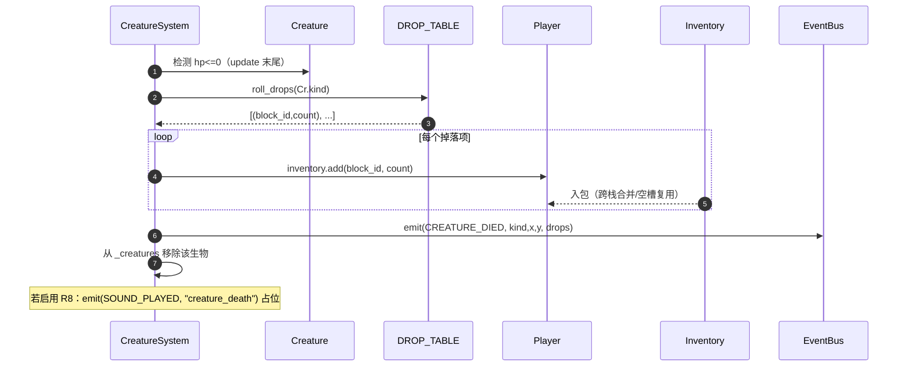
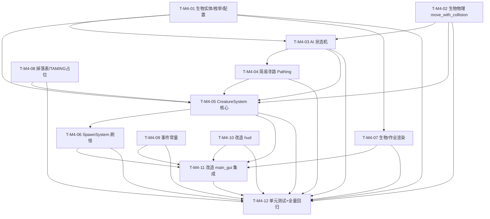

# 架构设计 · M4 生物与世界（mc_clone_gui）

> 架构师：高见远（Gao）
> 范围：基于 `docs/prd_large.md`（M4 章节 M4-R1~R8）+ `docs/architecture_gui.md` / `docs/architecture_m2.md` / `docs/architecture_m3.md`
> 的 **M4 系统架构设计 + 单元级任务分解**。
> **本文件只描述设计与分解，不写任何实现代码、不修改任何 .py 源码。**
> 演进基点：`D:\allin\example` 现有地基（零改动、仅 import）+ 已交付 M1（96 测试）/ M2（52 测试）/ M3（模拟层）。
> 语言：中文。

---

## 0. 设计目标与约束摘要（继承 M1/M2/M3，扩展生物世界）

| 项 | 结论 |
|---|---|
| 渲染路线 | pygame-ce 2D 瓦片（不引入 3D/OpenGL/numpy），沿用 M1 |
| 瓦片尺寸 | 32px（沿用 M1） |
| 游戏循环 | pygame.Clock + 固定步长累加器（FIXED_DT=1/60，FPS_CAP=60），逻辑/渲染解耦（沿用 M1） |
| 坐标/物理/事件约定 | 全部继承 M1~M3（geometry/block_registry/block_world/event_bus 已固化） |
| **生物所在层** | 生物实体与玩家一致，**仅在 z=0 侧视层**活动（M3 已固化「玩家与 Z 层关系」，生物沿用，不跨层） |
| 生物物理 | 复用 `geometry.AABB2D` + 仿 `player.py` 的「轴分离扫掠碰撞」思路，抽到 `creatures/physics.py` 的 `move_with_collision`（**绝不修改 player.py**） |
| 地基（零改动、仅 import） | geometry / noise / block_registry / block_world / terrain / text_world_renderer / input_realtime / main / data/blocks.default.json |
| M1~M3 文件（可改造，向后兼容） | camera / tile_world_renderer / player / main_gui / hud / mouse_input / event_bus / systems/survival / inventory |
| M4 新增 pip 依赖 | **无**（沿用 pygame-ce） |
| 确定性 | 仅 `random.Random(seed)`（CreatureSystem / SpawnSystem 各持独立 rng）；生成/AI/刷怪 headless 可断言；不破坏 M1/M2/M3 既有约 193 个测试 |
| 不破坏既有硬约束 | `GameLoop.__init__` 新增 `creatures=None, spawn=None` 可选；左键语义「攻击优先、否则挖」仅在 `creatures is not None` 时生效；`--no-gui` 路径不动 |
| **AI tick 预算** | 移动每帧随 FIXED_DT 推进（与玩家同成本）；AI **决策节流** `AI_DECISION_STEP=0.5s`（状态切换/转向/跳跃意图按计时器，非每帧随机）；实体总数上限 `CREATURE_CAP=20`（性能护栏） |
| 复用优先 | 刷怪/HUD/事件接入沿用 `event_bus.py` / `hud.py` / `mouse_input.py` / `camera.py` / `tile_world_renderer.py` 的扩展方式（参考 M3）；掉落复用 `inventory.add`；生物→玩家伤害复用 `SurvivalSystem.damage`（经回调注入，不耦合） |

> 本设计严格遵循 PRD §5 M4 章节（M4-R1~R8）与架构 M1/M2/M3 已固化决策；M4 任务在本文件 §5 拆到单元级，集成闸口 = T-M4-11（`main_gui.py` 串联 creatures/spawn/combat），质量门 = T-M4-12（M4 单元测试 + 全量回归）。

---

## 1. M4 范围与依赖

### 1.1 M4 复用 M1~M3 的既有接口（复用，按改造方式接入）

| 来源 | 复用的接口 / 字段 | M4 用途 / 改造方式 |
|---|---|---|
| `geometry.py` · `AABB2D` / `clamp` / `lerp` | `AABB2D`（生物包围盒基类，同 Player 模式）、`clamp`/`lerp`（钳制/插值） | `Creature(AABB2D)`；`creatures/physics.py` 碰撞钳制沿用 |
| `block_world.py` · `BlockWorld` | `get(x,y,z)` / `in_bounds(x,y,z)`（z=0 层 solid 查询） | 生物碰撞、刷怪表面定位、掉落/攻击判定均经 `world.get(x,y,0)` |
| `player.py` · `Player`（**零改动**） | `fx/fy`（浮点脚底）、`AABB2D` 子类模式、`width_f/height_f`、`inventory`、`take_damage` | 仿其「float 脚底 + `_sync_aabb()` + 轴分离扫掠」实现生物物理；战斗读取 `player` 位置、写入 `player.inventory` |
| `camera.py` · `Camera` | `viewport` / `screen_to_world_cell` / `follow` / `set_z` | 生物渲染随相机视口（沿用 `renderer.draw_player` 同款映射）；**不改造** |
| `tile_world_renderer.py` · `TileWorldRenderer` | `draw_player` 同款 `_world_to_screen` 像素映射、`_TILE_RGB` 调色板 | **新增** `CreatureRenderer.draw`（独立模块）复用其 `_world_to_screen` 公式绘制 glyph；**tile_world_renderer.py 本体不改造** |
| `hud.py` · `HUD` | `draw(...)` 顶部条 / 右侧信息区 | `draw` 增可选入参 `creature_count` / `nearest_hp` / `nearest_max`（默认值兼容旧调用） |
| `mouse_input.py` · `GUIInputManager` | `mouse_pressed(0)`（左键）、`mouse_pos` | 战斗复用左键（普通模式）；**不新增键**（详见 §7.4 共存方案）——若 PM 要求零歧义再加 `F` 攻击键（保留位） |
| `event_bus.py` · `EventBus/EventTypes` | `subscribe()` / `emit(etype, **data)`（机制不变） | `EventTypes` 增 M4 常量（`CREATURE_SPAWNED` / `CREATURE_DIED` / `CREATURE_HIT` / `PLAYER_HIT` / `CREATURE_TAMED` / `SOUND_PLAYED`）；机制不变 |
| `systems/survival.py` · `SurvivalSystem` | `damage(amount)` / `is_dead()` | 生物近身攻击经回调 `on_player_hit = survival.damage` 扣玩家 HP；玩家死亡仍由既有 `GameLoop` 死亡判定处理 |
| `inventory.py` · `Inventory` | `add(block_id, n)` | 生物死亡掉落经 `player.inventory.add` 入包 |
| `daynight.py` · `DayNight` | `is_night()` / `update(dt)` | 刷怪系统按 `is_night()` 决定夜间刷敌对 / 白天刷被动 |
| `systems/jobs.py` · `JobSystem` | `jobs()`（活动作业列表） | 渲染「作业精灵」glyph（M4-R2 提及的「作业 glyph 瓦片」复用 M3 作业列表，在世界上叠加标记） |

### 1.2 M4 新增模块 → 对 M1~M3 的回调点（集成闸口见 §5 T-M4-11）

| M4 新增 | 回调 / 接入点（M1~M3 侧） |
|---|---|
| `creatures/entity.py` · `Creature` / `CreatureKind` / `AIState` / `CreatureConfig` | 数据模型；`GameLoop` 持有 `CreatureSystem` 列表 |
| `creatures/physics.py` · `move_with_collision(c, world, registry, dt)` | 生物移动碰撞，调用 `world.get(x,y,0)` 判断 solid（仿 player `_move_x/_move_y`） |
| `creatures/ai.py` · `AIController` | 状态机 `decide_state` + `apply`；依赖 `Pathing.step_toward`；R6 贪心/攀爬 |
| `creatures/drops.py` · `DROP_TABLE` / `TAMING`（R7 占位） | 死亡掉落表；驯服/繁殖占位（P2） |
| `creatures/__init__.py` + `creatures/system.py` · `CreatureSystem` | 在 `GameLoop._update` 调 `creatures.update(dt, player, daynight, on_player_hit)`；`_render` 调 `creatures.draw(...)` |
| `creatures/spawn.py` · `SpawnSystem` | 在 `GameLoop._update` 调 `spawn.update(dt, daynight, creatures)`（按时间/群系/上限刷怪） |
| `creatures/render.py` · `CreatureRenderer` | 在 `GameLoop._render` 于世界/玩家之后调用，绘制生物 glyph + 作业 glyph + 血条 |
| `data/blocks.m4.json` | M4 新增「掉落物」方块（beef=9 / pork=10 / rotten_flesh=11），经 `BlockRegistry.from_json` + `register` 叠加（沿用 M2/M3 R4 模式，不碰地基 json） |

### 1.3 与 M1~M3 的 3 个最关键集成点

1. **生物 tick 接入主循环（T-M4-05 / T-M4-06 / T-M4-11）**：`GameLoop._update` 在 `Player.update → Survival.update → DayNight.update → 死亡判定 → 合成 → 相机/覆盖层 → 模拟 tick → 作业 tick` 之后，追加 `creatures.update(dt, player, daynight, on_player_hit=survival.damage)`（AI→移动→碰撞→攻击判定→死亡/掉落）。`GameLoop.__init__` **仅新增可选** `creatures=None, spawn=None`，M2/M3 stub 测试（只传 survival/daynight/crafting/world_sim/jobs）依然通过——gate 保证「无生物系统时不触发任何 M4 分支」。
2. **生物渲染 + HUD 计数/血条（T-M4-07 / T-M4-09 / T-M4-11）**：`GameLoop._render` 在 `renderer.render(...)` 与 `draw_player` 之后，调 `CreatureRenderer.draw(screen, camera, renderer, creatures, jobs)`（被动绿/敌对红 glyph + 最近生物血条）；HUD 顶部条加「生物:N」，右侧加最近生物 HP 条。渲染器复用 `TileWorldRenderer._world_to_screen` 同款像素映射，**tile_world_renderer.py 本体不改造**。
3. **战斗输入与伤害（T-M4-10 / T-M4-11）**：左键在普通模式（非作业模式）下改为「**攻击范围内最近生物优先，否则挖**」语义（详见 §7.4 共存方案），仅在 `creatures is not None` 时生效；生物→玩家伤害经 `on_player_hit(survival.damage)` 回调，复用既有死亡判定。现有 M1/M2 左键挖测试（无生物）逐字一致。

---

## 2. 实现方案 + 模块划分

### 2.1 M4 新增文件（相对 `D:\allin\example\`）

| 文件 | 职责 | 关键接口（设计签名，非实现） |
|---|---|---|
| `creatures/__init__.py` | 包标记；导出 `Creature` / `CreatureKind` / `AIState` / `CreatureConfig` / `CreatureSystem` / `SpawnSystem` / `CreatureRenderer` / `DROP_TABLE` / 常量 | 见各模块 |
| `creatures/entity.py` | `CreatureKind`（枚举：COW/PIG/ZOMBIE，含 `is_hostile()`）、`AIState`（枚举：IDLE/WANDER/FLEE/ATTACK）、`CreatureConfig`（物理/战斗数值）、`Creature(AABB2D)`（float 脚底 + 轴分离碰撞状态 + kind/hp/state/计时器） | `Creature(kind, x, y, cfg, rng)`、`update(dt, world, registry, ctx)`、`take_damage(a)`、`attack_target()`、`is_alive()`、`sync_aabb()` |
| `creatures/physics.py` | `move_with_collision(c, world, registry, dt)`：仿 `player._move_x/_move_y` 的轴分离扫掠 + 重力 + 落地置 on_ground；仅 z=0 层 | `move_with_collision(c, world, registry, dt) -> None`（就地更新 `c._fx/_fy/c.vx/c.vy/c.on_ground` 并 `sync_aabb()`） |
| `creatures/ai.py` | `AIController`：状态机 `decide_state(c, ctx)` + `apply(c, ctx, dt)`；R6 `Pathing.step_toward(c, tx, ty, world, registry)`（贪心朝向 + 遇阻跳跃攀爬） | `AIController.decide_state(c, ctx) -> AIState`、`AIController.apply(c, ctx, dt) -> None`、`Pathing.step_toward(c, tx, ty, world, registry) -> None` |
| `creatures/drops.py` | `DROP_TABLE: dict[CreatureKind, list[tuple[int,int]]]`（死亡掉落，block_id→数量）；`TAMING`（R7 占位：`enabled=False` + `tame()/breed()` 占位签名） | `DROP_TABLE`、`roll_drops(kind) -> list[tuple[int,int]]`、`TAMING` |
| `creatures/system.py` | `CreatureSystem`：生物列表、rng、spawn/remove_dead/nearest/attack/combat/事件；`SpawnSystem`：刷怪规则 | `CreatureSystem(world, registry, bus, cfg, seed)`、`spawn(kind,x,y)`、`update(dt, player, daynight, on_player_hit)`、`draw(...)`、`count()`、`nearest_within(player, r)`；`SpawnSystem(world, registry, creatures, bus, cfg, seed)`、`update(dt, daynight, creatures)` |
| `creatures/render.py` | `CreatureRenderer.draw(screen, camera, renderer, creatures, jobs)`：生物 glyph（被动绿/敌对红）、最近生物血条、作业 glyph 标记（dig=▽/build=△） | `CreatureRenderer(screen, registry)`、`draw(camera, renderer, creatures, jobs) -> None` |
| `data/blocks.m4.json` | M4 新增掉落物方块（beef=9 / pork=10 / rotten_flesh=11），`solid:false, transparent:true`；经 `BlockRegistry.from_json` + `register` 叠加 | 见 §7.6 |
| `tests/test_m4_*.py` | M4 单元测试（headless，沿用 `tests/_testutil.py` / `run_tests.py` / `conftest.py`） | 见 T-M4-12 |

### 2.2 M4 需改造的 M1~M3 文件（标注改什么、不改什么）

| 文件 | 改造点（M4） | 不破坏点 |
|---|---|---|
| `main_gui.py` | ① 顶部新增 M4 常量（`CREATURE_CAP`/`AI_DECISION_STEP`/`PLAYER_MELEE_DMG`/`SPAWN_INTERVAL`/`ATTACK_RANGE`/`BLOCKS_M4_DATA` 等）；② `GameLoop.__init__` 增 `creatures=None, spawn=None`；③ `_run_gui` 构造 `CreatureSystem`/`SpawnSystem` 并注入；④ `_update` 串 `creatures.update(...)` + `spawn.update(...)` + 左键战斗优先分支；⑤ `_render` 调 `CreatureRenderer.draw(...)` + HUD 传 `creature_count`/`nearest_hp`；⑥ `_run_gui` 订阅 M4 事件到 `log_subscriber`；⑦ `--no-gui` 分支**不变** | `creatures is None` 时 `_update/_render` 行为与 M3 逐字一致；M2/M3 stub 测试仍绿；`--no-gui` 仍打印「就绪」返回 0 |
| `hud.py` | `draw(..., creature_count=0, nearest_hp=0.0, nearest_max=0.0)` 可选入参；右侧加「生物:N」与最近生物 HP 条 | 旧 `draw(..., daynight=..., jobs=...)` 调用仍可用（新参默认 0）；M3 `test_m3_*` 不受影响 |
| `event_bus.py` | `EventTypes` 增 `CREATURE_SPAWNED`/`CREATURE_DIED`/`CREATURE_HIT`/`PLAYER_HIT`/`CREATURE_TAMED`(R7)/`SOUND_PLAYED`(R8)（机制不变） | M1~M3 既有常量与订阅不变；`test_m1_eventbus.py`/`test_m2_eventbus.py`/`test_m3_*` 全绿 |
| `mouse_input.py` | **默认不新增键**；仅文档化「左键 = 攻击优先否则挖」语义（见 §7.4）。若 PM 后续要求，预留 `attack_pressed()` 返回 `mouse_pressed(0)` 的语义包装（可选，本里程碑不强制）；`_pg_keys()` 不改动 | 不触动 `input_realtime.py`；M2 `test_m2_mouse_input.py`/M3 键位全绿 |
| `systems/survival.py` | **不改造**；生物伤害经 `survival.damage(amount)` 回调注入 | 既有 `damage`/`is_dead`/`respawn` 不变；M2 `test_m2_survival.py` 全绿 |
| `player.py` | **不改造**；生物物理独立实现于 `creatures/physics.py`（仿其模式），不引入对 player 的耦合 | M1 `test_m1_player.py`/M2 `test_m2_player.py` 零影响 |

> **明确不改动**：`geometry.py` / `noise.py` / `block_registry.py` / `block_world.py` / `terrain.py` / `text_world_renderer.py` / `input_realtime.py` / `main.py` / `data/blocks.default.json` / `data/blocks.m2.json` / `data/blocks.m3.json` / `camera.py` / `tile_world_renderer.py` / `systems/jobs.py` / `simulation/*` / `worldgen/*` / `daynight.py` / `inventory.py`。

### 2.3 模块分层（M4 增量）

```
entities/实体:  creatures/entity.py (Creature/CreatureKind/AIState) · player.py(零改动, 仅复用模式)
physics/物理:   creatures/physics.py (move_with_collision, 仿 player 碰撞)
ai/智能:        creatures/ai.py (AIController + Pathing 贪心/攀爬)
data/数据:      creatures/drops.py (DROP_TABLE / TAMING 占位) · data/blocks.m4.json
systems/系统:   creatures/system.py (CreatureSystem / SpawnSystem) · event_bus.py(扩展常量, 改造)
render/显示:    creatures/render.py (CreatureRenderer, 复用 tile 映射; tile_world_renderer.py 零改动)
io/入口:        main_gui.py (GameLoop 串联 creatures/spawn/combat; 改造) · hud.py(扩展生物计数/血条, 改造)
```

### 2.4 生物物理实现方案（如何不改 player.py 且满足地基零改动）

`player.py` 的碰撞是 `Player` 实例方法（`_move_x`/`_move_y`），依赖 `self._fx/_fy/width_f/height_f/_is_solid/_sync_aabb`，无法直接复用为独立函数。M4 因此新建 `creatures/physics.py`，**以完全相同的轴分离扫掠思路**重写一个通用 `move_with_collision(c, world, registry, dt)`：

1. 重力：`c.vy -= GRAVITY * dt`（钳制到 `MAX_FALL`）。
2. 水平：`c._fx += c.vx * dt`；若 `vx>0` 检测右前格 solid → 钳制 `c._fx` 并 `vx=0`；`vx<0` 同理左侧。
3. 垂直：`c._fy += c.vy * dt`；`vy<0` 检测脚下 solid → 落地 `on_ground=True, vy=0`；`vy>0` 检测头顶 solid → 顶部 `vy=0`。
4. 边界钳制 + `sync_aabb()`（由 `Creature` 派生整数 AABB）。
5. solid 判定：`registry.get(world.get(x,y,0)).solid`（与 `player._is_solid` 同款），未知 id 按 solid 保守处理。

`Creature(AABB2D)` 与 `Player` 采用同一「float 脚底 + 整数 AABB 派生」模式（继承 `geometry.AABB2D`），保证碰撞行为一致、可 headless 断言，且**完全不触碰 player.py**。

---

## 3. 数据结构与接口（类图 · Mermaid classDiagram）

> M1~M3 类（Player/GameLoop/HUD/Camera/TileWorldRenderer/EventBus/EventTypes/BlockWorld/AABB2D/DayNight/SurvivalSystem/JobSystem/Inventory/GUIInputManager）以引用形式出现；M4 新增类显式给出签名。关系：`--|>` 继承、`*--` 组合、`o--` 聚合、`..>` 依赖/调用。

```mermaid
classDiagram
    %% ===== 地基 / M1~M3 引用（不修改） =====
    class AABB2D {
        +min_x: int
        +min_y: int
        +max_x: int
        +max_y: int
        +width: int
        +height: int
    }
    class BlockWorld {
        +width: int
        +height: int
        +depth: int
        +get(x,y,z) int
        +in_bounds(x,y,z) bool
    }
    class Player {
        +fx: float
        +fy: float
        +vx: float
        +vy: float
        +width_f: float
        +height_f: float
        +on_ground: bool
        +hp: float
        +inventory: Inventory
        +take_damage(a) None
    }
    class GameLoop {
        +_update(dt) None
        +_render() None
    }
    class HUD {
        +draw(player, world, fps, seed, overlays_on, daynight, current_z, show_temp, show_water, jobs, creature_count, nearest_hp, nearest_max) None
    }
    class EventBus {
        +subscribe(etype, handler) None
        +emit(etype, **data) None
    }
    class EventTypes {
        +PLAYER_MOVED: str
        +CREATURE_SPAWNED: str
        +CREATURE_DIED: str
        +CREATURE_HIT: str
        +PLAYER_HIT: str
        +CREATURE_TAMED: str
        +SOUND_PLAYED: str
    }
    class DayNight {
        +is_night() bool
        +update(dt) None
    }
    class SurvivalSystem {
        +damage(amount) None
        +is_dead() bool
    }
    class JobSystem {
        +jobs() list~Job~
    }
    class Inventory {
        +add(block_id, n) int
    }
    class Camera {
        +viewport: AABB2D
        +current_z: int
    }
    class TileWorldRenderer {
        +_world_to_screen(tx,ty,viewport) tuple~int,int~
    }
    class GUIInputManager {
        +mouse_pressed(b) bool
        +mouse_pos() tuple
    }

    %% ===== M4 新增：枚举 / 配置 / 数据 =====
    class CreatureKind {
        <<enum>>
        COW
        PIG
        ZOMBIE
        +is_hostile() bool
    }
    class AIState {
        <<enum>>
        IDLE
        WANDER
        FLEE
        ATTACK
    }
    class CreatureConfig {
        +gravity: float = 30.0
        +move_speed: float = 2.5
        +jump_v: float = 12.0
        +max_fall: float = 40.0
        +attack_range: float = 1.5
        +attack_cooldown: float = 1.0
        +melee_damage: float = 4.0
        +flee_range: float = 5.0
        +sight_range: float = 8.0
        +decision_step: float = 0.5
    }
    class SpawnConfig {
        +total_cap: int = 20
        +interval: float = 2.0
        +passive_kinds: list
        +hostile_kinds: list
        +seed: int
    }
    class DropEntry {
        +block_id: int
        +count: int
    }

    %% ===== M4 新增：实体 / AI / 物理 =====
    class Creature {
        +kind: CreatureKind
        +_fx: float
        +_fy: float
        +vx: float
        +vy: float
        +width_f: float
        +height_f: float
        +on_ground: bool
        +facing: int
        +hp: float
        +max_hp: float
        +state: AIState
        +attack_cd: float
        +ai_timer: float
        +rng: Random
        +update(dt, world, registry, ctx) None
        +take_damage(a) None
        +sync_aabb() None
        +is_alive() bool
    }
    class Physics {
        +move_with_collision(c, world, registry, dt) None
    }
    class AIController {
        +decide_state(c, ctx) AIState
        +apply(c, ctx, dt) None
    }
    class Pathing {
        +step_toward(c, tx, ty, world, registry) None
    }
    class Drops {
        +DROP_TABLE: dict
        +roll_drops(kind) list~DropEntry~
        +TAMING: object
    }

    %% ===== M4 新增：系统 / 渲染 =====
    class CreatureSystem {
        +__init__(world, registry, bus, cfg, seed) None
        +spawn(kind, x, y) Creature
        +update(dt, player, daynight, on_player_hit) None
        +remove_dead(player) None
        +count() int
        +nearest_within(player, r) Creature
        +attack(target, dmg) None
        +draw(camera, renderer, jobs) None
        +_creatures: list~Creature~
        +_rng: Random
    }
    class SpawnSystem {
        +__init__(world, registry, creatures, bus, cfg, seed) None
        +update(dt, daynight, creatures) None
        +_try_spawn(daynight, creatures) None
    }
    class CreatureRenderer {
        +__init__(screen, registry) None
        +draw(camera, renderer, creatures, jobs) None
    }

    %% ===== 关系 =====
    Creature --|> AABB2D
    Creature *-- CreatureConfig : cfg(读)
    Creature o-- CreatureKind : kind
    Creature o-- AIState : state

    CreatureSystem *-- "0..*" Creature : _creatures
    CreatureSystem *-- CreatureConfig : cfg
    CreatureSystem ..> AIController : 决策/执行
    CreatureSystem ..> Physics : 移动碰撞
    CreatureSystem ..> Drops : 掉落
    CreatureSystem ..> DropEntry : 掉落项
    CreatureSystem ..> Player : 战斗/掉落目标
    CreatureSystem ..> EventBus : emit M4 事件
    CreatureSystem ..> Inventory : player.inventory.add
    CreatureSystem ..> BlockWorld : 碰撞/表面
    CreatureSystem ..> DayNight : (via update 入参)

    SpawnSystem ..> CreatureSystem : creatures.spawn
    SpawnSystem *-- SpawnConfig : cfg
    SpawnSystem ..> DayNight : is_night()
    SpawnSystem ..> BlockWorld : 表面定位
    SpawnSystem ..> EventBus : emit CREATURE_SPAWNED

    AIController ..> Pathing : 贪心/攀爬
    AIController ..> CreatureKind : 被动/敌对分支
    AIController ..> DayNight : (ctx)
    Pathing ..> BlockWorld : solid 查询
    Physics ..> BlockWorld : solid 查询
    Physics ..> "block_registry.BlockRegistry" : get(solid)

    CreatureRenderer ..> CreatureSystem : 读 _creatures
    CreatureRenderer ..> JobSystem : jobs() 作业 glyph
    CreatureRenderer ..> TileWorldRenderer : 复用 _world_to_screen 映射
    CreatureRenderer ..> Camera : viewport

    GameLoop ..> CreatureSystem : update / nearest_within(战斗)
    GameLoop ..> SpawnSystem : update
    GameLoop ..> CreatureRenderer : draw
    GameLoop ..> HUD : draw(creature_count, nearest_hp)
    GameLoop ..> GUIInputManager : mouse_pressed(0) 战斗
    GameLoop ..> SurvivalSystem : on_player_hit = damage
    GameLoop ..> EventBus : subscribe M4 事件
    HUD ..> CreatureSystem : (读 count / nearest，经 GameLoop 传参)
```

---

## 4. 程序调用流程（时序图 · Mermaid sequenceDiagram）

### 4.1 M4 单帧 `_update`（串 creatures tick + 刷怪 + 战斗输入）

```mermaid
sequenceDiagram
    autonumber
    participant Loop as GameLoop
    participant Input as GUIInputManager
    participant Player
    participant Surv as SurvivalSystem
    participant Day as DayNight
    participant Sim as WorldSim
    participant Jobs as JobSystem
    participant CrSys as CreatureSystem
    participant Spawn as SpawnSystem
    participant Cam as Camera
    participant World as BlockWorld
    participant Inv as Inventory

    Loop->>Input: update()
    Loop->>Player: update(dt, world, input)
    Loop->>Surv: update(dt)
    Loop->>Day: update(dt)
    alt player.hp<=0 且 alive（既有死亡判定）
        Loop->>Surv: respawn(world)
    end
    Note over Loop: 合成 overlay / 相机 / Z / 覆盖层（同 M3）
    Loop->>Sim: tick(SIM_DT)  %% 节流≤20Hz（同 M3）
    Loop->>Jobs: tick(dt)     %% 同 M3
    Note over Loop: ── M4 新增 ──
    Loop->>CrSys: update(dt, player, daynight, on_player_hit=Surv.damage)
    CrSys->>CrSys: 对每个生物：AIController.decide_state → apply（AI→移动→碰撞→攻击判定）
    CrSys->>World: get(x,y,0) solid 查询（Physics.move_with_collision）
    CrSys->>Player: 敌对生物近身且 cd 就绪 → on_player_hit(ZOMBIE_MELEE)；emit PLAYER_HIT
    CrSys->>Inv: 生物 hp<=0 → DROP_TABLE 入包；emit CREATURE_DIED；移除
    Loop->>Spawn: update(dt, daynight, CrSys)
    Spawn->>World: 表面定位 + is_night() 决定 hostile/passive + 上限检查
    Spawn->>CrSys: spawn(kind, x, surface_y)；emit CREATURE_SPAWNED
    Note over Loop: 鼠标目标格（瞄准层=current_z）
    Loop->>Input: mouse_pressed(0)  %% 左键
    alt 作业模式(G/B)
        Loop->>Jobs: assign_dig/build
    else 普通模式 且 范围内有生物（creatures is not None）
        Loop->>CrSys: nearest_within(player, ATTACK_RANGE)
        CrSys-->>Loop: target 或 None
        alt target 命中
            Loop->>CrSys: attack(target, PLAYER_MELEE_DMG)；emit CREATURE_HIT
        else 无生物
            Loop->>Player: try_break(world, tx, ty, tz)  %% 回退挖（M1/M2 行为）
        end
    else 普通模式（无生物系统）
        Loop->>Player: try_break(world, tx, ty, tz)  %% 与 M3 一致
    end
```

### 4.2 刷怪判定（SpawnSystem.update）

```mermaid
sequenceDiagram
    autonumber
    participant Loop as GameLoop
    participant Spawn as SpawnSystem
    participant Day as DayNight
    participant World as BlockWorld
    participant CrSys as CreatureSystem
    participant Bus as EventBus

    Loop->>Spawn: update(dt, daynight, CrSys)
    Spawn->>Spawn: _acc += dt
    alt _acc >= SPAWN_INTERVAL
        Spawn->>Spawn: _acc -= SPAWN_INTERVAL
        Spawn->>CrSys: count()
        CrSys-->>Spawn: n
        alt n < TOTAL_CAP
            Spawn->>Day: is_night()
            Day-->>Spawn: night?
            Spawn->>Spawn: 选 kind（夜→hostile / 昼→passive，rng）
            Spawn->>World: 随机 x ∈ [0,width)；求表面 y（最高 solid）
            World-->>Spawn: surface_y
            Spawn->>CrSys: spawn(kind, x, surface_y)
            CrSys-->>Spawn: Creature
            Spawn->>Bus: emit(CREATURE_SPAWNED, kind,x,y)
        end
    end
```

### 4.3 战斗（玩家点击→伤害生物；生物近身→伤害玩家）

```mermaid
sequenceDiagram
    autonumber
    participant Loop as GameLoop
    participant CrSys as CreatureSystem
    participant Cr as Creature
    participant Player
    participant Surv as SurvivalSystem
    participant Bus as EventBus

    Note over Loop,Cr: 玩家攻击（左键，普通模式，范围内有生物）
    Loop->>CrSys: nearest_within(player, ATTACK_RANGE)
    CrSys-->>Loop: target（最近生物）或 None
    Loop->>CrSys: attack(target, PLAYER_MELEE_DMG)
    CrSys->>Cr: take_damage(PLAYER_MELEE_DMG)
    CrSys->>Bus: emit(CREATURE_HIT, kind,id,dmg)
    alt Cr.hp <= 0
        CrSys->>CrSys: 标记死亡 → 下帧 remove_dead 处理掉落
    end

    Note over Loop,Surv: 生物攻击玩家（在 CrSys.update 内）
    CrSys->>Cr: state==ATTACK 且 attack_cd<=0 且 AABB 重叠 Player
    Cr->>CrSys: 触发近身攻击
    CrSys->>Surv: on_player_hit(ZOMBIE_MELEE)  %% = survival.damage
    CrSys->>Bus: emit(PLAYER_HIT, dmg)
    CrSys->>Cr: attack_cd = ATTACK_COOLDOWN
    Note over Loop: 玩家死亡仍由 GameLoop 既有死亡判定（survival.is_dead→respawn）处理
```

### 4.4 生物死亡 → 掉落入包



---

## 5. 任务列表（有序、含依赖、按实现顺序）

> 单元级拆分（工程师可直接执行）。每条标注：源文件、依赖、验收要点。
> M4 常量集中在 `main_gui.py` 顶部（沿用 M1/M2/M3），新增值见 §7。
> **集成闸口 = T-M4-11（main_gui 串联 creatures/spawn/combat）**，须等 T-M4-05/06/07/08/09/10 完成后统一接入；**T-M4-12 为质量门**（收尾全量断言 + M1/M2/M3 回归）。

### T-M4-01 生物实体与枚举/配置 `creatures/entity.py` + `creatures/__init__.py`
- **源文件**：`creatures/__init__.py`（新建，导出 `Creature`/`CreatureKind`/`AIState`/`CreatureConfig`）、`creatures/entity.py`（新建）
- **依赖**：无（仅 `geometry`/`block_registry` 类型；`random` 标准库）
- **优先级**：P0
- **落地要点**：
  - `CreatureKind`（枚举：COW/PIG/ZOMBIE）+ `is_hostile()`（ZOMBIE→True，其余 False）。
  - `AIState`（枚举：IDLE/WANDER/FLEE/ATTACK）。
  - `CreatureConfig`（dataclass，默认值见 §7.1：gravity=30.0 / move_speed=2.5 / jump_v=12.0 / max_fall=40.0 / attack_range=1.5 / attack_cooldown=1.0 / melee_damage=4.0 / flee_range=5.0 / sight_range=8.0 / decision_step=0.5）。
  - `Creature(AABB2D)`：`__init__(kind, x, y, cfg, rng)`；float 脚底 `_fx/_fy` + `width_f/height_f`（被动 0.8×0.9，敌对 0.8×1.8 参考）；`vx/vy/on_ground/facing/state/attack_cd/ai_timer`；`hp/max_hp`（按 kind，见 §8）；`update(dt, world, registry, ctx)`（委托 AIController+Physics，见后续任务）；`take_damage(a)`（钳制 hp≥0）；`sync_aabb()`（仿 player）；`is_alive()`。
  - 验收：`CreatureKind.ZOMBIE.is_hostile()==True`、COW/PIG==False；构造后 AABB 与 `fx/fy` 同步；`take_damage` 使 hp 下降且不为负；headless。

### T-M4-02 生物物理 `creatures/physics.py`（move_with_collision）
- **源文件**：`creatures/physics.py`（新建）
- **依赖**：无（仅 `geometry`/`block_world`/`block_registry` 类型）
- **优先级**：P0
- **落地要点**：
  - `move_with_collision(c, world, registry, dt) -> None`：仿 `player._move_x/_move_y` 轴分离扫掠 + 重力（`c.vy -= GRAVITY*dt`，钳制 `MAX_FALL`）+ 落地 `on_ground` + 水平/垂直边界钳制 + `c.sync_aabb()`；solid 判定 `registry.get(world.get(x,y,0)).solid`（未知 id 按 solid 保守）。**仅 z=0 层**（与玩家一致）。
  - 验收：生物不进入 solid 内部；站 solid 上 `on_ground==True` 且 `fy` 稳定；撞墙被阻挡；跳跃约 2–3 格高（按 jump_v=12）并落回；与 player 碰撞行为一致（对照 M1 测试几何）；headless。

### T-M4-03 生物 AI 状态机 `creatures/ai.py`（idle/wander/flee/attack）
- **源文件**：`creatures/ai.py`（新建）
- **依赖**：T-M4-01（`Creature`/`CreatureKind`/`AIState`）、T-M4-02（`move_with_collision`）
- **优先级**：P0
- **落地要点**：
  - `AIContext`（轻量 dataclass/命名元组）：含 `player` / `world` / `registry` / `rng` / `cfg` / `daynight`（按需）。
  - `AIController.decide_state(c, ctx) -> AIState`：被动——玩家在 `FLEE_RANGE` 内→FLEE，否则在 IDLE/WANDER 间按 `ai_timer` 周期切换；敌对——玩家在 `SIGHT_RANGE` 内→ATTACK，否则 IDLE/WANDER。
  - `AIController.apply(c, ctx, dt) -> None`：按 state 设置 `c.vx`（WANDER/FLEE/ATTACK 给方向速度；IDLE 给 0），调用 `Pathing.step_toward`（R6，见 T-M4-04）朝目标移动；`ai_timer` 按 `decision_step` 节流（非每帧随机，保证确定性）；ATTACK 状态由 `CreatureSystem.update` 负责伤害判定（见 T-M4-05）。
  - 验收：状态机可由构造好的 ctx 驱动并切换（idle↔wander 周期、flee 远离玩家、attack 朝玩家）；状态可观测（读 `c.state`）；不引入全局 random（用 `ctx.rng`）；headless。

### T-M4-04 简易寻路 `creatures/ai.py` 内 `Pathing.step_toward`（贪心/攀爬，R6）
- **源文件**：`creatures/ai.py`（同 T-M4-03，扩展 `Pathing`）
- **依赖**：T-M4-02（`move_with_collision`/world solid 查询）
- **优先级**：P1
- **落地要点**：
  - `Pathing.step_toward(c, tx, ty, world, registry) -> None`：贪心设置水平速度朝 `tx`；若前方（脚/头）有 solid 且 `on_ground`→`c.vy = JUMP_V`（攀爬/越障）；若水平被阻且脚下悬空则允许下落；避免简单障碍（单格台阶/坑）。无 A\*，纯启发式，确定性（依赖固体查询，不依赖 RNG）。
  - 验收：生物能朝目标 x 移动并跨过 1 格高障碍 / 绕过 1 格宽坑（headless 用小型 world 断言生物 `fx` 朝目标收敛且不被卡死）；headless。

### T-M4-05 生物系统核心 `creatures/system.py`（CreatureSystem：spawn/update/攻击/死亡/掉落/事件）
- **源文件**：`creatures/__init__.py`（扩展导出）、`creatures/system.py`（新建 `CreatureSystem`）
- **依赖**：T-M4-01、T-M4-02、T-M4-03、T-M4-04、T-M4-06（`DROP_TABLE` 接口）
- **优先级**：P0（**集成核心**）
- **落地要点**：
  - `CreatureSystem(world, registry, bus=None, cfg=CreatureConfig(), seed=0)`：持 `self._creatures: list[Creature]`、`self._rng = random.Random(seed)`。
  - `spawn(kind, x, y) -> Creature`：构造 `Creature(kind, x, y, self.cfg, self._rng)`，加入列表（返回）。
  - `update(dt, player, daynight, on_player_hit) -> None`：① 每生物 `AIController.apply` + `Physics.move_with_collision`；② 敌对且 `state==ATTACK` 且 `attack_cd<=0` 且 AABB 与 `player` 重叠→`on_player_hit(melee_damage)`、`emit(PLAYER_HIT)`、`attack_cd=cfg.attack_cooldown`；③ `remove_dead(player)`（见下）。
  - `attack(target, dmg) -> None`：`target.take_damage(dmg)`；`emit(CREATURE_HIT)`；死亡交由 `remove_dead`。
  - `remove_dead(player) -> None`：`hp<=0` 的生物：按 `DROP_TABLE[kind]` 调用 `player.inventory.add(block_id, count)`；`emit(CREATURE_DIED)`；从列表移除（R5 + R8 占位 `SOUND_PLAYED`）。
  - `count() -> int`、`nearest_within(player, r) -> Creature|None`（玩家中心 r 内最近生物，供左键战斗）、`draw(...)`（见 T-M4-07）。
  - 验收：spawn 后 count+1；update 推进后生物移动且不与 solid 重叠；敌对近身扣玩家 HP（`on_player_hit` 被调用）；生物 hp<=0 后掉落入 `player.inventory` 且被移除；事件正确 emit；headless。

### T-M4-06 刷怪系统 `creatures/spawn.py`（SpawnSystem：时间/群系/上限）
- **源文件**：`creatures/spawn.py`（新建 `SpawnSystem`）
- **依赖**：T-M4-05（`CreatureSystem` 接口）、`daynight.py`、`block_world.py`
- **优先级**：P0（R3）
- **落地要点**：
  - `SpawnConfig`（dataclass：`total_cap=20` / `interval=2.0` / `passive_kinds=[COW,PIG]` / `hostile_kinds=[ZOMBIE]` / `seed`）。
  - `SpawnSystem(world, registry, creatures, bus=None, cfg=SpawnConfig(), seed=0)`：持 `self._rng = random.Random(seed)`、`self._acc=0`。
  - `update(dt, daynight, creatures) -> None`：累加 `self._acc`；达 `interval` 时若 `creatures.count() < total_cap`：① 选 kind（夜→`hostile_kinds`，昼→`passive_kinds`，用 `self._rng.choice`，确定性）；② 随机 `x∈[0,width)`，`surface_y =` 最高 solid y（复用 main_gui `_surface_y` 同款逻辑，或系统内小函数）；③ `creatures.spawn(kind, x, surface_y+1)`；`emit(CREATURE_SPAWNED)`。
  - **群系**：M4 暂无 biome 系统（M5 引入），默认「全表面=平原」；`biome_at(x)` 预留钩子（返回常量 PLAINS），M5 接入。
  - 验收：白天只刷被动、夜间可刷敌对；总量不超 `total_cap`（断言多次 update 后 `count()<=total_cap`）；同 seed 序列确定性；headless。

### T-M4-07 生物/作业精灵渲染 `creatures/render.py`（CreatureRenderer）
- **源文件**：`creatures/render.py`（新建 `CreatureRenderer`）
- **依赖**：T-M4-01（`Creature` 字段）、`tile_world_renderer._world_to_screen` 同款映射（仅公式复用，不依赖实例）、`systems/jobs.Job`
- **优先级**：P0（R2）
- **落地要点**：
  - `CreatureRenderer(screen, registry)`；`draw(camera, renderer, creatures, jobs=None) -> None`。
  - 生物 glyph：被动（COW/PIG）用绿 `(80,200,90)`、敌对（ZOMBIE）用红 `(200,60,60)` 纯色块（同 `TileWorldRenderer` 程序生成风格），叠加 1px 描边；按 `camera.viewport` 与 `_world_to_screen` 映射绘制。
  - 最近生物血条：对 `creatures` 中最近者在其头顶画 HP 条（绿→红）。
  - 作业 glyph（M4-R2「作业 glyph 瓦片」）：若 `jobs` 非 None，对 `jobs.jobs()` 每个 `Job` 在其 `(x,y)` 画小标记（dig=▽ 朝下三角 / build=△ 朝上三角），颜色区分。
  - headless（`screen=None`）时仅遍历验证，不 blit。
  - 验收：被动/敌对色块可辨；作业 glyph 出现在 job 坐标；`_world_to_screen` 映射与 `tile_world_renderer` 一致；headless 不报错；与 `draw_player` 同层不遮挡。

### T-M4-08 掉落表与驯服/繁殖占位 `creatures/drops.py`（R5/R7）
- **源文件**：`creatures/drops.py`（新建 `DROP_TABLE` / `TAMING`）
- **依赖**：无（仅 `creatures/entity.py` `CreatureKind` 类型；`blocks.m4.json` 的 id 约定）
- **优先级**：P1（R5）/ P2（R7 占位）
- **落地要点**：
  - `DROP_TABLE: dict[CreatureKind, list[tuple[int,int]]]`：COW→[(9,2)]（beef×2）、PIG→[(10,2)]（pork×2）、ZOMBIE→[(11,1)]（rotten_flesh×1）（id 见 §7.6 / §8）。
  - `roll_drops(kind) -> list[tuple[int,int]]`：返回该 kind 掉落（M4 固定，无需 RNG；预留可扩展为加权随机）。
  - `TAMING`（R7 占位）：`enabled=False` + `tame(creature)` / `breed(a,b)` 占位签名（返回 `NotImplementedError` 或 no-op + `emit(CREATURE_TAMED)` 占位），本里程碑不接入主循环。
  - 验收：`DROP_TABLE[ZOMBIE]==[(11,1)]` 等；`roll_drops` 稳定返回；`TAMING.enabled==False`；headless。

### T-M4-09 改造 `event_bus.py`（M4 事件常量）
- **源文件**：`event_bus.py`（改造 `EventTypes`）
- **依赖**：无
- **优先级**：P0
- **落地要点**：`EventTypes` 增 `CREATURE_SPAWNED="CREATURE_SPAWNED"` / `CREATURE_DIED="CREATURE_DIED"` / `CREATURE_HIT="CREATURE_HIT"` / `PLAYER_HIT="PLAYER_HIT"` / `CREATURE_TAMED="CREATURE_TAMED"`（R7 占位）/ `SOUND_PLAYED="SOUND_PLAYED"`（R8 占位）；`EventBus` 机制与 `log_subscriber` 不变。
  - 验收：新增常量可用；M1~M3 既有 12 类事件订阅不受影响；`test_m1_eventbus.py`/`test_m2_eventbus.py`/`test_m3_*` 全绿。

### T-M4-10 改造 `hud.py`（生物计数 + 最近生物血条）
- **源文件**：`hud.py`（改造 `draw`）
- **依赖**：T-M4-05（`CreatureSystem` 计数/最近接口；经 GameLoop 传参，避免直接耦合类型）
- **优先级**：P1
- **落地要点**：
  - `draw(..., creature_count=0, nearest_hp=0.0, nearest_max=0.0)` 可选入参（旧调用兼容）。
  - 顶部条加「生物:N」（N=creature_count）；右侧（作业区下方）加「最近生物 HP」条（`nearest_hp/nearest_max`，无生物时隐藏）。
  - 验收：HUD 显示生物计数与最近生物血条；M3 `draw(..., daynight=..., jobs=...)` 旧调用不报错；headless（screen=None 跳过绘制，仅验证属性读取）。

### T-M4-11 改造 `main_gui.py`（集成闸口：串联 creatures/spawn/combat + HUD/事件）
- **源文件**：`main_gui.py`（改造）
- **依赖**：T-M4-05（CreatureSystem）、T-M4-06（SpawnSystem）、T-M4-07（CreatureRenderer）、T-M4-08（DROP_TABLE 经 system）、T-M4-09（事件常量）、T-M4-10（HUD 入参）、T-M4-01~04
- **优先级**：P0（**集成闸口**）
- **落地要点**：
  - 顶部新增常量：`CREATURE_CAP=20`、`AI_DECISION_STEP=0.5`、`PLAYER_MELEE_DMG=4.0`、`ZOMBIE_MELEE_DMG=3.0`、`ATTACK_RANGE=1.5`、`SPAWN_INTERVAL=2.0`、`BLOCKS_M4_DATA="data/blocks.m4.json"`、`M4_ITEMS = {9:"beef",10:"pork",11:"rotten_flesh"}`（见 §7）。
  - `_build_world`：叠加 `blocks.m4.json`（beef/pork/rotten_flesh=9/10/11）经 `BlockRegistry.from_json` + `register`（同 M2/M3 R4 模式，不碰地基）。
  - `GameLoop.__init__` 增 `creatures=None, spawn=None`（可选，默认 None）。
  - `_run_gui`：构造 `creatures = CreatureSystem(world, registry, bus, seed=seed)`、`spawn_sys = SpawnSystem(world, registry, creatures, bus, seed=seed)`；`GameLoop(..., creatures=creatures, spawn=spawn_sys)`；`bus.subscribe` 订阅 6 个 M4 事件到 `log_subscriber`。
  - `_update`：在 M3 链（sim/jobs）之后追加：`if self.creatures is not None: self.creatures.update(dt, self.player, self.daynight, on_player_hit=self.survival.damage if self.survival else (lambda a: None))`；`if self.spawn is not None: self.spawn.update(dt, self.daynight, self.creatures)`；左键普通模式战斗优先分支（见 §3/§4.1：若 `creatures is not None` 且 `nearest_within(player, ATTACK_RANGE)` 命中→`creatures.attack` 否则 `try_break`）。
  - `_render`：`if self.creatures is not None: self._creature_renderer.draw(self.camera, self.renderer, self.creatures, self.jobs)`（在 `draw_player` 之后）；HUD 传 `creature_count=self.creatures.count()`、`nearest=self.creatures.nearest_within(player, BIG)` 的 hp/max。
  - `--no-gui` 分支**不变**。
  - 验收：`creatures is None` 时 `_update/_render` 与 M3 行为逐字一致；`_build_world` 注册 9/10/11；单帧推进生物移动+刷怪+战斗（headless 用桩 screen）；`--no-gui` 仍返回 0；M2/M3 stub 测试零退化。

### T-M4-12 M4 单元测试（headless，核心逻辑断言 + M1/M2/M3 回归）
- **源文件**：`tests/test_m4_*.py`（新建，沿用 `tests/_testutil.py` / `run_tests.py` / `conftest.py`）
- **依赖**：T-M4-01 ~ T-M4-11 全部就绪
- **优先级**：P0（质量门）
- **落地要点**（每条 headless 可跑，不依赖显示）：
  - **实体/物理**：`Creature` 构造 AABB 同步；`move_with_collision` 不进 solid、落地稳定、撞墙阻挡、跳跃回落（对照 M1 几何）。
  - **AI 状态机**：构造 ctx（player 远/近、daynight 昼/夜），断言 state 切换符合 idle/wander/flee/attack 规则；状态可读。
  - **寻路 R6**：小世界放 1 格障碍/坑，断言生物 `fx` 朝目标收敛且不被卡死。
  - **刷怪 R3**：`SpawnSystem` 多次 `update` 后 `count()<=total_cap`；白天仅被动、夜间含敌对；同 seed 确定性。
  - **战斗 R4**：`nearest_within` 命中→`attack` 使生物 hp 下降；敌对近身且 cd 就绪→`on_player_hit` 被调用（玩家 hp 下降）；生物 hp<=0 触发死亡移除。
  - **掉落 R5**：生物死亡后 `player.inventory` 含对应掉落（beef/pork/rotten_flesh 数量正确）。
  - **渲染 R2**（headless）：`CreatureRenderer.draw(screen=None, ...)` 不报错且遍历所有生物/作业；映射与 `tile_world_renderer._world_to_screen` 一致。
  - **事件**：`CREATURE_SPAWNED/DIED/HIT/PLAYER_HIT` 经 `EventBus` 正确 emit（订阅者收到）。
  - **HUD R2/P1**：`hud.draw(..., creature_count=3, nearest_hp=8, nearest_max=20)` 不报错（headless screen=None）。
  - **集成**：构造带 `creatures/spawn` 的 `GameLoop`（桩 screen/input），多帧 `_update` 后生物存在/移动/攻击生效；`creatures=None` 时行为与 M3 一致。
  - **回归**：`cd D:\allin\example` 后 `python -m pytest tests -q` 全量约 193 个 M1/M2/M3 用例仍绿（重点 `test_m2_blocks_and_gameloop.py` / `test_m3_*`）；`--no-gui` 仍返回 0。
  - 验收：以上用例全过；M1/M2/M3 回归无退化（集成闸口验证）。

### 5.1 M4 任务依赖图（Mermaid graph）



> 可并行起点：`T-M4-01`、`T-M4-02`、`T-M4-08`、`T-M4-09`、`T-M4-10` 互不依赖，建议并行开工；`T-M4-03→T-M4-04→T-M4-05` 为 AI/物理链；`T-M4-06` 依赖 `T-M4-05`；`T-M4-07` 依赖 `T-M4-01`；**T-M4-11 为集成闸口**，须等 05/06/07/09/10；`T-M4-12` 为质量门，收尾全量断言并回归 M1/M2/M3。

---

## 6. 依赖包列表

| 依赖 | 类型 | 说明 |
|---|---|---|
| **pygame-ce** | **硬依赖（运行时）** | 渲染/输入/主循环；`>=2.5`（沿用 M1~M3，M4 不新增） |
| `allin_engine`（纯净版，`D:\allin\tools`） | **仅基类来源** | `Serializable`/`JSONLoader`/`InputManager`；仅经 `PYTHONPATH` 注入，不进 pip |
| Python 3.14 标准库 | 标准 | `json`/`math`/`random`/`dataclasses`/`enum`/`os`/`sys`/`logging`（无新增第三方） |
| `PyInstaller` | **构建期** | 仅 M5 使用，不进运行时 |

> **M4 不新增任何 pip 依赖**。新增 `data/blocks.m4.json`（掉落物方块）沿用 `BlockRegistry.from_json` + `register` 式公共 API（与 M2 `blocks.m2.json` / M3 `blocks.m3.json` 一致），不引入新库；生物/AI/刷怪/物理纯标准库实现，全部 headless 可测。

---

## 7. 共享知识（M4 新增跨文件约定）

### 7.1 M4 关键跨文件常量（建议在 `main_gui.py` 顶部集中定义，供各模块引用）

| 常量 | 值 | 说明 |
|---|---|---|
| `CREATURE_CAP` | `20` | 生物实体总数上限（性能护栏，PRD M4-R3） |
| `AI_DECISION_STEP` | `0.5` | AI 决策节流（秒）：状态切换/转向/跳跃意图按计时器，非每帧随机（确定性 + 性能） |
| `PLAYER_MELEE_DMG` | `4.0` | 玩家左键近战对生物造成的伤害（≈5 击杀僵尸） |
| `ZOMBIE_MELEE_DMG` | `3.0` | 僵尸近身对玩家造成的伤害 |
| `ATTACK_RANGE` | `1.5` | 玩家近战触及半径（tile，玩家中心起算）；范围内最近生物优先 |
| `ATTACK_COOLDOWN` | `1.0` | 生物攻击玩家冷却（秒） |
| `SPAWN_INTERVAL` | `2.0` | 刷怪尝试间隔（秒） |
| `FLEE_RANGE` | `5.0` | 被动生物感知玩家并开始 flee 的距离 |
| `SIGHT_RANGE` | `8.0` | 敌对生物感知玩家并进入 ATTACK 的距离 |
| `BLOCKS_M4_DATA` | `"data/blocks.m4.json"` | M4 掉落物方块（beef/pork/rotten_flesh） |
| `M4_ITEMS` | `{9:"beef",10:"pork",11:"rotten_flesh"}` | 掉落物 id→名称（注册入 registry） |
| `CREATURE_GRAVITY` | `30.0` | 生物重力（与玩家一致） |
| `CREATURE_MOVE_SPEED` | `2.5` | 生物移动速度（被动/敌对通用；敌对可略快，留 cfg 扩展） |
| `CREATURE_JUMP_V` | `12.0` | 生物跳跃初速（≈2–3 格，用于越障攀爬） |
| `CREATURE_MAX_FALL` | `40.0` | 生物下落速度上限（防穿透） |
| `PASSIVE_KINDS` | `[COW, PIG]` | 白天刷怪种类 |
| `HOSTILE_KINDS` | `[ZOMBIE]` | 夜间刷怪种类 |

### 7.2 生物种类 / 状态 / 数值（跨文件统一）

- **`CreatureKind`**（枚举）：`COW`（被动）、`PIG`（被动）、`ZOMBIE`（敌对）。`is_hostile()` 仅 ZOMBIE 为 True。
- **`AIState`**（枚举）：`IDLE`（静止）/ `WANDER`（随机游走）/ `FLEE`（被动逃离玩家）/ `ATTACK`（敌对追击+攻击）。状态机可观测（读 `creature.state`）。
- **HP/伤害默认值**（见 §8 采纳值）：COW=10 / PIG=8 / ZOMBIE=20；玩家近战 4、僵尸近战 3。

### 7.3 刷怪规则（跨文件统一）

- **时间规则**：`DayNight.is_night()`（t<0.25 或 t>=0.75）→ 允许刷敌对（ZOMBIE）；白天 → 刷被动（COW/PIG）。
- **群系规则**：M4 暂无 biome 系统（M5 引入），默认「全表面=平原」，所有表面列均可刷；`biome_at(x)` 预留钩子（返回常量 `PLAINS`），M5 接入后按群系限定种类/密度。
- **上限规则**：`SpawnSystem` 每 `SPAWN_INTERVAL` 秒尝试 1 次；仅当 `creatures.count() < CREATURE_CAP` 时刷；保证不超上限。
- **定位规则**：随机 `x∈[0,width)`，`surface_y =` 该列最高 solid y（复用 main_gui `_surface_y` 同款逻辑），生物生成于 `surface_y + 1`（地表之上）。
- **确定性**：刷怪种类/位置用 `SpawnSystem._rng = random.Random(seed)`（非全局 random），同 `(seed, daynight 序列)` 可复现。

### 7.4 战斗键位与「左键挖/放」共存方案（跨文件统一，M4 关键决策）

> PRD/M1/M2/M3 键位占用：A/D 移动、Space/W/↑ 跳、1-6/滚轮手持、C/E 合成、Z/X 切层、T/V 覆盖层、G/B 作业、左键挖、右键放、J/K 键盘降级、F3 调试、Esc 退出。

**默认方案（采纳，§8）：左键「攻击优先、否则挖」**——普通模式（非 G/B 作业模式）下左键（button 0）：
1. 若 `creatures is not None` 且 `creatures.nearest_within(player, ATTACK_RANGE)` 命中生物 → 执行近战攻击该生物（`CREATURE_HIT`）；
2. 否则 → 回退 `player.try_break(world, tx, ty, tz)`（与 M1/M2/M3 完全一致）。

**共存性论证**：
- 当无生物系统时（`creatures is None`，即 M2/M3 stub 测试与 `--no-gui`）→ 左键直接 `try_break`，行为逐字不变，**零回归**。
- 当生物存在但玩家附近无生物 → 左键仍 `try_break`，挖矿不受影响。
- 仅当「附近有生物」时左键转为攻击，符合 MC「点击攻击身边生物」直觉；若想精准挖矿，可先远离生物（生物会 wander/flee，不会黏人）。
- 右键（button 2）语义不变（普通模式放置 / 作业模式取消），与战斗无冲突。

**可选增强（保留位，本里程碑不强制）**：若 PM 要求「挖矿与攻击零歧义」，可新增专用攻击键（建议保留 `F` 不占用），`mouse_input.py` 加 `attack_pressed()` 返回 `mouse_pressed(0)` 的语义包装或独立键；默认仍用左键优先方案。本设计以左键优先为默认，避免引入新键与既有键位冲突。

**生物→玩家伤害**：敌对生物在 `ATTACK` 状态且 `attack_cd<=0` 且 AABB 与玩家重叠时，经 `on_player_hit = survival.damage` 回调扣血（复用既有死亡判定），`emit(PLAYER_HIT)`。

### 7.5 渲染/精灵约定（跨文件统一，R2）

- **生物 glyph**：纯色块（程序生成，同 `TileWorldRenderer` 风格），被动 COW/PIG 用绿 `(80,200,90)`、敌对 ZOMBIE 用红 `(200,60,60)`；叠加 1px 描边区分轮廓；按 `_world_to_screen` 同款映射绘制于世界上层（不遮挡 HUD）。
- **最近生物血条**：在最近生物头顶画 HP 条（绿→红渐变，宽∝hp/max_hp）。
- **作业 glyph（M4-R2「作业 glyph 瓦片」）**：复用 M3 `JobSystem.jobs()`，在作业 `(x,y)` 画小标记——dig=▽（朝下三角，黄）、build=△（朝上三角，青），使作业在世界空间可见。
- HUD：顶部「生物:N」；右侧「最近生物 HP」条（无生物隐藏）。

### 7.6 M4 新方块（`data/blocks.m4.json`，**不改动** 地基 `blocks.default.json` / M2 / M3 json）

```json
[
  {"id": 9,  "name": "beef",           "glyph": "B", "color": "red",    "solid": false, "transparent": true, "props": {}},
  {"id": 10, "name": "pork",           "glyph": "P", "color": "brown",  "solid": false, "transparent": true, "props": {}},
  {"id": 11, "name": "rotten_flesh",   "glyph": "R", "color": "green",  "solid": false, "transparent": true, "props": {}}
]
```

> 经由 `_build_world`：`registry = BlockRegistry.from_json(BLOCKS_M2_DATA)`（保 0-7）→ `register` M3 `lava=8` → `register` M4 `beef=9/pork=10/rotten_flesh=11`（只叠加新方块，不动 0-8）。掉落物 `solid:false, transparent:true`，仅入包/可放置（放置为占位，不影响玩法）。

### 7.7 事件常量名（M4，跨文件统一）

| 事件 | 触发点 | data |
|---|---|---|
| `CREATURE_SPAWNED` | 刷怪成功 | `kind, x, y` |
| `CREATURE_DIED` | 生物 hp<=0 | `kind, x, y, drops` |
| `CREATURE_HIT` | 玩家近战命中生物 | `kind, id, dmg` |
| `PLAYER_HIT` | 生物近身攻击玩家 | `dmg, kind` |
| `CREATURE_TAMED` | R7 占位（驯服） | `kind, id`（本里程碑不 emit） |
| `SOUND_PLAYED` | R8 占位（音效钩子） | `name`（attack/death/spawn，本里程碑仅占位 emit，无音频实现） |

> 事件机制沿用 M1~M3（`EventBus`/`log_subscriber`），`main_gui._run_gui` 订阅上述到 `log_subscriber`（M4 仅日志，同 M3）。

### 7.8 掉落 / 驯服 / 音效 约定（R5/R7/R8）

- **掉落（R5，P1）**：`DROP_TABLE[kind]` → `player.inventory.add(block_id, count)`（复用 `inventory.add` 跨栈合并/空槽复用）。
- **驯服/繁殖（R7，P2 占位）**：`TAMING.enabled=False`；`tame()/breed()` 占位签名，本里程碑不接入主循环、不 emit `CREATURE_TAMED`，仅留接口扩展点。
- **音效钩子（R8，P2 占位）**：在攻击命中 / 生物死亡 / 刷怪处调用 `emit(SOUND_PLAYED, name=...)`；无音频库实现，仅事件占位，后续里程碑接 pygame.mixer。

---

## 8. 待明确事项的采纳默认值（M4 开放决策，逐条给默认值）

| # | 开放决策 | **采纳默认值** | 理由 / 备注 |
|---|---|---|---|
| O1 | 生物种类清单 | **COW(被动)/PIG(被动)/ZOMBIE(敌对)** | 满足 PRD M4-R1「牛/猪/僵尸」；枚举可扩展 |
| O2 | 各生物 HP | **COW=10 / PIG=8 / ZOMBIE=20** | 僵尸最硬、猪最脆；玩家近战 4 → 约 2~5 击 |
| O3 | 玩家近战伤害 | **4.0**（PLAYER_MELEE_DMG） | ≈5 击杀僵尸，节奏合理 |
| O4 | 僵尸对玩家伤害 | **3.0**（ZOMBIE_MELEE_DMG） | 攻击冷却 1.0s → 约 7 次击杀玩家（玩家 20HP），威胁但非秒杀 |
| O5 | 生物移动速度 | **2.5 tile/s**（慢于玩家 6） | 玩家可逃脱，被动 flee 也 2.5（玩家更快可绕开） |
| O6 | 生物跳跃初速 | **12.0**（≈2–3 格） | 用于越障/攀爬（R6），低于玩家 15 避免过于灵活 |
| O7 | AI 决策节流 | **0.5s**（AI_DECISION_STEP） | 状态切换/转向不每帧随机，保确定性 + 省 CPU |
| O8 | 刷怪上限 | **总数 ≤20**（CREATURE_CAP） | 性能护栏；AI O(n) 每帧，20 内无压力 |
| O9 | 刷怪间隔 | **2.0s**（SPAWN_INTERVAL） | 渐进填充，避免瞬时爆发 |
| O10 | 夜间阈值 | **`DayNight.is_night()`（t<0.25 或 t>=0.75）** | 直接复用 M2/M3 已固化昼夜状态，零新增 |
| O11 | 群系（M4） | **默认全表面=平原（biome_at 返回 PLAINS 常量）** | M4 无 biome 系统（M5 引入），先占位钩子 |
| O12 | 掉落物 | **COW→beef×2(9) / PIG→pork×2(10) / ZOMBIE→rotten_flesh×1(11)** | 经 `blocks.m4.json` 注册（R4 约束 #2 模式） |
| O13 | 攻击键位（左键共存） | **左键「攻击优先、否则挖」（默认）**；可选专用 `F` 攻击键（保留位） | 见 §7.4 论证；默认零新增键、无回归 |
| O14 | 生物所在层 | **z=0（侧视前层，与玩家一致）** | 沿用 M3「玩家与 Z 层关系」；不跨层 |
| O15 | 驯服/繁殖（R7） | **占位（TAMING.enabled=False，接口预留）** | P2，不接入主循环 |
| O16 | 音效（R8） | **事件占位（emit SOUND_PLAYED）** | P2，无音频实现 |
| O17 | 作业精灵（R2「作业 glyph」） | **渲染 M3 JobSystem 活动作业的世界 glyph（dig▽/build△）** | 复用既有 jobs()，低成本满足 R2 文本 |

---

## 9. 风险与开放点（M4 架构层）

1. **地基零改动 vs 生物物理**：`player.py` 碰撞为实例方法无法直接复用 → M4 新建 `creatures/physics.py` 以**完全相同思路**重写 `move_with_collision`（轴分离扫掠 + 重力 + 落地），生物 `Creature(AABB2D)` 沿用 Player 的「float 脚底 + 整数 AABB 派生」模式。**不改 player.py、不改 geometry/block_world**（§2.4）。
2. **M1/M2/M3 测试兼容（关键约束）**：
   - `GameLoop.__init__` 新增 `creatures=None, spawn=None` 可选 → M2/M3 stub 测试（只传 survival/daynight/crafting/world_sim/jobs）零影响。
   - 左键战斗分支 `if self.creatures is not None` 包裹 → 无生物系统时逐字回退 `try_break`，`test_m2_blocks_and_gameloop.py` 全绿。
   - `hud.draw` 新增参数带默认值 → 旧调用不报错；`event_bus` 仅增常量、机制不变 → `test_m*_eventbus` 全绿。
   - 全量回归门：`cd D:\allin\example && python -m pytest tests -q` 须约 193 绿（T-M4-12）。
3. **渲染 headless 断言**：`CreatureRenderer.draw(screen=None, ...)` 仅遍历验证（不 blit），映射复用 `tile_world_renderer._world_to_screen` 同款公式，可对照断言；`TileWorldRenderer` 本体不改造。
4. **性能预算（实体上限/AI tick）**：`CREATURE_CAP=20` 硬上限；移动每帧随 FIXED_DT（与玩家同成本，O(n)）；AI 决策节流 `AI_DECISION_STEP=0.5s`（随机/转向非每帧），实际随机调用频率 ≤2Hz×n，远低于玩家物理；满足 30–60 FPS。
5. **与 M3 模拟层/作业系统的潜在耦合**：
   - 生物**独立**于 `WorldSim`：生物移动不触发流体/温度脏标记（不调用 `mark_dirty_around`），避免与 M3 模拟互相干扰；若未来需要（如生物踩水），可经回调扩展，本里程碑不耦合。
   - 生物**不依赖** `JobSystem` 逻辑，仅 `CreatureRenderer` 读取 `jobs.jobs()` 画 glyph（单向、只读），无状态耦合；作业仍是「指派→模拟节拍完成」范式（M3 不变）。
   - 战斗写玩家 HP 经 `survival.damage` 回调（单向注入），不修改 `survival.py`/`player.py`。
6. **确定性边界**：生成/AI/刷怪仅用 `random.Random(seed)`（CreatureSystem / SpawnSystem 各持独立 rng），不引入全局 random / 不读墙钟；同 `(seed, 初始世界, daynight 序列)` 下生物行为可复现（可测）。
7. **输入事件无冲突**：战斗复用既有左键（普通模式），不新增键（默认方案）；即使 PM 后续要求专用攻击键，也仅扩展 `mouse_input._pg_keys()` 与语义动作，不触动冻结的 `input_realtime.py`；M2/M3 键位测试不受影响。
8. **是否发现 M1~M3 需要调整才能接 M4**：**不需要修改 M1~M3 任何地基/普通文件即可接入**（除本设计显式改造的 `main_gui/hud/event_bus` 三处，均为自身文件且向后兼容）。`player.py`/`tile_world_renderer.py`/`camera.py`/`systems/survival.py`/`inventory.py`/`daynight.py` 均仅 import 复用，零改动。

> 以上为 M4 设计基线。实现细节由工程师在 T-M4-01~T-M4-12 各自落地；本文件为设计基线，M5（世界深度：群系/洞穴/存档/打包）启动时据 biome 钩子（§7.3 / O11）与存档序列化（生物入 `save_load`）细化。
