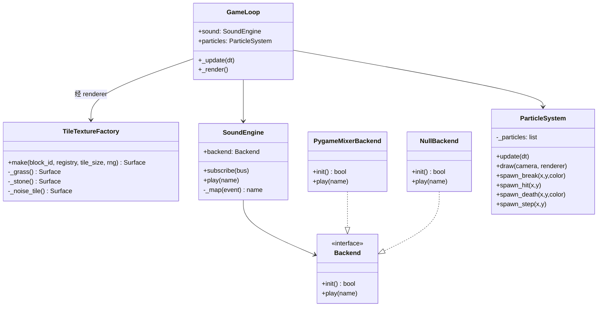
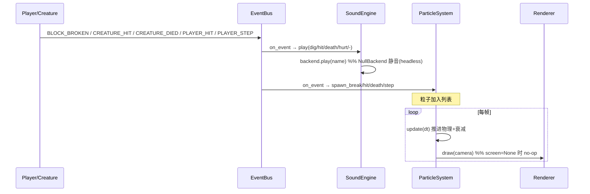

# M6 架构文档 · 渲染与体验美化（mc_clone_gui / <仓库根>/MC2）

## 一句话总结
在 M1–M5（引擎/生存/模拟层/生物/群系洞穴存档打包）之上，M6 聚焦**体验层美化**：
**像素瓦片纹理**（程序化生成带纹理的方块贴图，替代纯色块）、**音效系统**（可插拔后端，
真机有声、headless 静音）、**粒子系统**（挖掘碎屑/受击/死亡爆裂/脚步尘土）。全部走事件总线
解耦，地基零改动，headless 全兼容。

## 范围
**做：**
- 像素瓦片纹理：grass/stone/dirt/sand/water/lava/wood(stone_brick)/glass 等生成带纹理 tile。
- 音效：dig/place/hit/death/hurt 五种，订阅现有事件，程序合成短音（无素材依赖）。
- 粒子：挖掘碎屑、受击红屑、死亡爆裂、脚步尘土；订阅事件生成。
- 脚步尘土：新增轻量 `PLAYER_STEP` 事件（在 main_gui 检测玩家移动 emit，不改 player.py）。

**不做（留待后续里程碑）：**
- 大型渲染管线重写、3D、光照阴影、红石机械、村民/NPC、作物生长动画。

## 设计基线（与既有架构一致）
- **事件解耦**：音效/粒子订阅现有事件 `BLOCK_BROKEN`(挖)/`BLOCK_PLACED`(放)/
  `CREATURE_HIT`(击中生物)/`CREATURE_DIED`(生物死)/`PLAYER_HIT`(玩家受伤)/
  `PLAYER_MOVED`/`PLAYER_LANDED`；仅新增 `PLAYER_STEP`（脚步）。事件已由 player.py /
  creatures/system.py 真实 emit（已 grep 确认），订阅即生效。
- **headless 全兼容**：renderer.screen=None 时绘制为 no-op；音效后端在无音频设备时
  回退 NullBackend（静音）；粒子 update 为纯逻辑、draw 在 screen=None 时 no-op。
- **确定性**：纹理生成接受可选 `random.Random(seed)`，同 seed 同纹理；粒子运动由 dt 推进。
- **地基零改动**：不修改 terrain/block_world/player/geometry/camera/survival/inventory/
  daynight；`tile_world_renderer.py` 仅增强 `_tile_surface`（保留 PNG 钩子与纯色回退）；
  `player.py` 不新增事件（PLAYER_STEP 改在 main_gui._update 检测发射，保持 player 零改动）。

## 任务清单（T-M6-01~12）
| 任务 | 模块 | 内容 |
|---|---|---|
| T-M6-01 | fx_tiles.py | `TileTextureFactory`：按 block_id + 语义色生成带纹理 surface（grass 草边+泥底、stone 噪点、sand 颗粒、water 波纹、lava 亮斑、brick 砖纹、glass 透光边框等） |
| T-M6-02 | fx_tiles.py | 确定性：接受 `rng=random.Random(seed)`，同 seed 同纹理；缓存按 (block_id, seed) |
| T-M6-03 | tile_world_renderer.py | `_tile_surface` 优先调用 `TileTextureFactory.make`（异常/无 pygame 时回退纯色块 + PNG 钩子） |
| T-M6-04 | audio_fx.py | `SoundEngine` + 后端抽象：`Backend` 接口、`PygameMixerBackend`（pygame.mixer 程序合成短音）、`NullBackend`（静音） |
| T-M6-05 | audio_fx.py | 事件→音效映射：`BLOCK_BROKEN→dig`、`BLOCK_PLACED→place`、`CREATURE_HIT→hit`、`CREATURE_DIED→death`、`PLAYER_HIT→hurt`；`subscribe(bus)` 自动接线 |
| T-M6-06 | audio_fx.py | headless 容错：`init()` 失败（无 mixer/无设备）回退 NullBackend；`play()` 永不抛 |
| T-M6-07 | particles.py | `ParticleSystem`：粒子数据 (x,y,vx,vy,life,max_life,color,size)；`update(dt)` 重力+衰减+移除死亡粒子 |
| T-M6-08 | particles.py | spawn 工厂：`spawn_break(x,y,color)`/`spawn_hit(x,y)`/`spawn_death(x,y,color)`/`spawn_step(x,y)` |
| T-M6-09 | particles.py | `draw(camera, renderer)`：复用 renderer 瓦片映射 blit 小 surface；screen=None 时 no-op；订阅事件生成粒子 |
| T-M6-10 | event_bus.py + main_gui.py | 增 `PLAYER_STEP` 事件；main_gui._update 检测玩家 on_ground 且水平移动，按节流 emit（player.py 零改动） |
| T-M6-11 | main_gui.py | GameLoop 加 `self.sound`/`self.particles`；`_update` 尾 `particles.update(dt)` + 移动检测 emit PLAYER_STEP；`_render` 在 creature_renderer 后 `particles.draw`；`_run_gui` 构造并 `subscribe` |
| T-M6-12 | tests/ | `test_m6_tiles.py`/`test_m6_audio.py`/`test_m6_particles.py`/`test_m6_integration.py`（≥15 例，全 headless）；全量回归无退化 |

## 类图（mermaid）

## 时序图（事件 → 音效/粒子，mermaid）

## 风险
- **R1（headless 音频设备）**：CI/无显示环境无音频设备，`pygame.mixer.init()` 可能失败。
  缓解：`SoundEngine.init()` try/except，失败用 NullBackend；`play()` 永不抛；headless 测试只验证映射与不崩。
- **R2（纹理性能）**：逐格生成带纹理 surface 成本高。缓解：按 (block_id, seed) 缓存，
  世界渲染只查缓存；纹理用低价噪声（模运算/固定图案）而非逐像素随机。
- **R3（粒子数量爆炸）**：大量挖掘/死亡瞬时生成海量粒子拖慢。缓解：`ParticleSystem` 设
  硬上限（如 400），超出丢弃最旧；粒子短生命（0.3–0.8s）自动回收。
- **R4（地基零改动）**：严格不动 player.py 等禁改地基；PLAYER_STEP 改在 main_gui 检测发射；
  `tile_world_renderer` 仅增强 `_tile_surface` 且保留纯色回退，旧测试签名不变。

## 验收标准
1. 方块瓦片为带纹理像素图（非纯色块），同 seed 确定性一致；PNG 钩子仍优先。
2. 挖掘/放置/击中生物/生物死亡/玩家受伤触发对应音效；headless 下静音且不崩。
3. 上述动作生成对应粒子（碎屑/受击/死亡/脚步），粒子随物理衰减消失；headless 下不崩。
4. 全量 pytest 无退化（255+ 基线 + M6 新测全过）。
5. 真机观感需目检（本环境无显示，仅验证构建/逻辑/不崩）。
