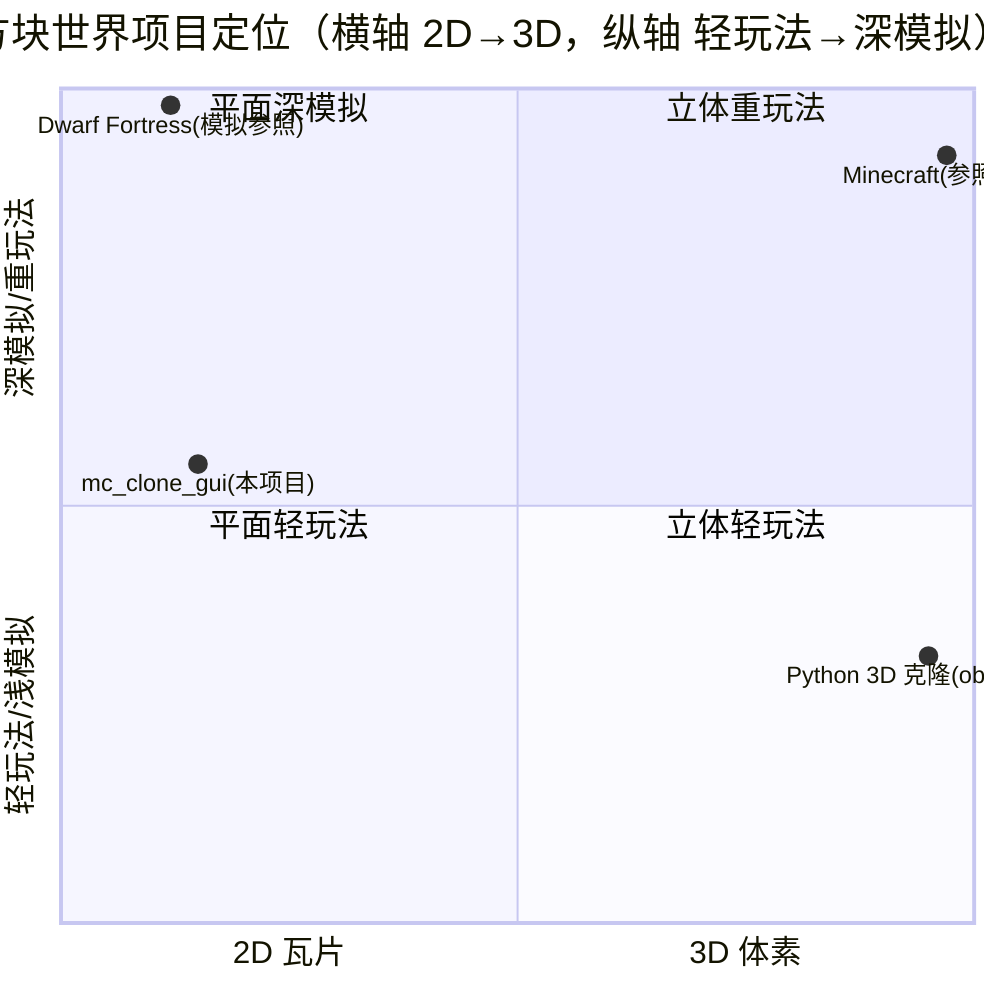

# PRD：我的世界复刻版（2D 瓦片 GUI 版）· 大型多里程碑项目

> 产品经理：许清楚（Xu）
> 范围：仅需求分析，**不写任何代码、不修改任何 .py 源码**。本文件为新建，不覆盖 `prd_mvp.md`。
> 方向：在 `<仓库根>/MC2` 现有 2D 文字向 MC 地基之上，演进为 **pygame-ce 驱动的 2D 瓦片 GUI 版本**，
> 参考《我的世界》可玩闭环与《矮人要塞》瓦片化/模拟深度，**绝不引入 3D OpenGL**（贴合用户既有 pygame 栈、可达、易打包）。
> 调研结论引用：主理人已搜集的《我的世界》《矮人要塞》信息（见文末附录引用）。

---

## 0. 项目信息

| 项 | 内容 |
|---|---|
| **语言** | 中文（文档与 UI 文案均中文） |
| **技术栈** | Python 3.14 + **pygame-ce**（2D 瓦片渲染 / 输入 / 主循环）；复用现有 `geometry` / `noise` / `block_registry` / `block_world` / `terrain`；保留 `text_world_renderer` 作为无 GUI 降级；`PyInstaller` 打包发布 |
| **项目名** | `mc_clone_gui` |
| **明确不引入** | 3D / OpenGL（obiwac 等 Python 3D 克隆路线不在本项目范围） |
| **渲染范式** | 2D 侧视（Terraria 式）方块世界 + 瓦片（tile）图形渲染，非 ASCII |
| **原始需求复述** | 在 `<仓库根>/MC2` 已完成「2D 文字向 MC 地基 + 可玩 MVP PRD + 架构文档 + 全套测试」的基础上，做成《我的世界》复刻的 **GUI 版本**，并参考《矮人要塞》的瓦片化与模拟深度；按**大型项目**规划，从「文字渲染」演进为「GUI 瓦片渲染」，扩展为多里程碑路线图（M1~M5）。 |

> **坐标与数据约定（继承地基，不破坏）**：x 向右、y 向上、z 为层（depth，地基默认 1，本路线图 M3 起启用 >1）；方块 id `0=air 1=stone 2=dirt 3=grass 4=water 5=sand`；`BlockDef` 含 `solid/transparent/props`，`BlockWorld` 以 `(x,y,z)` 稀疏存储并支持 `to_dict/from_dict` 序列化。

---

## 1. 产品目标

> **一句话**：在已完成的 2D 文字向 MC 地基之上，演进为 pygame-ce 驱动的 2D 瓦片 GUI 版本，串起「可玩闭环 → 生存基底 → 轻模拟层 → 生物世界 → 世界深度」五里程碑路线图，对标《我的世界》的可玩性与《矮人要塞》的模拟深度，走「**2D 瓦片 + 轻模拟 + 中文友好 + 单机可玩**」的差异化路线。
>
> **简介**：玩家在一个程序化生成、可由 2D 瓦片实时渲染的方块侧视世界中，用鼠标/键盘控制角色移动、跳跃、受重力并与地形碰撞，能破坏/放置方块、管理背包与合成、经历昼夜；中远期叠加《矮人要塞》式的 Z 层级、温度/水流/岩浆模拟覆盖层与挖掘/建造作业系统，并引入被动/敌对生物与生物群系、洞穴矿脉，最终支持存档读档与一键打包发布。全程中文 UI、单机即玩、纯 Python + pygame 技术可达。

---

## 2. 产品目标拆解（3 个互斥正交目标）

| # | 目标 | 说明（互斥正交） |
|---|---|---|
| G1 | **GUI 可玩闭环** | 用 2D 瓦片渲染替换 ASCII，提供稳定的「移动 + 重力 + 碰撞 + 挖/放 + 相机跟随 + HUD」，玩家能在窗口里真正玩起来。关注「输入输出与渲染的可玩性」，**不涉及**生存数值与世界模拟。 |
| G2 | **可塑世界 + 轻模拟层** | 世界可被改造（挖/放/合成/存档）并叠加《矮人要塞》式 Z 层级与温度/水流/岩浆**模拟覆盖层**与作业系统，让世界「活」起来。关注「世界状态与模拟」，**不关心**画面是否 3D、是否有生物。 |
| G3 | **可扩展大型骨架** | 以多里程碑路线图 + 模块化架构（渲染/玩家/模拟/生物/世界生成/存档解耦）+ 数据/事件驱动，支撑后续无限扩展，且保留无 GUI 降级与确定性。关注「架构与可维护性」，**不绑定**任何单一玩法。 |

> 三目标彼此正交：G1 是「能玩」，G2 是「世界有深度」，G3 是「能长期长」。任一目标的进展不替代另一目标。

---

## 3. 市场与竞品分析

### 3.1 竞品对比

| 竞品 | 维度 | 定位 | 优点 | 缺点 | 对本项目意义 |
|---|---|---|---|---|---|
| **《我的世界》Minecraft** | 3D 体素 / 商业闭源 / 全平台 | **参照基准（可玩性标杆）** | 玩法完整（生存/创造/合成/生物/生物群系）、生态庞大、教育向 | 3D 技术门槛高、体量大、非中文原生友好度一般、闭源不可改 | 我们的「可玩闭环 + 中文友好 + 单机即玩」对标对象 |
| **《矮人要塞》Dwarf Fortress** | 2D（ASCII/瓦片）/ 程序化世界 / 极深模拟 | **GUI/模拟参照** | 程序化整世界、Z 层级、温度/水/岩浆模拟、作业系统、Steam 版 tileset 图形、免费 | 学习曲线陡峭、原 ASCII 不友好、性能吃配置 | 我们的「瓦片化渲染 + Z 层级 + 轻模拟覆盖层」直接借鉴 |
| **Python 生态 3D 克隆**（obiwac/python-minecraft-clone、Luka12-dev、StanislavPetrovV） | 3D OpenGL / 教学演示 | **技术对照（反面教材）** | 证明 Python 能做 MC 式渲染、开源可学 | 3D 性能受限、玩法浅、依赖 OpenGL 复杂、难 PyInstaller 打包 | 印证「不引入 3D OpenGL」的路线正确性 |

### 3.2 定位象限图（Mermaid）

横轴 = 2D 瓦片 → 3D 体素；纵轴 = 轻玩法/浅模拟 → 深模拟/重玩法。分值 0~1。



### 3.3 市场 / 定位结论

- 我们**不做 3D**（避开 OpenGL 性能/打包地狱，见 Python 3D 克隆的反面教训），也**不做《矮人要塞》式极致硬核模拟**（避开学习曲线与性能悬崖）。
- 取两者之长：**MC 的「可玩闭环 + 中文友好 + 单机即玩」** + **DF 的「瓦片化渲染 + Z 层级 + 轻模拟覆盖层」**。
- **差异化定位**：「**2D 瓦片 + 轻模拟 + 中文友好 + 单机可玩**」的方块世界；技术可达（Python 3.14 + pygame-ce，纯标准库为主），适合教学 / 演示 / 二次开发 / 中文社区分发。

---

## 4. 用户故事（10 条，覆盖全路线图）

| # | 用户故事 | 关联里程碑 |
|---|---|---|
| US1 | 作为玩家，我想在 pygame 窗口里看到**瓦片化**的世界（而非字符），以便获得直观的图形体验。 | M1 |
| US2 | 作为玩家，我想用 A/D 移动、Space 跳跃、受重力落地，以便像 MC 一样操控角色。 | M1 |
| US3 | 作为玩家，我想用鼠标瞄准并左键挖、右键放方块，以便改造世界。 | M1 |
| US4 | 作为玩家，我想屏幕视口始终跟随角色并钳制到世界边界，以便随时看到身边地形。 | M1 |
| US5 | 作为玩家，我想在顶部 HUD 看到坐标/手持/HP/饥饿/FPS/时间，以便掌握状态。 | M1/M2 |
| US6 | 作为玩家，我想管理背包、用数字键/滚轮切换手持，并合成基础物品，以便生存。 | M2 |
| US7 | 作为玩家，我想经历**昼夜循环**（天空变色、光照变化），以便有生存节奏。 | M2 |
| US8 | 作为玩家，我想切换 **Z 层级** 查看不同深度的地层，并看到**温度/水流/岩浆模拟覆盖层**，以便理解世界动态。 | M3 |
| US9 | 作为玩家，我想用《矮人要塞》式**作业指定**（划定挖/建区域）让改造按模拟节拍进行，以便规划大型工程。 | M3 |
| US10 | 作为玩家，我想遇到被动/敌对**生物**（带精灵图形），能被刷出、攻击我或被我击败掉落物品，以便世界有生命。 | M4 |
| US11 | 作为玩家，我想探索不同**生物群系**、地下**洞穴与矿脉**，以便有探索目标。 | M5 |
| US12 | 作为玩家，我想随时**存档/读档**，并把游戏**打包成 exe 双击即玩**，以便长期游玩与分享。 | M5 |

---

## 5. 需求池（按里程碑 M1~M5 组织，含 P0/P1/P2 + 验收标准）

> 优先级：P0=必须（里程碑可交付底线）；P1=应有（体验完整）；P2=可选（占位/后续）。
> 每项含**验收标准**（可测量）。架构/工程实现由后续阶段落地，本 PRD 不写代码。

### 里程碑路线图（依赖关系）


---

### M1 · GUI 垂直切片（在现有 MVP 上 GUI 化）

**目标**：用瓦片渲染器替换 ASCII 渲染器，落地完整可玩闭环（G1）。

#### P0 — 可交付底线

| 编号 | 功能 | 验收标准 |
|---|---|---|
| M1-R1 | **瓦片渲染器 `TileWorldRenderer`**：基于 pygame Surface，给定 `BlockWorld` + 视口 `AABB2D` + `tile_size`，将可见方块逐格 blit 为瓦片；复用 `BlockDef.color` 与 `glyph`；支持纯色块兜底与可选 PNG tileset；`y` 轴上下翻转映射（继承地基约定） | ① 同视口渲染结果与 `TextWorldRenderer` 几何一致；② 玩家瓦片叠加在对应格（不改 `BlockWorld`）；③ 80×24 瓦片场景 ≥30 FPS |
| M1-R2 | **玩家实体 + 物理**：`AABB2D` 玩家，水平移动(A/D)、跳跃初速度(Space/W)、重力下落、与 `solid` 方块碰撞；落地静止 | ① 不进入 `solid` 内部；② 站 `solid` 上 y 稳定；③ 撞墙被阻挡；④ 跳跃约 3–4 格高并落回 |
| M1-R3 | **挖/放**：目标选择（**推荐鼠标瞄准 Terraria 式**；键盘降级为面朝相邻格）；左键挖→air，右键放手持方块 | ① 目标格高亮；② 挖置 0 且 `to_dict()` 改变；③ 不可放在玩家 AABB 占用格（防卡死）；④ 边界保护不穿地 |
| M1-R4 | **相机跟随**：视口 `AABB2D` 以玩家为中心、尺寸固定；抵达边界钳制到 `BlockWorld.bounds()` | ① 玩家移动视口随动且居中（或接近居中）；② 边界钳制 |
| M1-R5 | **游戏循环**：pygame `Clock` + 固定步长累加器；每帧 `update(读输入→更新玩家→发事件)` + `render(瓦片渲染)`；逻辑固定 dt、渲染解耦 | ① 每帧读 `RealtimeInputManager`（扩展鼠标）；② FPS 显示；③ 逻辑与渲染解耦 |
| M1-R6 | **基础 HUD（pygame 绘制）**：顶部条显示坐标(XY/Z)、手持方块、FPS、种子；底部提示条 | ① 实时随状态更新；② 不遮挡主视口瓦片 |

#### P1 — 体验完整

| 编号 | 功能 | 验收标准 |
|---|---|---|
| M1-R7 | **目标高亮（准星）**：在被瞄准瓦片叠加描边/标记 | ① 视觉可辨识；② 随瞄准移动 |
| M1-R8 | **手持/快捷栏切换（基础）**：数字键 `1-6` 循环手持方块（固定手持、不消耗） | ① 切换后放置用新方块；② HUD 显示当前手持 |
| M1-R9 | **保留 `text_world_renderer` 无 GUI 降级**：`main.py` 支持 `--no-gui` 走 ANSI 渲染路径（不触发 pygame 渲染） | ① `--no-gui` 可运行并打印；② 无 GUI 依赖被误触发 |

#### P2 — 占位/后续

| 编号 | 功能 | 验收标准 |
|---|---|---|
| M1-R10 | **调试覆盖层（F3 式）**：显示坐标/实体数/模拟 tick | ① 按键切换可见 |
| M1-R11 | **事件总线钩子**：移动/挖/放/落地经事件系统发预置类型（复用 MVP `EventTypes` 或轻量本地事件发射器），本里程碑仅日志 | ① 订阅者可接收；② 调用点存在 |

---

### M2 · 生存基底

**目标**：在 G1 之上叠加生命/饥饿/背包/合成/昼夜（G2 起点）。

#### P0

| 编号 | 功能 | 验收标准 |
|---|---|---|
| M2-R1 | **生命 & 饥饿**：HP(默认 20)、饥饿(0–20)；饥饿随时间衰减；饥饿=0 时持续扣血 | ① HUD 双条显示；② 饥饿下降；③ 饥饿耗尽触发扣血 |
| M2-R2 | **背包模型**：本地 `Inventory`（槽位 `{block_id, count}`）；挖→入包，放→消耗 | ① 数量随操作更新；② 数量为 0 时禁止放置 |
| M2-R3 | **合成（基础）**：配方表（确定性，如 `stone×4→stone_brick`、`sand×?→glass` 等少量配方）；`C` 开合成界面 | ① 消耗输入产出输出；② 配方数据驱动（JSON） |
| M2-R4 | **昼夜循环**：时间累加器；天空/背景色调循环；HUD 时钟 | ① 可见昼/夜渐变；② 时间可序列化 |
| M2-R5 | **手持切换（完整）**：数字键 `1-6` + 鼠标滚轮切换快捷栏 | ① 滚轮与数字键一致切换；② HUD 同步 |

#### P1

| 编号 | 功能 | 验收标准 |
|---|---|---|
| M2-R6 | **死亡/重生**：HP=0 在出生点重生 | ① 触发重生且不崩；② 出生点记忆 |
| M2-R7 | **饥饿→回血**：饥饿高时缓慢回 HP | ① 满足条件回血 |

#### P2

| 编号 | 功能 | 验收标准 |
|---|---|---|
| M2-R8 | **音效占位**：挖/放/跳触发点（仅日志/空函数） | ① 调用点存在 |
| M2-R9 | **天气占位**（群系无关） | ① 事件占位 |

---

### M3 · 模拟层（借鉴《矮人要塞》）

**目标**：启用 Z 层级 + 温度/水流/岩浆模拟覆盖层 + 挖掘/建造作业系统（G2 核心）。

#### P0

| 编号 | 功能 | 验收标准 |
|---|---|---|
| M3-R1 | **Z 层级启用**：`BlockWorld` `depth>1`（推荐 8–16 层）；地形生成多层（地表 +  subsurface 石层）；相机支持当前 Z 切换（`Z`/`Shift+Z` 或 `[` `]`） | ① 多层世界可构建；② 可查看/切换 Z；③ 数据结构沿用现有 `get/set(x,y,z)` |
| M3-R2 | **温度模拟覆盖层**：逐格温度场；热源（岩浆）扩散；覆盖层开关（`T`）按色阶映射 | ① 覆盖层正确渲染；② 岩浆抬升邻格温度 |
| M3-R3 | **水流/岩浆模拟**：元胞自动机——水/岩浆向更低/侧向空位扩散、找水平面；覆盖层开关（`W`） | ① 水填平盆地、达水平面；② 岩浆扩散更慢 |
| M3-R4 | **挖掘/建造作业系统**：DF 式划定作业区（挖/建）；作业入队由模拟 tick 按节拍完成（耗时挖掘） | ① 指定后生成作业；② N tick 后方块被移除/放置 |

#### P1

| 编号 | 功能 | 验收标准 |
|---|---|---|
| M3-R5 | **多层可见性**：Z 滑块/堆叠层视图 | ① 可滑动查看各层 |
| M3-R6 | **作业优先级 & 指派**：玩家作为工人按优先级执行 | ① 优先级生效 |

#### P2

| 编号 | 功能 | 验收标准 |
|---|---|---|
| M3-R7 | **温度→方块效应**：冰融化、水结冰 | ① 条件触发 |
| M3-R8 | **模拟性能预算开关**：限制 tick 频率（默认 ≤20Hz） | ① 可调；② 仅重算变化 chunk |

---

### M4 · 生物与世界

**目标**：引入生物实体与精灵、刷怪、战斗（G2 延伸 + 可玩性补全）。

#### P0

| 编号 | 功能 | 验收标准 |
|---|---|---|
| M4-R1 | **生物实体**：被动（牛/猪）/敌对（僵尸）以实体列表存在，含 `AABB2D`、HP、简易 AI 状态机（idle/wander/flee/attack） | ① 实体可生成并更新；② 状态机可观测 |
| M4-R2 | **生物/作业精灵**：经 tileset 绘制（动物/作业 glyph 瓦片），被动/敌对视觉区分 | ① 精灵随实体渲染；② 类型可辨 |
| M4-R3 | **刷怪**：按生物群系/时间规则刷出（夜间敌对），限数量上限 | ① 规则生效；② 不超上限 |
| M4-R4 | **战斗**：玩家攻击（点击/近战）扣生物 HP；生物攻击扣玩家 HP | ① 双向伤害正确；② 死亡处理 |

#### P1

| 编号 | 功能 | 验收标准 |
|---|---|---|
| M4-R5 | **生物掉落**：死亡掉物品入包 | ① 掉落入包 |
| M4-R6 | **简易寻路**：贪心/攀爬移动 | ① 能绕过简单障碍 |

#### P2

| 编号 | 功能 | 验收标准 |
|---|---|---|
| M4-R7 | **驯服/繁殖占位** | ① 占位 |
| M4-R8 | **音效钩子** | ① 调用点 |

---

### M5 · 世界深度

**目标**：生物群系、洞穴矿脉、存档读档、PyInstaller 发布（G2/G3 收口）。

#### P0

| 编号 | 功能 | 验收标准 |
|---|---|---|
| M5-R1 | **生物群系**：地形生成扩展群系噪声（平原/沙漠/山地/水域），按群系选方块调色板 | ① 出现可辨识区域；② 确定性可复现 |
| M5-R2 | **洞穴 & 矿脉**：利用 M3 多层，用 3D 噪声开凿洞穴，在石中散布矿（铁/煤/钻石） | ① 地下有洞穴与矿脉；② 矿按层分布合理 |
| M5-R3 | **存档/读档**：复用 `BlockWorld.to_dict/from_dict` + 序列化玩家/背包/时间/生物；`F5` 存、启动读 | ① 重载后世界+玩家+状态一致 |
| M5-R4 | **PyInstaller 打包**：`build.spec` 打包为 exe，捆绑 `allin_engine` 与资源 | ① 目标机无 Python 可双击运行 |

#### P1

| 编号 | 功能 | 验收标准 |
|---|---|---|
| M5-R5 | **设置/菜单**：种子输入、世界尺寸、语言 | ① 可配置后新开世界 |
| M5-R6 | **多世界/世界列表** | ① 可切换 |

#### P2

| 编号 | 功能 | 验收标准 |
|---|---|---|
| M5-R7 | **Modding**：JSON 增方块 | ① 加载扩展方块 |
| M5-R8 | **本地化**：全中文 UI 文案 | ① 无英文残留（核心路径） |

---

## 6. UI / 交互设计稿

### 6.1 pygame 窗口布局（ASCII 草图）

```
+==================================================================+
| HUD 顶部: XY:(32,11,Z2) 手持:stone x64  HP:♥♥♥♥ 饥饿:🍗🍗  FPS:60 时:☀12:30 |  ← 顶部 HUD 条 (M1-R6/M2-R1)
+==================================================================+
|                                                          |         |
|                  .########.                               |  右侧    |
|                  ."""""""".                              |  状态/   |
|             @    .########.                              |  模拟    |
|            ####  .########.        [ ] 目标高亮           |  覆盖层  |
|            #### [~]~~~~~~~                              |  开关：  |
|            #### :####:                                  |  T 温度  |
|                                                          |  W 水流  |
|        ← 主视口：2D 瓦片渲染（相机跟随玩家，TileWorldRenderer） →  |  Z± 层级 |
|                                                          |         |
+==================================================================+
| 快捷栏: [1 stone][2 dirt][3 grass][4 sand][5 water][6 air]   ← 底部背包/手持栏 (M1-R8/M2-R2) |
+==================================================================+
| 提示: A/D 移动 · Space 跳 · 左键挖 · 右键放 · 滚轮/1-6 切换 · C 合成 · T 温度 · W 水流 · Z± 层级 · Esc 菜单 · F5 存 |
+==================================================================+
```

说明：
- 主视口由 `TileWorldRenderer` 基于 `BlockWorld` + 视口 `AABB2D` 渲染；玩家与其 AABB 在渲染层叠加（不改 `BlockWorld` 数据）。
- HUD / 快捷栏 / 提示条由 pygame 独立绘制，不计入瓦片网格，避免与世界对齐冲突。
- 右侧为可选**模拟覆盖层开关区**（M3 起）：温度(`T`)、水流/岩浆(`W`)、Z 层级切换(`Z`/`Shift+Z`)。

### 6.2 键位映射表（复用并扩展 MVP 的 A/D/Space/方向键/J-K）

| 操作 | 建议键位 | 里程碑 |
|---|---|---|
| 向左移动 | `A` / `←` | M1 |
| 向右移动 | `D` / `→` | M1 |
| 跳跃 | `Space` / `W` / `↑` | M1 |
| 破坏（挖） | 鼠标左键 / `J` | M1 |
| 放置 | 鼠标右键 / `K` | M1 |
| 鼠标瞄准 | 鼠标移动（**推荐 M1 启用**） | M1 |
| 切换手持 | 数字 `1-6` / 鼠标滚轮 | M1(基础)/M2(完整) |
| 合成界面 | `C` | M2 |
| 暂停/菜单 | `Esc` | M1 |
| 切换 Z 层级 | `Z` / `Shift+Z`（或 `[` `]`） | M3 |
| 温度覆盖层 | `T` | M3 |
| 水流/岩浆覆盖层 | `W` | M3 |
| 作业指定（挖/建模式） | 拖动鼠标 + `D`/`B` 模式键 | M3 |
| 保存 | `F5` | M5 |
| 调试覆盖层 | `F3` | M1 |

> 输入统一经 `RealtimeInputManager`（扩展鼠标支持）读取；跳跃等用「本帧刚按下」避免连发。鼠标瞄准为推荐默认，键盘 `J-K` 作无鼠标降级保留。

---

## 7. 待确认问题（具体化，≥5 条，含推荐默认值）

| # | 问题 | 方案对比 | **推荐默认值** |
|---|---|---|---|
| Q1 | **GUI 瓦片尺寸** | 16px（轻量）/ 18px（对标 DF Steam 版）/ 24px / 32px（清晰） | **32px**（清晰且性能友好；世界默认 256×96 视口约 80×24 格即 2560×768，可分屏/缩放） |
| Q2 | **tileset 来源** | 纯色块（最快可达）/ PNG 贴图（美观，需美术资源）/ 程序生成（代码画渐变+纹理） | **程序生成纯色块 + 可选 PNG 覆盖**（M1 先纯色保证可达，后续 `data/tiles/` 放 PNG 即可热替换；沿用 `BlockDef.color`） |
| Q3 | **Z 层级是否 M1 就启用** | M1 即 `depth>1`（更复杂）/ M1 仍 `depth=1`，M3 起启用 | **M1 保持 `depth=1`**（垂直切片更稳）；数据结构已支持 `z`，M3 直接启用 >1，无返工 |
| Q4 | **模拟层性能预算** | 高 tick（如 60Hz，吃 CPU）/ 低 tick（如 10Hz，响应慢）/ 折中 | **模拟 tick ≤ 20Hz，且只重算「有变化的 chunk」**；瓦片渲染目标 30–60 FPS |
| Q5 | **M1 是否支持鼠标瞄准** | 是（贴近 MC/Terraria，pygame 已支持）/ 否（纯键盘 J-K） | **是**（鼠标瞄准为默认；键盘 `J-K` 作降级保留） |
| Q6 | **游戏循环驱动** | 复用 `allin_engine` `FixedTimestepLoop` / 用 pygame `Clock` 固定步长累加器 | **pygame `Clock` + 固定步长累加器**（减少引擎耦合，便于 PyInstaller 打包）；保留 `allin_engine` 仅用于 `Serializable`/`JSONLoader`/`InputManager` 基类 |
| Q7 | **默认世界尺寸** | 小（64×24，呼应首轮）/ 中（256×96）/ 大（512×192） | **宽 256 × 高 96 × depth**（M1 depth=1；M3 起 8–16）；比首轮大以体现「相机跟随有意义」 |

---

## 8. 复用与依赖说明（本 PRD 不写代码，仅标注）

### 8.1 复用现有 `<仓库根>/MC2` 模块（不修改）

| 模块 | 复用点 | 备注 |
|---|---|---|
| `geometry.py` | `Vec2i` / `AABB2D` / `clamp` / `lerp` | 玩家 AABB、视口、相机钳制、碰撞 |
| `noise.py` | `PerlinNoise.fbm` | 地形、M5 群系/洞穴噪声（扩展多 octave/3D 采样） |
| `block_registry.py` | `BlockDef` / `BlockRegistry` / `from_json` | 方块定义；`props` 扩展温度/流动元数据；群系调色板 |
| `block_world.py` | `BlockWorld`（稀疏 `(x,y,z)` 存储、`to_dict/from_dict`、`serialize_chunk`） | 世界存储 + 存档（M5）；`depth` 启用 Z 层级（M3） |
| `terrain.py` | `TerrainGenerator.generate` | 基础地形；M5 扩展群系/洞穴 |
| `text_world_renderer.py` | **保留为 `--no-gui` 降级** | 不删除；M1-R9 复用其 ANSI 路径 |
| `input_realtime.py` | `RealtimeInputManager` / `PygameKeyStateSource` | 键盘输入；**扩展鼠标支持**（新增 `MouseStateSource` 或扩展现有类） |
| `data/blocks.default.json` | 6 默认方块 | 扩展新增方块（砖/玻璃/矿/生物素材引用） |

### 8.2 新增模块（由后续工程阶段实现，PM 不写）

| 模块（建议名） | 职责 | 里程碑 |
|---|---|---|
| `tile_world_renderer.py` | `TileWorldRenderer`：pygame Surface 瓦片渲染 | M1 |
| `player.py` | 玩家实体 + 物理（移动/重力/碰撞/生命/饥饿） | M1/M2 |
| `camera.py` | 视口跟随 + 边界钳制 + Z 层级视口 | M1/M3 |
| `hud.py` | pygame HUD / 快捷栏 / 提示条绘制 | M1 |
| `inventory.py` | 本地 `Inventory`（推荐自实现，降耦合，不依赖 `allin_engine.systems.inventory`） | M2 |
| `crafting.py` | 配方表（JSON 数据驱动）与合成逻辑 | M2 |
| `daynight.py` | 昼夜时间累加器与光照/色调 | M2 |
| `simulation/temperature.py` | 温度场 + 扩散 | M3 |
| `simulation/fluid.py` | 水/岩浆元胞自动机 | M3 |
| `simulation/jobs.py` | 挖掘/建造作业队列与模拟 tick | M3 |
| `creatures/entity.py` `creatures/ai.py` `creatures/spawn.py` | 生物实体/AI/刷怪 | M4 |
| `worldgen/biome.py` `worldgen/caves.py` | 群系/洞穴矿脉 | M5 |
| `save_load.py` | 包装 `BlockWorld` 序列化 + 玩家/背包/时间/生物 | M5 |
| `main_gui.py` | pygame 入口（保留 `main.py` 作无 GUI 入口） | M1 |
| `build.spec` | PyInstaller 打包配置 | M5 |

### 8.3 依赖包

| 依赖 | 类型 | 说明 |
|---|---|---|
| **pygame-ce** | **硬依赖** | 渲染 / 输入 / 主循环；`>=2.5` |
| `allin_engine`（纯净版，位于 `<仓库根>`） | 保留依赖 | 仅用 `core.serializable.Serializable`、`utils.json_loader.JSONLoader`、`systems.input.InputManager` 基类；M1 起游戏循环改用 pygame，不再依赖其 `FixedTimestepLoop`/`EventBus`（本地轻量事件即可） |
| Python 3.14 标准库 | 标准 | `json` / `math` / `random` / `dataclasses` / `argparse` / `os` / `sys` 等 |
| `PyInstaller` | **构建期**依赖 | 仅 M5 打包使用，不进运行时 |

> **明确声明**：本 PRD 仅定义需求与分析，**不写任何代码、不修改任何 .py 源码**。所有实现由架构/工程阶段按里程碑落地。不引入 3D / OpenGL / numpy（纯 Python 为主，性能可后续评估是否引入）。

---

## 附录 · 调研引用（主理人已搜集，供引用）

- **《我的世界》**：核心循环=程序化体素世界放置/破坏；模式生存/创造/冒险/旁观/极限；技术=Chunk(16×16×高)+噪声+生物群系+网格生成/纹理图集/环境光遮蔽+客户端-服务端；Python 生态已有 3D OpenGL 实现（obiwac/Luka12-dev/StanislavPetrovV）；关键机制=带属性方块、挖掘耗时、合成、背包、生命/饥饿、昼夜、生物 AI、生物群系。
- **《矮人要塞》**（GUI 路线核心参考）：程序化整世界（海拔→水文→生物群系→文明→历史）；双模式 Fortress/Adventure；**Z 层级垂直分层**、每格多状态（生物/作业/物品/建筑/温度）；Steam 版新增 **Graphics Mode——tileset 瓦片图形（18×18px）**、社区 tilesets、Stonesense 等距可视化；启发我们：瓦片化渲染、启用 depth 维度、温度/水模拟覆盖层、生物/作业精灵、富 HUD。
