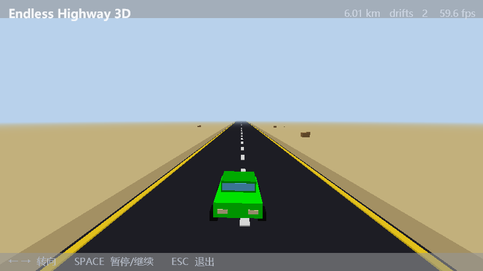

# Endless Highway 3D

> Repository: <https://gitee.com/siwpan/lonely-desert-road> ｜ License: MIT-0 (see [LICENSE](LICENSE))

An endless desert-highway driving game with an **ECS architecture**, drift mechanics and
synthwave audio. The rendering layer now runs entirely on the
[3dworld engine](https://gitee.com/siwpan/3dworld) (PyPI distribution `3dworld`, import
name `world3d`), turning the original top-down pygame 2D view into a real 3D perspective
highway.



## Live gameplay recording

**[▶ Endless Highway 3D — 3-minute live demo](docs/demo_3d.mp4)** (1280×720 / 30 fps /
H.264 + AAC stereo / 20.1 MB)

Frames are read back from the app's own GL framebuffer (not screen capture), and the
audio track comes from the mixer output, so the adaptive synthwave score is preserved.

| Time | Content |
| --- | --- |
| 0–6 s | Opening drive: perspective highway, lane dashes, roadside props, HUD distance climbing |
| 6–9.5 s | **PAUSED** overlay |
| 9.5–162 s | Main driving: autopilot holds the lane, body roll on steering, random drift, 0→470 km, drift counter accumulating |
| 162–180 s | Steering off the shoulder → **GAME OVER** overlay (distance / drift stats, car flashing red) |

## What the 3D refactor changed

| Area | Before (pygame 2D) | After (3dworld 3D) |
| --- | --- | --- |
| Graphics | `pygame.draw` primitives | 3dworld `DemoApp` + pyglet OpenGL perspective |
| Geometry | 2D pixel shapes | `world3d.core.geometry.box_data` procedural boxes (car, road, cactus, rock, bush, guardrail) |
| Coordinates | screen pixels (x, y) | world space (x lateral, y up, z depth), -z is into the screen |
| Camera | none (orthographic top-down) | chase camera behind/above, eased lateral follow, body roll on turns |
| Depth | fake 3D via downward scrolling | true perspective + distance fog (horizon blends into the sky) |
| Handling | teleport-style lateral movement | lateral **velocity + acceleration + damping** — steering and drift have inertia |
| Audio | `pygame.mixer` | `sounddevice` mixer (`audio/sd_mixer.py`), no SDL/GLFW conflict in one process |
| Framework | hand-rolled window/loop | same conventions as 3dworld-demos: `world3d.platform.app.DemoApp` |

**Unchanged**: the ECS core (`ecs/__init__.py`), the gameplay feel (endless scroll, random
drift, crash on hitting the road edge), the semantics of `config.json`, and the whole
faatt synthwave music/SFX asset set (19 WAVs; `audio/synthesizer.py` kept as is).

## Install & run

```bat
:: ① virtualenv + dependencies (engine on PyPI: dist 3dworld / import world3d)
python -m venv .venv
.venv\Scripts\activate
pip install -r requirements.txt

:: ② run
python main.py                 :: play
python main.py --smoke 3       :: smoke test, auto-close after 3 s
python main.py --shot          :: capture a frame into docs/, then close
python main.py --size 1280x720 :: explicit window size
```

`env.bat` sets the environment up in one step. `WORLD3D_PROJECT_ROOT` points at this
repository root — 3dworld's `platform.app` resolves it **at import time** to locate
screenshots, which would otherwise land inside `site-packages` for a pip install.

## Controls

| Key | Action |
| --- | --- |
| ← / → | Steer (with inertia and damping) |
| SPACE | Pause / resume |
| ESC | Quit |

The road randomly shoves the car sideways (**drift**), and the effect intensifies with
distance — the longer you drive, the slicker it gets. Hitting a road edge ends the run.

## Layout

```
main.py            entry: HighwayApp(DemoApp) — wires ECS world + 3D scene + audio + overlays
highway_scene.py   3D presentation: procedural geometry, shader (with distance fog), chase camera, draw
ecs/               gameplay logic (renderer-agnostic; imports no graphics library)
audio/             synthwave music & SFX (sounddevice playback; pygame fully removed)
config.json        tuning: window, road, player, drift, decorations + a `threed` section
faatt.py           standalone audio-workstation GUI tool (dev only, not used by the game)
scripts/
  smoke_logic.py   gameplay smoke test (no window, no GL)
  record_demo.py   live recording: capture + mux, one command
docs/              captured frames + the live demo video
```

## Recording

```bat
pip install -r requirements-dev.txt          :: brings ffmpeg (bundled with imageio-ffmpeg)
python scripts/record_demo.py --duration 180 --out docs/demo_3d.mp4
```

Frames are read back with `glReadPixels` and piped to ffmpeg as rawvideo (so the result
is unaffected by window occlusion); the audio track is dumped straight from the mixer
output and muxed in afterwards. `--demo` adds a scripted run: autopilot → PAUSED
overlay → crash into the GAME OVER screen.

## Test status

- `py_compile` passes (13 modules)
- `python scripts/smoke_logic.py` — **11/11 gameplay assertions pass**
- `python main.py --shot` — real-GL frame capture succeeds, scene renders correctly, **59.5 fps** at 1280×720
- Audio: sounddevice mixer starts, 5 music layers + 14 SFX load and play, clean shutdown

## License

MIT-0 (MIT No Attribution) — see [LICENSE](LICENSE).
