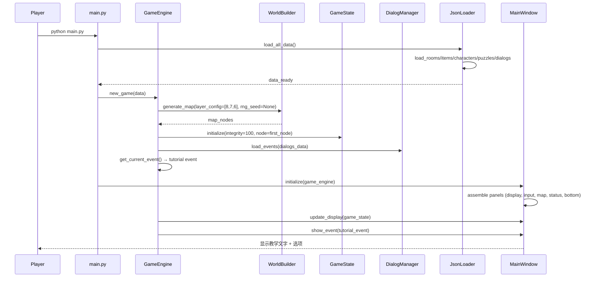
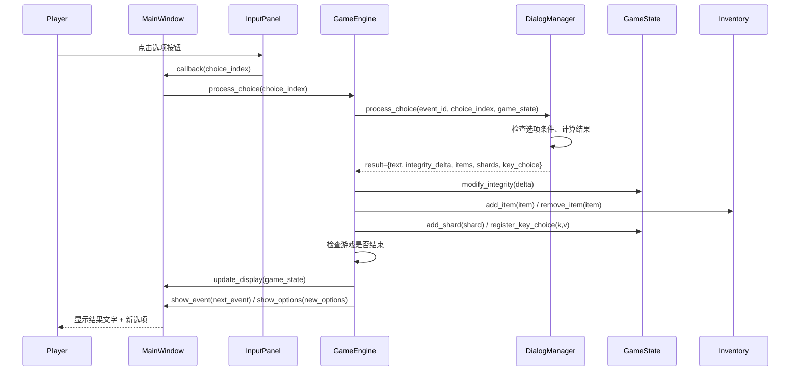
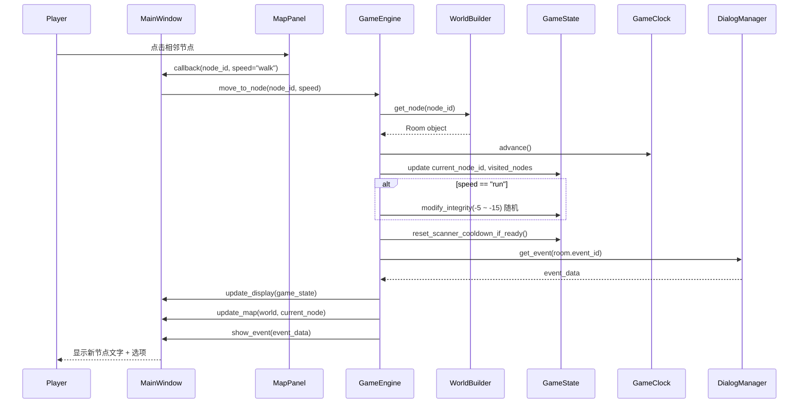
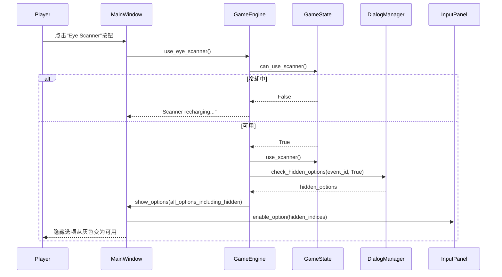
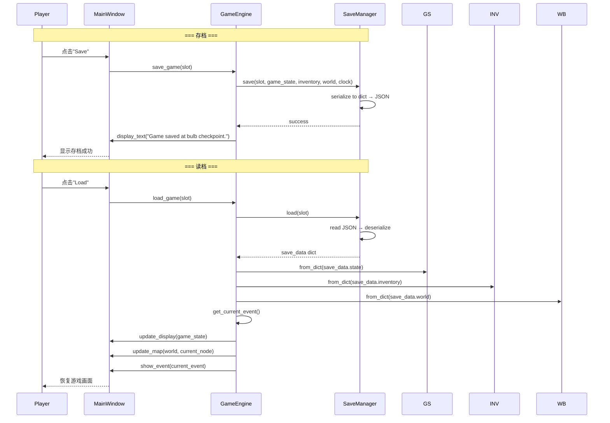
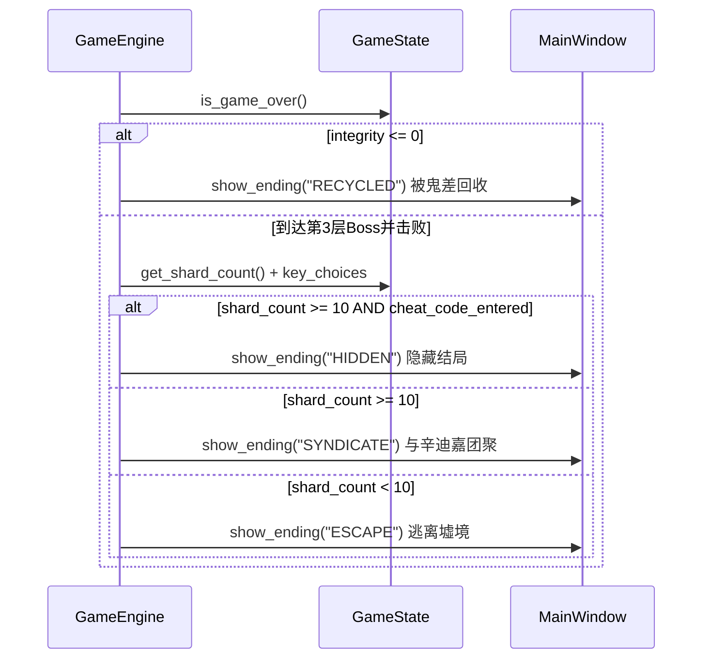
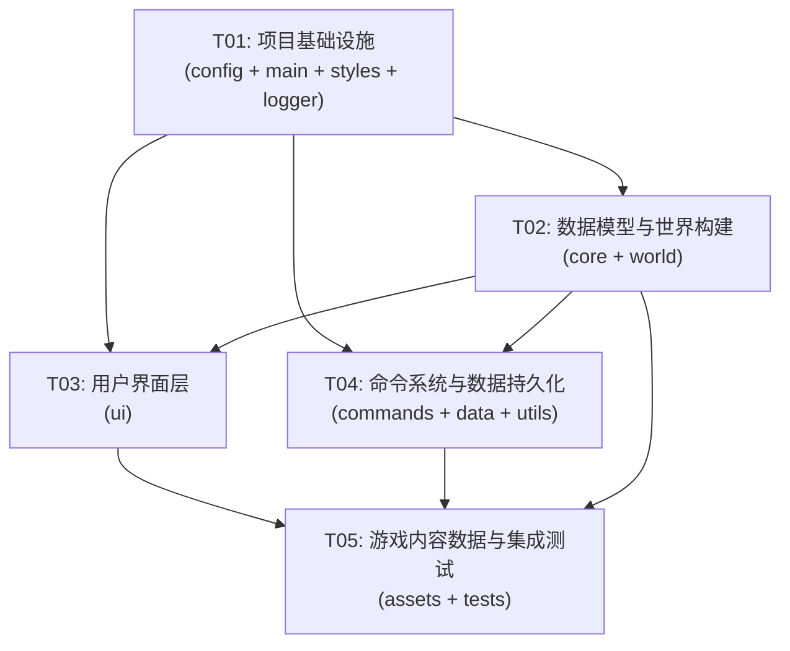

# Ruined Realm — 系统架构设计文档

> 架构师：高见远（Gao） | 版本：1.0 | 日期：2025-07

---

## Part A: 系统设计

### 1. 实现方案与框架选型

#### 1.1 核心技术挑战

| 挑战 | 说明 | 解决方案 |
|---|---|---|
| 节点式地图的随机生成与分支可视化 | 3层×6~8节点的类杀戮尖塔分支地图，需要随机生成+有向图连线+Tkinter Canvas渲染 | WorldBuilder 使用预定义模板+随机权重生成节点图；MapPanel 在 Canvas 上绘制节点+连线，已访问/当前位置用不同样式 |
| 事件/对话引擎的选项驱动状态变更 | 2~4选项触发不同状态变化，需要灵活的事件定义格式 | JSON 驱动的事件数据 + DialogManager 条件判断（依赖 GameState 快照），选项可带 condition 字段控制可见性 |
| 化身完整性驱动的资源管理 | 完整性100%→0%，多种消耗来源+恢复手段，降到0%游戏结束 | GameState 统一管理完整性，所有消耗/恢复操作通过 modify_integrity() 方法，自动检查游戏结束 |
| 义眼扫描的隐藏选项机制 | 扫描后揭示当前节点的隐藏选项，有冷却 | DialogManager 的选项分 visible/hidden 两层，use_scanner() 将 hidden 选项提升为 visible |
| 多结局的碎片收集判定 | 12碎片（4金+4红+4蓝），≥10/12解锁真结局 | GameState 维护碎片集合，check_ending() 综合碎片数+关键选择判定结局 |
| 打字机效果+暗色主题 Tkinter | 逐字显示+等宽字体+深色界面 | GameDisplay 使用 after() 定时器逐字追加；Styles 集中管理颜色/字体常量 |

#### 1.2 框架与库选型

| 组件 | 选型 | 理由 |
|---|---|---|
| GUI 框架 | **Tkinter**（Python 内置） | PRD 指定，无需额外依赖，跨平台 |
| 数据格式 | **JSON**（stdlib json） | 事件/物品/角色等游戏数据使用 JSON 定义，易于编辑和验证 |
| 音效 | **pygame.mixer**（可选） | 轻量音效播放，仅在用户安装 pygame 时启用，否则静默降级 |
| 测试 | **pytest** | Python 标准测试框架，简洁易用 |
| 日志 | **logging**（stdlib） | Python 内置日志库 |

#### 1.3 架构模式

采用 **MVC（Model-View-Controller）** 架构：

```
┌──────────────────────────────────────────────┐
│                   View (ui/)                  │
│  MainWindow → GameDisplay, InputPanel,       │
│  MapPanel, InventoryPanel, DialogWindow      │
└──────────┬───────────────────────────────────┘
           │ 更新显示 / 接收用户操作
┌──────────▼───────────────────────────────────┐
│              Controller (commands/)            │
│  CommandParser → CommandHandler →             │
│  Movement/Interaction/System/Puzzle Commands  │
└──────────┬───────────────────────────────────┘
           │ 调用 Model 方法 / 读取 Model 状态
┌──────────▼───────────────────────────────────┐
│                Model (core/ + world/)          │
│  GameEngine → GameState, Inventory,           │
│  WorldBuilder, DialogManager, GameClock       │
└──────────────────────────────────────────────┘
```

- **Model**：core/（游戏状态与引擎）+ world/（世界构建与数据模型）
- **View**：ui/（所有 Tkinter 界面组件）
- **Controller**：commands/（命令解析与分发）
- **数据持久化**：data/（存档与数据加载）

---

### 2. 文件列表及职责

```
ruined_realm/
├── main.py                          # 程序入口，初始化 GameEngine 和 MainWindow
├── config/
│   ├── __init__.py                  # 包初始化
│   ├── game_config.py               # 游戏常量配置（完整性初始值、冷却回合、碎片数量等）
│   └── paths.py                     # 文件路径常量（assets/saves 目录等）
├── core/
│   ├── __init__.py                  # 包初始化
│   ├── game_engine.py               # 游戏引擎主控，协调 Model/View/Controller
│   ├── game_state.py                # 游戏状态（完整性、碎片、回合、扫描冷却等）
│   ├── inventory.py                 # 玩家背包（物品增删查用、序列化）
│   └── game_clock.py                # 回合计时器（推进回合、事件触发检查）
├── world/
│   ├── __init__.py                  # 包初始化
│   ├── room.py                      # 地图节点/房间（类型、连接、坐标、事件绑定）
│   ├── item.py                      # 物品定义（电缆/灯泡碎片/数据包，使用效果）
│   ├── character.py                 # NPC 定义（对话树ID、交互限制、缓存合并逻辑）
│   ├── puzzle.py                    # 谜题定义（描述、答案、提示、奖励）
│   ├── dialog_manager.py            # 事件/对话引擎（选项获取、条件判断、隐藏选项）
│   └── world_builder.py             # 世界构建器（随机地图生成、节点布局、Boss放置）
├── commands/
│   ├── __init__.py                  # 包初始化
│   ├── command_parser.py            # 解析用户操作为结构化命令
│   ├── command_handler.py           # 命令分发器，路由到具体命令处理器
│   └── commands/
│       ├── __init__.py              # 包初始化，注册所有命令
│       ├── movement.py              # 移动命令（慢走/快跑到相邻节点）
│       ├── interaction.py           # 交互命令（义眼扫描、NPC对话、使用物品）
│       ├── system.py                # 系统命令（存档、读档、设置、退出）
│       └── puzzle.py                # 谜题命令（查看提示、提交答案）
├── ui/
│   ├── __init__.py                  # 包初始化
│   ├── main_window.py               # 主窗口（组装所有面板、状态栏、底部功能栏）
│   ├── game_display.py              # 主叙事区（打字机效果、文字追加、自动滚动）
│   ├── input_panel.py               # 选项按钮区（动态按钮、灰色禁用、回调触发）
│   ├── inventory_panel.py           # 背包弹窗（物品列表、物品详情、使用按钮）
│   ├── map_panel.py                 # 小地图面板（Canvas 绘制节点图、高亮当前位置）
│   ├── dialog_window.py             # 对话窗口（NPC对话展示、对话选项）
│   └── styles.py                    # 全局样式常量（颜色、字体、尺寸主题定义）
├── data/
│   ├── __init__.py                  # 包初始化
│   ├── save_manager.py              # 存档管理器（保存/加载/多存档位/自动存档）
│   ├── json_loader.py               # JSON 数据加载器（加载 rooms/items/characters 等）
│   └── data_validator.py            # 数据验证器（校验 JSON 数据完整性）
├── utils/
│   ├── __init__.py                  # 包初始化
│   ├── logger.py                    # 日志工具（统一日志格式与级别）
│   ├── text_formatter.py            # 文本格式化（完整性条渲染、碎片统计等）
│   ├── sound_manager.py             # 音效管理器（可选 pygame，降级静默处理）
│   └── animation.py                 # 动画工具（打字机效果计时器、闪烁效果）
├── assets/
│   ├── data/
│   │   ├── rooms.json               # 地图节点定义（3层×6~8节点+Boss）
│   │   ├── items.json               # 物品定义（电缆、灯泡碎片、数据包）
│   │   ├── characters.json          # NPC 定义（老鬼、辛迪嘉、鬼差·辛等）
│   │   ├── puzzles.json             # 谜题定义（各类解密谜题）
│   │   └── dialogs.json             # 事件与对话定义（节点事件+选项+结果）
│   ├── saves/                       # 存档目录（运行时生成）
│   ├── images/                      # 图片资源（可选）
│   └── sounds/                      # 音效资源（可选）
└── tests/
    ├── __init__.py                  # 包初始化
    ├── test_game_logic.py           # 游戏逻辑测试（完整性、碎片、结局判定）
    ├── test_commands.py             # 命令系统测试（解析、分发、执行）
    └── test_ui.py                   # UI 组件测试（显示更新、按钮回调）
```

---

### 3. 数据结构与接口

```mermaid
classDiagram
    direction TB

    class GameEngine {
        -game_state: GameState
        -world: WorldBuilder
        -dialog_manager: DialogManager
        -inventory: Inventory
        -clock: GameClock
        -save_manager: SaveManager
        -ui: MainWindow
        -command_handler: CommandHandler
        +start()
        +new_game()
        +process_choice(choice_index: int) dict
        +move_to_node(node_id: str, speed: str) dict
        +use_eye_scanner() dict
        +use_item(item_id: str) dict
        +interact_npc(npc_id: str) dict
        +solve_puzzle(puzzle_id: str, answer: str) dict
        +save_game(slot: int) bool
        +load_game(slot: int) bool
        +check_ending() str
        +get_current_event() dict
    }

    class GameState {
        -integrity: float
        -current_node_id: str
        -turn: int
        -shards: dict~str, list~
        -eye_scanner_cooldown: int
        -npc_interaction_counts: dict~str, int~
        -visited_nodes: set~str~
        -key_choices: dict~str, str~
        -difficulty: str
        -cheat_code_entered: bool
        +modify_integrity(amount: float) float
        +add_shard(shard_type: str, shard_id: str)
        +get_shard_count() int
        +can_use_scanner() bool
        +use_scanner()
        +reset_scanner_cooldown()
        +increment_npc_interaction(npc_id: str) int
        +is_game_over() bool
        +register_key_choice(key: str, value: str)
        +to_dict() dict
        +from_dict(data: dict) GameState
    }

    class Inventory {
        -items: list~Item~
        +add_item(item: Item)
        +remove_item(item_id: str) Item
        +has_item(item_id: str) bool
        +get_items_by_type(item_type: str) list~Item~
        +use_item(item_id: str, game_state: GameState) bool
        +get_item_count(item_type: str) int
        +to_dict() dict
        +from_dict(data: dict) Inventory
    }

    class GameClock {
        -current_turn: int
        +advance() int
        +get_turn() int
        +reset()
    }

    class Room {
        +id: str
        +name: str
        +node_type: str
        +layer: int
        +connections: list~str~
        +event_id: str
        +x: float
        +y: float
        -visited: bool
        +visit()
        +is_visited() bool
        +get_available_connections(all_nodes: dict) list~str~
    }

    class Item {
        +id: str
        +name: str
        +description: str
        +item_type: str
        +effect_value: float
        +effect_type: str
        +use(game_state: GameState) bool
    }

    class Character {
        +id: str
        +name: str
        +description: str
        +dialog_tree_id: str
        +interaction_limit: int
        +is_merchant: bool
        +interact(interaction_count: int) dict
    }

    class Puzzle {
        +id: str
        +name: str
        +description: str
        +solution: str
        +hints: list~str~
        +reward: dict
        +max_attempts: int
        +check_solution(answer: str) bool
        +get_hint(index: int) str
    }

    class DialogManager {
        -events: dict
        -dialogs: dict
        +load_events(data: dict)
        +load_dialogs(data: dict)
        +get_event(event_id: str) dict
        +get_options(event_id: str, game_state: GameState) list~dict~
        +process_choice(event_id: str, choice_index: int, game_state: GameState) dict
        +check_hidden_options(event_id: str, scanner_active: bool) list~dict~
        +get_dialog(dialog_id: str) dict
    }

    class WorldBuilder {
        -nodes: dict~str, Room~
        -layers: int
        -nodes_per_layer: list~int~
        -json_loader: JsonLoader
        +generate_map(layer_config: list, rng_seed: int) dict~str, Room~
        +get_node(node_id: str) Room
        +get_current_node(current_id: str) Room
        +get_adjacent_nodes(node_id: str) list~Room~
        +get_layer_nodes(layer: int) list~Room~
        +get_boss_node(layer: int) Room
        +get_all_nodes() dict
        +to_dict() dict
        +from_dict(data: dict) WorldBuilder
    }

    class SaveManager {
        -save_dir: str
        -max_slots: int
        +save(slot: int, game_state: GameState, inventory: Inventory, world: WorldBuilder, clock: GameClock)
        +load(slot: int) dict
        +get_save_info(slot: int) dict
        +delete_save(slot: int)
        +auto_save(game_state, inventory, world, clock)
        +list_saves() list~dict~
    }

    class JsonLoader {
        -data_dir: str
        -cache: dict
        +load_rooms() dict
        +load_items() dict
        +load_characters() dict
        +load_puzzles() dict
        +load_dialogs() dict
        +load_file(filename: str) dict
        +clear_cache()
    }

    class DataValidator {
        +validate_rooms(data: dict) tuple~bool, list~
        +validate_items(data: dict) tuple~bool, list~
        +validate_characters(data: dict) tuple~bool, list~
        +validate_puzzles(data: dict) tuple~bool, list~
        +validate_dialogs(data: dict) tuple~bool, list~
        +validate_all(data_map: dict) tuple~bool, list~
    }

    class CommandParser {
        +parse_button_click(button_id: str, context: dict) dict
        +parse_map_click(node_id: str) dict
        +parse_system_action(action: str) dict
    }

    class CommandHandler {
        -game_engine: GameEngine
        -commands: dict~str, BaseCommand~
        +handle(parsed_command: dict) dict
        +register_command(name: str, command: BaseCommand)
    }

    class BaseCommand {
        <<abstract>>
        +name: str
        +game_engine: GameEngine
        +execute(params: dict) dict
    }

    class MovementCommand {
        +execute(params: dict) dict
    }

    class InteractionCommand {
        +execute(params: dict) dict
    }

    class SystemCommand {
        +execute(params: dict) dict
    }

    class PuzzleCommand {
        +execute(params: dict) dict
    }

    class MainWindow {
        -root: tk.Tk
        -game_display: GameDisplay
        -input_panel: InputPanel
        -inventory_panel: InventoryPanel
        -map_panel: MapPanel
        -dialog_window: DialogWindow
        -status_bar: tk.Frame
        -bottom_bar: tk.Frame
        +initialize(game_engine: GameEngine)
        +update_display(game_state: GameState)
        +show_event(event_data: dict, options: list)
        +show_options(options: list)
        +update_status_bar(game_state: GameState)
        +update_map(world: WorldBuilder, current_node: str)
        +show_inventory(inventory: Inventory)
        +show_dialog(character: Character, dialog: dict)
    }

    class GameDisplay {
        -text_widget: tk.Text
        -typewriter_speed: int
        -is_typing: bool
        +display_text(text: str)
        +display_text_typewriter(text: str, callback: Callable)
        +clear()
        +append(text: str, tag: str)
        +stop_typewriter()
        +scroll_to_bottom()
    }

    class InputPanel {
        -frame: tk.Frame
        -buttons: list~tk.Button~
        -callback: Callable
        +show_options(options: list, callback: Callable)
        +disable_option(index: int)
        +enable_option(index: int)
        +clear_options()
        +set_hidden_option(index: int)
    }

    class MapPanel {
        -canvas: tk.Canvas
        -node_elements: dict
        -edge_elements: list
        +draw_map(nodes: dict, current: str, visited: set)
        +highlight_node(node_id: str)
        +on_node_click(callback: Callable)
        +update_current_position(node_id: str)
    }

    class InventoryPanel {
        -toplevel: tk.Toplevel
        -items_listbox: tk.Listbox
        -detail_text: tk.Text
        +show(inventory: Inventory, callback: Callable)
        +update_items(inventory: Inventory)
        +on_item_select(item: Item)
    }

    class DialogWindow {
        -toplevel: tk.Toplevel
        -portrait_area: tk.Label
        -dialog_text: tk.Text
        -options_frame: tk.Frame
        +show_dialog(character: Character, dialog: dict, callback: Callable)
        +show_response(text: str)
        +close()
    }

    GameEngine --> GameState : owns
    GameEngine --> Inventory : owns
    GameEngine --> WorldBuilder : owns
    GameEngine --> DialogManager : owns
    GameEngine --> GameClock : owns
    GameEngine --> SaveManager : owns
    GameEngine --> MainWindow : owns
    GameEngine --> CommandHandler : owns

    WorldBuilder --> Room : creates/contains
    DialogManager --> Character : references
    CommandHandler --> BaseCommand : dispatches
    BaseCommand <|-- MovementCommand
    BaseCommand <|-- InteractionCommand
    BaseCommand <|-- SystemCommand
    BaseCommand <|-- PuzzleCommand

    MainWindow --> GameDisplay : contains
    MainWindow --> InputPanel : contains
    MainWindow --> MapPanel : contains
    MainWindow --> InventoryPanel : creates
    MainWindow --> DialogWindow : creates

    SaveManager --> JsonLoader : uses
    JsonLoader --> DataValidator : validates
```



---

### 4. 程序调用流程

#### 4.1 游戏启动流程



#### 4.2 玩家选择选项流程



#### 4.3 移动到新节点流程



#### 4.4 义眼扫描流程



#### 4.5 存档/读档流程



#### 4.6 结局判定流程



---

### 5. 待明确事项

| # | 问题 | 假设/决策 | 影响范围 |
|---|---|---|---|
| 1 | 商人交易的具体机制？ | 商人节点可用碎片或完整性交换物品，具体交换比例在 JSON 数据中定义 | world/character.py, dialogs.json |
| 2 | 快跑的完整性损失范围？ | 固定 -5% 基础 + 0~-10% 随机，在 game_config.py 中配置 | config/game_config.py |
| 3 | 信号冲突（P1）的具体交互流程？ | 简化为文字选项交互：每回合2~3个选项（压制/对抗/逃跑），选项结果影响完整性，不做回合制战斗系统 | world/dialog_manager.py, dialogs.json |
| 4 | 存档是否可在非灯泡节点存档？ | 仅灯泡（rest）节点可手动存档，每次移动自动存档到 slot 0（覆盖式） | data/save_manager.py |
| 5 | 谜题的类型和数量？ | 3种谜题类型（密码解密、序列推断、信号调频），每层1~2个谜题节点 | assets/data/puzzles.json |
| 6 | NPC 对话是否可重复？ | NPC 对话可重复但内容不同，同 NPC 交互 ≥3 次触发缓存合并 | world/character.py |
| 7 | 小地图显示层级？ | 只显示当前层节点，切换层时刷新地图 | ui/map_panel.py |
| 8 | 作弊码输入方式？ | 在游戏任意时刻输入 "10-10-10"（通过底部功能栏的隐藏输入框），触发隐藏结局标记 | commands/interaction.py |

---

## Part B: 任务分解

### 6. 依赖包列表

```
# requirements.txt
# 无外部必选依赖——Tkinter 和 JSON 为 Python 标准库

# 可选依赖
pygame>=2.5.0          # 音效播放（可选，未安装时静默降级）
pytest>=8.0.0          # 测试框架
```

> **说明**：本项目核心依赖仅 Python 3.13 标准库（tkinter, json, logging, random, os, dataclasses, typing），无强制第三方包。pygame 为可选音效依赖。

---

### 7. 任务列表

#### T01: 项目基础设施

| 字段 | 内容 |
|---|---|
| **任务名** | 项目基础设施 — 配置文件 + 入口文件 + 依赖声明 + 全局常量/样式 |
| **源文件** | `main.py`, `config/__init__.py`, `config/game_config.py`, `config/paths.py`, `core/__init__.py`, `world/__init__.py`, `commands/__init__.py`, `commands/commands/__init__.py`, `ui/__init__.py`, `data/__init__.py`, `utils/__init__.py`, `ui/styles.py`, `utils/logger.py`, `requirements.txt` |
| **依赖** | 无 |
| **优先级** | P0 |

**说明**：创建项目目录结构，所有 `__init__.py` 包文件，程序入口 `main.py`，游戏常量配置 `game_config.py`（完整性初始值100、扫描冷却3回合、碎片总数12、缓存合并阈值3次等），文件路径常量 `paths.py`，全局 UI 样式 `styles.py`（暗色主题颜色、Consolas 字体、窗口尺寸1024×700），日志工具 `logger.py`，以及 `requirements.txt`。

---

#### T02: 数据模型与世界构建

| 字段 | 内容 |
|---|---|
| **任务名** | 数据模型与世界构建 — 核心状态 + 世界数据模型 + 事件引擎 |
| **源文件** | `core/game_engine.py`, `core/game_state.py`, `core/inventory.py`, `core/game_clock.py`, `world/room.py`, `world/item.py`, `world/character.py`, `world/puzzle.py`, `world/dialog_manager.py`, `world/world_builder.py` |
| **依赖** | T01 |
| **优先级** | P0 |

**说明**：实现所有核心数据模型类（GameState、Inventory、GameClock、Room、Item、Character、Puzzle），世界构建器（WorldBuilder 随机地图生成算法：3层×6~8节点、分支连线、Boss放置），事件/对话引擎（DialogManager：选项获取、条件判断、隐藏选项逻辑），以及游戏引擎主控（GameEngine：协调所有 Model 组件的核心逻辑）。GameEngine 需提供完整 API 但 UI 集成暂时用 console mock。

---

#### T03: 用户界面层

| 字段 | 内容 |
|---|---|
| **任务名** | 用户界面层 — 所有 Tkinter 面板与交互组件 |
| **源文件** | `ui/main_window.py`, `ui/game_display.py`, `ui/input_panel.py`, `ui/inventory_panel.py`, `ui/map_panel.py`, `ui/dialog_window.py` |
| **依赖** | T01, T02 |
| **优先级** | P0 |

**说明**：实现所有 Tkinter UI 组件——主窗口布局（状态栏+主叙事区+选项区+小地图+底部功能栏），GameDisplay 打字机效果（after 定时器逐字追加），InputPanel 动态选项按钮（灰色禁用、回调触发），MapPanel Canvas 小地图（节点+连线绘制、当前高亮、点击移动），InventoryPanel 背包弹窗，DialogWindow NPC 对话窗口。所有面板通过 MainWindow 组装，接收 GameEngine 回调。

---

#### T04: 命令系统与数据持久化

| 字段 | 内容 |
|---|---|
| **任务名** | 命令系统与数据持久化 — 命令分发 + 存档 + 工具函数 |
| **源文件** | `commands/command_parser.py`, `commands/command_handler.py`, `commands/commands/movement.py`, `commands/commands/interaction.py`, `commands/commands/system.py`, `commands/commands/puzzle.py`, `data/save_manager.py`, `data/json_loader.py`, `data/data_validator.py`, `utils/text_formatter.py`, `utils/sound_manager.py`, `utils/animation.py` |
| **依赖** | T01, T02 |
| **优先级** | P0 |

**说明**：实现命令系统（CommandParser 解析用户操作、CommandHandler 分发到 MovementCommand/InteractionCommand/SystemCommand/PuzzleCommand），数据持久化（SaveManager 存档/读档/多存档位/自动存档、JsonLoader 加载 JSON 数据并缓存、DataValidator 校验数据完整性），工具函数（TextFormatter 完整性条渲染、SoundManager 可选音效、Animation 动画辅助）。

---

#### T05: 游戏内容数据与集成测试

| 字段 | 内容 |
|---|---|
| **任务名** | 游戏内容数据与集成测试 — JSON 数据 + 端到端集成 + 测试用例 |
| **源文件** | `assets/data/rooms.json`, `assets/data/items.json`, `assets/data/characters.json`, `assets/data/puzzles.json`, `assets/data/dialogs.json`, `tests/__init__.py`, `tests/test_game_logic.py`, `tests/test_commands.py`, `tests/test_ui.py` |
| **依赖** | T01, T02, T03, T04 |
| **优先级** | P0 |

**说明**：编写完整的 JSON 游戏内容数据（3层地图节点定义、物品/NPC/谜题/对话事件数据，包含老鬼教学、信号冲突、商人交易、Boss 战等完整内容），端到端集成调试（确保 GameEngine↔MainWindow↔Commands 全链路通畅），以及测试用例（完整性消耗/恢复、碎片收集与结局判定、命令解析执行、UI 更新等）。

---

### 8. 共享知识

```
- 化身完整性范围：0.0 ~ 100.0，float 类型，降至 0.0 触发游戏结束
- 碎片类型常量："gold"(辛迪嘉)、"red"(康采恩)、"blue"(幽灵协议)，每种 4 个，共 12 个
- 碎片收集 ≥10/12 解锁真结局（与辛迪嘉团聚）
- 扫描冷却：每移动 3 个节点重置 1 次（cooldown_counter 从 3 递减到 0）
- 缓存合并触发：同一 NPC 交互 ≥3 次，每次损失 5~10% 完整性
- 灯泡节点恢复：+10% 完整性；电缆使用：+25~30% 完整性
- 快跑损失：-5% 基础 + 0~-10% 随机
- 地图结构：3 层，第 1 层 8 节点，第 2 层 7 节点，第 3 层 6 节点 + Boss
- 所有 JSON 数据必须通过 DataValidator 校验后才能使用
- 存档格式：JSON，包含 game_state / inventory / world / clock 四部分
- UI 窗口尺寸：1024×700，Consolas 字体，暗色主题
- 所有文字显示使用打字机效果（speed=30ms/字）
- NPC 交互次数记录在 GameState.npc_interaction_counts 中
- 结局类型："ESCAPE"(逃离)、"SYNDICATE"(团聚)、"RECYCLED"(回收)、"HIDDEN"(隐藏)
- 作弊码 "10-10-10" 设置 GameState.cheat_code_entered = True
- 节点类型：event / signal_conflict / rest / merchant / puzzle / boss
- 所有日期/时间存储为 ISO 8601 UTC
- 日志统一使用 utils/logger.py，级别：DEBUG / INFO / WARNING / ERROR
- GameEngine 是唯一的状态修改入口，UI 和 Commands 不直接修改 GameState
```

---

### 9. 任务依赖图



**并行性说明**：T03（UI）和 T04（命令+持久化）在 T02 完成后可**并行开发**，互不阻塞，最终在 T05 汇合集成。
