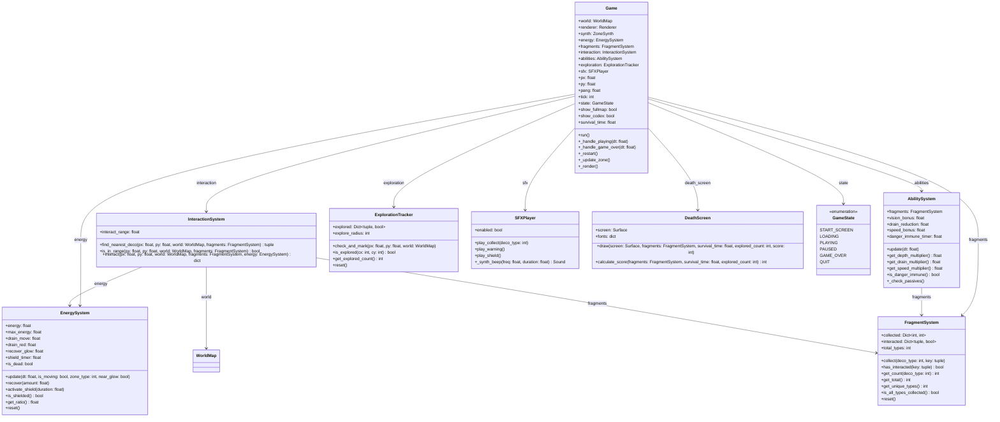
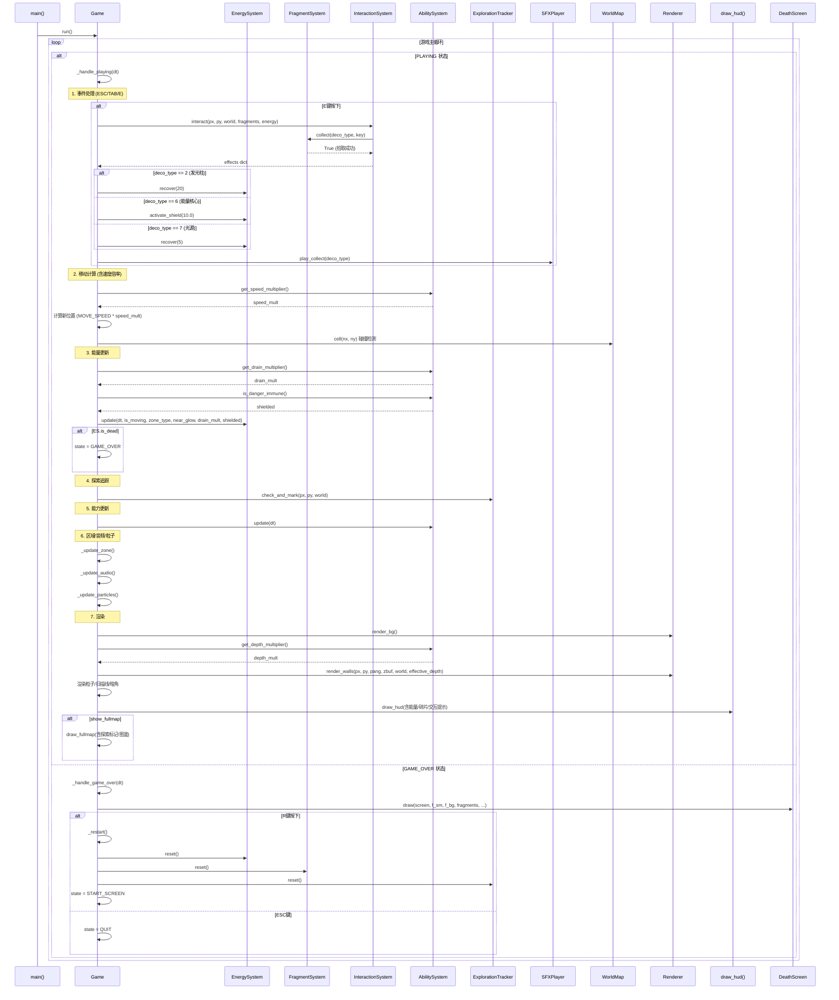
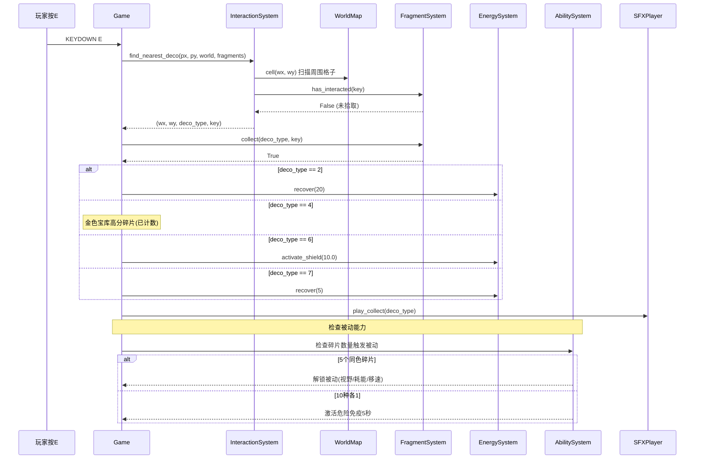
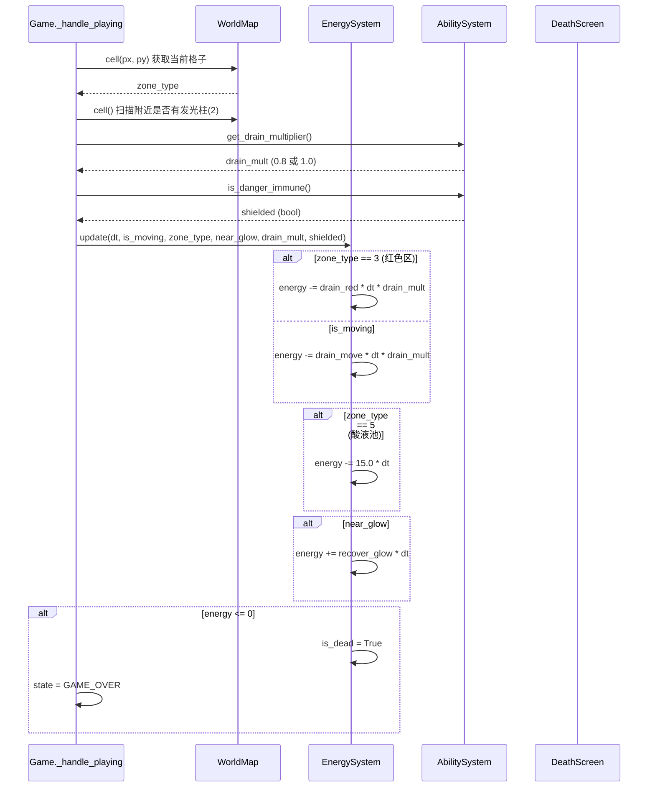

# KID-A WALKER 增强系统架构设计

> 架构师：高见远（Gao） | 基于 PRD v1.0 | 单文件扩展方案

---

## 1. 实现方案

### 1.1 核心技术挑战

| 挑战 | 分析 | 解决策略 |
|------|------|----------|
| 能量系统与移动耦合 | 移动消耗能量，不同区域消耗倍率不同，需要精确的帧率无关计算 | 使用 `dt`（帧间隔秒数）而非帧计数驱动消耗，乘以区域倍率 |
| 碎片系统与区块清理冲突 | WorldMap 会清理远处区块并重新生成，但碎片收集记录必须持久化 | 碎片记录字典挂在 Game 上而非 WorldMap，key 用 `(cx,cy,lx,ly)` 四元组，与区块数据解耦 |
| 暗室视野缩短 | 需要动态修改 MAX_DEPTH 影响射线投射，但不能破坏渲染器内部逻辑 | 引入 `effective_max_depth` 作为渲染参数传入，不修改全局常量 |
| 能力增强修改常量 | 被动能力需要修改 MOVE_SPEED / MAX_DEPTH 等值，但全局常量不应被直接修改 | 通过 `AbilitySystem.get_speed_multiplier()` / `get_depth_multiplier()` 方法在 Game 运行时计算生效值 |
| 结算画面新增状态 | 需要新增 GAME_OVER 状态，并处理 R 键重启逻辑 | 扩展 GameState 枚举，新增 `_handle_game_over` 方法 |
| 交互检测与射线不同步 | 玩家按 E 时的装饰物检测使用格子扫描，不依赖射线投射 | 独立的近距离格子扫描（3×3 范围），找到最近的装饰物 |

### 1.2 框架选型

- **渲染**：pygame-ce（已在使用）— 无需更换
- **数学运算**：numpy（已在使用）— 无需更换
- **数据结构**：Python dataclass + dict — 与现有风格一致
- **音频**：pygame.mixer + 自定义 ZoneSynth（已在使用）— 新增 SFX 合成
- **持久化**：本地 JSON（仅 P2-4 最高分记录）— 标准 `json` 模块

### 1.3 架构模式

沿用现有架构模式：**单文件 + 组合式类设计**

```
Game (主控制器)
 ├── WorldMap (地图管理，已有)
 ├── Renderer (渲染器，已有)
 ├── ZoneSynth (音频合成，已有)
 ├── EnergySystem (能量系统，新增)
 ├── FragmentSystem (碎片系统，新增)
 ├── InteractionSystem (交互系统，新增)
 ├── AbilitySystem (能力系统，新增)
 └── ExplorationTracker (探索追踪，新增)
```

各系统类通过 Game 实例组合，不使用继承。系统间通信通过 Game 中转（如 InteractionSystem 通知 FragmentSystem 拾取碎片，通知 EnergySystem 恢复能量）。

---

## 2. 文件列表

项目保持单文件结构：`kid_a_walker.py`

### 新增代码插入位置

| 插入位置（行号范围参考） | 内容 | 说明 |
|--------------------------|------|------|
| 常量区域之后 (L39) | `ENERGY_MAX=100`, `ENERGY_DRAIN_MOVE=1`, `ENERGY_DRAIN_RED=3`, `ENERGY_RECOVER_GLOW=0.5`, `INTERACT_RANGE=2.0`, `FRAGMENT_TYPES=10`, `EXPLORE_RADIUS=10` | 新增常量 |
| GameState 枚举 (L46) | 添加 `GAME_OVER = "game_over"` | 新增游戏状态 |
| WorldMap 类之后 (~L937) | `EnergySystem`, `FragmentSystem`, `InteractionSystem`, `AbilitySystem`, `ExplorationTracker` 5个新类 | 核心系统类 |
| ZoneSynth 类之后 (~L1115) | `SFXPlayer` 类 | 音效合成（P2-2） |
| draw_hud 函数 (~L1341) | 重写/扩展 | 能量条、碎片计数、危险提示、交互提示 |
| draw_fullmap 函数 (~L1377) | 扩展 | 探索标记、图鉴页切换 |
| LoadingScreen 类之后 (~L1720) | `DeathScreen` 类 | 结算画面 |
| Game 类内部 (~L1724) | 扩展 `__init__`、`_handle_playing`、`_render`，新增 `_handle_game_over`、`_restart` | 集成所有系统 |
| Game 类 `_render` 末尾 | 新增交互提示渲染 | HUD 扩展 |

---

## 3. 数据结构与接口

### 3.1 类图



### 3.2 核心类详细设计

#### EnergySystem

```python
@dataclass
class EnergySystem:
    """玩家能量管理"""
    energy: float = 100.0
    max_energy: float = 100.0
    drain_move: float = 1.0       # 点/秒，移动时消耗
    drain_red: float = 3.0        # 点/秒，红色区消耗
    recover_glow: float = 0.5     # 点/秒，发光柱附近恢复
    shield_timer: float = 0.0     # 护盾剩余时间（秒）
    is_dead: bool = False

    def update(self, dt: float, is_moving: bool, zone_type: int,
               near_glow: bool, drain_mult: float = 1.0, shielded: bool = False):
        """每帧更新能量值
        dt: 帧间隔（秒）
        is_moving: 玩家是否在移动
        zone_type: 当前脚下格子类型（3=红色区）
        near_glow: 是否在发光柱(2)附近
        drain_mult: AbilitySystem 提供的消耗倍率
        shielded: 是否处于危险免疫状态
        """
        # 护盾倒计时
        if self.shield_timer > 0:
            self.shield_timer -= dt

        if shielded:
            return  # 免疫期不消耗

        # 消耗计算
        if is_moving:
            drain = self.drain_move * dt * drain_mult
            if zone_type == 3:  # 红色区
                drain = self.drain_red * dt * drain_mult
            self.energy -= drain

        # 酸液池接触（格子5 + 在绿色区域）
        if zone_type == 5:
            self.energy -= 15.0 * dt  # 骤降

        # 发光柱恢复
        if near_glow and self.energy < self.max_energy:
            self.energy += self.recover_glow * dt

        # 夹紧
        self.energy = max(0.0, min(self.max_energy, self.energy))
        if self.energy <= 0:
            self.is_dead = True

    def recover(self, amount: float):
        self.energy = min(self.max_energy, self.energy + amount)

    def activate_shield(self, duration: float):
        self.shield_timer = duration

    def is_shielded(self) -> bool:
        return self.shield_timer > 0

    def get_ratio(self) -> float:
        return self.energy / self.max_energy

    def reset(self):
        self.energy = self.max_energy
        self.shield_timer = 0.0
        self.is_dead = False
```

#### FragmentSystem

```python
@dataclass
class FragmentSystem:
    """碎片收集系统"""
    collected: dict = field(default_factory=dict)      # {deco_type: count}
    interacted: dict = field(default_factory=dict)      # {(cx,cy,lx,ly): True}
    total_types: int = 10  # 10种碎片（类型2-11）

    def collect(self, deco_type: int, key: tuple):
        """拾取碎片并标记已互动"""
        if key in self.interacted:
            return False  # 已拾取过
        self.interacted[key] = True
        self.collected[deco_type] = self.collected.get(deco_type, 0) + 1
        return True

    def has_interacted(self, key: tuple) -> bool:
        return key in self.interacted

    def get_count(self, deco_type: int) -> int:
        return self.collected.get(deco_type, 0)

    def get_total(self) -> int:
        return sum(self.collected.values())

    def get_unique_types(self) -> int:
        return len(self.collected)

    def is_all_types_collected(self) -> bool:
        return self.get_unique_types() >= self.total_types

    def reset(self):
        self.collected.clear()
        self.interacted.clear()
```

#### InteractionSystem

```python
class InteractionSystem:
    """E键交互系统"""
    def __init__(self, interact_range: float = 2.0):
        self.interact_range = interact_range

    def find_nearest_deco(self, px, py, world, fragments) -> Optional[tuple]:
        """扫描玩家周围，找到最近的未互动装饰物
        返回 (wx, wy, deco_type, interact_key) 或 None
        """
        scan_r = int(self.interact_range) + 1
        best_dist = self.interact_range
        best = None
        for dy in range(-scan_r, scan_r + 1):
            for dx in range(-scan_r, scan_r + 1):
                wx = int(px) + dx
                wy = int(py) + dy
                ct = world.cell(wx + 0.5, wy + 0.5)
                if ct < 2:
                    continue
                cx, cy = world.world_to_chunk(wx, wy)
                lx = wx % CHUNK_SIZE
                ly = wy % CHUNK_SIZE
                key = (cx, cy, lx, ly)
                if fragments.has_interacted(key):
                    continue
                dist = math.sqrt((wx + 0.5 - px)**2 + (wy + 0.5 - py)**2)
                if dist < best_dist:
                    best_dist = dist
                    best = (wx, wy, ct, key)
        return best

    def is_in_range(self, px, py, world, fragments) -> bool:
        return self.find_nearest_deco(px, py, world, fragments) is not None

    def interact(self, px, py, world, fragments, energy) -> Optional[dict]:
        """执行交互，返回交互结果"""
        result = self.find_nearest_deco(px, py, world, fragments)
        if result is None:
            return None
        wx, wy, deco_type, key = result
        # 拾取碎片
        fragments.collect(deco_type, key)
        # 根据类型执行特殊效果
        effects = {"type": deco_type}
        if deco_type == 2:   # 青绿发光柱 → 恢复20能量
            energy.recover(20)
            effects["energy_recover"] = 20
        elif deco_type == 4: # 金色宝库 → 高分碎片（已在collect中计数）
            effects["bonus_score"] = True
        elif deco_type == 6: # 紫色能量核心 → 临时护盾10秒
            energy.activate_shield(10.0)
            effects["shield"] = 10.0
        elif deco_type == 7: # 橙色光源 → 恢复少量+标记
            energy.recover(5)
            effects["energy_recover"] = 5
            effects["marker"] = (wx, wy)
        return effects
```

#### AbilitySystem

```python
class AbilitySystem:
    """能力增强系统"""
    def __init__(self, fragments: FragmentSystem):
        self.fragments = fragments
        self.danger_immune_timer = 0.0
        self._last_check = {}  # 缓存上次检查结果

    def update(self, dt: float):
        if self.danger_immune_timer > 0:
            self.danger_immune_timer -= dt
        self._check_passives()

    def _check_passives(self):
        """检查是否解锁被动能力（5个同色碎片）"""
        # 每帧检查太频繁，可以在拾取时才检查
        pass

    def get_depth_multiplier(self) -> float:
        """视野增强：5个同色碎片 → +15%"""
        for deco_type in range(2, 12):
            if self.fragments.get_count(deco_type) >= 5:
                return 1.15
        return 1.0

    def get_drain_multiplier(self) -> float:
        """耗能降低：5个同色碎片 → -20%"""
        for deco_type in range(2, 12):
            if self.fragments.get_count(deco_type) >= 5:
                return 0.8
        return 1.0

    def get_speed_multiplier(self) -> float:
        """移速增加：5个同色碎片 → +15%"""
        for deco_type in range(2, 12):
            if self.fragments.get_count(deco_type) >= 5:
                return 1.15
        return 1.0

    def is_danger_immune(self) -> bool:
        """10种各1 → 危险免疫5秒"""
        if self.fragments.is_all_types_collected():
            self.danger_immune_timer = 5.0
            return True
        return self.danger_immune_timer > 0

    def has_vision_bonus(self) -> bool:
        return self.get_depth_multiplier() > 1.0

    def has_drain_reduction(self) -> bool:
        return self.get_drain_multiplier() < 1.0

    def has_speed_bonus(self) -> bool:
        return self.get_speed_multiplier() > 1.0
```

#### ExplorationTracker

```python
class ExplorationTracker:
    """区块探索追踪"""
    def __init__(self, explore_radius: int = 10):
        self.explored: dict[tuple, bool] = {}
        self.explore_radius = explore_radius

    def check_and_mark(self, px, py, world):
        """检查玩家是否在区块中心附近，标记已探索"""
        cx, cy = world.world_to_chunk(px, py)
        # 计算区块中心的世界坐标
        center_wx = cx * CHUNK_SIZE + CHUNK_SIZE // 2
        center_wy = cy * CHUNK_SIZE + CHUNK_SIZE // 2
        dist = math.sqrt((px - center_wx)**2 + (py - center_wy)**2)
        if dist <= self.explore_radius:
            self.explored[(cx, cy)] = True

    def is_explored(self, cx, cy) -> bool:
        return (cx, cy) in self.explored

    def get_explored_count(self) -> int:
        return len(self.explored)

    def reset(self):
        self.explored.clear()
```

#### SFXPlayer

```python
class SFXPlayer:
    """简易音效播放器"""
    def __init__(self, enabled: bool = True):
        self.enabled = enabled

    def play_collect(self, deco_type: int):
        """拾取音效：根据碎片类型变化音高"""
        if not self.enabled: return
        freq = 400 + deco_type * 50
        snd = self._synth_beep(freq, 0.08)
        snd.play()

    def play_warning(self):
        """危险预警蜂鸣"""
        if not self.enabled: return
        snd = self._synth_beep(200, 0.15)
        snd.play()

    def play_shield(self):
        """护盾激活音效"""
        if not self.enabled: return
        snd = self._synth_beep(800, 0.2)
        snd.play()

    def _synth_beep(self, freq, duration) -> pygame.mixer.Sound:
        """合成短促蜂鸣音"""
        n_samples = int(SR * duration)
        t = np.linspace(0, duration, n_samples, dtype=np.float32)
        wave = np.sin(2 * np.pi * freq * t).astype(np.float32)
        # 简单包络
        env = np.ones(n_samples, dtype=np.float32)
        fade = min(n_samples // 4, 200)
        env[:fade] = np.linspace(0, 1, fade)
        env[-fade:] = np.linspace(1, 0, fade)
        pcm = (wave * env * 0.3).astype(np.float32)
        i16 = np.clip(pcm * 32767, -32768, 32767).astype(np.int16)
        stereo = np.ascontiguousarray(np.column_stack([i16, i16]))
        return pygame.sndarray.make_sound(stereo)
```

#### DeathScreen

```python
class DeathScreen:
    """结算画面"""

    @staticmethod
    def calculate_score(fragments, survival_time, explored_count) -> int:
        score = 0
        score += fragments.get_total() * 100
        score += explored_count * 50
        score += int(survival_time) * 2
        if fragments.is_all_types_collected():
            score += 500
        return score

    @staticmethod
    def draw(screen, f_sm, f_bg, fragments, survival_time, explored_count, tick):
        """绘制结算画面"""
        score = DeathScreen.calculate_score(fragments, survival_time, explored_count)
        W, H = screen.get_size()

        # 半透明遮罩
        overlay = pygame.Surface((W, H), pygame.SRCALPHA)
        overlay.fill((0, 0, 0, 200))
        screen.blit(overlay, (0, 0))

        # 标题
        title = f_bg.render("SYSTEM OFFLINE", True, (220, 60, 60))
        screen.blit(title, (W//2 - title.get_width()//2, H//4))

        # 统计
        y = H//4 + 80
        stats = [
            f"DATA FRAGMENTS: {fragments.get_total()} ({fragments.get_unique_types()}/10 TYPES)",
            f"SURVIVAL TIME: {int(survival_time)//60:02d}:{int(survival_time)%60:02d}",
            f"SECTORS EXPLORED: {explored_count}",
            f"FINAL SCORE: {score}",
        ]
        for s in stats:
            lbl = f_sm.render(s, True, (200, 220, 255))
            screen.blit(lbl, (W//2 - lbl.get_width()//2, y))
            y += 30

        # 重启提示
        pulse = abs(math.sin(tick * 0.05))
        col = (int(150 + 105 * pulse), 255, int(200 + 55 * pulse))
        hint = f_sm.render("[R] RESTART  |  [ESC] QUIT", True, col)
        screen.blit(hint, (W//2 - hint.get_width()//2, H * 3//4))
```

---

## 4. 程序调用流程

### 4.1 主游戏循环时序图



### 4.2 交互拾取流程



### 4.3 能量消耗流程



---

## 5. 待明确事项

| # | 问题 | 当前假设 |
|---|------|----------|
| 1 | 被动能力"5个同色碎片"是指同一装饰物类型收集5个，还是任意5个？ | **同一deco_type收集5个** |
| 2 | 被动能力是否可叠加？（如同时有3种类型各5个） | **不叠加，取最优效果** |
| 3 | 暗室类型房间如何判定？ | **通过房间模板函数名包含"dark"或新增暗室标记字段** |
| 4 | 10种各1的全收集奖励危险免疫5秒，是自动触发还是手动？ | **自动触发，拾取第10种时立即激活** |
| 5 | 全收集免疫是一次性的还是可重复？ | **可重复：全收集状态持续期间每次进入危险区都免疫** |
| 6 | 金色宝库(4)的高分碎片在评分中如何体现？ | **collect时正常计数，评分公式中碎片×100已包含** |
| 7 | 橙色光源(7)的"标记"功能具体是什么？ | **在大地图上标记位置点，暂作为P1实现细节** |
| 8 | 能量条渐变色具体数值？ | **青绿(0,255,200)→黄色(255,255,0)→红色(255,50,50)，按ratio插值** |
| 9 | 暗室判定：是否需要新增格子类型或房间标记？ | **建议在WorldMap中新增 `is_dark_room(cx,cy)` 方法，根据模板函数名判断** |
| 10 | P2-5 稀有事件"发光门"是否需要新格子类型？ | **需要，建议用格子值 'C'(12) 表示传送门** |

---

## 6. 依赖包

```
# 现有依赖（无需新增）
- pygame-ce: 游戏框架（渲染/输入/音频）
- numpy: 数学运算（射线/音频合成）
- math: 标准库数学
- threading: 标准库多线程
- random: 标准库随机
- time: 标准库时间
- enum: 标准库枚举
- dataclasses: 标准库数据类
- typing: 标准库类型提示

# P2-4 新增依赖
- json: 标准库，本地最高分持久化

# 总结：无需安装任何第三方包
```

---

## 7. 任务列表

### T01: 项目基础设施 + 常量 + 枚举扩展

**源文件**: `kid_a_walker.py`（修改）
**修改位置**: L1-L46 区域
**依赖**: 无
**优先级**: P0

**内容**:
- 新增常量：`ENERGY_MAX`, `ENERGY_DRAIN_MOVE`, `ENERGY_DRAIN_RED`, `ENERGY_RECOVER_GLOW`, `INTERACT_RANGE`, `FRAGMENT_TYPES`, `EXPLORE_RADIUS`, `ACID_DRAIN_RATE`
- 扩展 `GameState` 枚举：添加 `GAME_OVER = "game_over"`
- 新增暗室房间模板标记：在房间模板函数中增加暗室标识（或新增 `DARK_ROOMS` 集合）
- 新增 `WorldMap.is_dark_room(cx, cy)` 方法

### T02: 核心系统类（能量 + 碎片 + 交互 + 能力 + 探索）

**源文件**: `kid_a_walker.py`（修改）
**修改位置**: L937 之后（WorldMap 类之后）
**依赖**: T01
**优先级**: P0

**内容**:
- 实现 `EnergySystem` 类（dataclass，能量管理、消耗、恢复、护盾、死亡判定）
- 实现 `FragmentSystem` 类（dataclass，碎片收集、互动记录、计数查询）
- 实现 `InteractionSystem` 类（E键交互、近距离扫描、效果分发）
- 实现 `AbilitySystem` 类（被动能力判定、倍率计算、危险免疫）
- 实现 `ExplorationTracker` 类（区块探索记录、中心范围检测）

### T03: Game 类集成 + HUD + 渲染扩展

**源文件**: `kid_a_walker.py`（修改）
**修改位置**: L1341（draw_hud）、L1724（Game 类）、L1377（draw_fullmap）
**依赖**: T02
**优先级**: P0

**内容**:
- 重写/扩展 `draw_hud()` 函数：能量条（渐变青绿→红）、碎片计数（右上角）、区域危险提示（中央偏下）、交互提示"[E] INTERACT"
- 扩展 `draw_fullmap()` 函数：已探索区块绿色边框、图鉴页切换（Q键）
- 扩展 `Game.__init__()`：初始化所有新系统实例、新增 `survival_time` / `show_codex` 属性
- 修改 `Game._handle_playing()`：集成能量更新、E键交互、探索追踪、能力检查、暗室视野缩短
- 修改 `Game._render()`：传入 effective_max_depth、渲染交互提示
- 修改 `Renderer.render_walls()`：接受 `effective_max_depth` 参数
- 新增 `Game._handle_game_over()` 方法：结算画面显示、R键重启、ESC退出
- 新增 `Game._restart()` 方法：重置所有系统、返回开始界面

### T04: 结算画面 + SFX + 预警 + 图鉴

**源文件**: `kid_a_walker.py`（修改）
**修改位置**: L1115 之后（SFXPlayer）、L1720 之后（DeathScreen）、Game 类
**依赖**: T03
**优先级**: P1

**内容**:
- 实现 `DeathScreen` 类：结算画面渲染、评分计算公式、统计展示
- 实现 `SFXPlayer` 类：拾取音效、危险预警蜂鸣、护盾音效
- 集成 HUD 危险预警：靠近红色区时 HUD 闪烁效果（P2-1）
- 实现碎片图鉴页：Tab大地图中按Q切换，10种碎片收集进度展示（P1-1）
- 集成 SFX 到 Game._handle_playing() 中

### T05: P2 锦上添花 + 最终调试

**源文件**: `kid_a_walker.py`（修改）
**修改位置**: 分散在各处
**依赖**: T04
**优先级**: P2

**内容**:
- P2-3 漂浮拾取物：装饰物周围可见3D精灵（在粒子系统中新增浮动粒子效果）
- P2-4 最高分记录：本地 JSON 读写，在结算画面显示历史最高
- P2-5 稀有事件：低概率发光门（新增格子类型 'C'=12），传送远距离
- 全面测试与调试：能量平衡、碎片收集完整性、暗室视野、评分计算

---

## 8. 共享知识

### 跨模块约定

```
- 坐标系统：世界坐标为浮点数，区块坐标为整数。world_to_chunk(wx, wy) → (cx, cy)
- 格子类型映射：0=空地, 1=墙壁, 2=发光柱, 3=红色警示, 4=金色宝库, 5=绿色植被, 6=紫色能量, 7=橙色光源, 8=灰色碎石, 9=科技装饰, 10(A)=蓝色水晶, 11(B)=紫水晶
- 互动记录键格式：(chunk_x, chunk_y, local_x, local_y) 四元组 tuple
- 碎片类型范围：deco_type 2~11，共10种，与格子类型一一对应
- 帧率：60fps，所有时间相关计算使用 dt（秒）而非帧数
- 能量范围：0.0 ~ 100.0，归零即死亡
- 被动能力生效值通过 AbilitySystem.get_xxx_multiplier() 方法获取，不修改全局常量
- 渲染器 effective_max_depth = MAX_DEPTH * depth_multiplier * (0.6 if is_dark_room else 1.0)
- 评分公式：碎片总数×100 + 探索区块数×50 + 存活秒数×2 + 全类型奖励×500
- 音频：SFX 使用 pygame.sndarray.make_sound 合成，BGM 使用 ZoneSynth
- 新增的 SFXPlayer 不干扰现有 ZoneSynth 的 BGM 播放
- 区块清理（_cleanup_distant_chunks）不影响碎片互动记录（interacted 字典在 Game 上）
- 探索记录（explored 字典）也不随区块清理而丢失
- 暗室判定：WorldMap.is_dark_room(cx, cy) 基于模板函数名或房间标记
- 护盾状态：shield_timer > 0 时 is_shielded() 返回 True，此时能量不消耗
- 酸液池(5)接触判定：玩家当前站在格子类型5上时触发能量骤降
```

---

## 9. 任务依赖图


---

## 附录：关键修改点速查表

| 修改目标 | 原代码位置 | 修改类型 | 说明 |
|----------|-----------|----------|------|
| 常量区 | L22-L39 | 扩展 | 新增能量/交互/探索相关常量 |
| GameState | L41-L46 | 扩展 | 添加 GAME_OVER |
| WorldMap | ~L768-L937 | 扩展 | 添加 is_dark_room() 方法 |
| 新类插入 | L937之后 | 新增 | 5个系统类 |
| SFXPlayer | L1115之后 | 新增 | 音效播放器 |
| draw_hud | ~L1341 | 重写 | 能量条/碎片/提示 |
| draw_fullmap | ~L1377 | 扩展 | 探索标记/图鉴页 |
| DeathScreen | ~L1720之后 | 新增 | 结算画面类 |
| Game.__init__ | ~L1727 | 扩展 | 新增系统实例 |
| Game._handle_playing | ~L1905 | 扩展 | 集成所有新系统逻辑 |
| Game._render | ~L2035 | 扩展 | effective_depth/交互提示 |
| Game 新方法 | Game类内 | 新增 | _handle_game_over, _restart |
| Renderer.render_walls | ~L1252 | 扩展 | 接受 effective_max_depth |
