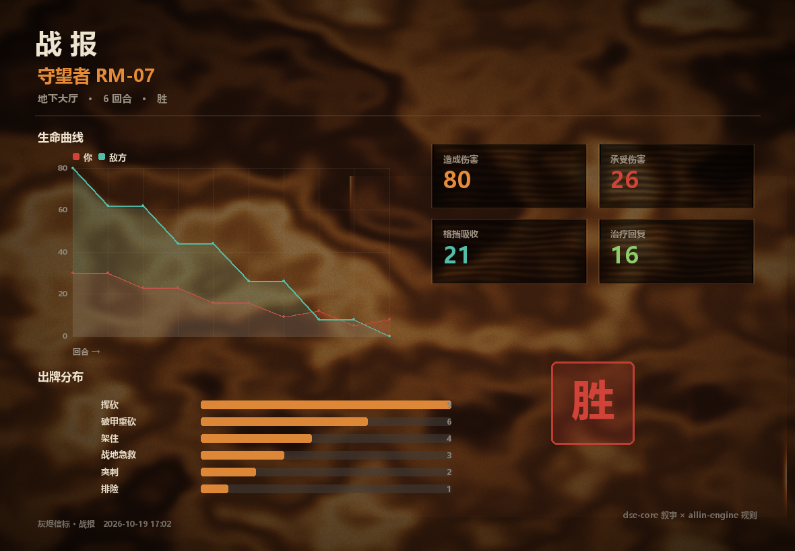
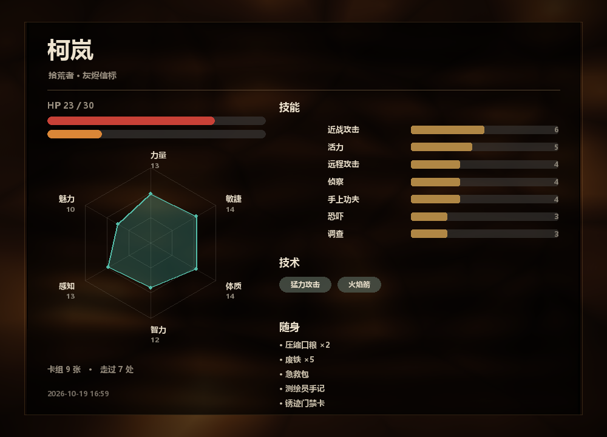

# 灰烬信标 · Ashen Beacon

一款终端文字冒险游戏。叙事层用 **dse-core**，规则层用 **allin-engine**，
两者通过一个桥接插件连通。

大崩塌之后的废土。有人说地平线尽头那座塔还在响。
你带着一张残缺的地图和两卷绷带往北走。

## 跑起来

```bash
pip install -r requirements.txt     # 版本已锁死：引擎换版本会改行为与存档结构
cd game
python play.py                  # 开始玩
python play.py --check           # 只做内容体检（悬空跳转 / 结局可达）
python play.py --script "1,1"    # 非交互跑一串输入
python play.py --entry library-hill    # 从任意场景开始（调试用）
python play.py --no-viz          # 关掉战报/角色卡出图（每张要 3~8 秒）
python -m viz.demo               # 不跑游戏，直接出两张示例图
```

出图（`numpy` + `Pillow`）是**可选**的：`requirements.txt` 里单独列在「可选」段，
不装游戏本体照样能通篇玩完，只是不会有战报和角色卡。装了想临时关掉用 `--no-viz`
或环境变量 `DSE_NO_VIZ=1`。

> **存档玩坏了怎么办**：存档是 `game/saves/save_0X.json`，纯 JSON、人可读可手改。
> 读档时如果碰上认不出的物品或技术，会跳过并提示，不会把游戏打崩；整份读不出来
> 也只提示「存档损坏」。真要重开，直接删掉整个 `game/saves/` 就行，不影响游戏本体
> —— `game/out/` 里的出图同理，随时可以整个删。

## 玩法

游戏里的每一种操作都来自两个引擎中某一个：

| 输入 | 来源 |
|---|---|
| `数字` 选选项 | dse-core 的场景图 |
| `stats` 角色卡 | allin-engine 的 TRPG 内核 |
| `inv` / `use medkit` | allin-engine 的 Inventory |
| `check 侦察 11` 掷骰 | allin-engine 的 d20 判定 |
| `answer 4173` 解谜 | allin-engine 的 PuzzleSystem |
| 卡牌战斗（出牌 / `e` / `f`） | allin-engine 的 CombatEngine |
| `save` / `load` / `slots` | allin-engine 的 SaveLoadManager 存盘 + dse 的 state 快照 |
| `rollback [n]` 回退 | dse-core 的历史快照 |
| `recipes` / `craft <配方>` 合成 | bridge 自实现的配方系统（辐射式拆解合成） |
| `ask <话题>` / `topics` / `end` | dse 内置 **dialogue** 插件（话题预算机制） |
| `buy` / `sell` / `next` / `info` | dse 内置 **trade** 插件（三日集经营循环） |

## 双引擎怎么分工

```
        ┌──────────────────────── dse-core ────────────────────────┐
        │  场景图(YAML) · 条件文本 · 选项/once/隧道 · 结局 · 成就  │
        └───────────────┬──────────────────────┬───────────────────┘
                        │ scene/mode 接管       │ emit / command 拦截
                   ┌────▼──────────────────────▼─────┐
                   │      bridge.py  (AllinBridge)    │  ← 唯一的双向通道
                   └────┬──────────────────────┬─────┘
        ┌───────────────▼──────────────────────▼───────────────────┐
        │              allin-engine                                │
        │  TRPG Character · CardCombat · Inventory · PuzzleSystem  │
        │  SaveLoadManager · ECS World · EventBus                  │
        └──────────────────────────────────────────────────────────┘
```

- **dse-core** 负责"故事在哪一幕"：YAML 里的场景、分支、`@restart`、`{call:}` 隧道。
- **allin-engine** 负责"这一手能不能成"：血量、技能等级、战斗、背包、谜题。
- **bridge.py** 是唯一知道两边存在的代码。

## 内容结构（69 场景 / 5 种结局 + 1 失败态 / 2 内容包）

> 口径说明：`play.py --check` 会报「结局数 7」，是因为 dse 的 `is_ending()` 判定为
> 「无选项 **或** 全部选项 goto 以 `@` 开头」——它把隧道返回 `@return`（继续游戏）
> 和重开局 `@restart` 一并当成了结局。真实构成是 **5 个叙事结局 + 1 个战败态
> `down`**，另有 `camp-rumor` 这个 `{call:}` 隧道片段被误判。`--check` 的数字
> 依然能正常检出悬空跳转与不可达场景，不用改。

按「Hub + 瓶颈 + 结局光谱」组织（分支叙事的标准做法）：

```
                    ┌────────── 北方公路（hub，cycle 变体文本）──────────┐
                    │  哨站        工地        山上图书馆    营地        │
                    │   │二层电台室  │地下室      │地下书库    │对话/集市/两难 │
                    │   │地堡→守望者  │尘埃行尸     │镜片/收音机  │丢药的丫头   │
                    │  水塔（鼠群）  中继站（无人机+配电盘谜题）  凹槽（遭遇战） │
                    └───────────────┬──────────────────────────────────┘
                            核心室 · 五种结局光谱
                            广播 / 带走 / 转身 / 交给别人 / 接班
```

- **结局是光谱不是排序**：五种活法，没有谁最好 —— 广播（利他）、带走（利己）、
  转身（悬置）、交给别人（信任）、接班（守候）。
- **延迟后果**：公路下放过掠夺者 → 塔下他带着枪回来堵你；
  营地丢药的三选一 → 结局文本各自回响；抽水站铜线 → 营地后来空了。
- **累积变量**（不是一堆布尔）：`allin.signal`（信号强度）= 天线/电池/镜片/铜线攒出来的，
  决定广播能传多远；市场 `gold` / `tradeProfit` 决定集市的盈亏结算。
- **`cred` 声望**：营地对话里会攒（确实写进存档），但**目前还没有消费点** ——
  它不参与条件判定、不影响结局、也没有成就读它。这一条是留给后续版本的钩子，
  当下可以理解成"你在他们眼里的分量"，只是暂时没有结算。
- **环境碎片**（`variants`/`variantMode`）：同一处地方每次来文本不一样，
  hub 用 cycle 轮转、外圈用 shuffle 抽取。
- **物品自带故事**：每件新物品的描述里藏着一段能还原出来的事
  （「狗牌，两片，一片是别人的。绳子是被扯断的，不是解开的」）。

### 数据怎么从 allin 流到 dse

dse 的条件表达式命名空间**只有 `state` 的顶层键**，没有任何注册外部函数的钩子。
所以桥的做法是：`pull()` 把 allin 的派生值整体刷进 `state["allin"]`——

```yaml
# YAML 里可以直接写：
text: '你还剩 {allin.hp} 点力气。'
choices:
  - text: 买绷带（3 废铁）
    if: 'allin.item.scrap >= 3'      # ← 读的就是 pull() 写进去的值
```

`pull()` 会把**所有可能出现的数据键都补上缺省值**（物品 0、技术 False、谜题 False），
否则条件表达式引用未定义名字时每次求值都会告警刷屏。

### dse → allin 走事件

内容是纯数据，不能直接调 Python。所以统一用 `emit` + 命名约定：

```yaml
onEnter: { emit: 'allin/check:侦察:11' }        # 技能判定
do:      { emit: 'allin/gain:medkit' }          # 拿东西
do:      { emit: 'allin/pay:scrap:3' }          # 花东西（不能全扣光）
do:      { emit: 'allin/learn:火焰箭' }         # 学技术
do:      { emit: 'allin/train:活力' }           # 技能升级
```

## 踩过的坑（都修在代码里了，注释上有标注）

1. **`scene/mode` 在渲染之前触发。** 战斗不能在这里同步跑完，否则玩家先看完整场战斗才看到场景文本。
   做法是这里只返回 `True` 标记接管，真正的 `begin_battle()` 挂在 `scene/rendered` 上。

2. **dse 的 effect 语义是「数值 + 原值 = 累加」。** 一度把 DC 写成 `'allin.dc': 13`，
   结果第一次 13、第二次叠成 23、第三次 35。现在把技能和 DC 直接编码进事件名（`allin/check:手上功夫:12`）。

3. **条件表达式不认连字符。** `visits.road-north` 会被解析成 `road - north` 减法。
   要计数就自己写计数器（本作用 `roadTrips`）。

4. **`Inventory` 的 `max_stack` 默认 1。** 货币类物品（废铁）锁成 1 的话，
   `inv.add()` 直接报「背包已满」，整个交易系统失效。

5. **`@restart` 只重置 dse 的 state。** allin 的角色不会跟着回血，
   不挂 `allin/rebirth` 钩子的话，重开时会带着 0 HP 必死。

6. **allin 卡牌战斗里敌人的 `armor` 不生效**——`CombatState.play_card` 直接减 `hp`，
   绕过 `EnemyInstance.take_damage()`。所以配表里 armor 全部设 0，免得界面和实算对不上。

7. **中文宽字符会把 ASCII 画的边框挤歪。** 用 `unicodedata.east_asian_width` 按显示列数补齐。

8. **技能名必须命中 allin 的 `SKILL_LIBRARY`。** 写"巧手/威吓/修理"会返回「未知技能」，
   真名是「手上功夫/恐吓/调查」。

9. **成就/条件里引用的每个 state 键都要在 `state.initial` 里预置。**
   给集市加了个「收市没赔」成就（`tradeProfit > 0`），没进过集市时每次渲染都刷
   「条件求值失败」告警 —— 和 `pull()` 补缺省值是同一类问题。

10. **选项会随条件/once 消失，编号跟着移位。** 脚本自测别背编号，优先 `--entry` 直达
    或写宽松的 `1` 序列。

11. **集市赊账要记账。** 进市折钱时给了 30 底钱，不加 `marketCredited` 标记的话，
    反复进出集市就能无限刷钱。

12. **`allin/check:<技能>:<DC>` 漏写 DC 会静默按 10 判定。** 这条和 `allin/lose:` 是
    同一类"不报错的错"：`lose` 曾用 `split(":", 1)`，把 `wire:2` 整个当成物品名，
    物品表里查不到就直接 `return` —— **静默不扣东西**，玩家白拿奖励。现在两条都走
    三段解析；玩家侧的 `check <技能>`（少写 DC）也会明确提示用法，不再静默 no-op。

13. **跨引擎状态只在战斗结束时同步一次。** 战斗中 `char.current_hp` 一直停在战前值，
    所以 `stats` / `save` 读到的都是上一场结束时的血（看着像凭空回满）。现在
    `_on_command` 开头统一把战斗态的 HP 实时写回角色。以后再加"读角色状态"的功能，
    记得也走这条路，别直接读 `char.current_hp`。

14. **`rollback` 必须清战斗态。** 引擎的 `rollback()` 全程不 emit，没有事件钩子可挂，
    只能在 `_on_command` 里拦。漏了这一步会留下「幽灵战斗」：dse 回到上一场景并照常
    列出选项，旧战斗却还活着，把玩家的选择输入劫持成出牌，两个选项都点不动。

15. **逃跑要保留当时的血量。** 战斗结束/逃跑都要用 `_sync_hp_back(st.player_hp)`，
    不能传字面量 0 —— 内容层没有死亡判定，0 HP 的玩家照样能在世界上走，
    下一场战斗会以 1 HP 开场，等于必死。

## 难度实测

`python tools/sim.py` —— 贪心 AI 每个敌人打 300 场（玩家 30 HP / 8 张初始卡组）。
数值是模拟跑出来的，不是拍的；调了敌人数值后记得重跑一遍。

| 对手 | 满血胜率 | 15 HP 胜率 | 平均回合 | 定位 |
|---|---|---|---|---|
| 瘸腿变异犬 | 100% | 100% | 2.0 | 新手战 |
| 蚀骨鼠群 | 100% | 100% | 2.0 | 数量恶心的骚扰战 |
| 掠夺者·拾荒客 | 100% | 100% | 3.0 | 掉约 8 HP |
| 巡检无人机 | 100% | 100% | 3.0 | 掉约 8 HP |
| 尘埃行尸 | 100% | 100% | 3.5 | 慢，但追人 |
| 掠夺者·老兵 | 91% | **50%** | 5.8 | 守着电台室，残血上去就是赌命 |
| 守望者 RM-07 | 93% | 82% | 7.6 | Boss：长局，要留牌 |

## 测试

```bash
python tools/test_interactive.py   # 23 项：交互模式边界（EOF / 坏编码 / Ctrl+C / 战斗中途断流）
python tools/test_keyboard.py      # 真实按键投递（Windows；环境不满足返回 2，不算失败）
python tools/sim.py                # 战斗平衡
python play.py --check             # 内容体检
```

`test_interactive.py` 走**真 stdin 管道**，不走 `DSE_INPUT`，所以能覆盖 `--script` 到不了的交互分支。改 `console_safe.py` 或 `play.py` 的输入路径后跑一遍。

`test_keyboard.py` 会先探测目标进程的 `stdin` 是否真挂在控制台上（`GetConsoleMode`），探测不过就报「环境不满足」并跳过 —— 它**不会**把「写入成功但游戏没反应」当成通过。要在真实终端里跑。<br>
曾经踩的坑：`CREATE_NEW_CONSOLE` 能开窗口，但子进程 `stdin` 仍继承父进程 ConPTY 的管道，此时 `WriteConsoleInput` 返回 `ok=1` 却毫无效果。<br>
想试 `--via-pynput` 那条通道得额外 `pip install pynput`（不在 `requirements.txt` 里 —— 跑游戏不需要它）。

## 输入编码

交互模式的输入走 `console_safe.SafeConsoleIO`（替换 dse 内置的 `ConsoleIO`）。上游只 catch 了 `EOFError`，**解码失败会把整局打崩**：中文 Windows 控制台（ACP=936）发 GBK 字节，而 Python 3.13 默认 UTF-8，一敲中文就可能踩到。现在 `UnicodeDecodeError` 会被提示一次并当作空输入；`Ctrl+C` 与终端失联也会正常退出而不是甩 traceback。

如果你在 GBK 终端上被提示「这一行不是 UTF-8」，换成 UTF-8 终端，或只用数字/英文命令。

普通敌人满血必胜但会掉血——真正的威胁是**连续遭遇不休整**。
老兵和 Boss 得带够状态再上；`rest-fire`（公路边的火堆）就是干这个的。

## 纹理贴图出图（数据可视化）

装上 `numpy pillow` 后，游戏会自动把对局数据烘成图片（没装就静默关闭，游戏照常跑）：

- **每场战斗结束** → `game/out/battle_<时间戳>.png`：血量曲线、四项结算数字牌、出牌分布、胜败印章；
- **`stats` 命令** → `game/out/character_sheet.png`：属性雷达、技能条、技术标签、背包。




整条管线是手工实现的纹理贴图（`game/viz/`，无 matplotlib、无第三方绘图库）：

```
noise     Perlin / fBm / 域扭曲 / Worley   ← 程序化材质的来源
datatex   数据烘焙成单通道纹理 → 1D 色带 LUT 上色 → 梯度法线凹凸光照 → 图层混合
canvas    numpy 像素合成 + Pillow 文字；paste_quad() 单应变换 UV 贴图
charts    折线 / 横向条形 / 雷达 / 进度条（直接画在 Canvas 上）
report    战报(1180×820) 与角色卡(1000×720) 的排版
```

其中 `paste_quad()` 是真正的纹理映射：求 dst→src 的 8 自由度单应矩阵，
用 `PIL.Image.transform(PERSPECTIVE)` 逐像素反向采样——所以战报右侧的数字牌是
「斜放在沙地上的铁牌」，而不是一张贴上去的矩形图。

### 游戏数据怎么变成图

`bridge.py` 在战斗中做遥测（`_telem_mark` / `_telem_take`，动作前后快照差分）：
出牌次数、双方血量序列、造成/承受伤害、获得格挡、治疗。战斗结束把整包数据交给
`report.battle_report()`。`stats` 则直接从 TRPG 角色 + 背包 + 卡组现读。

## 文件

```
game/
├── play.py              启动器（--check / --script / --entry）
├── dse.yml              插件清单：scenes/state/io/engine + dialogue/trade/成就 + 桥
├── bridge.py            ★ 双引擎桥接（dse Service 插件）
├── console_safe.py      输入加固层（替换 dse 的 ConsoleIO）
├── data.py              物品 / 敌人 / 卡组 / 谜题 / 配方 / 开局配点
├── content/beacon.yml   主线 + 结局（第一批）
├── content/wasteland.yml 外圈区域：水站/中继站/地下室/书库/电台室/营地对话集市（第二批）
├── tools/sim.py         战斗平衡模拟（贪心 AI，每敌 300 场）
├── tools/test_interactive.py 交互模式边界测试（23 项）
├── tools/test_keyboard.py    真实按键投递测试（Windows）
├── viz/                 ★ 纹理贴图出图（noise/datatex/canvas/charts/report）
├── out/                 战报与角色卡（运行时生成）
└── saves/               存档（运行时生成）
docs/                   示例图
```

## 改自己的游戏

- **改剧情**：只动 `content/` 下的 YAML（`beacon.yml` 主线 + `wasteland.yml` 外圈），纯文本，无需改 Python。
- **改数值 / 加敌人 / 加物品 / 加卡牌**：只动 `data.py`。
- **加新事件**：在 `bridge.py` 的 `_route_content_events()` 里加一个前缀分支
  （它会扫描全部场景的 `emit` 名，自动注册 handler）。

新增鉴定时注意：`emit` 不携带参数，参数只能"写进 state 再 emit"或者直接编码在事件名里——
推荐后者，没有顺序依赖。

## 许可证

MIT © 2026 siwpan。见 [LICENSE](LICENSE)。

依赖的两个引擎同为 MIT：[dse-core](https://pypi.org/project/dse-core/) · [allin-engine](https://pypi.org/project/allin-engine/)。
