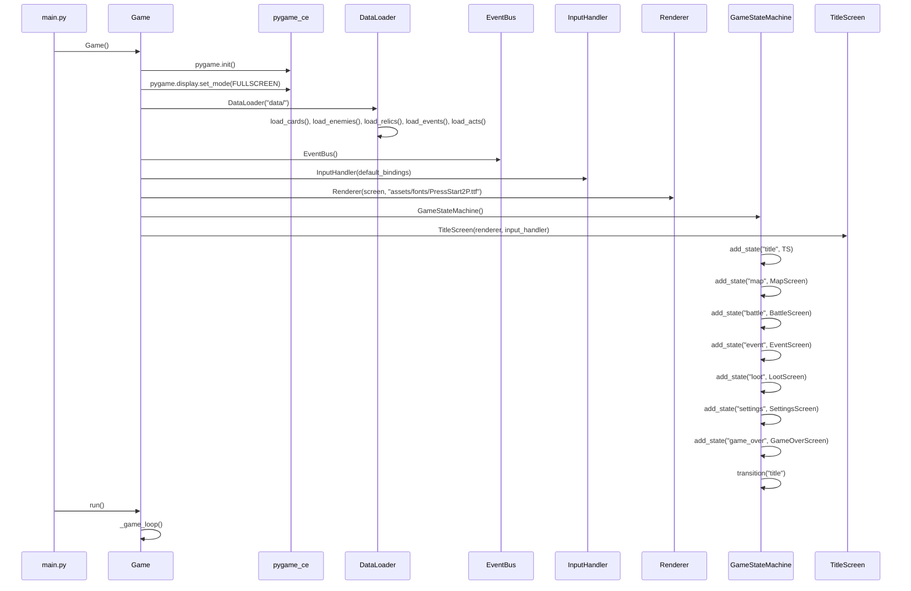
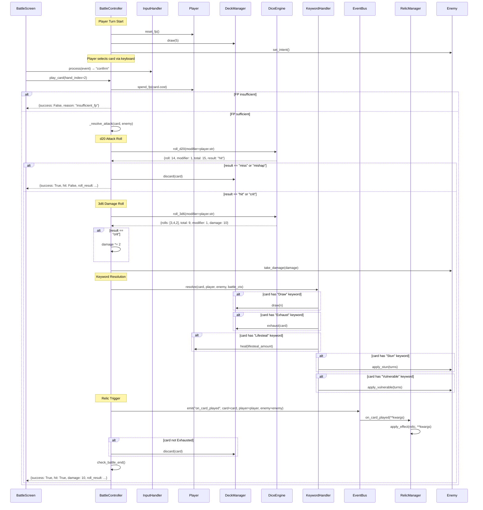
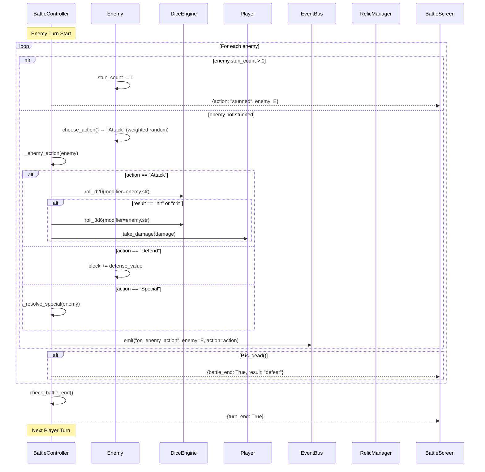
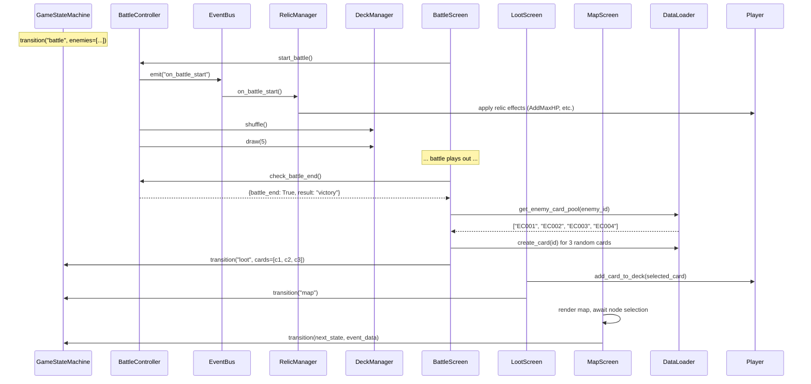
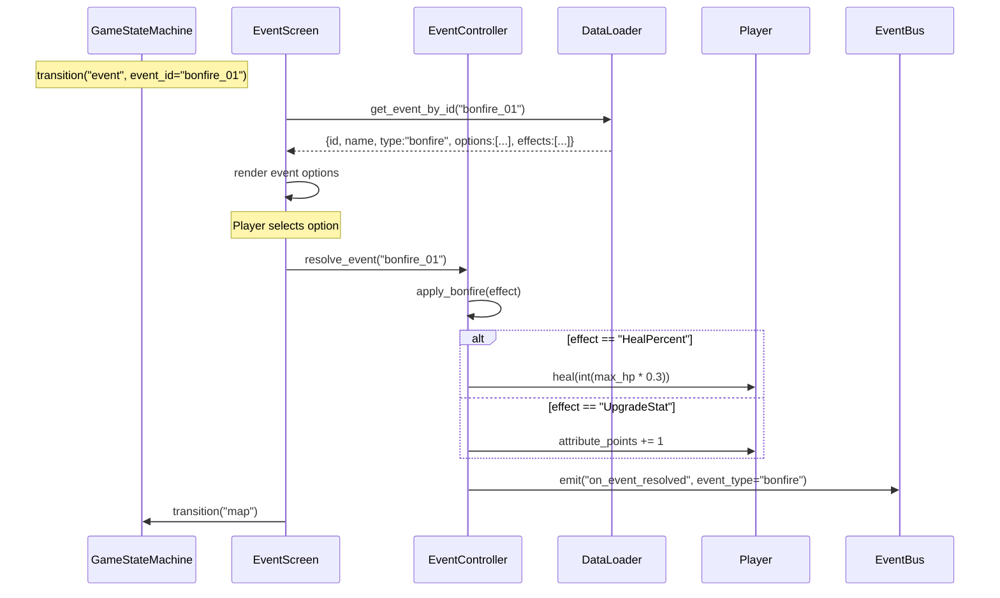
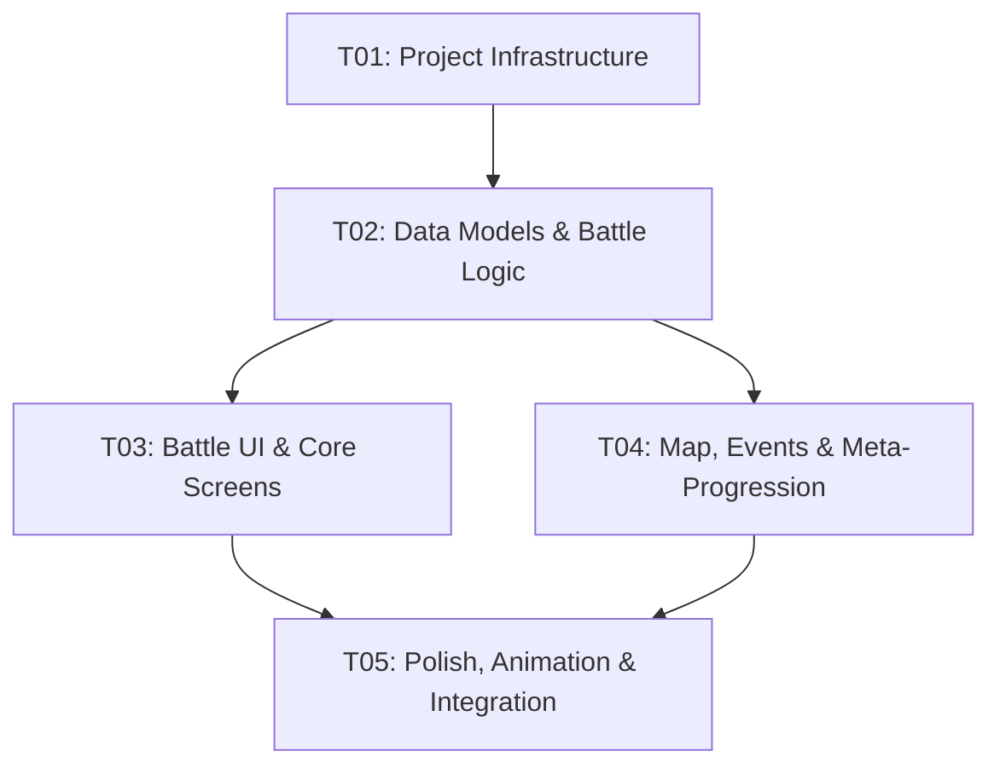

# System Architecture: Elde — Dark Souls × Slay the Spire Roguelike Card Game

## 1. Implementation Approach

### 1.1 Core Technical Challenges

| Challenge | Description | Solution |
|---|---|---|
| d20 Attack Resolution | d20 roll + attribute modifier → 4-tier result (mishap/miss/hit/crit) | Dedicated `DiceEngine` class with modifier pipeline |
| 3d6 Damage Distribution | Normal-distribution damage via 3d6 + STR modifier | `DiceEngine` handles roll + modifier composition |
| Pile-based Deck Management | Draw/Discard/Exhaust cycle with keyword effects (Draw, Exhaust, Repeat) | `DeckManager` class encapsulating all three piles and transitions |
| Keyword Effect Resolution | 8+ keywords that modify card resolution order and side effects | `KeywordHandler` with per-keyword resolver, called from `BattleController` |
| Relic Trigger Pipeline | Passive triggers (on_battle_start/on_calculate_defense/on_card_played) with 4 effect types | Observer pattern: `RelicManager` subscribes to `EventBus` signals |
| Enemy AI | Probability-weighted action selection | Simple weighted random from `ai` dict in enemy JSON |
| State Machine for Game Flow | Title → Map → Event → Battle → Loot → Event → … → Game Over | `GameStateMachine` with `State` base class and per-screen subclasses |
| Fullscreen + Keyboard-only UI | Forced fullscreen, all interaction via keyboard | pygame_ce `FULLSCREEN` flag; custom `InputHandler` captures all key events |
| Font Loading Bug Avoidance | `pygame.font.SysFont` is buggy; must use `pygame.font.Font(path, size)` | Bundle a `.ttf` font file; load exclusively via `pygame.font.Font` |

### 1.2 Framework and Library Selection

| Library | Version | Purpose | Justification |
|---|---|---|---|
| pygame_ce | ^2.3 | Core rendering, input, window management | Community Edition of pygame; actively maintained; required by PRD |
| Python | 3.11+ | Language runtime | Performance, match/case, type hints |

No other third-party libraries needed. All game logic is custom-built on top of pygame_ce.

### 1.3 Architecture Pattern

**Layered MVC with State Machine**:

```
┌─────────────────────────────────────────────┐
│                  View Layer                  │
│  (Screens: BattleScreen, MapScreen, etc.)    │
├─────────────────────────────────────────────┤
│               Controller Layer              │
│  (BattleController, EventController, etc.)  │
├─────────────────────────────────────────────┤
│                Model Layer                   │
│  (Player, Enemy, DeckManager, DiceEngine)   │
├─────────────────────────────────────────────┤
│               Data Layer                     │
│  (JSON loaders, DataLoader)                  │
├─────────────────────────────────────────────┤
│              Infrastructure                  │
│  (Game loop, EventBus, InputHandler,        │
│   GameStateMachine, Renderer)                │
└─────────────────────────────────────────────┘
```

- **Model**: Pure data + game logic (no rendering). Classes: `Player`, `Enemy`, `Card`, `Relic`, `DeckManager`, `DiceEngine`, `KeywordHandler`, `RelicManager`.
- **View**: Screen classes that read model state and render via `Renderer`. Each screen is a `State` in the state machine.
- **Controller**: Orchestrates model mutations and view transitions. `BattleController` is the primary controller; `EventController` and `MapController` handle their respective screens.
- **Infrastructure**: Cross-cutting concerns — `Game` (main loop), `EventBus` (pub/sub for relic triggers), `InputHandler` (key → action mapping), `GameStateMachine` (screen transitions), `Renderer` (drawing primitives + font cache), `DataLoader` (JSON → Python dicts).

**Key Design Decisions**:

1. **EventBus for Relic Triggers**: Instead of hard-coding relic checks into battle flow, emit events (`"on_battle_start"`, `"on_card_played"`, `"on_calculate_defense"`). `RelicManager` subscribes to these events and applies effects. This decouples relics from battle logic.

2. **Data-Driven Everything**: Cards, enemies, relics, events, acts are all loaded from JSON. No game data is hard-coded. This allows easy content expansion.

3. **Dependency Injection**: Core objects (`Renderer`, `EventBus`, `DataLoader`) are created in `Game.__init__` and passed into controllers/screens via constructor parameters. No global singletons.

4. **State Pattern for Screens**: Each game screen (battle, map, event, loot, settings) is a `State` subclass with `handle_input()`, `update()`, and `render()` methods. `GameStateMachine` manages transitions.

---

## 2. File List

```
elde_cardgame/
├── main.py                          # Entry point
├── game/
│   ├── __init__.py                  # Exports: Game
│   ├── game.py                      # Game class (main loop, state machine host)
│   ├── state.py                     # State base class + GameStateMachine
│   ├── event_bus.py                 # EventBus (pub/sub for relic triggers)
│   └── input_handler.py             # InputHandler (key → action mapping)
├── models/
│   ├── __init__.py                  # Exports: Player, Enemy, Card, Relic, DeckManager, DiceEngine
│   ├── card.py                      # Card dataclass
│   ├── player.py                    # Player class (stats, deck, relics, inventory)
│   ├── enemy.py                     # Enemy class (stats, AI, intent)
│   ├── relic.py                     # Relic dataclass + RelicManager
│   ├── deck_manager.py              # DeckManager (draw/discard/exhaust piles)
│   ├── dice_engine.py               # DiceEngine (d20, 3d6, modifiers)
│   └── keyword_handler.py           # KeywordHandler (per-keyword resolvers)
├── controllers/
│   ├── __init__.py                  # Exports: BattleController, MapController, EventController
│   ├── battle_controller.py         # Battle flow orchestration
│   ├── map_controller.py            # Map route selection
│   └── event_controller.py          # Event resolution (bonfire/shop/blacksmith)
├── screens/
│   ├── __init__.py                  # Exports: all screen classes
│   ├── base_screen.py               # BaseScreen(State) with common rendering helpers
│   ├── battle_screen.py             # Battle UI rendering + input handling
│   ├── map_screen.py                # Map UI rendering + input handling
│   ├── event_screen.py              # Event UI rendering + input handling
│   ├── loot_screen.py               # Loot selection UI (3 cards, pick 1)
│   ├── game_over_screen.py          # Death / victory screen
│   ├── title_screen.py              # Title screen
│   └── settings_screen.py           # Settings overlay
├── services/
│   ├── __init__.py                  # Exports: DataLoader, Renderer
│   ├── data_loader.py               # JSON loading + card/enemy/relic/event/act parsing
│   └── renderer.py                  # Rendering primitives, font cache, layout helpers
├── data/
│   ├── cards.json                   # All card definitions
│   ├── enemies.json                 # All enemy definitions
│   ├── relics.json                  # All relic definitions
│   ├── events.json                  # All event definitions
│   └── acts.json                    # Act/route/map configurations
└── assets/
    └── fonts/
        └── PressStart2P.ttf         # Pixel font (bundled, for pygame.font.Font loading)
```

**Total: 24 files** (16 Python + 5 JSON + 1 font + 2 entry/config)

---

## 3. Data Structures and Interfaces

```mermaid
classDiagram
    class Game {
        -screen_width: int
        -screen_height: int
        -display: pygame.Surface
        -clock: pygame.time.Clock
        -state_machine: GameStateMachine
        -event_bus: EventBus
        -input_handler: InputHandler
        -renderer: Renderer
        -data_loader: DataLoader
        -player: Player
        -settings: dict
        +__init__()
        +run() None
        -_init_pygame() None
        -_game_loop() None
        -_handle_global_input(event: pygame.Event) None
    }

    class GameStateMachine {
        -states: dict~str, State~
        -current_state: State
        +add_state(name: str, state: State) None
        +transition(name: str, **kwargs) None
        +get_current() State
        +handle_input(event: pygame.Event) None
        +update(dt: float) None
        +render(surface: pygame.Surface) None
    }

    class State {
        <<abstract>>
        +name: str
        +enter(**kwargs) None
        +exit() None
        +handle_input(event: pygame.Event) None
        +update(dt: float) None
        +render(surface: pygame.Surface) None
    }

    class EventBus {
        -listeners: dict~str, list~Callable~~
        +subscribe(event: str, callback: Callable) None
        +unsubscribe(event: str, callback: Callable) None
        +emit(event: str, **kwargs) None
    }

    class InputHandler {
        -key_bindings: dict~int, str~
        +bind(key: int, action: str) None
        +unbind(key: int) None
        +process(event: pygame.Event) str|None
        +get_bindings() dict~int, str~
    }

    class Player {
        +name: str
        +hp: int
        +max_hp: int
        +fp: int
        +max_fp: int
        +str: int
        +dex: int
        +vit: int
        +fcs: int
        +level: int
        +attribute_points: int
        +deck: DeckManager
        +relics: list~Relic~
        +souls: int
        +current_act: int
        +__init__(data_loader: DataLoader)
        +take_damage(amount: int) None
        +heal(amount: int) None
        +gain_block(amount: int) None
        +reset_fp() None
        +spend_fp(cost: int) bool
        +upgrade_stat(stat: str) None
        +recalculate_derived() None
        +add_relic(relic: Relic) bool
        +add_card_to_deck(card: Card) None
        +is_dead() bool
    }

    class Enemy {
        +id: str
        +name: str
        +hp: int
        +max_hp: int
        +str: int
        +dex: int
        +ai: dict~str, float~
        +card_pool: list~str~
        +act: int
        +intent: str
        +intent_value: int
        +block: int
        +is_boss: bool
        +stun_count: int
        +vulnerable: int
        +__init__(data: dict)
        +take_damage(amount: int) None
        +choose_action() str
        +set_intent() None
        +is_dead() bool
        +apply_stun(turns: int) None
        +apply_vulnerable(turns: int) None
    }

    class Card {
        +id: str
        +name: str
        +cost: int
        +type: str
        +damage: str
        +block: int
        +keywords: dict~str, int~
        +description: str
        +source: str
        +__init__(data: dict)
        +is_attack() bool
        +is_skill() bool
        +has_keyword(keyword: str) bool
        +get_keyword_value(keyword: str) int
    }

    class Relic {
        +id: str
        +name: str
        +trigger: str
        +effect: dict
        +description: str
        +__init__(data: dict)
    }

    class RelicManager {
        -player: Player
        -event_bus: EventBus
        +__init__(player: Player, event_bus: EventBus)
        +add_relic(relic: Relic) bool
        +remove_relic(relic_id: str) None
        +on_battle_start(**kwargs) None
        +on_card_played(**kwargs) None
        +on_calculate_defense(**kwargs) int
        +apply_effect(relic: Relic, **kwargs) None
    }

    class DeckManager {
        +draw_pile: list~Card~
        +discard_pile: list~Card~
        +exhaust_pile: list~Card~
        +hand: list~Card~
        +__init__(cards: list~Card~)
        +shuffle() None
        +draw(n: int) list~Card~
        +discard(card: Card) None
        +exhaust(card: Card) None
        +discard_hand() None
        +move_to_draw() None
        +add_card(card: Card) None
        +remove_card(card_id: str) None
        +get_pile_counts() dict~str, int~
    }

    class DiceEngine {
        +__init__()
        +roll_d20(modifier: int) dict
        +roll_3d6(modifier: int) dict
        +roll_nd6(n: int, modifier: int) dict
        -_resolve_d20(roll: int) str
    }

    class KeywordHandler {
        -event_bus: EventBus
        +__init__(event_bus: EventBus)
        +resolve(card: Card, player: Player, enemy: Enemy, battle_ctx: dict) dict
        -_handle_draw(value: int, deck: DeckManager) None
        -_handle_exhaust(card: Card, deck: DeckManager) None
        -_handle_repeat(card: Card, deck: DeckManager) None
        -_handle_gain_strength(value: int, player: Player) None
        -_handle_consume(card: Card, deck: DeckManager) None
        -_handle_stun(value: int, enemy: Enemy) None
        -_handle_lifesteal(value: int, player: Player, damage_dealt: int) None
        -_handle_vulnerable(value: int, enemy: Enemy) None
    }

    class BattleController {
        -player: Player
        -enemies: list~Enemy~
        -deck: DeckManager
        -dice: DiceEngine
        -keywords: KeywordHandler
        -relic_mgr: RelicManager
        -event_bus: EventBus
        -state: str
        +__init__(player, enemies, event_bus, data_loader)
        +start_battle() None
        +player_turn_start() None
        +play_card(hand_index: int) dict
        +end_player_turn() None
        +enemy_turn() list~dict~
        +check_battle_end() str|None
        -_resolve_attack(card: Card, enemy: Enemy) dict
        -_resolve_skill(card: Card, player: Player) dict
        -_enemy_action(enemy: Enemy) dict
        -_apply_damage_to_enemy(enemy: Enemy, amount: int) None
        -_apply_damage_to_player(amount: int) None
    }

    class MapController {
        -data_loader: DataLoader
        -current_act: int
        -nodes: list~dict~
        -current_node: int
        +__init__(data_loader, player)
        +generate_act_map(act: int) dict
        +select_node(direction: str) None
        +confirm_node() dict
        +get_current_map() dict
        +advance_act() None
    }

    class EventController {
        -data_loader: DataLoader
        -player: Player
        +__init__(data_loader, player, event_bus)
        +resolve_event(event_id: str) dict
        +apply_bonfire(effect: dict) None
        +apply_shop(effect: dict) None
        +apply_blacksmith(effect: dict) None
    }

    class DataLoader {
        -data_dir: str
        -cache: dict~str, list~
        +__init__(data_dir: str)
        +load_cards() list~dict~
        +load_enemies() list~dict~
        +load_relics() list~dict~
        +load_events() list~dict~
        +load_acts() list~dict~
        +get_card_by_id(card_id: str) dict
        +get_enemy_by_id(enemy_id: str) dict
        +get_relic_by_id(relic_id: str) dict
        +get_enemies_by_act(act: int) list~dict~
        +get_boss_by_act(act: int) dict
        +create_card(card_id: str) Card
        +create_enemy(enemy_id: str) Enemy
        +create_relic(relic_id: str) Relic
    }

    class Renderer {
        -screen: pygame.Surface
        -font_cache: dict~tuple, pygame.font.Font~
        -font_path: str
        +__init__(screen: pygame.Surface, font_path: str)
        +draw_text(text: str, pos: tuple, size: int, color: tuple) None
        +draw_rect(rect: pygame.Rect, color: tuple, width: int) None
        +draw_bar(pos: tuple, width: int, height: int, ratio: float, fg: tuple, bg: tuple) None
        +draw_card(card: Card, pos: tuple, selected: bool) None
        +draw_enemy(enemy: Enemy, pos: tuple) None
        +draw_button(text: str, pos: tuple, selected: bool) None
        +get_font(size: int) pygame.font.Font
        +clear(color: tuple) None
        +flip() None
    }

    class BaseScreen {
        <<abstract>>
        #renderer: Renderer
        #input_handler: InputHandler
        +__init__(renderer, input_handler)
    }

    class BattleScreen {
        -battle_ctrl: BattleController
        -selected_card: int
        -anim_state: dict
        +__init__(renderer, input_handler, battle_ctrl)
        +enter(**kwargs) None
        +handle_input(event: pygame.Event) None
        +update(dt: float) None
        +render(surface: pygame.Surface) None
        -_render_enemy_area() None
        -_render_dice_area() None
        -_render_hand_area() None
        -_render_bottom_bar() None
        -_render_battle_log() None
    }

    class MapScreen {
        -map_ctrl: MapController
        -selected_node: int
        +__init__(renderer, input_handler, map_ctrl)
        +enter(**kwargs) None
        +handle_input(event: pygame.Event) None
        +update(dt: float) None
        +render(surface: pygame.Surface) None
    }

    class EventScreen {
        -event_ctrl: EventController
        -selected_option: int
        +__init__(renderer, input_handler, event_ctrl)
        +enter(**kwargs) None
        +handle_input(event: pygame.Event) None
        +update(dt: float) None
        +render(surface: pygame.Surface) None
    }

    class LootScreen {
        -cards: list~Card~
        -selected: int
        -player: Player
        +__init__(renderer, input_handler, player)
        +enter(**kwargs) None
        +handle_input(event: pygame.Event) None
        +update(dt: float) None
        +render(surface: pygame.Surface) None
    }

    class TitleScreen {
        -selected: int
        +enter(**kwargs) None
        +handle_input(event: pygame.Event) None
        +update(dt: float) None
        +render(surface: pygame.Surface) None
    }

    class SettingsScreen {
        -settings: dict
        -selected: int
        +enter(**kwargs) None
        +handle_input(event: pygame.Event) None
        +update(dt: float) None
        +render(surface: pygame.Surface) None
    }

    class GameOverScreen {
        -victory: bool
        +enter(**kwargs) None
        +handle_input(event: pygame.Event) None
        +update(dt: float) None
        +render(surface: pygame.Surface) None
    }

    %% Relationships
    Game --> GameStateMachine : owns
    Game --> EventBus : owns
    Game --> InputHandler : owns
    Game --> Renderer : owns
    Game --> DataLoader : owns
    Game --> Player : owns
    GameStateMachine --> State : manages
    State <|-- BaseScreen
    BaseScreen <|-- BattleScreen
    BaseScreen <|-- MapScreen
    BaseScreen <|-- EventScreen
    BaseScreen <|-- LootScreen
    BaseScreen <|-- TitleScreen
    BaseScreen <|-- SettingsScreen
    BaseScreen <|-- GameOverScreen
    BattleScreen --> BattleController : uses
    MapScreen --> MapController : uses
    EventScreen --> EventController : uses
    BattleController --> Player : references
    BattleController --> Enemy : references
    BattleController --> DeckManager : uses
    BattleController --> DiceEngine : uses
    BattleController --> KeywordHandler : uses
    BattleController --> RelicManager : uses
    Player --> DeckManager : owns
    Player --> Relic : collects
    RelicManager --> EventBus : subscribes
    RelicManager --> Player : references
    KeywordHandler --> EventBus : emits events
    DataLoader --> Card : creates
    DataLoader --> Enemy : creates
    DataLoader --> Relic : creates
    MapController --> DataLoader : uses
    EventController --> DataLoader : uses
    EventController --> Player : references
    Renderer ..> Card : renders
    Renderer ..> Enemy : renders
    DeckManager --> Card : manages
    LootScreen --> Player : modifies
```



---

## 4. Program Call Flow

### 4.1 Game Initialization



### 4.2 Battle Turn Flow (Player Plays an Attack Card)



### 4.3 Enemy Turn Flow



### 4.4 Battle Start → Loot → Map Transition



### 4.5 Event Resolution (Bonfire Example)



---

## 5. Anything UNCLEAR

| # | Issue | Assumption Made | Impact |
|---|---|---|---|
| 1 | d20 modifier formula: is it flat +STR, or +STR only for Attack cards? | d20 modifier = STR for Attack cards, DEX for Defend cards | `DiceEngine.roll_d20(modifier)` accepts modifier from caller |
| 2 | Damage dice notation: `"2d6+STR"` — is this parsed at runtime or predefined fields? | `card.damage` is a string like `"2d6+STR"` parsed by `DiceEngine` at runtime | Need a small dice notation parser in `DiceEngine` |
| 3 | Enemy multi-action per turn for Bosses | Basic enemies: 1 action; Bosses: 2 actions (per PRD suggestion) | `Enemy.is_boss` flag controls action count in `BattleController` |
| 4 | Relic max carry limit | Max 5 relics (per PRD suggestion), excess must replace | `RelicManager.add_relic()` checks `len(player.relics) < 5` |
| 5 | Currency (souls) for shop events | Enemies drop souls on defeat; shop prices defined in `events.json` | `Player.souls` field; shop logic in `EventController` |
| 6 | Save system scope | P1: single save at act boundaries only | Save/load not in P0 scope; architected but not implemented yet |
| 7 | Map generation algorithm | Simple linear node chain with branching at mid-point | `MapController.generate_act_map()` creates a DAG structure per act |
| 8 | Settings persistence | Settings saved to a local JSON file (`settings.json`) | `Game._load_settings()` / `Game._save_settings()` |
| 9 | Card target selection (multi-enemy battles) | Assume 1 enemy per battle for P0; multi-enemy is P1 | `BattleController.play_card()` targets `enemies[0]` by default |
| 10 | Block mechanic: does block persist across turns? | Block resets to 0 at start of each player turn (StS-style) | `BattleController.player_turn_start()` calls `player.block = 0` |

---

## 6. Required Packages

```
- pygame_ce@^2.3.0: Core rendering, input, window management (Community Edition of pygame)
```

No other third-party packages. The game uses Python 3.11+ standard library for JSON loading, random number generation, and all other functionality.

---

## 7. Task List (Ordered by Dependency)

### T01: Project Infrastructure

**Task Name**: Project Infrastructure and Core Engine

**Source Files**:
- `main.py`
- `game/__init__.py`
- `game/game.py`
- `game/state.py`
- `game/event_bus.py`
- `game/input_handler.py`
- `services/__init__.py`
- `services/renderer.py`
- `services/data_loader.py`
- `data/cards.json`
- `data/enemies.json`
- `data/relics.json`
- `data/events.json`
- `data/acts.json`
- `assets/fonts/PressStart2P.ttf`

**Description**: Set up the entire project skeleton. Implement the game loop (`Game`), state machine (`GameStateMachine` + `State`), event bus, input handler, renderer with font cache, data loader for all 5 JSON files. Create all JSON data files with initial content. Include the bundled font file. The `main.py` should launch and display a title screen (even if placeholder).

**Dependencies**: None

**Priority**: P0

---

### T02: Data Models and Battle Logic

**Task Name**: Data Models, Dice Engine, Deck Manager, and Battle Controller

**Source Files**:
- `models/__init__.py`
- `models/card.py`
- `models/player.py`
- `models/enemy.py`
- `models/relic.py`
- `models/deck_manager.py`
- `models/dice_engine.py`
- `models/keyword_handler.py`
- `controllers/__init__.py`
- `controllers/battle_controller.py`

**Description**: Implement all data model classes (`Card`, `Player`, `Enemy`, `Relic`, `DeckManager`, `DiceEngine`, `KeywordHandler`, `RelicManager`). Implement `BattleController` with full battle loop: battle start → player turn (draw, play card with d20+3d6 resolution, keyword handling, relic triggers via EventBus) → enemy turn (AI action selection, damage application) → end check. All 8 keywords must work. All 4 relic effect types must work. `DiceEngine` must support d20 resolution (1=mishap, 2-5=miss, 6-19=hit, 20=crit) and 3d6 damage rolls with modifiers. `DeckManager` must manage all three piles correctly. Include dice notation parser for card damage strings (e.g., "2d6+STR").

**Dependencies**: T01

**Priority**: P0

---

### T03: Battle UI and Core Screens

**Task Name**: Battle Screen, Loot Screen, and Base Screen

**Source Files**:
- `screens/__init__.py`
- `screens/base_screen.py`
- `screens/battle_screen.py`
- `screens/loot_screen.py`
- `screens/game_over_screen.py`
- `screens/title_screen.py`

**Description**: Implement all core gameplay screens. `BaseScreen` provides common rendering helpers. `BattleScreen` renders the full battle interface: enemy area (top), dice animation area (middle), hand cards (bottom), pile counts + End Turn + Settings (bottom bar). Keyboard controls: ←→ select hand card, Enter play card, Space end turn, D/G/E view piles, Escape open settings. `LootScreen` shows 3 cards from defeated enemy's pool, ←→ select, Enter confirm. `GameOverScreen` shows victory/defeat. `TitleScreen` shows title with "Start Game" option. All screens must use `Renderer` for all drawing (no direct pygame calls except through Renderer).

**Dependencies**: T01, T02

**Priority**: P0

---

### T04: Map, Events, and Meta-Progression

**Task Name**: Map Controller/Screen, Event Controller/Screen, Settings Screen, and Run Loop Integration

**Source Files**:
- `controllers/map_controller.py`
- `controllers/event_controller.py`
- `screens/map_screen.py`
- `screens/event_screen.py`
- `screens/settings_screen.py`

**Description**: Implement the full run loop outside of battle. `MapController` generates act maps (5-7 nodes per act, branching), manages node selection and act transitions (Act 1 → 2 → 3). `MapScreen` renders the node graph with keyboard navigation (↑↓ select, Enter confirm). `EventController` resolves bonfire (heal/upgrade), shop (buy relics with souls), and blacksmith (upgrade stat) events. `EventScreen` renders event text and options with ←→ selection. `SettingsScreen` is an overlay (Escape to toggle) with volume slider and fullscreen toggle. Wire everything together: Title → Map → (Battle/Event) → Loot → Map → next act → Boss → Victory/Defeat.

**Dependencies**: T01, T02

**Priority**: P0

---

### T05: Polish, Animation, and Integration Testing

**Task Name**: Dice Animation, Enemy Intent, Battle Log, and Full Game Integration

**Source Files**:
- `screens/battle_screen.py` (modify: add dice animation, intent display, battle log)
- `screens/map_screen.py` (modify: polish map rendering)
- `screens/event_screen.py` (modify: polish event UI)
- `game/game.py` (modify: settings persistence, save/load hooks)
- `services/renderer.py` (modify: animation primitives)
- `data/cards.json` (expand: more cards)
- `data/enemies.json` (expand: more enemies including all 3 bosses)
- `data/relics.json` (expand: more relics)
- `data/events.json` (expand: more events)

**Description**: Add P1 features: dice rolling animation (d20 spin → result, 3d6 tumble → total), enemy intent display (show next action with icon/text), scrolling battle log (dice results, damage numbers, keyword triggers). Expand all JSON data files with full content: ~20+ cards across Player/Encounter/Neutral pools, 10+ enemies across 3 acts including 3 bosses (Abyss Watchers, Yhorm the Giant, Soul of Cinder), 8+ relics, 6+ events. Add settings persistence to `settings.json`. Full integration pass: play through all 3 acts, verify all mechanics work end-to-end, fix any state transition bugs.

**Dependencies**: T01, T02, T03, T04

**Priority**: P1

---

## 8. Shared Knowledge

```
- All JSON data files are in data/ directory, loaded at startup by DataLoader
- All UI text must be English (no Chinese in rendering)
- Font loading: MUST use pygame.font.Font(path, size) — NEVER pygame.font.SysFont
- Font file path: assets/fonts/PressStart2P.ttf
- All events on EventBus use string event names: "on_battle_start", "on_card_played", "on_calculate_defense", "on_enemy_action", "on_event_resolved"
- Relic effects are dicts with a single key: {AddMaxHP: 15}, {HealPercent: 0.3}, {AddFlat: 5}, {ModifyStat: {stat: "str", amount: 1}}
- Card damage is a dice notation string: "2d6+STR", "3d6", "1d6+2" — parsed by DiceEngine
- d20 resolution: roll=1 → mishap, roll=2-5 → miss, roll=6-19 → hit, roll=20 → crit
- Crit doubles the damage dice total (before modifier)
- 3d6 = sum of 3 individual d6 rolls (normal distribution), then + modifier
- Block resets to 0 at the start of each player turn
- FP resets to max_fp at the start of each player turn
- Initial stats: STR=1, DEX=1, VIT=1, FCS=1; HP=50+VIT*10, FP=3+FCS*1
- Max relics: 5 (excess must replace)
- Card sources: "Player", "Encounter", "Neutral"
- Enemy AI: weighted random selection from ai dict (e.g., {"Attack": 0.7, "Defend": 0.3})
- Boss enemies: is_boss=True, 2 actions per turn
- Dependency injection: all core objects (Renderer, EventBus, DataLoader, InputHandler) created in Game.__init__ and passed to constructors
- Screen size: forced fullscreen (pygame.display.set_mode with FULLSCREEN flag)
- Keyboard-only: all interaction via keyboard events processed by InputHandler
- Settings saved to settings.json in project root
```

---

## 9. Task Dependency Graph



**Critical Path**: T01 → T02 → T03 → T05

**Parallelizable**: T03 and T04 can be developed in parallel after T02 is complete, since they depend on models/controllers but not on each other's screens.
