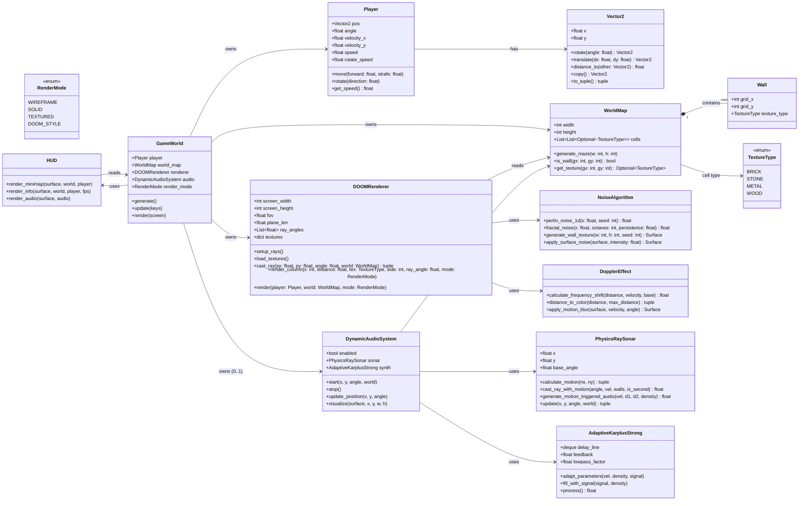

# DOOM 风格伪3D 光线投射游戏 — 架构设计与任务分解

> 文档来源：对 `../be like.txt`（仓库根目录，约 4352 行、多套重复/交叠类定义）进行**去重整合**后的唯一一致设计。
> 技术栈：**Python 3.11+ + pygame-ce + numpy**（音频可选：**sounddevice**）。
> 作者：架构师（高见远）。语言：中文。

---

## 1. 实现方案与框架选型

### 1.1 框架确认
- **图形/输入**：`pygame-ce`（社区维护版 pygame，API 与 pygame 完全兼容）。文档第 2911 行明确要求「统一使用 `pygame_ce` 替换 `pygame`」，故全工程统一 `import pygame_ce as pygame`。
- **数值/信号**：`numpy`（音频缓冲、噪声合成、可视化数组）。
- **音频（可选、可禁用）**：`sounddevice`（实时音频流）。**必须在导入与初始化处做 headless 安全降级**（见第 7、8 节）。
- **语言/运行**：纯 Python，不依赖外部资源文件（纹理由噪声算法实时生成，保证可复现 + headless 可测）。

### 1.2 主渲染路径选型：为何用 DDA 射线投射而非「线段投影」
文档前半段有一个 `Renderer`（基于 `WallSegment` 端点投影 + 梯形裁剪），这是**较原始的「线段投影」思路**。它存在根本缺陷：
- 逐墙段投影端点、绘制梯形，无遮挡一致性（近处墙可能被远处墙覆盖需额外 z-buffer）；
- 无法做 DOOM 式**按列渲染**与逐像素纹理映射；
- 墙体为自由线段，碰撞/射线检测需 O(W) 遍历，且无网格结构。

而文档后半段的 `DOOMRenderer`（DDA 算法 `cast_ray` + `render_column`）才是本游戏真正的核心渲染器，具备：
- 每屏幕列一条射线、按网格 DDA 步进 → **O(1) 每步**、天然深度排序与遮挡；
- 可正确做纹理映射、距离亮度衰减、多普勒颜色混合、运动模糊；
- 与 `RenderMode`（WIREFRAME/SOLID/TEXTURED/DOOM_STYLE）自然契合。

**决策**：**丢弃独立的「线段投影 Renderer」**，以 `DOOMRenderer`（DDA）作为唯一投影路径；`RenderMode` 仅切换「列」的绘制样式（见第 8 节歧义 1）。

### 1.3 默认参数建议（写入 `config.py` 全局常量）
| 参数 | 值 | 说明 |
|---|---|---|
| `SCREEN_WIDTH` | 1024 | 逻辑分辨率宽 |
| `SCREEN_HEIGHT` | 768 | 逻辑分辨率高 |
| `HALF_HEIGHT` | 384 | = `SCREEN_HEIGHT // 2`，地平线 |
| `FOV` | `math.pi / 2`（90°） | 视野角 |
| `CAMERA_PLANE_LEN` | `tan(FOV/2) = 1.0` | 相机平面半长（经典 Lodev 公式） |
| `NUM_RAYS` | `SCREEN_WIDTH`（每像素一列）或 `SCREEN_WIDTH // 2` 双像素列 | 推荐每像素一列，质量优先；性能不足时退回 `//2` |
| `TEXTURE_SIZE` | 64 | 纹理边长（tex_x/tex_y 均归一化到 0–63） |
| `MAX_RENDER_DIST` | 20.0 | 最大渲染/射线距离（网格单位） |
| `MOVE_SPEED` | 0.1 | 每帧前进/平移距离（网格单位） |
| `ROTATE_SPEED` | 0.05 | 每帧旋转角速度（弧度） |
| `MIN_AUDIO_VELOCITY` | 0.05 | 音频触发速度阈值（静止无声） |

### 1.4 架构模式
分层 package + **Facade/Orchestrator**：
- `core/`：基础类型与权威碰撞结构（`Vector2`、`Player`、`Wall`、`TextureType`、`RenderMode`、`WorldMap`）。
- `render/`：纯渲染算法（`NoiseAlgorithm`、`DopplerEffect`、`DOOMRenderer`）。
- `audio/`：可选音频子系统（headless 安全，`DynamicAudioSystem` 封装 `PhysicsRaySonar` + `AdaptiveKarplusStrong`）。
- `world/`：业务编排（`GameWorld`、`HUD`）。
- `main.py`：主循环（事件、输入、渲染编排）。
- 统一约定：所有跨文件基础类型**只从 `core/` 导入**，杜绝重复定义。

---

## 2. 文件列表及相对路径

包根目录：`doom_game/`

| 相对路径 | 职责（一句话） |
|---|---|
| `doom_game/__init__.py` | 包导出与版本号 |
| `doom_game/config.py` | 全局常量（分辨率、FOV、相机平面、速度、纹理尺寸等） |
| `doom_game/core/__init__.py` | core 子包导出 |
| `doom_game/core/types.py` | 基础类型：`Vector2`、`Wall`、`TextureType`(Enum)、`RenderMode`(Enum) |
| `doom_game/core/player.py` | `Player`：位置/朝向/速度、前后移动+平移、旋转、速度查询 |
| `doom_game/core/world_map.py` | `WorldMap`：网格化地图，`generate_maze`、`is_wall`、`get_texture`（O(1) 碰撞） |
| `doom_game/render/__init__.py` | render 子包导出 |
| `doom_game/render/noise.py` | `NoiseAlgorithm`：Perlin/分形噪声、墙面纹理生成、表面噪声 |
| `doom_game/render/doppler.py` | `DopplerEffect`：频移计算、距离→颜色、运动模糊 |
| `doom_game/render/renderer.py` | `DOOMRenderer`：DDA `cast_ray`、`render_column`、按 `RenderMode` 渲染、运动模糊 |
| `doom_game/audio/__init__.py` | audio 子包导出 |
| `doom_game/audio/karplus_strong.py` | `AdaptiveKarplusStrong`：延迟线 + 低通 + 自适应反馈的弦乐合成 |
| `doom_game/audio/sonar.py` | `PhysicsRaySonar`：双射线声纳、运动触发、环境密度感知 |
| `doom_game/audio/audio_system.py` | `DynamicAudioSystem`：整合声纳+合成器，**headless 安全、可禁用** |
| `doom_game/world/__init__.py` | world 子包导出 |
| `doom_game/world/game_world.py` | `GameWorld`：装配地图/玩家/渲染器/音频，提供 `update`/`render` |
| `doom_game/world/hud.py` | `HUD`：小地图 `render_minimap`、信息面板 `render_info`、音频可视化 |
| `main.py` | 程序入口：初始化、事件循环、键盘控制（WASD/方向键/1-4/ESC/QUIT） |
| `requirements.txt` | 依赖声明（pygame-ce、numpy、sounddevice） |
| `pyproject.toml` | 包元数据与可选依赖分组（含 `audio` extra） |

> 去重要点：全工程**仅一份** `Vector2`、`Player`、`Wall`、`TextureType`、`RenderMode`、`WorldMap`；所有模块统一从 `core/` 导入。

---

## 3. 数据结构与接口（类图）



---

## 4. 程序调用流程（时序图：单帧渲染）

```mermaid
sequenceDiagram
    autonumber
    participant M as main loop
    participant GW as GameWorld
    participant P as Player
    participant WM as WorldMap
    participant R as DOOMRenderer
    participant D as DopplerEffect
    participant N as NoiseAlgorithm
    participant H as HUD
    participant A as DynamicAudioSystem

    M->>M: pygame.event.get() (QUIT/ESC/KEYDOWN)
    M->>GW: update(keys)
    GW->>P: move(forward, strafe)
    GW->>P: rotate(direction)
    GW->>A: update_position(px, py, angle) [if enabled]

    M->>GW: render(screen)
    GW->>R: render(player, world_map, render_mode)
    loop 每个屏幕列 i
        R->>R: world_angle = player.angle + ray_angles[i]
        R->>R: cast_ray(px, py, world_angle, world_map)
        R->>WM: is_wall(map_x, map_y)  %% O(1) 网格判定
        WM-->>R: bool / TextureType
        R->>R: 计算击中距离与 side
        alt SOLID
            R->>R: 纯色 = distance_to_color(distance)
        else TEXTURED
            R->>R: render_column(纹理采样 + 距离亮度)
        else DOOM_STYLE
            R->>N: 取预生成纹理
            R->>D: distance_to_color(distance)  %% 多普勒混合
            R->>R: render_column(纹理×亮度×多普勒)
        end
    end
    R->>D: apply_motion_blur(screen, player.get_speed(), angle) [DOOM_STYLE & 运动中]

    GW->>H: render_minimap(screen, world_map, player)
    GW->>H: render_info(screen, world, player, fps)
    opt 音频启用
        GW->>H: render_audio(screen, audio)
    end
    M->>M: pygame.display.flip(); clock.tick(60)
```

---

## 5. 任务列表（有序、含依赖、按实现顺序）

> 规则：同模块相关文件一起写；每任务 ≥3 个文件；T1 为基础设施；共 **5 个任务**。

### T1 — 项目基础设施与全局配置
- **依赖**：无（首个任务）
- **产出文件**：`requirements.txt`、`pyproject.toml`、`doom_game/__init__.py`、`doom_game/config.py`、`doom_game/core/__init__.py`、`doom_game/render/__init__.py`、`doom_game/audio/__init__.py`、`doom_game/world/__init__.py`
- **验收要点**：`pip install -e .` 可安装；`python -c "import doom_game"` 成功；`config.py` 含全部第 1.3 节常量；`SDL_VIDEODRIVER=dummy python -c "import doom_game"` 不报错（headless 可导入）。

### T2 — 核心类型与网格地图（O(1) 碰撞结构）
- **依赖**：T1
- **产出文件**：`doom_game/core/types.py`、`doom_game/core/player.py`、`doom_game/core/world_map.py`
- **验收要点**：
  - `Vector2`/`Player`/`Wall`/`TextureType`/`RenderMode` 仅此一份，可被其他模块 `from doom_game.core.types import ...`；
  - `WorldMap.generate_maze(w,h)` 生成外墙+内墙，`is_wall(x,y)` 与 `get_texture(x,y)` 为 **O(1)** 网格查询（解决文档「List[Wall] 遍历 vs 网格」矛盾，见第 8 节）；
  - `Player.move/rotate/get_speed` 行为符合约定（弧度、前后+平移、速度用于音频）。

### T3 — 渲染引擎（DDA 射线投射 + 4 渲染模式 + 多普勒/噪声）
- **依赖**：T1、T2
- **产出文件**：`doom_game/render/noise.py`、`doom_game/render/doppler.py`、`doom_game/render/renderer.py`
- **验收要点**：
  - `DOOMRenderer.cast_ray` 使用 **DDA** 遍历 `WorldMap` 网格，返回 `(distance, TextureType, side)`；
  - `render(player, world_map, mode)` 按 `RenderMode` 切换列绘制（WIREFRAME/SOLID/TEXTURED/DOOM_STYLE），详见第 8 节歧义 1；
  - `load_textures` 用 `NoiseAlgorithm.generate_wall_texture(64,64,seed)` 预生成 brick/stone/metal/wood；
  - `DopplerEffect.distance_to_color` / `apply_motion_blur` 可被 `DOOM_STYLE` 调用；
  - 纯函数可单测：`cast_ray` 对已知地图返回正确距离（headless，`SDL_VIDEODRIVER=dummy`）。

### T4 — 音频系统（运动触发 + 环境感知，headless 安全）
- **依赖**：T1、T2
- **产出文件**：`doom_game/audio/karplus_strong.py`、`doom_game/audio/sonar.py`、`doom_game/audio/audio_system.py`
- **验收要点**：
  - 采用文档最终版 `DynamicAudioSystem`（双射线声纳 + 自适应 Karplus-Strong）：**静止时无声、运动时有声、空旷处声弱**（对应文档第 2911 行物理约束）；
  - `DynamicAudioSystem.start()` 全程 `try/except`，**无音频设备/无 sounddevice 时 `enabled=False` 且绝不抛异常**；
  - 导出 `DISABLE_AUDIO=1` 环境变量可强制关闭；导入 `sounddevice` 失败自动降级为 `NullBackend`；
  - 音频在独立 daemon 线程运行，提供 `stop()` 供 `cleanup` 调用；主循环 `update_position` 仅在 `enabled` 时调用；
  - 可在 `SDL_VIDEODRIVER=dummy` 且无声卡环境下完整跑通主循环而不崩溃。

### T5 — 世界编排、HUD 与主循环
- **依赖**：T2、T3、T4
- **产出文件**：`doom_game/world/game_world.py`、`doom_game/world/hud.py`、`main.py`
- **验收要点**：
  - `GameWorld` 装配 `WorldMap`+`Player`+`DOOMRenderer`+（可选）`DynamicAudioSystem`，提供 `update(keys)`/`render(screen)`；
  - `HUD.render_minimap`/`render_info`/`render_audio` 独立可测；
  - `main.py`：QUIT/ESC 退出；WASD 移动、方向键旋转、数字键 1-4 切换 `RenderMode`；`clock.tick(60)`；
  - `SDL_VIDEODRIVER=dummy python main.py` 可在 CI/沙箱运行若干帧后退出无异常；
  - 退出时调用 `GameWorld.cleanup()` 关闭音频线程。

---

## 6. 依赖包列表

```
# requirements.txt
pygame-ce>=2.4.0        # 图形与输入（文档要求统一替换 pygame）
numpy>=1.24.0           # 数值计算 / 音频缓冲 / 可视化
sounddevice>=0.4.6      # 可选：实时音频流（缺失时自动降级，不影响主程序）

# pyproject.toml 可选 extra
# [project.optional-dependencies]
# audio = ["sounddevice>=0.4.6"]
```

**Headless 测试方式**：
- 视频：`SDL_VIDEODRIVER=dummy python main.py` 可在无显示环境下运行（pygame 使用 dummy 后端）。
- 音频：默认 `sounddevice` 不可用时自动禁用；亦可用 `DISABLE_AUDIO=1` 强制关闭；QA 沙箱无需声卡即可跑通。
- 单元测试：`pytest` 直接对 `core/`、`render/`、`audio/`（纯函数/无设备路径）做单测，无需任何显示/音频设备。

---

## 7. 共享知识（跨文件约定）

1. **坐标系**：世界坐标 = 网格单元（单位 `1.0` = 1 格）。玩家 `pos` 为浮点网格坐标；墙格整数坐标 `[gx][gy]`。`WorldMap.cells[gy][gx]`。
2. **角度单位**：全部使用**弧度**。`Player.angle` 归一到 `[0, 2π)`。
3. **纹理尺寸**：固定 `TEXTURE_SIZE = 64`，tex_x/tex_y 归一化到 `0..63`。四种类型：`brick/stone/metal/wood`，由 `NoiseAlgorithm.generate_wall_texture` 以不同 `seed` 生成并缓存于 `DOOMRenderer.textures`。
4. **颜色混合比例（DOOM_STYLE）**：`final = texel_color * (1 - MIX) + doppler_color * MIX`，`MIX = 0.7`（距离越近暖色越强，沿用文档 `render_column` 取值）；亮度 `brightness = max(0.2, 1 - distance/MAX_RENDER_DIST)`。
5. **屏幕常量定义位置**：`doom_game/config.py` 集中定义 `SCREEN_WIDTH/HEIGHT/HALF_HEIGHT/FOV/CAMERA_PLANE_LEN/...`，**禁止**在各模块内硬编码分辨率。
6. **基础类型导入约定**：任何模块需要 `Vector2/Player/Wall/TextureType/RenderMode` 时，**统一** `from doom_game.core.types import ...`；需要地图时 `from doom_game.core.world_map import WorldMap`。**不得**在 `render/`、`audio/`、`world/`、`main.py` 中重新定义这些类型。
7. **碰撞权威结构**：渲染与音频射线检测统一走 `WorldMap.is_wall/get_texture`（O(1)），**不再**使用 `List[Wall]` 或 `List[Tuple]` 遍历。
8. **音频安全约定**：任何音频调用前检查 `audio.enabled`；`start()` 必须 `try/except`；`DISABLE_AUDIO` 环境变量优先。
9. **主循环契约**：`GameWorld.update(keys)` 只更新状态（不绘制）；`GameWorld.render(screen)` 只绘制（不更新逻辑）；音频位置通过 `update_position` 在 `update` 内同步。

---

## 8. 待明确事项（文档歧义/矛盾 + 推荐取舍）

### 歧义 1：两套渲染器（线段投影 `Renderer` vs DDA `DOOMRenderer`）如何取舍
- **矛盾**：文档前半段 `Renderer`（端点投影/梯形）与后半段 `DOOMRenderer`（DDA 射线投射）并存；任务明确 `DOOMRenderer` 为「主渲染器」。
- **推荐**：**仅保留 `DOOMRenderer`**，删除独立线段投影 `Renderer`。`RenderMode` 不再对应「不同引擎」，而是切换同一 DDA 管线的列绘制样式：
  - `WIREFRAME`：只绘制每列墙顶/墙底的轮廓线（或叠加射线线框），不填充；
  - `SOLID`：按 `DopplerEffect.distance_to_color` 纯色填充列；
  - `TEXTURED`：纹理采样 + 距离亮度（无多普勒混合）；
  - `DOOM_STYLE`：纹理 + 距离亮度 + 多普勒颜色混合 + 运动模糊（默认模式）。

### 歧义 2：墙的碰撞表示（List[Wall] vs List[Tuple] vs 网格 world_map）
- **矛盾**：`DOOMRenderer.cast_ray` 用 `for wall in walls: if int(wall.x)==map_x...`（O(W) 每步）；后续 `GameWorld.cast_ray` 用 `if (map_x,map_y) in self.walls`（仍是列表遍历）；文档还出现 `world_map[y][x]` 思路。DDA 本应按网格 O(1) 步进。
- **推荐**：**统一为网格化 `WorldMap`**（`cells[gy][gx]: Optional[TextureType]`）。`cast_ray` 直接 `world.is_wall(map_x, map_y)` 为 O(1)。保留 `Wall` 类作为网格单元的「语义描述」（grid_x, grid_y, texture_type），但**碰撞走网格而非列表遍历**。这是本设计的关键去重与性能决策。

### 歧义 3：音频模块的多次迭代如何收敛
- **矛盾**：文档先后出现 `AudioReceiver + KarplusStrongSynthesizer + DopplerAudioEngine` → `DualRaySonar + EnhancedKarplusStrong + SonarAudioEngine` → 最终 `PhysicsRaySonar + AdaptiveKarplusStrong + DynamicAudioSystem`。
- **推荐**：**采用最终版 `DynamicAudioSystem`**（运动触发、环境感知、自适应参数），并满足文档第 2911 行物理约束：「玩家不动→无声；运动→有声；越空旷→声越弱」。前两版视为历史草稿，不在工程中实现。

### 歧义 4：运动模糊的性能代价
- **矛盾**：文档 `apply_motion_blur` 对每个模糊强度做多次 `surface.blit` 偏移循环，逐帧复制整屏，开销大。
- **推荐**：保留接口 `apply_motion_blur(surface, velocity, angle)`，但实现改为**廉价近似**：基于上一帧残影的半透明叠加（`screen.blit(prev_frame, offset)` + alpha），而非多重全屏 blit；强度由 `velocity` 控制，静止时不触发。

### 歧义 5：pygame vs pygame_ce
- **矛盾**：前半段用 `pygame`，第 2911 行要求统一为 `pygame_ce`。
- **推荐**：**全工程 `import pygame_ce as pygame`**，依赖声明 `pygame-ce`。

### 歧义 6：数值精度与确定性
- **推荐**：纹理由 `NoiseAlgorithm` 按 `seed` 确定性生成（不依赖全局 `random.seed` 副作用），保证 headless 测试可复现；音频随机性仅限信号填充，不影响渲染确定性。

---

> 本设计已消除文档中的多重重复定义，统一为单一、一致、可工程化、headless 安全的架构。工程师可直接按 T1→T5 顺序落地。
