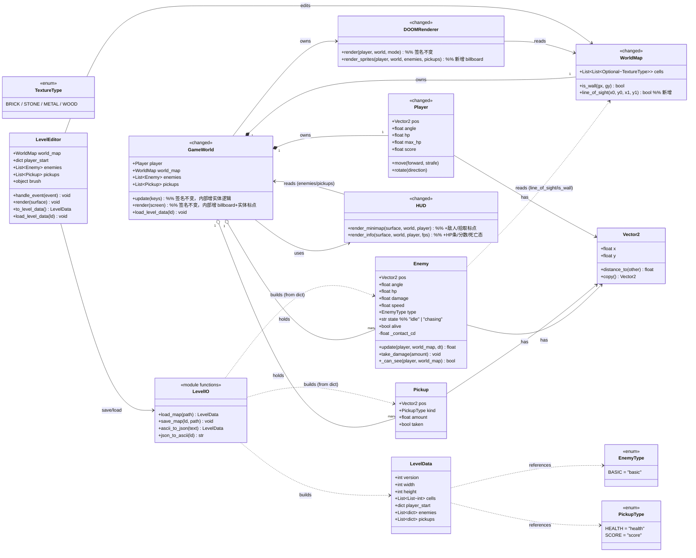
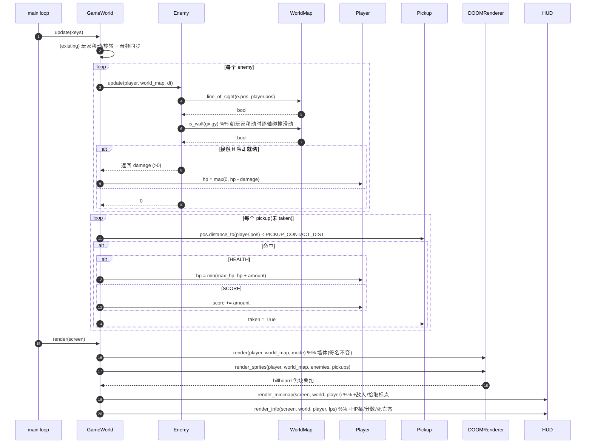
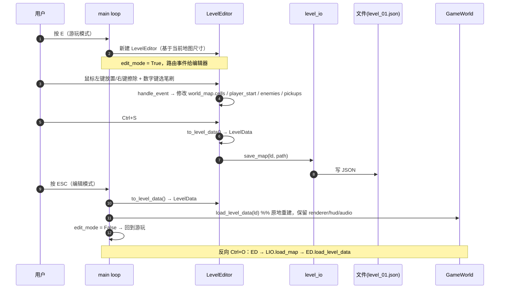
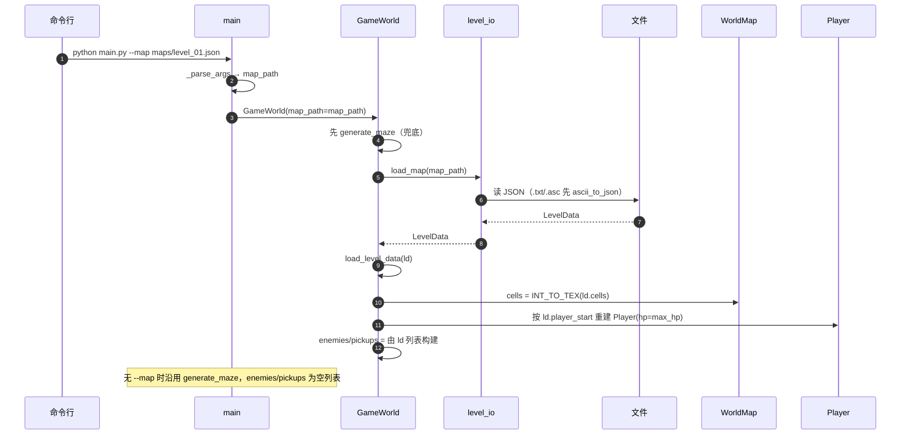

# DOOM 风格伪3D 光线投射游戏 — 增量架构设计与任务分解

> 本文档是 `design/ARCHITECTURE.md`（基础架构）与 `design/INCREMENTAL_PRD.md`（增量 PRD）的**增量落地设计**，只描述 4 项新需求「新增/变更了什么」。
> 作者：架构师（高见远）。语言：中文。状态：基于已确认 3 条核心决策（D1 简单追逐 / D2 编辑器同格式 / D3 拾取两类）与 7 条推荐默认。
> 约束：**只做设计，不写实现代码**；现有 53 个测试在「不做本次改动」时必须仍通过；本次改动后新增对应测试且 headless 自测不破。

---

## 1. 变更点总览（4 项各自要改/新增哪些文件）

| # | 需求 | 新增文件 | 修改文件 | 是否破坏现有接口 |
|---|---|---|---|---|
| 1 | README 文档 | `README.md` | — | 否（纯新增） |
| 2 | 敌人 / 拾取物 | `doom_game/core/entities.py`、`tests/test_entities.py`、`tests/test_game_world_entities.py`(建议) | `core/player.py`(扩展 hp/score)、`core/world_map.py`(+`line_of_sight`)、`world/game_world.py`(enemies/pickups/update/render/`__init__` map_path)、`world/hud.py`(生命条/分数/小地图标点)、`render/renderer.py`(+`render_sprites`) | 否（Player/WorldMap/GameWorld 接口**签名不变**，仅增字段与方法；render 的 `render()` 保持 3 参） |
| 3 | 纹理 surfarray 提速 | —（仅改实现）、`tests/test_noise.py` 增量用例 | `render/noise.py`(`generate_wall_texture` 改为 numpy+surfarray) | 否（函数签名 `(w,h,seed)` 不变；输出 64×64、`textures` 仍 4 张） |
| 4 | 简易关卡编辑器 | `doom_game/editor/__init__.py`、`doom_game/editor/level_editor.py`、`doom_game/world/level_io.py`、`maps/level_01.json`(示例)、`tests/test_level_io.py`、`tests/test_editor.py`(可选) | `main.py`(`--map`、`E` 键编辑模式、ESC 协调、`R` 重开) | 否（main 入口行为追加；headless 路径不触发编辑器） |

**关键结论**：所有改动均为**追加式（additive）**——不删除/不改现有函数签名，不破坏 `core/types.py`/`render/renderer.py`/`audio/` 已在测试的契约。回归风险集中点在 `noise.py` 重写与 `main.py` 事件循环（见第 6 节）。

---

## 2. 文件清单（增量）

> 改动类型：**[新增]** 全新文件；**[修改]** 在现有文件上追加；**[微调]** 仅常量/导入调整。

| 相对路径 | 职责 | 改动类型 | 模块落点说明 |
|---|---|---|---|
| `README.md` | 项目安装/运行/操作/特性/关卡格式/架构/测试说明 | 新增 | 根目录，P0 |
| `doom_game/config.py` | 新增敌人/玩家/拾取/地图相关常量（Q1/Q2/Q3） | 修改（仅追加常量） | 保持规则 #5：所有魔法数集中此处 |
| `doom_game/core/entities.py` | `Enemy`/`Pickup`/`PickupType`/`EnemyType` 基本类型 | 新增 | **采纳 PRD 建议**：基础实体只从 `core` 导入（遵守规则 #1/#6），放 `core` 子包，与 `types.py`/`player.py` 同源 |
| `doom_game/core/player.py` | `Player` 扩展 `hp`/`max_hp`/`score` | 修改（仅追加字段，签名向后兼容） | 新增字段作为**末尾关键字参数**，现有 `Player(x,y,angle=,speed=,rotate_speed=)` 调用全部仍有效 |
| `doom_game/core/world_map.py` | 新增 `line_of_sight(x0,y0,x1,y1)` 网格射线步进 | 修改（仅追加方法） | 视线判定读网格（O(1) 碰撞权威结构），不污染 cells |
| `doom_game/world/game_world.py` | `enemies`/`pickups` 字段；`update` 增敌人 AI+伤害+拾取；`render` 增 billboard 叠加；`__init__` 增 `map_path`；新增 `load_level_data(ld)` | 修改 | 实体挂在 GameWorld（业务编排层），`update`/`render` 签名**不变** |
| `doom_game/world/hud.py` | 生命条 + 分数文本；小地图敌人(红)/拾取(绿=health、黄=score)标点；死亡态提示 | 修改 | 复用现有 `render_minimap`/`render_info`，**保持字体每帧创建（不缓存）**以避免 headless 字体回归 |
| `doom_game/render/renderer.py` | 新增 `render_sprites(player, world, enemies, pickups)` billboard 叠加 pass | 修改（仅追加方法） | **不改动** `render(player,world,mode)` 签名（test_renderer 依赖其 3 参），新方法在 GameWorld.render 中于墙体之后调用 |
| `doom_game/render/noise.py` | `generate_wall_texture` 由逐像素 `set_at` 改 numpy 向量化 + `surfarray` | 修改（仅改实现） | 函数签名/输出尺寸/4 纹理/确定性全部保持 |
| `doom_game/world/level_io.py` | `LevelData` 数据类；`load_map`/`save_map`/`ascii_to_json`/`json_to_ascii` | 新增 | **采纳 PRD 建议**：关卡 I/O 落 `world/` 子包（读网格+实体，导入自 `core`） |
| `doom_game/editor/__init__.py` | 编辑器子包导出 | 新增 | 新建子包 |
| `doom_game/editor/level_editor.py` | `LevelEditor`：网格视图、笔刷、鼠标放置/擦除、保存/加载 | 新增 | **采纳 PRD 建议**：编辑器独立子包；仅游玩模式 `E` 进入，headless 不实例化 |
| `main.py` | 解析 `--map`；`E` 键切换编辑模式；编辑模式 ESC 退回游玩；`R` 重开；路由事件 | 修改 | 事件循环追加分支，`edit_mode` 在 headless 恒为 False |
| `maps/level_01.json` | 示例关卡（权威 JSON 格式） | 新增 | 由 IT4 生成，供 `--map` 默认与编辑器示例 |
| `tests/test_entities.py` | 敌人 AI（idle/chasing、LOS、不穿墙、接触伤害+冷却）、拾取（health/score、taken）、Player hp/score | 新增 | headless 纯逻辑 |
| `tests/test_level_io.py` | JSON 往返、ASCII 往返、load/save、默认元数据补全 | 新增 | headless 纯 IO |
| `tests/test_noise.py`（增量） | surfarray 与旧实现逐像素相等、确定性、耗时对比、仍 4 纹理 | 修改（追加用例类） | 保留现有用例，新增 `TestSurfarrayParity` |
| `tests/test_game_world_entities.py` | GameWorld.update 敌人/拾取集成（headless，4 模式不崩） | 新增（建议） | 覆盖 headless 自测路径 |

**模块落点拍板**：完全采纳 PRD Q5 建议（实体 `core/entities.py`、I/O `world/level_io.py`、编辑器 `editor/level_editor.py`）。理由：
- 实体是「基础类型」，按架构规则 #6 必须只从 `core/` 导入，故放 `core/entities.py` 而非 `world/`。
- `LevelData` 是地图数据传输对象，紧密依赖 `Enemy`/`Pickup`/`WorldMap`，放 `world/level_io.py`（world 层可安全导入 core，无环）。
- 编辑器是交互层，独立 `editor/` 子包，避免污染 `world/`（world 层偏业务编排）。

---

## 3. 数据结构与接口（增量）

### 3.1 Mermaid 类图（新增/变更类）



### 3.2 关键接口签名（增量）

```python
# doom_game/core/entities.py
class PickupType(Enum):
    HEALTH = "health"
    SCORE  = "score"

class EnemyType(Enum):
    BASIC = "basic"

class Enemy:
    def __init__(self, x, y, hp=ENEMY_HP, damage=ENEMY_DAMAGE,
                 speed=ENEMY_SPEED, angle=0.0, type=EnemyType.BASIC):
        ...
    def update(self, player: Player, world_map: WorldMap, dt: float) -> float:
        """推进 AI：LOS+距离判定 idle/chasing；chasing 时朝玩家移动(网格碰撞滑动)；
        与玩家接触且冷却就绪则返回伤害值(>0)，否则 0。"""
    def take_damage(self, amount: float) -> None: ...

class Pickup:
    def __init__(self, x, y, kind: PickupType, amount=None, taken=False):
        # amount 缺省: HEALTH->HEALTH_PICKUP_AMOUNT, SCORE->SCORE_PICKUP_AMOUNT
        ...

# doom_game/core/player.py  (仅追加末尾关键字参数，签名向后兼容)
class Player:
    def __init__(self, x, y, angle=0.0, speed=0.1, rotate_speed=0.05,
                 max_hp=PLAYER_MAX_HP, hp=None, score=0):
        self.max_hp = max_hp
        self.hp = max_hp if hp is None else hp
        self.score = score
        ...

# doom_game/core/world_map.py  (仅追加方法)
class WorldMap:
    def line_of_sight(self, x0, y0, x1, y1) -> bool:
        """DDA 射线步进：从 (x0,y0) 到 (x1,y1)，任一中间格为墙则 False。"""

# doom_game/world/level_io.py
class LevelData: ...
def load_map(path: str) -> LevelData: ...
def save_map(ld: LevelData, path: str) -> None: ...
def ascii_to_json(text: str) -> LevelData: ...
def json_to_ascii(ld: LevelData) -> str: ...

# doom_game/world/game_world.py  (签名不变，仅增字段/方法)
class GameWorld:
    def __init__(self, map_width=DEFAULT_MAP_WIDTH, map_height=DEFAULT_MAP_HEIGHT,
                 seed=WORLD_SEED, map_path=None): ...
    def update(self, keys: dict) -> None: ...   # 内部遍历 enemies/pickups
    def render(self, screen) -> None: ...        # 内部调 renderer.render_sprites + hud 标点
    def load_level_data(self, ld: LevelData) -> None: ...  # 原地重建网格/玩家/实体

# doom_game/editor/level_editor.py
class LevelEditor:
    def __init__(self, screen_w, screen_h, map_path=None): ...
    def handle_event(self, event) -> None: ...
    def render(self, surface) -> None: ...
    def to_level_data(self) -> LevelData: ...
    def load_level_data(self, ld: LevelData) -> None: ...

# doom_game/render/renderer.py  (仅追加方法)
class DOOMRenderer:
    def render_sprites(self, player, world, enemies, pickups) -> None: ...
```

### 3.3 敌人/拾取物 JSON 字段 Schema（与 PRD 5.3 一致）

```json
{
  "version": 1,
  "width": 24,
  "height": 24,
  "cells": [[0,1,2,3,4,0], ["..."]],
  "player_start": { "x": 1.5, "y": 1.5, "angle": 0.0 },
  "enemies": [
    { "x": 5.5, "y": 5.5, "hp": 30, "damage": 10, "speed": 0.06, "type": "basic" }
  ],
  "pickups": [
    { "x": 8.5, "y": 8.5, "kind": "health", "amount": 25 },
    { "x": 9.5, "y": 9.5, "kind": "score",  "amount": 100 }
  ]
}
```

字段说明：
- `cells[gy][gx]`：整数 → `TextureType`（0=None/空, 1=BRICK, 2=STONE, 3=METAL, 4=WOOD）。
- `player_start`：浮点格中心坐标（如 `gx+0.5`）+ 朝向弧度。
- `enemies[].hp/damage/speed`：缺省用 config 常量；`type`：枚举字符串（"basic"）。
- `pickups[].kind`："health" | "score"；`amount`：缺省用 config 常量。

---

## 4. 地图文件格式规范（JSON 权威 + ASCII 可读中间格式）

### 4.1 JSON Schema（权威，无损）

| 字段 | 类型 | 说明 |
|---|---|---|
| `version` | int | 格式版本，当前 1 |
| `width`/`height` | int | 网格尺寸 |
| `cells` | `int[height][width]` | 单元格纹理整数（见 4.3 映射） |
| `player_start` | `{x,y,angle}` | 玩家起点（浮点格中心） |
| `enemies` | `list[{x,y,hp?,damage?,speed?,type?}]` | 敌人出生点，元数据缺省用 config |
| `pickups` | `list[{x,y,kind,amount?}]` | 拾取物，amount 缺省用 config |

### 4.2 ASCII 字符表（人类可读 / 导入导出中间格式）

| 字符 | 含义 | 映射到 JSON |
|---|---|---|
| ` ` 或 `.` | 空地 | cells=0 |
| `#` | 墙（默认 STONE） | cells=2 |
| `B` | 砖墙 | cells=1 |
| `S` | 石墙 | cells=2 |
| `M` | 金属墙 | cells=3 |
| `W` | 木墙 | cells=4 |
| `P` | 玩家起点 | player_start（取该格中心） |
| `E` | 敌人出生点 | enemies（hp/type 用默认值） |
| `H` | 生命拾取 | pickups{kind:health} |
| `$` | 分数拾取 | pickups{kind:score} |

- ASCII 为单字符/格，**无法表达**敌人 hp/damage/speed/type、拾取 amount 等元数据 → 导出为 ASCII 时这些字段用 config 默认值补全；**JSON 为往返无损的权威格式**。
- ASCII 校验：`P` 必须恰好出现一次（否则取第一个或报错，由编辑器/loader 决定，默认取第一个）。

### 4.3 互转规则

- **整数 ↔ TextureType**：
  `INT_TO_TEX = {0:None, 1:BRICK, 2:STONE, 3:METAL, 4:WOOD}`
  `TEX_TO_INT = {None:0, BRICK:1, STONE:2, METAL:3, WOOD:4}`
- **JSON → 运行时**：
  `load_map(path)`：识别 `.json`（或 `.txt/.asc` → 先 `ascii_to_json`）→ 解析 → 构建 `LevelData`（cells 已转 int 二维数组）。`GameWorld.load_level_data(ld)` 将 int cells 经 `INT_TO_TEX` 还原为 `WorldMap.cells`（`Optional[TextureType]`），并据 `player_start`/`enemies`/`pickups` 填充 Player/Enemy/Pickup。
- **运行时 → JSON**：`LevelEditor.to_level_data()` 产出 `LevelData`（cells 存 int）；`save_map(ld, path)` 写 JSON（`indent=2`）。
- **JSON → ASCII**（`json_to_ascii`）：按 `TEX_TO_INT` 反查字符（`1→B,2→S,3→M,4→W,0→space`）；在 `player_start` 格写 `P`、`enemies` 格写 `E`、`pickups` 格按 kind 写 `H`/`$`。
- **ASCII → JSON**（`ascii_to_json`）：逐字符按 4.2 表映射；`P/E/H/$` 记录坐标并写入对应 list（元数据用 config 默认值）。
- **权威声明**：JSON 为唯一权威；ASCII 仅用于人工阅读/分享。验收断言：`ascii_to_json(json_to_ascii(ld))` 的**结构（墙/实体位置）稳定**；但 `json → ascii → json` 的元数据（敌人 hp 等）会因默认值补全而**与原始 JSON 不同**——这是预期，测试不应要求元数据逐字相等。

---

## 5. 程序调用流程（增量时序图）

### 5.1 一帧：敌人 AI 更新 + 碰撞伤害 + 玩家拾取



### 5.2 编辑器交互流（放置 → 保存 → 主游戏加载）



### 5.3 `--map` 启动加载链路



---

## 6. 兼容性 / 回归风险标记

### 6.1 headless 自测如何不破（现有 `main.py --headless 30` 断言）

现有断言：`len(game.renderer.textures)==4`、`game.renderer.num_rays==SCREEN_WIDTH`、`world_map.width>0`、`player is not None`、`modes rendered` 打印。本次设计保证：
- `map_path` 缺省 → `generate_maze` 路径不变 → `textures` 仍 4、`num_rays` 不变、`world_map` 有尺寸、`player` 非 None。
- `enemies`/`pickups` 在 maze 模式下为**空列表** → `update` 内循环零次、`render_sprites` 零实体、`hud` 标点零次 → 不产生任何新断言失败。
- `render` 签名与 `renderer.render(player,world,mode)` 三参一致 → `test_renderer` 现有用例不破。
- 4 种 `RenderMode` 仍被遍历 → `modes rendered` 仍打印。

### 6.2 surfarray 改动如何保持确定性与 64×64

- **确定性**：新实现沿用 `_fractal_2d`/`_hash2` 的**纯整数/浮点公式**，仅将其向量化为 numpy meshgrid 计算；**不引入全局 `random`**，不依赖 `np.random`。逐像素浮点运算顺序与旧循环一致（每像素独立、octave 顺序相同）→ 同 seed 逐像素相等。
- **64×64 输出**：输出 Surface 尺寸不变；`blit_array` 写入 `(w,h,3)` uint8 数组。
- **验收**：`test_noise.py` 增量用例内嵌旧实现（逐像素 `set_at` 循环）作参照，断言 `np.array_equal(array3d(surf_old), array3d(surf_new))` 且 `textures`/尺寸一致，并记录新实现耗时 < 旧实现。

### 6.3 地图加载与 generate_maze 并存

`GameWorld.__init__`：**先** `generate_maze`（保证 `world_map`/`player` 一定有效），**后**若 `map_path` 存在则 `load_level_data(load_map(path))` 覆盖。无 `--map` → 完全走 maze，行为零变化。`--map` 文件缺失 → 保畱 maze（打印 warning），不崩溃。

### 6.4 共享约定变更（是否仍需「基础类型只从 core 导入」）

- **是**。`Enemy`/`Pickup`/`PickupType`/`EnemyType` 放 `core/entities.py`，只 `from doom_game.core.types import Vector2, TextureType`；`world/level_io.py`、`editor/level_editor.py`、`world/game_world.py` 统一 `from doom_game.core.entities import ...`（规则 #6 保持）。
- `config.py` 新增常量（Q1/Q2/Q3），不引入硬编码（规则 #5 保持）。
- pygame 导入回退写法 `try: import pygame_ce as pygame except ImportError: import pygame` **沿用**于所有新文件。
- **headless 安全**：编辑器/音频在 headless 下**不启动**（editor 仅在 `E` 进入且非 headless；audio 沿用 `DISABLE_AUDIO` 降级）；`load_map` 为纯 IO（不依赖 display），可在 headless `--map` 使用；`render_sprites`/`hud` 标点均对 `surface is None`/空列表做保护。

### 6.5 回归风险点（明确标记）

| 改动 | 风险 | 缓释 |
|---|---|---|
| `render/noise.py` `generate_wall_texture` 重写 | **中** | 最高风险改动；用内嵌旧实现做像素级相等断言；保持公式逐像素一致 |
| `main.py` 事件循环（`--map`/`E`/`ESC`/`R`） | **中** | `edit_mode` 在 headless 恒 False；`--map` 可选且缺省走 maze；游玩模式 `ESC=quit` 行为不变；新增分支均 `continue` 隔离 |
| `world/game_world.py` `update`/`render` 内部追加逻辑 | **低** | 签名不变；maze 模式 enemies/pickups 为空 → 新路径零执行；headless 断言不受影响 |
| `world/hud.py`（生命条/分数/标点） | **低-中** | **不做字体缓存**，沿用每帧 `pygame.font.SysFont(None,22)`；对 `surface is None` 保护；死亡态仅叠加文本 |
| `render/renderer.py` 新增 `render_sprites` | **低** | 不改动 `render()`；新方法在 `render()` 之后调用，空列表安全 |
| `core/player.py` 扩展 hp/score | **低** | 新字段为**末尾关键字参数**（默认 `max_hp=PLAYER_MAX_HP, hp=None, score=0`），现有 `Player(...)` 调用零改动 |
| `core/world_map.py` 新增 `line_of_sight` | **低** | 纯追加方法，不读/写 `cells` 结构，现有 O(1) 测试不受影响 |
| `config.py` 追加常量 | **低** | 仅 append，不影响现有常量 |
| `core/entities.py` / `world/level_io.py` / `editor/` 新文件 | **低** | 全新模块，无既有调用方被改 |

---

## 7. 任务列表（有序 IT1..ITn，含依赖、产出文件、验收、可并行性）

> 规则：同模块相关文件一起写；每任务 ≥3 文件；标注依赖前置与独立并行项。
> 说明：本增量基于已建好的 T1–T5，故 **IT1 不是「基础设施」而是「基础类型/配置层」**；README 与 surfarray 可作为独立并行任务。

### IT1 — 配置与实体基础层（所有任务前置）
- **依赖**：无
- **产出文件**：`doom_game/config.py`（追加常量）、`doom_game/core/entities.py`（新增）、`doom_game/core/player.py`（扩展 hp/score）、`doom_game/core/world_map.py`（追加 `line_of_sight`）
- **验收要点**：
  - `from doom_game.core.entities import Enemy, Pickup, PickupType, EnemyType` 成功；
  - `Player(0,0)` 默认 `hp==max_hp`、`score==0`，现有 `Player(x,y,angle=,speed=,rotate_speed=)` 调用仍有效；
  - `world_map.line_of_sight` 对相邻空地返回 True、隔墙返回 False；
  - config 含 `ENEMY_HP/DAMAGE/SPEED/PERCEPTION_RANGE/CONTACT_DIST/CONTACT_COOLDOWN`、`PLAYER_MAX_HP/HEALTH_PICKUP_AMOUNT/SCORE_PICKUP_AMOUNT/PICKUP_CONTACT_DIST`、`DEFAULT_MAP_DIR/DEFAULT_MAP_PATH`、`FRAME_DT`。
- **回归风险**：低（均为追加）。

### IT2 — 纹理生成改 surfarray（独立并行）
- **依赖**：无（可并行 IT1）
- **产出文件**：`doom_game/render/noise.py`（改 `generate_wall_texture`）、`tests/test_noise.py`（追加 `TestSurfarrayParity`）
- **验收要点**：
  - 无显式 `for y/for x ... set_at` 循环；
  - 内嵌旧实现参照，`np.array_equal(array3d(old), array3d(new))` 为 True，同 seed 确定性；
  - 输出仍 64×64、`DOOMRenderer.textures` 仍 4 张；
  - 新实现耗时 < 旧实现（或记录相对提速）；
  - 现有 `test_noise.py` 用例仍全过。
- **回归风险**：中（最高风险点，靠像素相等断言兜底）。

### IT3 — 游戏世界实体集成（敌人 AI + 拾取 + HUD + billboard）
- **依赖**：IT1
- **产出文件**：`doom_game/world/game_world.py`（`enemies`/`pickups`/`update`/`render`/`__init__` map_path/`load_level_data`）、`doom_game/world/hud.py`（生命条/分数/标点/死亡态）、`doom_game/render/renderer.py`（`render_sprites`）
- **验收要点**：
  - maze 模式 `enemies`/`pickups` 为空；`update`/`render` 签名不变；
  - 敌人 LOS 追击 + 网格碰撞不穿墙 + 接触伤害带冷却（headless 单测可构造场景）；
  - 拾取 health→hp 上升、score→score 增加、`taken=True`；
  - HUD 出现生命条+分数；小地图出现敌人(红)/拾取(绿/黄)标点；
  - `main.py --headless 30` 仍 returncode 0 且 `modes rendered` 打印。
- **回归风险**：低-中（集中在 hud 字体不做缓存、render 不破签名）。

### IT4 — 关卡 I/O 与示例关卡（独立并行，依赖 IT1）
- **依赖**：IT1
- **产出文件**：`doom_game/world/level_io.py`（新增）、`maps/level_01.json`（示例）、`tests/test_level_io.py`、`tests/test_entities.py`
- **验收要点**：
  - `load_map`/`save_map` 往返一致；`ascii_to_json`/`json_to_ascii` 结构稳定；
  - 示例 `maps/level_01.json` 可被 `load_map` 解析且 `player_start`/enemies/pickups 与文件一致；
  - `test_entities.py`：敌人 idle/chasing 切换、不穿墙、接触伤害+冷却；拾取 health/score；Player hp/score。
- **回归风险**：低（全新模块 + 纯逻辑测试）。

### IT5 — 编辑器与主循环集成（依赖 IT3、IT4）
- **依赖**：IT3、IT4
- **产出文件**：`doom_game/editor/__init__.py`（新增）、`doom_game/editor/level_editor.py`（新增）、`main.py`（改 `--map`/`E`/ESC/`R`）、`tests/test_game_world_entities.py`（建议 headless 集成）
- **验收要点**：
  - `python main.py --map maps/level_01.json` 加载关卡并运行 30 帧退出干净；
  - `E` 进入编辑、`ESC` 退回游玩（游玩 ESC 仍退出程序）；`R` 重开复位 hp/score/实体；
  - 编辑器 `Ctrl+S` 写 JSON 可被 `--map` 直接加载（闭环）；
  - headless 下 `edit_mode` 永 False，所有既有断言不破；
  - `load_level_data` 原地重建网格/玩家/实体且不重建 renderer/hud/audio。
- **回归风险**：中（main 事件循环改动，靠「headless 不触发编辑器 + ESC 行为隔离」缓释）。

### IT6 — README 文档（独立，最后写）
- **依赖**：无（可最后并行，建议 IT3/IT4 完成后以拿到准确格式）
- **产出文件**：`README.md`
- **验收要点**：`os.path.exists('README.md')`；含简介/安装/运行(`--headless`/`DISABLE_AUDIO`)/操作(WASD/方向/1-4/ESC/E/R)/特性/关卡格式(JSON+ASCII)/架构概览/测试方式/F.A.Q。

### IT7 — 集成与回归验证（收尾，依赖 IT2–IT6）
- **依赖**：IT2、IT3、IT4、IT5、IT6
- **产出文件**：（无新代码，跑验证）`pytest` 全量 + `main.py --headless 30` ×（audio 关/开）
- **验收要点**：现有 53 测试全过；新增 `test_entities`/`test_level_io`/`test_noise`(surfarray)/`test_game_world_entities` 全过；headless 30 帧（audio 关/开）均 returncode 0；`--map` headless 加载不破。
- **回归风险**：汇总验证（无新代码风险）。

**可独立并行任务**：IT2（surfarray）、IT6（README）与 IT1 完全独立；IT4 仅依赖 IT1；IT3/IT5 串行于 IT1。工程师可按「IT1 → {IT2, IT4} 并行；IT3（需 IT1）；IT5（需 IT3+IT4）；IT6 随时；IT7 收尾」推进。

---

## 8. 待明确事项（PRD 未覆盖、影响实现，给推荐取舍）

1. **迷宫模式是否自动生成敌人/拾取**：PRD 未要求。推荐：**不生成**（enemies/pickups 为空），以保 `generate_maze` 确定性与现有 maze 测试不变；敌人/拾取仅来自 `--map`/编辑器。若后续要「随机撒敌」，单独迭代。
2. **敌人 3D billboard 投影算法**：PRD 仅说纯色色块。推荐采用 **Lodev 相机空间变换**（dir/plane 求 `transformX/transformY`，`transformY>0` 且在 FOV 内则 `spriteScreenX = (w/2)*(1+transformX/transformY)`，尺寸 ∝ `1/transformY`），纯 pygame 矩形/圆绘制，P1 再换动画 sprite。
3. **编辑器网格视图坐标映射**：推荐编辑器用**独立视口**（如屏幕左侧 70% 区域按 `cell = viewport_w // width` 映射 `screen→(gx,gy)`），避免与右下角小地图（玩法 HUD）视觉冲突；保存时仅导出 `WorldMap.cells` + 实体，不导出视口。
4. **玩家起点落在墙格**：编辑器应校验 `player_start` 不在 `is_wall` 格；`load_map` 若发现冲突则回退到 `find_open_cell()` 并打印 warning。
5. **死亡/重开键**：PRD R2.11 为 P1。推荐 `R` 键在游玩模式重开（按原始 `map_path` 或 maze 重建 GameWorld，复位 hp/score/实体）；HUD 在 `hp<=0` 叠加「YOU DIED」提示。
6. **`DEFAULT_MAP_PATH` 随仓库走**：早期 PRD 给过绝对路径 `G:/loly/maps/level_01.json`（当时仓库位于 G:\loly）；仓库迁至 `G:\repos\loly` 后（2026-08-28），改为由 `config.py` 自身位置推导项目根，不再写死绝对路径；`--map` 仍接受相对路径（相对 cwd）。
7. **ASCII 元数据丢失**：已明确 JSON 权威、ASCII 仅结构稳定（见 4.3）；测试不应要求 `json→ascii→json` 元数据逐字相等。
8. **`los_clear` 步进精度**：推荐 DDA 网格步进（与 `cast_ray` 同思路），步长 0.05 格采样，遇首个墙即 False；足够「简单追逐」判定，不引入浮点误差放大。

---

> 本增量设计已贴合现有 `ARCHITECTURE.md` 全部约定（规则 #1/#5/#6/#9、headless 安全、update/render 契约），所有改动追加式，现有 53 测试不受影响，新增测试覆盖 4 项需求且 headless 自测不破。工程师可按 IT1→IT7 顺序落地。
