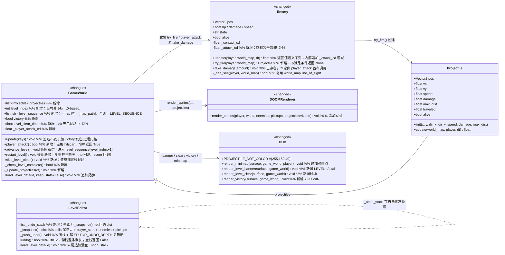
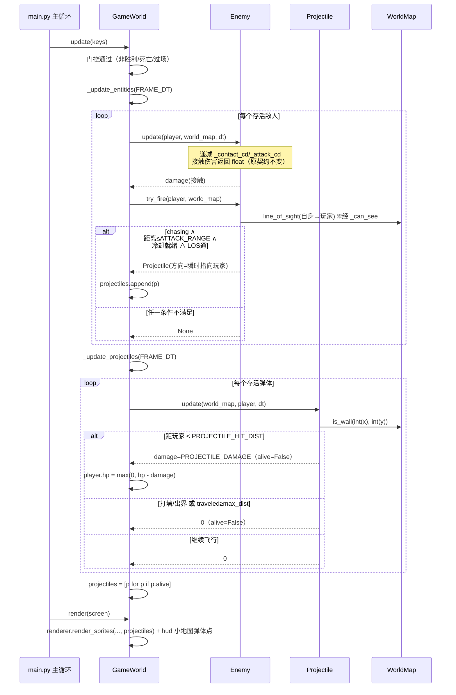
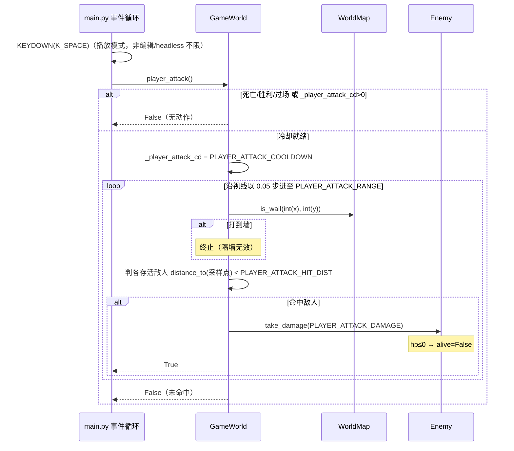
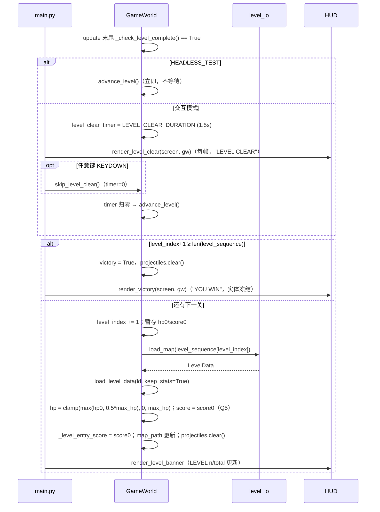
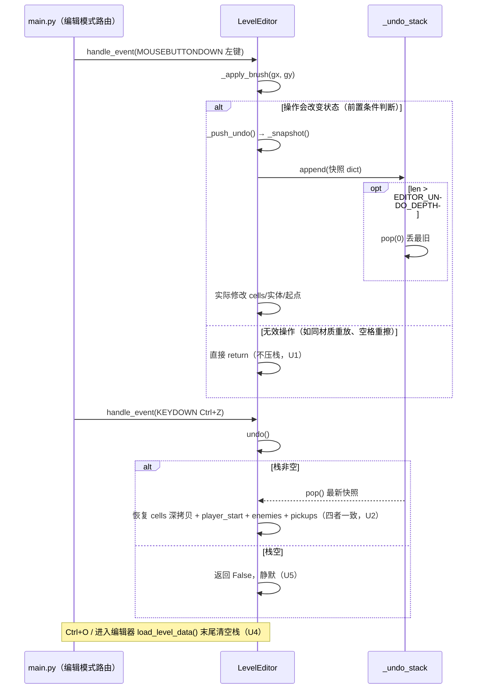
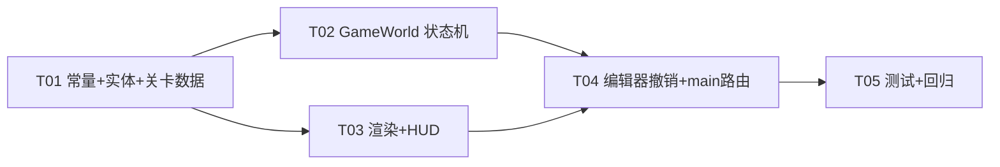

# DOOM 风格伪3D 射线投射游戏 — 增量架构设计与任务分解 V2

> 本文档是 `design/INCREMENTAL_ARCHITECTURE.md`（上一轮增量架构）与 `design/INCREMENTAL_PRD_V2.md`（本轮增量 PRD）的落地设计，只描述本轮 3 项新需求（编辑器撤销 / 敌人远程攻击 / 多关卡递进）「新增/变更了什么」。
> 作者：架构师（高见远）。语言：简体中文。
> 约束：只做设计，不写实现代码；现有 209 个测试必须保持全过；所有改动均为**追加式**，不破坏 DDA 渲染管线、`WorldMap`/`line_of_sight`、音频子系统、ASCII 字符表与 `LevelData` 既有字段语义。
> 决策基线（主理人已拍板，本设计直接采用）：Q1 通关=清空全部敌人（含 L4 玩家空格 hitscan 攻击）；Q2 不做 redo；Q3 直线弹+BASIC 全员双伤害；Q4 `--map` 单关达成条件即 YOU WIN；Q5 score 累计、hp 带入且进新关 `hp = clamp(max(hp, 0.5*max_hp), 0, max_hp)`；Q6 空格 hitscan；Q7 LEVEL CLEAR 固定 1.5s + 任意键跳过、headless 不等待。

---

## 1. 实现方案与框架选型

### 1.1 结论：零新依赖，完全沿用现有架构

- **技术栈不变**：Python + pygame-ce + numpy + 标准库（`copy.deepcopy` 用于撤销快照，`math` 用于射线步进）。**不新增任何第三方依赖**。
- **架构模式不变**：继续遵守既有规则——`update` 只改状态 / `render` 只绘制；基础类型只在 `core/` 定义一次；所有数值常量集中 `config.py`；JSON 为权威关卡格式且向后兼容；headless 路径不实例化编辑器、不阻塞等待。

### 1.2 三块功能的挂载点（与现有模块的关系）

| 功能 | 挂载模块 | 挂载方式 | 为什么不破坏现有管线 |
|---|---|---|---|
| 编辑器撤销 | `editor/level_editor.py` | 纯编辑器内部状态：新增 `_undo_stack` + `_snapshot()/undo()/_push_undo()`，在 `_apply_brush`/`_erase` 生效前压栈；`_handle_key` 加 `Ctrl+Z` 分支（对齐现有 `Ctrl+S/O` 写法） | 不触碰 `level_io` 序列化格式与 `WorldMap` 结构；快照是编辑器私有数据，24×24 网格整体深拷贝成本可忽略 |
| 敌人远程攻击 | `core/entities.py`（`Projectile` 基础类型 + `Enemy.try_fire`）→ `world/game_world.py`（列表管理/命中结算）→ `render/renderer.py`（billboard 叠加）→ `world/hud.py`（小地图点） | `Enemy.update` 返回值**保持 float 不变**（不动 209 测试契约）；开火走**新增独立方法** `try_fire(player, world_map) -> Projectile|None`，由 `GameWorld._update_entities` 每帧调用并收集 | 投射物只是「会移动的 billboard 点」：渲染沿用 `render_sprites` 的 Lodev 相机变换叠加通道（新增可选参数），DDA 墙体管线一行不改；LOS 复用 `world_map.line_of_sight`（经 `Enemy._can_see`） |
| 多关卡递进 | `world/game_world.py`（`level_index`/`victory`/`level_clear_timer` 状态机 + `advance_level` + `player_attack`）、`world/hud.py`（LEVEL n/total、LEVEL CLEAR、YOU WIN）、`main.py`（事件路由：空格攻击、R 重开当前关、过场任意键跳过） | 进度状态**只在 GameWorld 维护**；关卡重建复用既有 `_load_map_file`/`load_level_data`（`load_level_data` 增加可选参数以保留 hp/score，见 §7.3 冲突约定） | `LEVEL_SEQUENCE` 是 config 显式清单，不做目录扫描；`--map` 单关模式完全绕开序列（`level_sequence = [map_path]`），向后兼容 |

### 1.3 核心技术难点与对策

1. **`load_level_data` 会把 hp/score 重置**（现代码第 108–110 行固定 `hp=PLAYER_MAX_HP, score=0`）。`advance_level` 需要"保留 score、hp 按 Q5 回血"。对策：给 `load_level_data(ld, keep_stats: bool = False)` 增加**尾部关键字参数**（默认 False = 现行为，签名向后兼容，209 测试不受影响）；`advance_level` 以 `keep_stats=True` 调用后按 Q5 公式修正 hp。详见 §7.3。
2. **玩家攻击须避免按住连发**。对策：攻击入口为 `GameWorld.player_attack()` 显式方法，由 `main.py` 在 `KEYDOWN(K_SPACE)` 事件中调用（事件驱动，天然一次一发），冷却 `_attack_cd` 在 `update` 里按 dt 递减兜底。
3. **hitscan 与 billboard 无真实半径**。对策：沿玩家朝向按固定步长（0.05）步进射线，逐步判 `world_map.is_wall`（打墙即止）与「与各存活敌人距离 < `PLAYER_ATTACK_HIT_DIST`（0.4，与弹体命中半径同量级）」，命中最近敌人即 `take_damage` 并结束。不引入新几何系统。
4. **headless 不阻塞**。对策：LEVEL CLEAR 过场用 `level_clear_timer`（秒，dt 递减）实现而非 sleep；`HEADLESS_TEST` 为真时 `advance_level` 立即执行、timer 置 0。主循环永不 wait。
5. **投射物生命周期不泄漏**。对策：`Projectile.alive=False` 的三种消亡路径（命中/打墙或出界/超程）统一在 `GameWorld._update_projectiles` 末尾一次性 `[p for p in ... if p.alive]` 过滤。

---

## 2. 文件列表（逐文件：修改 / 新增）

| 相对路径 | 类型 | 改动要点 |
|---|---|---|
| `doom_game/config.py` | 修改（仅追加常量） | `ENEMY_ATTACK_RANGE=5.0`、`ENEMY_ATTACK_COOLDOWN=1.5`、`PROJECTILE_SPEED=0.15`、`PROJECTILE_DAMAGE=8`、`PROJECTILE_HIT_DIST=0.4`、`PROJECTILE_MAX_DIST=8.0`、`PROJECTILE_COLOR=(255,150,40)`、`PLAYER_ATTACK_DAMAGE=15`、`PLAYER_ATTACK_RANGE=6.0`、`PLAYER_ATTACK_COOLDOWN=0.4`、`PLAYER_ATTACK_HIT_DIST=0.4`、`EDITOR_UNDO_DEPTH=50`、`LEVEL_SEQUENCE=[maps/level_01.json, maps/level_02.json, maps/level_03.json]`（用既有 `DEFAULT_MAP_DIR` 拼路径）、`LEVEL_CLEAR_DURATION=1.5`、`NEW_LEVEL_HP_FLOOR=0.5` |
| `doom_game/core/entities.py` | 修改 | 新增 `Projectile` 类；`Enemy` 新增 `_attack_cd` 字段与 `try_fire(player, world_map) -> Projectile|None`；`Enemy.update` 内追加 `_attack_cd` 的 dt 递减（返回值语义不变） |
| `doom_game/world/game_world.py` | 修改 | 新增 `projectiles`/`level_index`/`victory`/`level_clear_timer`/`level_sequence`/`_player_attack_cd` 状态；`_update_entities` 收集 `try_fire` 产物；新增 `_update_projectiles(dt)`、`player_attack()`、`_check_level_complete()`、`advance_level()`、`restart_level()`；`update` 加胜利/死亡/过场门控；`load_level_data(ld, keep_stats=False)`；`render` 传 projectiles 并调用新 HUD |
| `doom_game/render/renderer.py` | 修改 | `render_sprites(player, world, enemies, pickups, projectiles=None)` 追加**尾部默认参数**（现有调用与测试不破）；投射物按亮橙小色块（宽度系数约敌块 1/3）加入同一 blocks 列表 |
| `doom_game/world/hud.py` | 修改 | `render_minimap` 追加投射物橙色 2px 点（读 `getattr(game_world, "projectiles", None) or []`，兼容旧调用）；新增 `render_level_banner(surface, game_world)`、`render_level_clear(surface, game_world)`、`render_victory(surface, game_world)`（风格对齐 `render_death`） |
| `doom_game/editor/level_editor.py` | 修改 | 新增 `_undo_stack`、`_snapshot()`、`_push_undo()`、`undo()`；`_apply_brush`/`_erase` 顶部压栈（含无效操作不入栈判定）；`_handle_key` 加 `ctrl and K_z`；`load_level_data()` 末尾清栈；`_render_palette` 帮助行追加 "Ctrl+Z undo" |
| `main.py` | 修改 | 播放模式 `KEYDOWN(K_SPACE)` → `game.player_attack()`；`R` → `game.restart_level()`（重开当前关，替换原「重建 GameWorld」写法，保留 `level_index`）；过场期间任意键 → 跳过 timer；胜利态 `R` → 从第 1 关重开；`--map` 传入时 GameWorld 走单关模式；`_headless_validate` 增补「敌人开火中 + 弹体在场」渲染一帧与胜利/过场 HUD 各一帧 |
| `doom_game/world/level_io.py` | 微调（可选 A7） | `build_enemies` 增读可选 `attack_range`/`attack_cooldown`（`dict.get` 缺省 config），旧文件零改动可加载；ASCII 字符表**不动** |
| `maps/level_02.json` | 新增 | 中等难度：24×24，敌人 4–5 个（部分守拾取点）、走廊更窄、health 拾取 2 个 |
| `maps/level_03.json` | 新增 | 高难度：24×24，敌人 6–8 个（含高 hp/高速个体，走 JSON 字段覆盖）、开阔房间利于远程弹、health 拾取 1–2 个 |
| `README.md` | 修改 | 操作表补空格攻击、Ctrl+Z；特性补远程敌人/多关流程/胜利条件 |
| `tests/test_editor_undo.py` | 新增 | U1–U5：压栈/多步撤销/深度上限/加载清栈/空栈静默 |
| `tests/test_projectiles.py` | 新增 | A1–A6：Projectile 构造与三种消亡、try_fire 条件矩阵（LOS/射程/冷却）、冷却频率上限、config 常量存在 |
| `tests/test_level_progression.py` | 新增 | L1–L8：LEVEL_SEQUENCE 三关可解析、通关判定、advance_level 内容与 hp/score 规则、胜利态冻结、player_attack 命中/隔墙/冷却、单关 --map 胜利语义、restart_level 语义 |

**明确不改**：`render/noise.py`、`render/doppler.py`、`audio/`、`core/types.py`、`core/world_map.py`、`core/player.py`、`doom_game/editor/__init__.py`、ASCII 字符表、`LevelData` 字段。

---

## 3. 数据结构与接口（类图）

> 只画新增/变更部分；`<<changed>>` 表示在现有类上追加成员，签名保持向后兼容。



### 3.1 关键接口语义（工程师照此实现）

**`Projectile.__init__(x, y, dir_x, dir_y, speed=PROJECTILE_SPEED, damage=PROJECTILE_DAMAGE, max_dist=PROJECTILE_MAX_DIST)`**
- `(dir_x, dir_y)` 在构造时归一化后存为 `vx, vy`（单位方向）；`pos = Vector2(x, y)`；`traveled = 0.0`；`alive = True`。
- 方向为**发射瞬间**敌人指向玩家的直线（Q3 不追踪）。

**`Projectile.update(world_map, player, dt) -> float`**（返回本帧对玩家造成的伤害，通常 0）
1. `alive` 为 False → 返回 0。
2. 位移：`pos += (vx, vy) * speed`（speed 为格/帧，与 `ENEMY_SPEED` 同单位；`dt` 参数保留用于未来换算，当前按帧步进，与现有 `_contact_cd` 的 dt 递减风格并存并在 docstring 注明）。`traveled += speed`。
3. 命中玩家：`pos.distance_to(player.pos) < PROJECTILE_HIT_DIST` → `alive=False`，返回 `damage`（**由 GameWorld 扣 hp**，Projectile 不直接改 player，保持"实体不越权"惯例）。
4. 打墙/出界：`world_map.is_wall(int(pos.x), int(pos.y))` 为 True（`is_wall` 对界外已返回 True 语义按现实现处理）→ `alive=False`，返回 0。
5. 超程：`traveled >= max_dist` → `alive=False`，返回 0。

**`Enemy.try_fire(player, world_map) -> Projectile | None`**（由 GameWorld 每帧调用，Enemy.update 之后）
- 全部满足才发射：`alive`、`state == "chasing"`（已含 LOS+感知范围）、`pos.distance_to(player.pos) <= ENEMY_ATTACK_RANGE`、`_attack_cd <= 0`、`self._can_see(player, world_map)`（开火瞬间二次确认 LOS）。
- 发射：`_attack_cd = ENEMY_ATTACK_COOLDOWN`；返回 `Projectile(pos.x, pos.y, player.pos.x - pos.x, player.pos.y - pos.y)`。
- `_attack_cd` 的 dt 递减放在 `Enemy.update` 内（与 `_contact_cd` 同段代码），保证不调 try_fire 也正常冷却。
- A7（可选）：`Enemy.__init__` 追加尾部关键字参数 `attack_range=None, attack_cooldown=None`（None → 用 config），`build_enemies` 透传 `e.get(...)`。

**`GameWorld.player_attack() -> bool`**（main.py 在 KEYDOWN 空格时调用；死亡/胜利/过场中直接返回 False）
1. `_player_attack_cd > 0` → False。命中与否都置 `_player_attack_cd = PLAYER_ATTACK_COOLDOWN`（在 `update` 中 dt 递减）。
2. 从 `player.pos` 沿 `(cos(player.angle), sin(player.angle))` 以 0.05 步长步进至 `PLAYER_ATTACK_RANGE`：
   - 先判 `world_map.is_wall(int(x), int(y))` → 打墙即止（天然实现"隔墙无效"，无需再调 line_of_sight）；
   - 再判每个存活敌人 `distance_to(采样点) < PLAYER_ATTACK_HIT_DIST` → 命中即 `enemy.take_damage(PLAYER_ATTACK_DAMAGE)`，返回 True。
3. 走完射程无命中 → False。

**`GameWorld._check_level_complete() -> bool`**：`len(self.enemies) == 0 or all(not e.alive for e in self.enemies)`（Q1：无敌人关立即可过；注意 PRD L3 原文要求"列表非空"，主理人拍板为无敌人视为立即可过，以拍板为准）。

**`GameWorld.advance_level()`**：
- 若 `level_index + 1 >= len(level_sequence)` → `victory = True`，清空 `projectiles`，返回。
- 否则 `level_index += 1`；记录 `hp0=player.hp, score0=player.score`；`_load_map_file(level_sequence[level_index])`（内部 `load_level_data(ld, keep_stats=True)` 不重置数值）；然后 `player.hp = min(max(hp0, 0.5*player.max_hp), player.max_hp)`、`player.score = score0`（Q5）；`projectiles.clear()`；`_level_entry_score = score0`（供死亡重开回退）；`map_path = level_sequence[level_index]`（保证 `E` 编辑当前关，L9）。

**`GameWorld.restart_level()`**：重载 `level_sequence[level_index]`（`keep_stats=False`，hp 回满）；`player.score = _level_entry_score`（L8：score 回退到进本关时的值）；`victory=False`、`level_clear_timer=0`、`projectiles.clear()`。胜利态下由 main.py 先把 `level_index=0`、`_level_entry_score=0` 再调用（= 从第 1 关重开）。

**`GameWorld.update(keys)` 门控顺序**（在方法开头追加）：
1. `_player_attack_cd` dt 递减。
2. `victory` 或 `player.hp <= 0` → 直接 return（冻结实体与投射物，L5；渲染仍照常走）。
3. `level_clear_timer > 0` → `timer -= FRAME_DT`，归零（或 headless 立即）时调 `advance_level()`；过场期间 return（不更新实体）。
4. 正常帧：原有移动/旋转/音频 → `_update_entities`（内部对每个存活敌人调 `try_fire` 收集入 `projectiles`）→ `_update_projectiles` → 末尾 `_check_level_complete()` 为 True 且未在过场 → `HEADLESS_TEST ? advance_level() : level_clear_timer = LEVEL_CLEAR_DURATION`（Q7）。

**`GameWorld.__init__`**：`map_path` 非空 → `level_sequence = [map_path]`（单关模式，Q4 语义自动成立：唯一关通关即 victory）；否则 `level_sequence = list(LEVEL_SEQUENCE)` 且加载 `level_sequence[0]`（维持"maze 兜底"仅在加载失败时生效的现行为）。`level_index=0`、`_level_entry_score=0`。

**`LevelEditor` 撤销**：
- `_snapshot() -> dict`：`{"cells": copy.deepcopy(world_map.cells), "width": w, "height": h, "player_start": dict(player_start) if player_start else None, "enemies": [dict(x,y,hp,damage,speed,type) ...], "pickups": [dict(x,y,kind,amount) ...]}`——实体存**可序列化 dict**（与 `to_level_data` 同构），恢复时经 `build_enemies`/`build_pickups` 同款逻辑重建对象，避免深拷贝 Enemy 对象带来的引用歧义。
- `_push_undo()`：`_undo_stack.append(_snapshot())`；`len > EDITOR_UNDO_DEPTH` → `pop(0)`。
- **无效操作不入栈**（U1）：`_apply_brush`/`_erase` 先计算"是否会改变状态"（如擦除目标格无墙、无实体、无 player_start 命中 → 直接 return 不压栈；放置同材质墙到同格 → 不压栈）。实现建议：先 `_snapshot()`，执行操作后与栈顶预备快照比较不可行（成本高）——改为**前置条件判断**：`_erase` 判 `cells[gy][gx] is None and 无实体 and player_start 不在该格`；`_apply_brush` 墙笔刷判 `cells[gy][gx] == brush`，实体/玩家笔刷视为总是有变化（追加实体/覆盖起点）。
- `undo() -> bool`：栈空 → False（静默，U5）；否则弹栈恢复四元组并重建 `WorldMap`（宽高一致时可直接赋 cells）。
- `_handle_key`：`if ctrl and event.key == pygame.K_z: self.undo(); return`（放在 Ctrl+S/O 之后）。
- `load_level_data()` 末尾：`self._undo_stack = []`（U4，覆盖 Ctrl+O 与游玩快照进入两条路径）。

**HUD 新增方法**（均为 `(surface, game_world)` 签名，surface/None 守卫与现有一致）：
- `render_level_banner`：常驻左上/信息区文本 `LEVEL {level_index+1}/{len(level_sequence)}`；单关模式（len==1）也照常显示 `LEVEL 1/1`。
- `render_level_clear`：`game_world.level_clear_timer > 0` 时居中大字 "LEVEL CLEAR"（72 号，黄绿色 (120,220,80)）+ 小字 "press any key"。
- `render_victory`：`game_world.victory` 为 True 时，完全对齐 `render_death` 实现（半透明遮罩 + 72 号 "YOU WIN" 金色 (255,215,80) + "Press R to restart"）。
- `render_death` 不变；GameWorld.render 调用顺序：banner → clear → victory（victory 与 death 互斥：死亡时 hp>0 才可能 victory，无叠加）。

---

## 4. 程序调用流程（时序图）

### 4.1 一帧内：敌人开火 → 投射物飞行 → 命中扣血



### 4.2 玩家按空格攻击（hitscan）



### 4.3 通关 → 过场 → advance_level → 下一关重建



### 4.4 编辑器：编辑压栈 → Ctrl+Z 弹栈恢复



---

## 5. 依赖包列表

**确认：本轮零新增第三方依赖。**

```
- pygame-ce（现有）：窗口/事件/绘制，投射物与新 HUD 均走既有 Surface API
- numpy（现有）：仅纹理生成使用，本轮不新增用法
- Python 标准库（新用到的模块）：copy（deepcopy 撤销快照）、math（射线步进，已在用）
```

---

## 6. 任务列表（有序、含依赖，共 5 个任务）

> 主理人建议的 ①–⑨ 实现顺序完整保留，按功能层次归组为 5 个可独立提交的任务（每任务内部按 ①–⑨ 序号推进）。除 T01 外，T02/T03 可并行；T04 依赖 T02；T05 依赖全部。

| Task ID | 任务名 | 源文件 | 对应步骤 | 依赖 | 优先级 |
|---|---|---|---|---|---|
| **T01** | 常量 + 核心实体 + 关卡数据（战斗与关卡的数据基座） | `doom_game/config.py`（① 全部新常量）、`doom_game/core/entities.py`（② Projectile 类 + Enemy._attack_cd/try_fire）、`doom_game/world/level_io.py`（A7 可选字段透传）、`maps/level_02.json`、`maps/level_03.json`（⑥ 难度递增关卡） | ①②⑥ | 无 | P0 |
| **T02** | GameWorld 战斗与关卡递进状态机 | `doom_game/world/game_world.py`（③ projectiles 更新、player_attack、_check_level_complete、advance_level、restart_level、load_level_data(keep_stats)、update 门控） | ③ | T01 | P0 |
| **T03** | 渲染与 HUD 呈现层 | `doom_game/render/renderer.py`（④ render_sprites 追加 projectiles 尾参）、`doom_game/world/hud.py`（⑤ level_banner / level_clear / victory / 小地图弹体点） | ④⑤ | T01（可与 T02 并行；仅 GameWorld.render 接线处等 T02） | P0 |
| **T04** | 编辑器撤销 + main.py 流程路由 | `doom_game/editor/level_editor.py`（⑦ _undo_stack/_snapshot/undo/Ctrl+Z/清栈/帮助行）、`main.py`（⑧ 空格攻击转发、R=restart_level、过场任意键跳过、胜利态 R 回第 1 关、_headless_validate 增补）、`README.md`（操作表/特性更新） | ⑦⑧ | T02、T03（main 接线需两者就绪；编辑器撤销部分仅依赖 T01 的 EDITOR_UNDO_DEPTH，可先行） | P0 |
| **T05** | 测试与回归验证 | `tests/test_editor_undo.py`、`tests/test_projectiles.py`、`tests/test_level_progression.py`（⑨）；跑全量 209+ 测试与 `--headless` 自测 | ⑨ | T01–T04 | P0 |

**关键先后约束**（供工程师排程）：
- T01 必须最先（所有模块 import 新常量/新类）。
- T02 与 T03 互不 import，可并行；`GameWorld.render` 调新 HUD/render_sprites 新参的三行接线归 T02 收尾或 T04 开头均可（建议 T04 统一接线并联调）。
- T04 中编辑器撤销与 main.py 路由相互独立，可拆两次提交。
- T05 建议边做边写（TDD），但**最终全量回归**必须在 T04 完成后执行。

### 任务依赖图



---

## 7. 共享知识（跨文件约定）

### 7.1 常量与命名
- 所有新数值只在 `config.py` 定义一次：敌方远程 `ENEMY_ATTACK_*` / `PROJECTILE_*`，玩家攻击 `PLAYER_ATTACK_*`，编辑器 `EDITOR_UNDO_DEPTH`，关卡 `LEVEL_SEQUENCE` / `LEVEL_CLEAR_DURATION` / `NEW_LEVEL_HP_FLOOR`。任何模块不得散落魔法数字。
- 速度单位统一为**格/帧**（与 `MOVE_SPEED`/`ENEMY_SPEED` 一致）；冷却/计时单位为**秒**，按 `FRAME_DT` 每帧递减（与 `_contact_cd` 同款模式）。

### 7.2 颜色约定（渲染 + 小地图一致）
- 投射物：亮橙 `PROJECTILE_COLOR = (255, 150, 40)`（3D billboard 与小地图 2px 点同色），区别于敌红 (220,50,50)/血绿 (40,210,40)/分黄 (230,210,40)/玩家金 (255,220,80)。
- 3D 弹体色块宽度系数取敌块的 1/3（enemy draw_w 用 0.35 系数 → 弹体用 ≈0.12）。
- HUD 文字：LEVEL CLEAR 黄绿 (120,220,80)、YOU WIN 金 (255,215,80)、YOU DIED 沿用红 (220,40,40)。

### 7.3 hp/score 与 load_level_data 冲突约定（本轮最大风险点）
- 现状：`load_level_data` 固定重建 `Player(hp=PLAYER_MAX_HP, score=0)`。
- 约定：追加**尾部关键字参数** `keep_stats: bool = False`。False = 现行为（209 测试、编辑器 ESC 回玩、restart 均不变）；True = 重建 Player 后回填调用前暂存的 hp/score（`advance_level` 专用）。
- Q5 公式统一写作：`player.hp = min(max(hp0, NEW_LEVEL_HP_FLOOR * player.max_hp), player.max_hp)`。
- score 回退基准：`GameWorld._level_entry_score` 在每次 advance_level/restart 起点更新；死亡 R 重开当前关时 `score = _level_entry_score`、hp 回满。

### 7.4 撤销快照结构（editor 内部私有契约）
```python
{
  "width": int, "height": int,
  "cells": List[List[Optional[TextureType]]],   # copy.deepcopy
  "player_start": dict | None,                   # {"x","y","angle"} 浅拷贝
  "enemies": List[dict],                          # 与 to_level_data 同构（x,y,hp,damage,speed,type）
  "pickups": List[dict],                          # (x,y,kind,amount)
}
```
恢复时 enemies/pickups 经 dict → 对象重建（同 `build_enemies`/`build_pickups` 逻辑），保证撤销后对象无残留引用。栈上限 `EDITOR_UNDO_DEPTH=50`，超限 `pop(0)`。

### 7.5 关卡序列与加载约定
- `LEVEL_SEQUENCE` 用 `DEFAULT_MAP_DIR` 拼绝对路径，显式三元素清单，禁止目录扫描。
- `--map <path>` → `level_sequence = [path]`（单关模式）；无 `--map` → `level_sequence = list(LEVEL_SEQUENCE)` 并加载第 0 关（取代原「纯 maze」为默认入口；maze 仍是加载失败兜底，行为与现有 `_load_map_file` 容错一致）。
- `game.map_path` 始终 == `level_sequence[level_index]`，`E` 编辑/Ctrl+S 保存自然指向当前关（L9 零额外改动）。
- level_02/03 均为 24×24、version=1、只用现有 0–4 材质与现有实体字段，保证 `load_map`/编辑器/ASCII 导出全兼容。

### 7.6 headless 约定
- `HEADLESS_TEST` 或 `--headless` 下：LEVEL CLEAR 不进 timer，直接 `advance_level()`（不阻塞不等待，Q7）；编辑器仍不实例化；`_headless_validate` 注入「玩家射程内敌人 + 一枚在飞弹体」渲染一帧、并各渲染一帧 level_clear/victory 覆盖层（渲染后恢复状态），全部不崩即通过。
- 新测试全部纯逻辑或 `SDL_VIDEODRIVER=dummy`，不依赖真实显示/声卡。

### 7.7 与 PRD 的差异修正（以代码实际为准）
- PRD L3 写"敌人列表非空"才判通关，主理人 Q1 拍板"无敌人关卡视为立即可过"——**以拍板为准**，`_check_level_complete` 采用 §3.1 定义；测试按拍板断言。
- PRD A4 建议 `Projectile` 直接扣血；本设计改为 update 返回伤害、GameWorld 统一扣 `player.hp`（与 Enemy.update 返回接触伤害的现有惯例一致，便于测试）。
- PRD 建议 `Enemy.update` 返回值改 `(damage, projectile)` 或独立 try_fire 二选一——**选独立 `try_fire`**：`Enemy.update` 返回 float 的契约被现有测试与 `_update_entities` 直接依赖（`if damage > 0`），改元组属破坏性变更。
- 现 `main.py` 的 `R` 重建整个 `GameWorld`（连 renderer/audio 一起重建）；本轮改为调 `game.restart_level()` 原地重载，保留 `level_index` 与子系统（更快且符合 L6）。胜利态 R 由 main.py 先重置 `level_index=0` 再调 restart_level。

---

## 8. 待明确事项

无。7 项待确认问题（Q1–Q7）均已由主理人拍板并落入本设计；发现的设计风险（load_level_data 的 hp/score 重置冲突、Enemy.update 返回值契约、R 键语义变更）已在 §7.3 / §7.7 给出解决约定，无需再决策。


