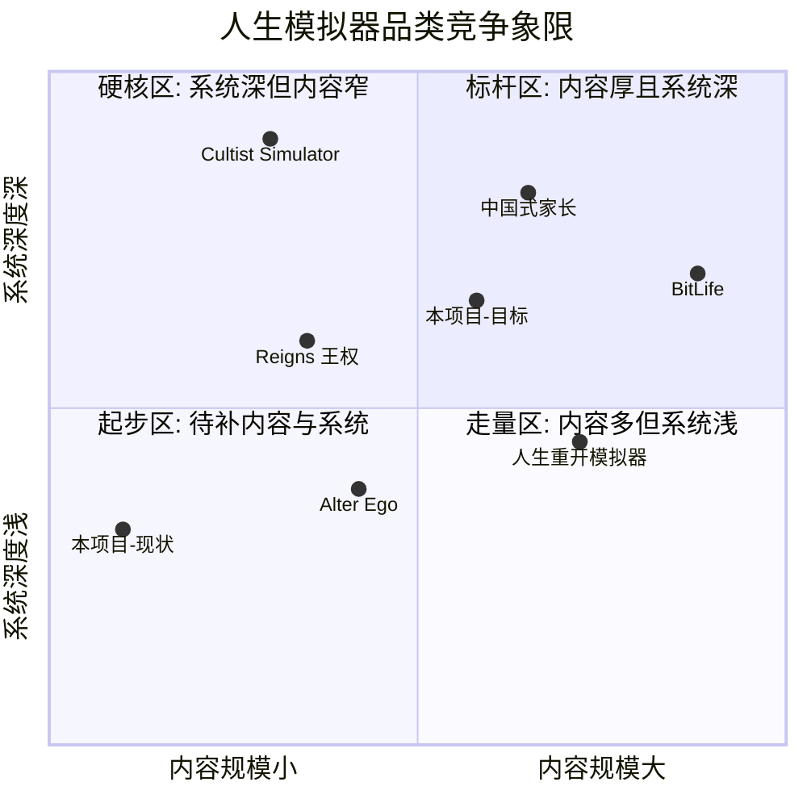

# 人生重开模拟器 — 全面增强版 PRD（增量开发）

| 项 | 内容 |
|---|---|
| Language | 中文 |
| Programming Language | **Python 3 + Tkinter（标准库）** — 沿用既有技术栈，不引入 Web/Pygame |
| Project Name | life_reset_simulator |
| 文档类型 | 完整 PRD（含竞品分析），增量增强 |
| 版本 | v1.0 |
| 作者 | 许清楚（产品经理） |

## 0. 原始需求复述

对已存在的《Life Reset Simulator》（Python + Tkinter 人生模拟器）做**从内容到功能的全面增强**。要求通过联网调研同品类成熟设计来指导增强方向，产出可落地的增量需求。

**硬性约束**：保持 Python + Tkinter 技术栈；不破坏现有存档兼容性；纯标准库（+ 最多 1-2 个轻量可选依赖）可实现；内容需符合中文语境且文案质量高。

---

## 1. 项目现状勘察（实测数据，非估算）

### 1.1 代码资产

| 文件 | 体量 | 职责 |
|---|---|---|
| `main.py` | 38 KB / 26 个函数 | CLI 版游戏本体 |
| `game_gui.py` | 62 KB / 48 个符号 | Tkinter GUI 版（完整移植 CLI 逻辑） |
| `decision_tree.py` | 16.5 KB / 19 个符号 | 王权(Reigns)风格决策树引擎 |
| `backgrounds.json` | 9.7 KB | 出身选择内容库 |
| `decision_cards.json` | 10.5 KB | 决策卡内容库 |
| `events.json` | 17.6 KB | 人生事件内容库 |

无 `requirements.txt`、无测试、无文档。`__pycache__` 与 `11.docx` 为冗余产物。

### 1.2 内容库实测规模（核心痛点）

| 内容库 | 实测量 | 结构 | 问题 |
|---|---|---|---|
| `backgrounds.json` | **6 步** | `steps{name, gender, father_job, childhood, teenage, adulthood}` | 开局分支太浅，第二局起完全无新鲜感 |
| `decision_cards.json` | **16 张** | `cards[]`，字段 `id/title/description/left_choice/right_choice/conditions/weight` | 极度稀缺，一局即打完全部卡池 |
| `events.json` | **22 条**（非 4 类） | `event_templates{generic:4, by_wealth:4, by_personality:7, by_age:7}` | 重复率极高 |

> **实测细分**：`generic` 4 条；`by_wealth` = rich 2 + poor 2；`by_personality` = 7 组 × 1 条；`by_age` = 20s:2 / 30s:2 / 40s:1 / 50s:1 / 60+:1。**全库合计仅 22 条事件**。

### 1.3 关键发现（影响需求设计的三个事实）

**发现 A：题材割裂（严重）**
`decision_cards.json` 全部 16 张卡是**中世纪王国**题材（边境冲突、瘟疫爆发、异端邪说、贵族叛乱、农民起义、王室盛宴），而 `backgrounds.json` 是**现代中国人生**题材（王建国/李翠花、父亲职业、童年/青年/成年）。两套内容在同一游戏中割裂，玩家体验断裂。

**发现 B：存档天然向后兼容（利好）**
```python
@classmethod
def from_dict(cls, data):
    player = cls()
    for key, value in data.items():
        if hasattr(player, key):      # 未知键静默忽略
            setattr(player, key, value)
    return player
```
该实现**天然容错**：新增属性时旧存档缺失的字段会保留 `__init__` 默认值；旧存档多余的键被忽略。**这意味着内容与属性扩充不会破坏存档**——只要遵守"新属性必须在 `__init__` 中有默认值"这一铁律。

**发现 C：`to_dict()` 与实际存档不一致（缺陷）**
实际存档 `save_陈明_24.json` 含 `game_mode` 字段，但 `Player.to_dict()` 并未输出该字段——说明 GUI 层在存档时额外拼接。这是一处需要在增强中收敛的技术债。

**发现 D：结局极少**
`traditional_ending()` 仅 6 个隐藏结局分支；`reigns_ending()` 仅 6 个称号判定。收集动机严重不足。

**发现 E：决策树引擎已相当完备（可复用）**
`decision_tree.py` 已实现 11 维度（力量/智慧/民心/财政/道德/稳定/教会/贵族/平民/健康/幸福）、`_check_card_conditions`、`_check_chain_reactions`（连锁反应）、`_check_crisis`（危机）、`get_ending_based_on_history`。**引擎能力远超现有 16 张卡的内容供给** —— 这是典型的"引擎强、内容弱"，扩内容的边际收益极高。

---

## 2. 竞品调研结论

### 2.1 竞品分析表

| 产品 | 核心机制 | 优点 | 缺点 | 可借鉴点 |
|---|---|---|---|---|
| **人生重开模拟器**（神户小德/小鸟, 2021, Web） | 天赋抽卡（10 连抽选 3）→ 20 点属性分配（颜值/智力/体质/家境）→ 逐年点击推进 | **146 个天赋分 4 稀有度**（黑/蓝/紫/橙）；天赋**互斥**设计（彩虹之下 vs 三胎人生）；**天赋继承**（死后选 1 个天赋下辈子必出）；人生总结 7 项评级；修仙隐藏线（活到 100 岁开启，上限 500 岁） | 纯文本、无 GUI 精细度；后期数值膨胀 | ★★★ **天赋继承是全行业最低成本的留存机制**；稀有度分层制造抽卡爽感；互斥制造 Build 身份 |
| **BitLife**（Candywriter, 2018） | 4 核心属性（Health/Happiness/Smarts/Looks）+ 每年 Age 按钮推进 | **200+ 职业 / 15 行业**；教育→职业的门槛链；**Legacy 系统**（角色死后接续玩其子孙，特质遗传）；犯罪/监狱子系统；房产股票投资；关系好感度会**随忽视而衰减**；死亡后 obituary 讣告总结 | 子系统多而浅；内购墙 | ★★★ 教育→职业门槛链；关系衰减机制；讣告式总结 |
| **中国式家长**（墨鱼玩游戏, 2018） | 挖脑洞获取属性 → 日程安排（6 项/天）→ 面子对决 → 高考 | 属性分层清晰（智商/情商/体魄/记忆力/想象力/魅力/悟性）+ 状态值（**面子/压力/行动力/父母满意度/零花钱**）；**特长分 4 稀有度**（普通/稀有/史诗/传说）；**多代传承 + 传家宝**；14 位同学羁绊 | **官方公认缺点：后期随机事件重复度较高** | ★★★ 压力/面子这类"社会性状态值"极贴中文语境；**"重复度高"正是本项目必须规避的头号失败模式** |
| **Reigns 王权**（Nerial, 2016） | 左右滑卡，4 资源（教会/民众/军队/财富）**双向死亡**（归零或爆满都亡） | 极简操作；**平衡张力**（不能一味堆高任一资源）；卡牌链式叙事 | 资源仅 4 维，深度有限 | ★★ 双向死亡的平衡张力（本项目 11 维已具备，需在卡面上体现） |
| **Alter Ego**（1986/复刻） | 人生阶段文字抉择 + 心理学人格测量 | 文学性强；抉择有心理学依据 | 无重玩激励；线性 | ★ 阶段化叙事结构 |
| **Cultist Simulator**（Weather Factory, 2018） | 卡牌+桌面拖拽，知识组合 | 系统深度极高；涌现式叙事 | 学习曲线陡峭；内容量中等 | ★ 事件链/组合解锁的深度设计 |
| **Vampire Survivors / Slay the Spire**（元进度参照） | 成就驱动解锁，扩充**卡池**而非直接加数值 | 每局失败都有产出；卡池越玩越大 | — | ★★★ **成就解锁扩池** —— 让同样的内容量"感觉更大"的最高性价比手法 |

### 2.2 竞品象限图




### 2.3 三条核心调研结论（直接驱动需求）

**结论 1 — 本项目的瓶颈是内容供给，不是引擎能力。**
`decision_tree.py` 已实现条件筛选、连锁反应、危机检测、历史结局判定，但只有 16 张卡可供调度。竞品中最接近的《人生重开模拟器》有 146 个天赋 + 数百事件。**扩内容的 ROI 远高于加系统**，故本 PRD 将「内容扩充」与「功能增强」并列为两大需求类，且内容类占 P0 主体。

**结论 2 — 留存机制中，「天赋继承 + 成就解锁扩池」性价比最高。**
《人生重开模拟器》仅用"死后选 1 个天赋，下辈子必出"一个机制就撑起了极高重开率；Slay the Spire / Vampire Survivors 用"成就解锁扩池"让固定内容量产生持续新鲜感。两者都是**纯数据层机制，无需图形/引擎改造**，完美适配 Tkinter 约束。

**结论 3 — 「后期重复度高」是本品类的头号失败模式，必须用工程手段防御。**
《中国式家长》的公开差评集中在此。本项目当前 22 条事件 + 16 张卡的规模下，该问题会在**第一局内**就暴露。因此除了堆量，必须引入**卡池冷却（cooldown）、已见集合（seen set）、权重衰减**三件套作为 P0 需求，而非可选优化。

---

## 3. 产品定义

### 3.1 产品目标（可量化）

| # | 目标 | 量化指标 |
|---|---|---|
| **G1** | **消除内容枯竭** — 单局与跨局都不再出现明显重复 | 决策卡 16 → **≥120 张**；事件 22 → **≥150 条**；单局内同一卡/事件重复率 **= 0**；连续 3 局的内容重合率 **< 30%** |
| **G2** | **建立重开动机** — 从"玩一次就删"变成"再来一局" | 上线天赋（**≥60 个** / 4 稀有度）、天赋继承、成就（**≥40 个**）、结局图鉴（**≥60 个结局**）；单用户平均局数目标 **≥5 局** |
| **G3** | **统一世界观并保持零破坏升级** — 修复题材割裂，旧存档 100% 可读 | 拆分「王朝篇 / 现代篇」双卡池，题材内自洽率 100%；**存量存档读取成功率 = 100%**，无需迁移脚本 |

### 3.2 用户故事

1. **As a** 第一次打开游戏的玩家，**I want** 通过天赋抽卡获得 3 个有稀有度、有个性的开局天赋，**so that** 我从第一秒就感到这局人生是"我的"，而不是千篇一律的模板。
2. **As a** 刚结束一局的玩家，**I want** 在结算页选择 1 个本局天赋"带到下辈子"，**so that** 我有明确理由立刻再开一局去试验新的天赋组合。
3. **As a** 连玩三局的玩家，**I want** 每局遇到的决策卡和事件大部分是没见过的，**so that** 我不会因为"又是这张边境冲突"而弃游。
4. **As a** 喜欢收集的玩家，**I want** 有成就系统和结局图鉴记录我解锁了哪些结局、还剩哪些没见过，**so that** 我有长期目标去反复探索不同 Build。
5. **As a** 偏好策略的玩家，**I want** 我的属性和选择能真实决定能走哪条职业路线（如智力不够就考不上大学、进不了科研线），**so that** 我的决策是有权重的而不是纯随机。
6. **As a** 有旧存档的老玩家，**I want** 升级后我之前的存档还能正常读取继续玩，**so that** 我不会因为更新而丢失进度。
7. **As a** 使用 GUI 版的玩家，**I want** 属性以进度条/颜色直观展示、危机有醒目预警、人生经历有时间轴回顾，**so that** 我不用在满屏文字里找数字。
8. **As a** 玩到结局的玩家，**I want** 一份带评级（如"智力 92 · 人中龙凤"）的人生总结报告并能导出为文本，**so that** 我可以保存或分享我这局的离奇人生。

---

## 4. 需求池

> 优先级：**P0 = Must have（本次必做）** / **P1 = Should have（本次应做）** / **P2 = Nice to have（可延后）**
> 分类：**【功能】= 功能增强（代码）** / **【内容】= 内容扩充（JSON 数据）**

### 4.1 P0 — Must have

| ID | 类别 | 需求 | 验收标准 |
|---|---|---|---|
| **P0-1** | 【功能】 | **内容加载器重构 + 防重复引擎**。统一 `content_loader` 加载全部 JSON；实现三件套：① **已见集合** seen set（单局内绝不重复）② **冷却 cooldown**（跨局 N 局内降权）③ **权重衰减**（抽中后 weight×0.5，跨局缓慢恢复） | 单局内同卡/同事件出现次数 = 1；连续 3 局内容重合率 < 30%；卡池耗尽时优雅降级而非崩溃 |
| **P0-2** | 【功能】 | **天赋系统（Talent）**。开局 10 连抽选 3；4 稀有度权重抽取；支持**互斥组**（mutex group）；天赋以修饰器形式影响初始属性、事件权重、解锁专属事件 | 抽卡界面可用；互斥天赋不同时出现；天赋效果在属性面板可见 |
| **P0-3** | 【功能】 | **天赋继承（Inheritance）**。结算页从本局 3 个天赋中选 1 个写入全局档案，下局抽卡时**置顶必出** | 选择后下一局首位天赋即为所选；跨进程持久化 |
| **P0-4** | 【功能】 | **全局档案 `profile.json`**。独立于单局存档，持久化：累计局数、已解锁成就、已见结局、继承天赋、已解锁卡池 | 文件不存在时自动创建默认档案；损坏时降级为默认而非崩溃 |
| **P0-5** | 【功能】 | **存档版本化与向后兼容**。存档新增 `schema_version`；`from_dict` 保持 `hasattr` 容错模式；收敛 `game_mode` 进 `to_dict()`（修复发现 C） | **现存 `save_陈明_24.json` 必须能被新版本正常读取并继续游戏**（无 `schema_version` 视为 v1）；新增属性一律在 `__init__` 给默认值 |
| **P0-6** | 【内容】 | **决策卡 16 → 120 张**（详见 §5.1），拆「王朝篇 60 / 现代篇 60」双卡池，修复题材割裂 | 卡数 ≥120；每张卡含双选项 + effects + speech；schema 校验通过 |
| **P0-7** | 【内容】 | **事件 22 → 150 条**（详见 §5.2），新增 `by_career`、`by_trait` 两个分组维度 | 事件数 ≥150；覆盖全部年龄段与人格类型；向后兼容原 4 组结构 |
| **P0-8** | 【内容】 | **天赋库 0 → 60 个**（详见 §5.3），4 稀有度分层 + 互斥组设计 | 60 个天赋，稀有度分布符合 §5.3 配比；每个含名称/描述/稀有度/效果/互斥组 |
| **P0-9** | 【内容】 | **结局 12 → 60 个**（详见 §5.5），分 6 大类 | 结局数 ≥60；每个含触发条件 + 文案 + 稀有度 |

### 4.2 P1 — Should have

| ID | 类别 | 需求 | 验收标准 |
|---|---|---|---|
| **P1-1** | 【功能】 | **成就系统**。40+ 成就，触发即提示并写入 `profile.json`；部分成就**解锁新卡池/新天赋**（借鉴 Slay the Spire 扩池） | 可触发、可持久化、可在图鉴查看；解锁类成就生效 |
| **P1-2** | 【功能】 | **结局图鉴 / 收集面板**。展示已解锁与未解锁（显示 `???`）结局 | 图鉴可打开；进度显示 `已解锁 X / 60` |
| **P1-3** | 【功能】 | **职业系统**。教育门槛 → 职业链（借鉴 BitLife），属性不达标不可进入；职业影响收入与后续事件池 | 40 个职业可达成；门槛判定生效 |
| **P1-4** | 【功能】 | **人生总结报告 + 评级**。结算输出 7 项评级（借鉴人生重开"颜值:0 地狱"式分级）+ 一键**导出 txt** | 报告含全属性评级、关键选择回顾、结局；导出文件可读 |
| **P1-5** | 【功能】 | **关系系统（轻量）**。父母/伴侣/挚友三类好感度，**随忽视衰减**（借鉴 BitLife） | 好感度可增减、会衰减、影响事件与结局 |
| **P1-6** | 【功能】 | **GUI 体验改进**（Tkinter 范围内，详见 §6） | 属性条、危机高亮、时间轴日志、卡牌切换过渡均实现 |
| **P1-7** | 【内容】 | **职业库 0 → 40 个**（详见 §5.4） | 40 个职业，覆盖 8 大门类，含门槛与收入 |
| **P1-8** | 【内容】 | **出身步骤 6 → 12 步**（详见 §5.6） | 12 步，含家庭结构/地域/时代/天赋倾向等新增维度 |
| **P1-9** | 【内容】 | **成就库 0 → 40 个** | 40 个成就，分 5 类，含隐藏成就 |

### 4.3 P2 — Nice to have

| ID | 类别 | 需求 | 说明 |
|---|---|---|---|
| **P2-1** | 【功能】 | **事件链（多幕剧情）** | 借鉴 Reigns 卡牌链，2-4 幕连续故事线；引擎已有 `_check_chain_reactions` 基础 |
| **P2-2** | 【功能】 | **多周目元进度（轮回点）** | 每局按表现产出"轮回点"，兑换开局微增益（借鉴 Hades 冥镜） |
| **P2-3** | 【功能】 | **修行模式扩充** | 补齐 `play_cultivation_mode` 的境界、渡劫、飞升内容 |
| **P2-4** | 【功能】 | **主题与字号设置** | 深/浅色主题、字号调节，写入 `profile.json` |
| **P2-5** | 【功能】 | **本地排行榜** | 历史最高分/最长寿/最富，本地 JSON |
| **P2-6** | 【内容】 | **事件链剧本 12 条** | 配合 P2-1 |
| **P2-7** | 【工程】 | **项目卫生**：`requirements.txt`、`.gitignore`（排除 `__pycache__`）、清理 `11.docx`、`README` | 非功能但影响可维护性 |

---

## 5. 内容扩充量化规格（核心章节）

> 本章是本次增强的**主体工作量**，所有数字均为**硬性下限**。工程师可超出，不可低于。
> 文案要求：**符合中文语境**，有具体细节与生活质感，允许黑色幽默与讽刺（参考人生重开模拟器的"美籍华人""天龙人"式设计），**严禁模板化灌水**（如"事件A/事件B"、同一句式换名词）。

### 5.1 决策卡：16 → **120 张**（P0-6）

**拆分为两个题材自洽的卡池，解决发现 A 的题材割裂问题。**

| 卡池 | 数量 | 说明 |
|---|---|---|
| **王朝篇** `decision_cards_dynasty.json` | **60 张** | 保留现有 16 张（不改 id，保证兼容），新增 44 张 |
| **现代篇** `decision_cards_modern.json` | **60 张** | 全新，对齐 `backgrounds.json` 的现代中国语境 |

**王朝篇 60 张分类配比：**

| 主题 | 数量 | 示例方向 |
|---|---|---|
| 军事 / 外交 | 12 | 边境冲突（存量）、质子入朝、议和条款、班师回朝、边将拥兵 |
| 财政 / 民生 | 12 | 粮食危机（存量）、经济改革（存量）、加征商税、开仓放粮、治河工程 |
| 宗教 / 文化 | 10 | 异端邪说（存量）、宗教分裂（存量）、文化复兴（存量）、修订史书、封禅大典 |
| 贵族 / 权谋 | 12 | 贵族叛乱（存量）、间谍发现（存量）、继承危机（存量）、外戚干政、党争站队 |
| 天灾 / 危机 | 8 | 瘟疫爆发（存量）、天灾降临（存量）、农民起义（存量）、蝗灾、地动 |
| 宫廷 / 私人 | 6 | 政治联姻（存量）、王室盛宴（存量）、储君教育、宠臣求情 |

**现代篇 60 张分类配比：**

| 主题 | 数量 | 示例方向 |
|---|---|---|
| 学业 | 10 | 分科选择、竞赛保送、复读与否、导师推荐、论文署名争议 |
| 职场 | 14 | offer 抉择、996 加班、背锅顶罪、跳槽窗口、竞业协议、被裁补偿谈判、创业合伙 |
| 情感 / 家庭 | 12 | 异地恋、彩礼谈判、婆媳矛盾、要不要孩子、父母养老、离婚财产 |
| 财务 / 投资 | 10 | 首付凑不凑、股票追高、借钱给亲戚、网贷诱惑、保险推销 |
| 健康 / 心理 | 8 | 体检异常、熬夜习惯、心理咨询、健身计划、职业病 |
| 社会 / 舆论 | 6 | 网络争议、见义勇为、举报同事、公益捐款 |

**卡牌 JSON schema（严格沿用现有结构，仅新增可选字段，保证向后兼容）：**

```json
{
  "id": "career_offer_choice",
  "pool": "modern",
  "title": "两份 offer",
  "description": "大厂给了高薪但要 996，国企钱少但清闲。HR 都催你今天答复。",
  "left_choice": {
    "text": "去大厂，趁年轻搏一把",
    "effects": { "WEALTH": 15, "HEALTH": -12, "HAPPINESS": -5 },
    "speech": "钱到位，什么都好说。"
  },
  "right_choice": {
    "text": "进国企，图个安稳",
    "effects": { "WEALTH": 5, "STABILITY": 15, "HAPPINESS": 8 },
    "speech": "健康是自己的。"
  },
  "conditions": { "required_traits": [], "min_intelligence": 0, "age_range": [22, 35] },
  "weight": 1.0,
  "tags": ["职场", "抉择"],
  "cooldown": 3
}
```

> **新增字段均为可选**：`pool` / `tags` / `cooldown` / `conditions.age_range`。旧卡缺失这些字段时须走默认值（`pool="dynasty"`, `tags=[]`, `cooldown=0`），**不得因缺字段而报错**。

---

### 5.2 人生事件：22 → **150 条**（P0-7）

**保留现有 4 个分组键（`generic` / `by_wealth` / `by_personality` / `by_age`）以兼容旧代码，新增 2 个分组键。**

| 分组 | 现状 | 目标 | 细分配比 |
|---|---|---|---|
| `generic` | 4 | **30** | 通用生活事件，任何阶段可触发 |
| `by_wealth` | 4 | **30** | `rich` 10 / `middle` 10（**新增档位**）/ `poor` 10 |
| `by_personality` | 7 | **32** | 8 组 × 4 条：`introvert` / `extrovert` / `nt_rational` / `nf_idealist` / `strong_warrior` / `smart_scholar` / `adventurer` / `sf_caretaker`（**新增**） |
| `by_age` | 7 | **48** | 8 档 × 6 条：`childhood`(0-12) / `teenage`(13-18) / `youth`(19-25)（**新增 3 档**）/ `20s` / `30s` / `40s` / `50s` / `60+` |
| `by_career` | — | **20**（新增） | 8 大职业门类，每类 2-3 条专属事件 |
| `by_trait` | — | **20**（新增） | 关联天赋/特质触发的专属事件 |
| **合计** | **22** | **≥180**（下限 150） | |

**事件 JSON schema（完全沿用现有结构）：**

```json
{
  "id": "evt_wallet_found",
  "desc": "地铁口捡到一个钱包，里面有三千块现金和一张身份证。",
  "options": {
    "A": { "text": "送到派出所 (运气+2)", "effects": { "luck": 2 },
           "feedback": ["民警给你倒了杯水。", "好人一生平安。"] },
    "B": { "text": "钱留下，证件寄回 (财富+3, 幸福-1)", "effects": { "wealth": 3, "happiness": -1 },
           "feedback": ["你说服了自己。", "夜里翻来覆去。"] },
    "C": { "text": "原地等失主 (魅力+2, 幸福-1)", "effects": { "charisma": 2, "happiness": -1 },
           "feedback": ["等了两小时，失主哭着道谢。"] }
  },
  "weight": 1.0,
  "cooldown": 5,
  "tags": ["道德", "都市"]
}
```

> 现有事件**无 `id` 字段** — 需求：为存量 22 条补齐 `id`，否则防重复引擎（P0-1）无法追踪。这是 P0-1 的前置依赖。
> 每个选项的 `feedback` 数组要求 **≥2 条**，避免反馈重复。存量部分事件有"这很符合你的人设"这类通用占位文案，**须替换为具体文案**。

---

### 5.3 天赋库：0 → **60 个**（P0-8）·新建 `talents.json`

**4 稀有度分层（借鉴人生重开模拟器的黑/蓝/紫/橙）：**

| 稀有度 | 代号 | 数量 | 抽取权重 | 强度定位 |
|---|---|---|---|---|
| 传说 | `legendary` (橙) | **6** | 1% | 改变整局玩法走向（如开启隐藏模式） |
| 史诗 | `epic` (紫) | **12** | 8% | 强力单向增益或高风险高回报 |
| 稀有 | `rare` (蓝) | **20** | 26% | 明确的属性倾向 |
| 普通 | `common` (黑) | **22** | 65% | 小幅调整 + 风味文案 |

**分类维度（每个天赋归属 1 个）：** 出身类 / 天资类 / 性格类 / 际遇类 / 诅咒类（负面但有补偿）/ 特殊类（开启隐藏线）

**互斥组设计（必须实现，制造 Build 身份）：** 至少定义 **8 组互斥**，例如 `family_wealth`（豪门 / 赤贫 互斥）、`health_axis`（天生强健 / 体弱多病 互斥）、`social_axis`（社交牛人 / 重度社恐 互斥）。

**天赋 JSON schema：**

```json
{
  "id": "tal_mysterious_box",
  "name": "神秘的小盒子",
  "rarity": "legendary",
  "category": "special",
  "description": "你有一个打不开的盒子。据说活得够久就能打开。",
  "mutex_group": "hidden_route",
  "effects": { "init": { "luck": 3 }, "modifiers": { "event_weight": { "tags": ["神秘"], "multiplier": 3.0 } } },
  "unlocks": ["cultivation_mode"],
  "unlock_condition": null
}
```

> `unlock_condition` 为 `null` 表示默认可抽；非 null 时需成就解锁（配合 P1-1 扩池机制）。**建议 60 个中有 12 个为成就解锁天赋**，制造长期目标。
> 传说级 6 个中至少 2 个用于开启隐藏路线（如已有的修行模式）。

---

### 5.4 职业库：0 → **40 个**（P1-7）·新建 `careers.json`

**8 大门类 × 5 个职业，形成阶梯：**

| 门类 | 数量 | 阶梯示例（初级 → 高级） |
|---|---|---|
| 学术科研 | 5 | 助教 → 讲师 → 副教授 → 教授 → 院士 |
| 医疗健康 | 5 | 实习医生 → 住院医 → 主治 → 主任医师 → 专家 |
| 工程技术 | 5 | 初级工程师 → 高工 → 架构师 → 技术总监 → CTO |
| 商业金融 | 5 | 柜员 → 分析师 → 基金经理 → 合伙人 → 董事长 |
| 法律政务 | 5 | 实习律师 → 律师 → 合伙人 / 科员 → 处长 → 厅局 |
| 文化艺术 | 5 | 群演 → 签约演员 → 主演 → 影帝 / 网红 → 顶流 |
| 体力技能 | 5 | 学徒 → 技工 → 技师 → 工长 → 包工头 |
| 灰色地带 | 5 | 黄牛 → 中介 → 放贷 → 白手套 → 阶下囚（借鉴 BitLife 犯罪线，含风险判定） |

**职业 JSON schema：**

```json
{
  "id": "car_software_architect",
  "name": "软件架构师",
  "category": "engineering",
  "tier": 3,
  "requires": { "education": "bachelor", "intelligence": 12, "prev_career": "car_senior_engineer", "min_age": 30 },
  "income": 45,
  "effects_per_year": { "wealth": 6, "health": -2, "happiness": -1 },
  "unlock_events": ["by_career.engineering"],
  "risk": null
}
```

> **教育门槛链（借鉴 BitLife）**：`none` → `high_school` → `bachelor` → `master` → `phd`，学历由学业阶段的属性与决策决定，**智力不达标则无法进入对应职业**（对应用户故事 5）。
> 灰色地带职业须含 `risk` 字段（被抓概率 + 后果），呼应 BitLife 犯罪线，但**文案须保持批判立场，不美化违法行为**。

---

### 5.5 结局库：12 → **60 个**（P0-9）·新建 `endings.json`

| 类别 | 数量 | 说明 |
|---|---|---|
| 普通结局 | 15 | 按属性区间判定的常规人生（平凡一生、小康、郁郁不得志…） |
| 事业结局 | 12 | 与职业顶点绑定（院士、影帝、CTO、阶下囚…） |
| 情感结局 | 8 | 与关系系统绑定（白头偕老、孤独终老、众叛亲离…） |
| 隐藏结局 | 12 | 苛刻条件触发（保留现有 6 个 + 新增 6 个） |
| 死亡结局 | 8 | 各类非自然结束（意外、疾病、危机崩盘…） |
| 传说结局 | 5 | 极限条件（飞升、名垂青史、富可敌国…） |

**结局 JSON schema：**

```json
{
  "id": "end_scholar_master",
  "name": "一代宗师",
  "category": "career",
  "rarity": "epic",
  "conditions": { "intelligence": [15, 999], "career_tier": 5, "career_category": "academic", "age": [65, 999] },
  "text": "你的名字被印在教科书的脚注里。学生们记不住你的脸，却背得出你的公式。",
  "score_bonus": 200
}
```

> **兼容要求**：现有 `traditional_ending()` 的 6 个隐藏结局与 `reigns_ending()` 的 6 个称号，**须迁移进 `endings.json` 但保持触发条件与文案不变**，避免老玩家感知到"结局丢了"。
> 每个结局文案 **≥2 句**，要有画面感和记忆点（对标人生重开的"你作为「人」的人生结束了"）。

---

### 5.6 出身步骤：6 → **12 步**（P1-8）

| 现有 6 步 | 新增 6 步 | 作用 |
|---|---|---|
| `name` 姓名 | `era` 出生年代 | 决定时代背景事件池（借鉴人生重开的年代事件） |
| `gender` 性别 | `region` 地域（一线/新一线/县城/乡镇） | 决定初始家境与教育资源 |
| `father_job` 父亲职业 | `mother_job` 母亲职业 | 补齐家庭画像 |
| `childhood` 童年 | `siblings` 家庭结构（独生/有兄姐/有弟妹） | 影响资源分配与性格 |
| `teenage` 青年 | `health_at_birth` 先天健康 | 与天赋互动 |
| `adulthood` 成年 | `aptitude` 天赋倾向（文/理/艺/体） | 与职业门槛链衔接 |

> **兼容要求**：`backgrounds.json` 的 `steps` 是 dict，新增键不影响旧代码遍历。但 `run_background_step()` 需支持新步骤类型，**且旧存档不含新字段时须走默认值**。
> 每步的选项数从当前的 2-3 个提升到 **≥4 个**，并为每个选项补充 **1-2 句风味文案**。

---

### 5.7 成就库：0 → **40 个**（P1-9）·新建 `achievements.json`

| 类别 | 数量 | 示例 |
|---|---|---|
| 里程碑 | 8 | 首次通关、玩满 10 局、活过 80 岁 |
| 属性极限 | 8 | 单项属性 ≥20、全属性 ≥10、单项归零仍存活 |
| 结局收集 | 8 | 解锁 10/30/60 个结局、集齐传说结局 |
| 奇葩成就 | 10 | 一局内破产三次、拒绝所有好意、连续 5 次选左 |
| 隐藏成就 | 6 | 不剧透，触发时才显示名称 |

> **其中至少 12 个成就须绑定解锁物**（新天赋 / 新卡池 / 新出身选项），落实结论 2 的"成就解锁扩池"。

---

### 5.8 内容工作量汇总表

| 内容项 | 现状 | 目标 | 增量 | 优先级 |
|---|---|---|---|---|
| 决策卡 | 16 | **120** | +104 | P0 |
| 人生事件 | 22 | **150**（建议 180） | +128 | P0 |
| 天赋 | 0 | **60** | +60 | P0 |
| 结局 | 12 | **60** | +48 | P0 |
| 职业 | 0 | **40** | +40 | P1 |
| 出身步骤 | 6 | **12** | +6 | P1 |
| 成就 | 0 | **40** | +40 | P1 |
| **合计条目** | **56** | **482** | **+426** | — |

---

## 6. UI / 交互改进建议（Tkinter 可行范围内）

> **约束**：纯 `tkinter` + `tkinter.ttk` 标准库实现，不引入 GUI 框架。允许可选依赖 **Pillow**（仅用于图标/图片，缺失时须优雅降级为纯文本）。

### 6.1 布局草案（主游戏界面）

```
┌──────────────────────────────────────────────────────────┐
│  [人生重开模拟器]         陈明 · 24岁 · 平民      [☰ 菜单] │
├────────────────────────┬─────────────────────────────────┤
│  ◆ 属性面板（左栏）     │   ◆ 主内容区（中栏）             │
│                        │                                 │
│  力量  ████████░░ 18   │   ┌───────────────────────────┐ │
│  智力  ███░░░░░░░  7   │   │  【两份 offer】            │ │
│  敏捷  ███░░░░░░░  7   │   │                           │ │
│  魅力  ████░░░░░░  8   │   │  大厂给了高薪但要 996，   │ │
│  幸运  ███░░░░░░░  6   │   │  国企钱少但清闲。         │ │
│  财富  ██░░░░░░░░  5   │   │                           │ │
│  幸福  ███░░░░░░░  6   │   │  [ 去大厂 ]  [ 进国企 ]   │ │
│  健康  ██████████ 20   │   └───────────────────────────┘ │
│                        │                                 │
│  ⚠ 稳定度偏低（危机）  │   ◆ 时间轴日志（可折叠）         │
│                        │   22岁 · 大学毕业               │
│  🏅 天赋               │   23岁 · 第一份工作             │
│  [神秘的小盒子] 橙     │   24岁 · 面临 offer 抉择 ←      │
│  [社交牛人] 蓝         │                                 │
└────────────────────────┴─────────────────────────────────┘
```

### 6.2 具体改进项

| # | 改进 | 实现方式（Tkinter） | 优先级 |
|---|---|---|---|
| U1 | **属性可视化进度条** | `ttk.Progressbar` 或 `Canvas` 矩形填充；按数值区间着色（红/黄/绿） | P1 |
| U2 | **危机高亮预警** | 复用 `decision_tree.get_crisis_warning()`，用红色 `Label` + 闪烁（`after()` 定时切换前景色） | P1 |
| U3 | **天赋徽章展示** | 按稀有度着色的 `Label`（橙/紫/蓝/灰），`tooltip` 悬浮显示描述 | P1 |
| U4 | **时间轴日志** | `Text` 组件 + `tag_config` 分色，支持滚动回看整局经历 | P1 |
| U5 | **卡牌切换过渡** | `Canvas` + `after()` 实现简易滑入/淡入（**纯坐标位移即可，不需图形库**） | P1 |
| U6 | **抽卡界面** | `Toplevel` 弹窗，10 张卡网格布局，按稀有度描边，点击选 3 | P0（配合 P0-2） |
| U7 | **结局图鉴面板** | `Toplevel` + `Canvas` 滚动区，未解锁显示 `???` | P1 |
| U8 | **人生总结报告** | `Toplevel` 展示评级表 + "导出 txt" 按钮（`filedialog.asksaveasfilename`） | P1 |
| U9 | **成就弹窗提示** | 右下角 `Toplevel` 无边框浮层，3 秒后 `after()` 自动淡出 | P1 |
| U10 | **主题与字号** | `ttk.Style` 切换配色；字号写入 `profile.json` | P2 |

### 6.3 交互原则

1. **不阻塞主线程** — 所有动画用 `widget.after()`，禁止 `time.sleep()`（会冻结 Tkinter 事件循环）。
2. **CLI 与 GUI 共享逻辑** — 新增系统（天赋/成就/结局）必须实现在**独立模块**中，`main.py` 与 `game_gui.py` 同时调用，避免现有的逻辑重复问题（当前 GUI 是 CLI 的完整移植，已产生 62KB 冗余）。
3. **降级友好** — Pillow 缺失、`profile.json` 损坏、内容 JSON 缺字段，均应降级运行而非崩溃。

---

## 7. 兼容性与技术约束（硬性）

### 7.1 存档兼容铁律

| 规则 | 说明 |
|---|---|
| **R1** | 所有新增 `Player` 属性**必须在 `__init__` 中赋默认值**。这样旧存档缺失该键时自动使用默认值。 |
| **R2** | **保持 `from_dict` 的 `hasattr` 容错模式**，不得改为严格校验。 |
| **R3** | 存档新增 `schema_version` 字段；读取时**无该字段视为 v1**，正常加载。 |
| **R4** | **不得删除或重命名**现有存档字段（`name/gender/title/strength/intelligence/agility/charisma/luck/wealth/happiness/health/EI/SN/TF/JP/traits/age/game_mode`）。 |
| **R5** | 验收必须包含：用**现存的 `saves/save_陈明_24.json` 实测读档并继续游戏成功**。 |
| **R6** | 全局档案 `profile.json` 与单局存档**分离**，互不影响；`profile.json` 损坏时重建默认档案。 |

### 7.2 内容 JSON 兼容铁律

| 规则 | 说明 |
|---|---|
| **R7** | 现有 `decision_cards.json` 的 16 个 `id` **不得更改**。 |
| **R8** | 现有 `events.json` 的 4 个分组键**不得删除**，只可新增分组键。 |
| **R9** | 所有新增 JSON 字段**必须可选**，加载器须为缺失字段提供默认值。 |
| **R10** | 内容文件拆分后，加载器须**同时支持新旧路径**（旧的 `decision_cards.json` 若存在则合并加载）。 |

### 7.3 依赖约束

- **必须**：Python 3 标准库（`tkinter`、`json`、`random`、`dataclasses`、`enum`、`pathlib`）。
- **可选（最多 2 个，且须优雅降级）**：`Pillow`（图标/图片）、`pytest`（测试，仅开发期）。
- **禁止**：任何 Web 框架、Pygame、PyQt、游戏引擎、网络请求依赖。

---

## 8. 待确认问题（Open Questions）

| # | 问题 | 影响 | 建议默认 |
|---|---|---|---|
| **Q1** | 「王朝篇」与「现代篇」是**在主菜单让玩家选择题材**，还是**按出身自动决定**？ | 影响主菜单与卡池加载逻辑 | 建议主菜单显式选择，最直观且实现最简 |
| **Q2** | 天赋系统是否**同时适用于王权模式和传统模式**，还是仅传统模式？ | 影响天赋效果的作用域设计 | 建议两者都适用，但王权模式下天赋主要影响 11 维初始值 |
| **Q3** | 是否需要**多代传承**（借鉴 BitLife Legacy / 中国式家长）？此项工作量大，本次未纳入需求池。 | 若要做需在架构上预留家族数据结构 | 建议本次不做，但 `profile.json` 预留 `lineage` 字段 |
| **Q4** | 内容扩充是**一次性交付全量**，还是**分批交付**（先各类 50%，验证后补齐）？ | 影响任务分解与验收节奏 | 建议分两批：P0 内容先交 60%，跑通引擎后补满 |
| **Q5** | 现有 `game_gui.py`（62KB，CLI 逻辑的完整副本）是否在本次做**逻辑抽取重构**？ | 不重构则新系统要写两遍，长期维护成本高 | 建议做**最小抽取**：仅将新增系统写成共享模块，不动存量代码 |
| **Q6** | 「灰色地带」职业线的尺度边界？ | 内容合规 | 建议保留但文案批判化，不出现具体作案手法 |
| **Q7** | 是否需要**内容 JSON 的 schema 校验脚本**（开发期自检）？ | 400+ 条目手写易出错 | 强烈建议做，成本低收益高 |

---

## 9. 附录：需求与调研结论对照

| 需求 ID | 来源竞品 | 借鉴点 |
|---|---|---|
| P0-1 防重复引擎 | 中国式家长（反面教材） | "后期重复度较高"是品类头号差评，用工程手段防御 |
| P0-2 天赋系统 | 人生重开模拟器 | 146 天赋 / 4 稀有度 / 互斥组 |
| P0-3 天赋继承 | 人生重开模拟器 | "死后选 1 个天赋，下辈子必出" |
| P0-9 / P1-2 结局图鉴 | 人生重开模拟器、BitLife | 结局收集 + 讣告式总结 |
| P1-1 成就解锁扩池 | Slay the Spire / Vampire Survivors | 成就解锁新卡进池，让固定内容"越玩越大" |
| P1-3 职业系统 | BitLife | 200+ 职业 / 教育门槛链 / 15 行业 |
| P1-4 评级报告 | 人生重开模拟器 | 7 项评级（"颜值:0 地狱"） |
| P1-5 关系衰减 | BitLife | 关系随忽视而衰减 |
| P2-1 事件链 | Reigns 王权 | 卡牌链式叙事 |
| P2-2 轮回点 | Hades（冥镜）| 元进度货币 |
| §5.1 现代篇卡池 | 中国式家长 | 面子/压力等贴合中文语境的社会性状态 |

---

**文档结束** · 交付物路径：`G:\Life Reset Simulator\docs\PRD-增强版.md`
