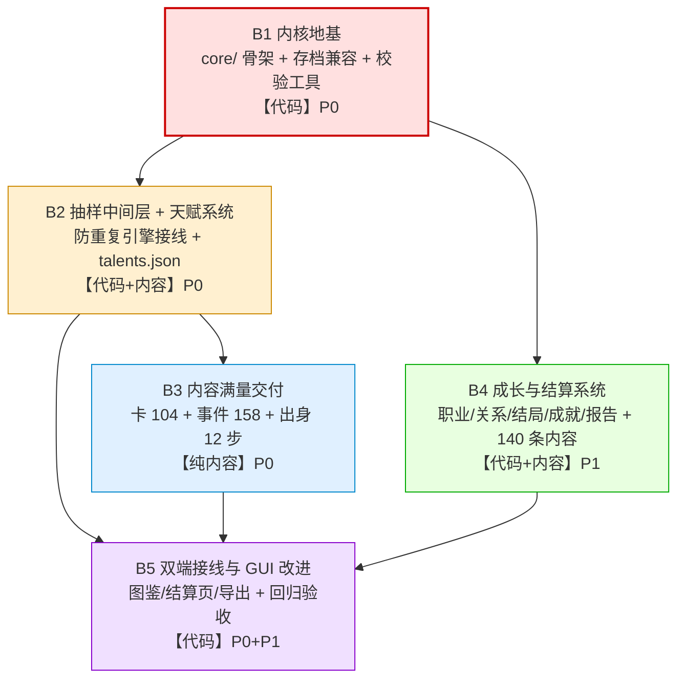

# 人生重开模拟器 — 增量架构设计（增强版）

> 架构师：高见远｜输入：`docs/PRD-增强版.md`（许清楚）＋ 交付总监拍板结论
> 面向读者：工程师寇豆码｜本文件是实现的唯一依据

---

## 1. 实现方案概述

### 1.1 本次任务的真实性质

实地勘察代码后的结论：**这不是一次引擎重构，而是一次「内容扩容 8.6 倍 + 外挂 4 个纯数据层系统 + 插入一个抽样中间层」的增量工程。**

| 维度 | 判断 |
|---|---|
| 引擎能力 | 已溢出。`DecisionTree` 的条件过滤、连锁反应、危机检测、历史结局全部就绪 |
| 内容规模 | 严重不足。56 → 482 条目，是唯一的真瓶颈 |
| 最大技术债 | `main.py` 与 `game_gui.py` 双份 `Player` + 双份玩法逻辑 |
| 本次工程重心 | 新建 `core/` 共享层，**双端同时调用**，杜绝第三份重复实现 |

### 1.2 为什么不重写 `decision_tree.py`（论证）

逐条核对现有引擎能力与新需求的匹配度：

| 新需求 | 现有引擎是否已支持 | 结论 |
|---|---|---|
| 120 张卡的条件过滤 | `_check_card_conditions()` 已支持 `required_traits` + 任意 `min_<dimension>` | ✅ 直接可用 |
| 卡池扩容 | `self.decision_cards` 是一个普通 list 属性 | ✅ **可在构造后直接赋值替换**，零侵入 |
| 加权抽样 | `get_available_cards()` 已实现按 `weight` 的无放回轮盘赌 | ✅ 直接可用 |
| 危机加权 | `crisis_imminent` 时标题含「危机」的卡 ×2.0 | ✅ 直接可用 |
| 11 维初始值受天赋影响 | `adjust_dimension()` 公开可调用 | ✅ 直接可用 |
| 双卡池（王朝/现代） | 无 | ⚠️ 由 `core` 层过滤后注入，引擎无需改动 |
| 防重复三件套 | 无 | ⚠️ 由 `core` 层在注入前完成，引擎无需改动 |
| 数据驱动连锁反应 | `_check_chain_reactions()` 硬编码 4 个 id | ⚠️ **唯一需要改动点**，追加式补丁 ≤30 行 |

**关键发现（决定整个架构形态）**：

```python
# decision_tree.py L55
self.decision_cards = self._load_decision_cards()
```

`decision_cards` 是一个可写的普通列表属性。这意味着：

> **我们只要在每次调用 `get_available_cards()` 之前，把「已过滤 + 已衰减权重」的卡池写回 `dt.decision_cards`，
> 就能在完全不修改引擎一行代码的前提下，实现分篇章卡池 + 防重复 + 权重衰减。**

这是本设计的核心杠杆点。称之为 **DeckBinder 注入模式**。

因此 `decision_tree.py` 的改动被压缩到只有一处：让 `_check_chain_reactions()` 在硬编码分支之外，追加读取卡牌自带的 `chain_reactions` 数据字段。这是**纯追加**，不删不改任何现有分支，存量 4 个 id 的行为完全不变。

**重写引擎的收益 ≈ 0，风险 = 破坏 16 张存量卡 + 双端调用点。故不重写。**

### 1.3 核心架构决策

| 编号 | 决策 | 理由 |
|---|---|---|
| A1 | 新建 `core/` 包承载全部新系统，**不含任何 tkinter / print** | 保证 CLI 与 GUI 都能 import；`core` 只吐数据结构，表现层各自渲染 |
| A2 | 采用 **DeckBinder 注入模式**接管卡池 | 零侵入复用引擎（见 1.2） |
| A3 | 存量 3 个 JSON **原地保留在根目录**，新内容放 `content/` 目录，加载器做**深合并** | 同时满足 R7/R8/R10；旧文件不动 = 零回归风险 |
| A4 | 新增内容按**交付批次**拆多文件，而非一个巨型 JSON | 400+ 条目单文件不可评审、易冲突、加载慢 |
| A5 | `Player` 类**不抽取到 core**，仅在两处各自追加同样的新字段 | Q5 拍板「只做最小抽取」；抽取 Player 会牵动 GUI 全部 62KB 调用点 |
| A6 | 新系统状态**全部挂在 `Player` 的新属性上**，随存档走 | 复用现成的 `to_dict`/`from_dict` 通道，不引入第二套序列化 |
| A7 | 引入 `GAME_MODE` 归一化表 | 修复实测发现的真实 BUG（见 1.4） |
| A8 | 内容校验脚本 `tools/validate_content.py` 作为**批次准入门禁** | Q7 拍板要做；400+ 条目手写必错 |

### 1.4 实测发现的存量 BUG（必须在 B1 修掉）

**BUG-1｜`game_mode` 命名双轨，导致读档进错模式**

- `game_gui.py` 写入的模式名：`power` / `adventure` / `cultivation`
- `main.py` 读档时的判断：`if game_mode == "reigns"` / `elif == "cultivation"`
- 实测存档 `saves/save_陈明_24.json` 里是 `"game_mode": "power"`

后果：该存档在 CLI 里加载，`"power" != "reigns"` 且 `!= "cultivation"`，**静默落入 traditional 分支**——玩家的王权局变成了冒险局。R5 要求「必须实测该存档能读档并继续游戏」，不修此 BUG 无法验收。

**BUG-2｜`game_mode` 在读档后丢失**

`Player.__init__` 没有 `game_mode` 属性 → `from_dict` 的 `hasattr` 判断为假 → 该字段被丢弃；`to_dict` 也不输出它，靠 `save_game()` 外部塞入。这是 P0-5「收敛 `game_mode` 进 `to_dict()`」的直接动机。

**BUG-3｜`by_age` 的三个新档位天然不可达**

`background_choice()` 末尾硬编码 `player.age = 20`，冒险循环每步 `age += 10` → 年龄序列恒为 20/30/…/90。因此新增的 `childhood`/`teenage`/`youth` 三档若挂在 `get_age_group()` 上，**永远抽不到**。

**处置方案（重要，工程师必须按此实现）**：
- `get_age_group()` **保持现有 5 档语义完全不变**（向后兼容，不动它）
- `childhood` / `teenage` / `youth` 三个新池由**新增的「早年回顾」阶段**显式点名抽取——该阶段挂在 12 步出身流程中（第 4/8/12 步后各触发一次），分别定点消费这三个池
- 即：`get_age_group()` 负责「按年龄自动匹配」，新三池走「按池名显式请求」通道。两条通道都由 `EventPicker` 统一提供

### 1.5 分层架构

```
┌─────────────────────────────────────────────────────┐
│  表现层（各自实现，互不复用）                          │
│  main.py (CLI/print)          game_gui.py (Tkinter)  │
└───────────────┬─────────────────────┬───────────────┘
                │  只调用 core 的纯函数/纯数据接口         │
┌───────────────▼─────────────────────▼───────────────┐
│  core/  共享领域层（零 UI 依赖、零 print、零 sleep）    │
│  ┌──────────────┬──────────────┬──────────────────┐ │
│  │ 抽样中间层    │ 成长系统      │ 结算系统          │ │
│  │ content_loader│ talents      │ endings          │ │
│  │ antirepeat    │ careers      │ achievements     │ │
│  │ deck / events │ relationships│ report           │ │
│  └──────────────┴──────────────┴──────────────────┘ │
│  基础设施：paths / constants / profile / savegame     │
└───────────────┬─────────────────────┬───────────────┘
                │                     │
┌───────────────▼──────┐   ┌──────────▼───────────────┐
│ decision_tree.py     │   │ 数据层                    │
│ （引擎，仅 +30 行）    │   │ 根目录 3 个存量 JSON       │
│                      │   │ content/ 8 个新 JSON      │
│                      │   │ profile.json / saves/     │
└──────────────────────┘   └──────────────────────────┘
```

**铁律**：`core/` 内**禁止** `import tkinter`、禁止 `print()`、禁止 `input()`、禁止 `time.sleep()`。
所有需要玩家交互的地方，`core` 只返回「候选项数据结构」，由表现层渲染并回传玩家选择。

---

## 2. 完整文件清单

图例：🆕 新增｜✏️ 修改（增量，不重构）｜⛔ 不动

### 2.1 根目录（存量）

| 路径 | 标记 | 职责 | 改动说明 |
|---|---|---|---|
| `main.py` | ✏️ | CLI 本体 | `Player` 追加新字段与 `to_dict`；接线 `core`；主菜单加篇章选择；`game_mode` 归一化 |
| `game_gui.py` | ✏️ | Tkinter GUI 本体 | 同上镜像改动 + 天赋抽卡页/图鉴页/结算页；`bg_step_keys` 改为读 `step_order` |
| `decision_tree.py` | ✏️ | 王权引擎 | **仅 1 处追加**：`_check_chain_reactions()` 末尾补数据驱动分支（≤30 行） |
| `backgrounds.json` | ✏️ | 出身库 | 6 步 → 12 步；新增顶层 `step_order`；每步选项补足 ≥4 |
| `decision_cards.json` | ✏️ | 王朝篇存量卡 | **16 个 id 一律不动**；每张补可选字段 `era`/`category`/`tags` |
| `events.json` | ✏️ | 存量事件 | **4 个分组键不动**；22 条**逐条补 `id`**（防重复引擎的前置条件） |
| `saves/*.json` | ⛔ | 存档 | 不迁移、不改写，靠加载器兼容 |
| `11.docx` | ⛔ | 废弃设计稿 | 忽略 |
| `__pycache__/` | ⛔ | — | 建议加 `.gitignore` |

### 2.2 `core/` 共享领域层（全部 🆕）

| 路径 | 职责 | 关键对外接口 |
|---|---|---|
| `core/__init__.py` | 包入口，暴露 `get_services()` 单例工厂 | `get_services() -> Services` |
| `core/paths.py` | 统一路径解析（含空格路径安全） | `ROOT`, `CONTENT_DIR`, `SAVES_DIR`, `PROFILE_PATH` |
| `core/constants.py` | 全局常量与枚举 | `SCHEMA_VERSION`, `Rarity`, `Era`, `GAME_MODES`, `MODE_ALIASES`, `EDUCATION_CHAIN`, `AGE_BANDS` |
| `core/jsonio.py` | 容错读写 JSON（损坏→返回默认值，绝不抛） | `read_json(path, default)`, `write_json_atomic(path, data)` |
| `core/content_loader.py` | **内容总加载器**：合并存量+新增、建 id 索引、补默认值、去重报警 | `ContentLoader.load()`, `.cards(era)`, `.events(group,sub)`, `.talents()`, `.careers()`, `.endings()`, `.achievements()` |
| `core/antirepeat.py` | **防重复三件套引擎**（已见集合／冷却／权重衰减 + 4 级降级） | `AntiRepeatEngine.pick(pool, k, ctx)`, `.mark_seen(id)`, `.effective_weight(item)` |
| `core/profile.py` | 全局档案 `profile.json` 读写、损坏重建、跨局衰减恢复 | `Profile.load()`, `.save()`, `.begin_run()`, `.end_run(result)` |
| `core/savegame.py` | 单局存档：`schema_version` 写入、v1→v2 迁移、`game_mode` 归一化 | `SaveManager.dump(player,mode)`, `.load(path) -> (data, migrated)`, `.normalize_mode(s)` |
| `core/deck.py` | **DeckBinder**：把过滤+衰减后的卡池注入 `DecisionTree` | `DeckBinder.bind(dt, player)`, `.next_cards(dt, player, k=3)` |
| `core/events_picker.py` | 人生事件抽取（自动年龄匹配 + 显式点名池 + 防重复） | `EventPicker.pick(player, pools=None)` |
| `core/talents.py` | 天赋：10 连抽、稀有度桶抽样、互斥、继承置顶、修饰器计算 | `TalentSystem.roll(profile, n=10)`, `.apply(player, chosen)`, `.modifier_for(player)` |
| `core/careers.py` | 职业：教育链门槛、晋升判定、灰色职业风险结算 | `CareerSystem.available(player)`, `.promote(player)`, `.tick_year(player)` |
| `core/relationships.py` | 关系：父母/伴侣/挚友好感度、忽视衰减 | `RelationshipSystem.tick(player)`, `.adjust(player, who, delta)` |
| `core/endings.py` | 结局判定：按 `endings.json` 条件匹配，返回最高优先级结局 | `EndingResolver.resolve(player, dt=None) -> Ending` |
| `core/achievements.py` | 成就：触发检测、解锁物派发（扩池机制） | `AchievementSystem.check(player, profile, phase)`, `.grant(profile, ach)` |
| `core/report.py` | 人生总结报告：7 项评级、评分、导出 txt | `LifeReport.build(player, ending)`, `.to_text()`, `.export(path)` |
| `core/models.py` | 轻量数据类（`Talent`/`Career`/`Ending`/`Achievement`/`EventItem`/`CardItem`） | dataclass 定义 |

### 2.3 `content/` 新内容目录（全部 🆕）

按**交付批次**切分，便于并行创作与分批评审：

| 路径 | 条目数 | 内容 |
|---|---|---|
| `content/cards_dynasty.json` | 44 | 王朝篇新增卡（与存量 16 张合计 60） |
| `content/cards_modern.json` | 60 | 现代篇卡（学业10/职场14/情感家庭12/财务投资10/健康心理8/社会舆论6） |
| `content/events_core.json` | 56 | `generic` 26 新增（+存量4=30）／`by_wealth` 30（rich10 + **middle10 新增** + poor10，含存量4） |
| `content/events_persona.json` | 52 | `by_personality` 32（8组×4，新增 `sf_caretaker`）／`by_trait` 20（**新分组**） |
| `content/events_life.json` | 68 | `by_age` 48（8档×6，新增 `childhood`/`teenage`/`youth`）／`by_career` 20（**新分组**） |
| `content/talents.json` | 60 | 传说6／史诗12／稀有20／普通22，≥8 组互斥 |
| `content/careers.json` | 40 | 8 门类 × 5 阶梯 |
| `content/endings.json` | 60 | 普通15／事业12／情感8／隐藏12（含存量6）／死亡8／传说5 |
| `content/achievements.json` | 40 | 里程碑8／属性极限8／结局收集8／奇葩10／隐藏6，≥12 个绑定解锁物 |

> 事件总计 = 30 + 30 + 32 + 48 + 20 + 20 = **180 条** ✅（PRD 下限 150）
> 决策卡总计 = 60（王朝，含存量16）+ 60（现代）= **120 张** ✅

### 2.4 工具与运行时产物（全部 🆕）

| 路径 | 职责 |
|---|---|
| `tools/validate_content.py` | 内容 schema 校验 CLI（Q7）。检查：必填字段、类型、枚举值、id 唯一性、id 命名规范、互斥组闭合、职业前置链闭合、结局条件字段合法、数量达标。**退出码非 0 即批次不准入** |
| `tools/count_content.py` | 输出各内容项当前条目数 vs 目标数的进度表（分批交付时自查） |
| `profile.json` | 运行时生成的全局档案（不入库，首次运行自动创建） |
| `exports/` | 人生总结报告 txt 导出目录（运行时自动创建） |

### 2.5 明确不做的事

- ❌ 不抽取 `Player` 到 `core`（Q5）
- ❌ 不重构 `game_gui.py` 存量 62KB 渲染代码（Q5）
- ❌ 不做多代传承玩法，仅在 `profile.json` 预留 `lineage` 字段（Q3）
- ❌ 不引入任何 Web/Pygame/PyQt/网络请求
- ❌ 不新增必需的第三方依赖（Pillow 与 pytest 均为可选，缺失时降级）

---

## 3. 数据结构与接口

> **本章是内容创作的唯一模板依据。** 所有 JSON 必须逐字段对齐本章定义，`tools/validate_content.py` 按本章生成校验规则。
> 通用约定：所有文件 UTF-8 无 BOM；缩进 2 空格；`ensure_ascii=false`；**所有"可选"字段的默认值由加载器补齐，内容作者可省略**（R9）。

### 3.0 通用类型约定

| 类型记号 | 含义 |
|---|---|
| `str!` | 必填字符串 |
| `int?=N` | 可选整数，默认 N |
| `float?=1.0` | 可选浮点，默认 1.0 |
| `[str]?=[]` | 可选字符串数组，默认空数组 |
| `{stat:int}` | 属性增量字典，键必须是 `PLAYER_STATS` 之一 |
| `{DIM:int}` | 维度增量字典，键必须是 `Dimension` 枚举名（大写） |
| `null` | 显式空值，语义为"无条件/不限制" |

**`PLAYER_STATS`（属性字典的合法键，与 `Player.adjust()` 严格对齐）**：
`strength` `intelligence` `agility` `charisma` `luck` `wealth` `happiness` `health` `EI` `SN` `TF` `JP` `traits`

> ⚠️ 前 7 项被 `adjust()` 钳制在 `[0,20]`，`health` 钳制在 `[0,100]`，`EI/SN/TF/JP` 不钳制，`traits` 为追加语义。内容作者的数值必须按此假设设计。

**`DIMENSIONS`（王权维度的合法键，共 11 个，必须大写）**：
`STRENGTH` `INTELLIGENCE` `CHARISMA` `WEALTH` `MORALITY` `STABILITY` `CHURCH` `NOBLES` `COMMONERS` `HEALTH` `HAPPINESS`

**`RARITY` 枚举**：`common` / `rare` / `epic` / `legendary`
**`ERA` 枚举**：`dynasty`（王朝篇）/ `modern`（现代篇）/ `any`（两篇通用）
**`EDUCATION_CHAIN`（有序）**：`none` → `high_school` → `bachelor` → `master` → `phd`

### 3.1 决策卡 schema（`decision_cards.json` ✏️ / `content/cards_*.json` 🆕）

**存量 16 张只允许"补可选字段"，`id`/`title`/`left_choice`/`right_choice`/`conditions`/`weight` 一律不动（R7）。**

```jsonc
{
  "id": "dyn_border_conflict",     // str! 唯一。存量16张保持原样；新增卡按 3.9 命名规则
  "title": "边境冲突",              // str! ≤12 字
  "description": "邻国在边境集结军队，是战是和？",  // str! 1-2 句，≤60 字
  "era": "dynasty",                // str?="dynasty"  枚举 ERA。存量16张统一补 "dynasty"
  "category": "military",          // str?="misc"     见下方分类表
  "tags": ["战争", "外交"],         // [str]?=[]      供天赋 event_weight 修饰器匹配
  "left_choice": {                 // obj! 左选项
    "text": "主动出击，展示武力",     // str! ≤20 字
    "effects": { "STRENGTH": 15, "WEALTH": -20 },  // {DIM:int}! 键必须是 DIMENSIONS，值 -30..30
    "speech": "让他们知道我们的厉害！"  // str?=""  选后台词
  },
  "right_choice": { /* 结构同 left_choice */ },
  "conditions": {                  // obj?={}  引擎 _check_card_conditions 直接消费
    "required_traits": [],         // [str]?=[]  玩家须同时拥有全部特质
    "min_strength": 0              // int?  形如 min_<dimension小写>，值 0..100
  },
  "weight": 1.0,                   // float?=1.0  基础权重，见 3.10 权重语义
  "min_year": 0,                   // int?=0    统治第 N 年后才可能出现（core 层过滤）
  "max_year": 999,                 // int?=999  超过则不再出现（core 层过滤）
  "once_per_run": false,           // bool?=false  true 时单局内绝不重复（防重复引擎强约束）
  "unlock_condition": null,        // str|null?=null  非空时须 profile 已解锁该成就 id
  "requires_talent": [],           // [str]?=[]  须持有的天赋 id（专属卡）
  "chain_reactions": [             // [obj]?=[]  数据驱动连锁反应（decision_tree.py 新增支持）
    {
      "on_choice": "left_choice",  // str! "left_choice" | "right_choice"
      "when": { "STRENGTH": [70, 100] },  // {DIM:[min,max]}?={}  全部满足才触发
      "title": "胜利的代价",         // str!
      "description": "阵亡士兵的家属充满怨恨。",  // str!
      "effects": { "COMMONERS": -10 }     // {DIM:int}!
    }
  ]
}
```

**`category` 分类表（用于配比校验，`validate_content.py` 强制检查数量）**

| era | category | 目标数 |
|---|---|---|
| dynasty | `military`（军事外交） | 12 |
| dynasty | `economy`（财政民生） | 12 |
| dynasty | `religion`（宗教文化） | 10 |
| dynasty | `intrigue`（贵族权谋） | 12 |
| dynasty | `disaster`（天灾危机） | 8 |
| dynasty | `personal`（宫廷私人） | 6 |
| modern | `study`（学业） | 10 |
| modern | `career`（职场） | 14 |
| modern | `family`（情感家庭） | 12 |
| modern | `finance`（财务投资） | 10 |
| modern | `health`（健康心理） | 8 |
| modern | `society`（社会舆论） | 6 |

> 存量 16 张需人工归入 dynasty 的 6 个 category（只补 `category` 字段，不改其它）。
> ⚠️ **现代篇卡仍使用 11 维 `DIMENSIONS` 作为 effects 键**——不引入第二套维度体系。现代语境下的语义映射：`NOBLES`→人脉资源、`COMMONERS`→群众口碑、`CHURCH`→体制/权威、`STABILITY`→生活稳定度、`MORALITY`→底线。此映射写进 `core/constants.py` 的 `DIMENSION_LABELS[era]`，仅影响 UI 显示文案，**不影响引擎计算**。

### 3.2 人生事件 schema（`events.json` ✏️ / `content/events_*.json` 🆕）

**顶层结构（新文件与存量文件同构，加载器做深合并）**

```jsonc
{
  "event_templates": {
    "generic":        [ /* EventItem[] */ ],
    "by_wealth":      { "rich": [], "middle": [], "poor": [] },
    "by_personality": { "introvert": [], "extrovert": [], "nt_rational": [], "nf_idealist": [],
                        "strong_warrior": [], "smart_scholar": [], "adventurer": [], "sf_caretaker": [] },
    "by_age":         { "childhood": [], "teenage": [], "youth": [],
                        "20s": [], "30s": [], "40s": [], "50s": [], "60+": [] },
    "by_career":      { "academic": [], "medical": [], "engineering": [], "business": [],
                        "legal": [], "art": [], "labor": [], "grey": [] },
    "by_trait":       { /* 键 = 特质名，值 = EventItem[] */ }
  }
}
```

> R8：`generic` / `by_wealth` / `by_personality` / `by_age` 四个键**必须存在且不得删除**。
> `by_wealth.middle`、`by_personality.sf_caretaker`、`by_age.childhood/teenage/youth`、`by_career`、`by_trait` 均为**新增键**。
> 深合并规则：同名 list 追加拼接，同名 dict 递归合并。**加载后按 `id` 全局去重，重复 id 报错**。

**`EventItem` 结构**

```jsonc
{
  "id": "ev_generic_peddler",   // str! 全局唯一。存量22条必须补齐（见 3.9 命名规则）
  "desc": "一个旅行商人向你兜售一件奇怪的东西。",  // str! 1-2 句
  "tags": ["际遇", "金钱"],       // [str]?=[]  供天赋 event_weight 匹配
  "weight": 1.0,                 // float?=1.0
  "era": "any",                  // str?="any"  枚举 ERA
  "once_per_run": false,         // bool?=false
  "cooldown_runs": 0,            // int?=0   跨局冷却局数，见 3.10
  "conditions": {                // obj?={}  由 core 层判定（引擎不参与）
    "min_age": 0,                // int?=0
    "max_age": 999,              // int?=999
    "required_traits": [],       // [str]?=[]
    "forbidden_traits": [],      // [str]?=[]
    "required_talents": [],      // [str]?=[]
    "required_education": null,  // str|null?=null  须 ≥ 该学历（EDUCATION_CHAIN 顺序比较）
    "min_stats": {},             // {stat:int}?={}  逐项 ≥
    "max_stats": {}              // {stat:int}?={}  逐项 ≤
  },
  "unlock_condition": null,      // str|null?=null  成就 id
  "options": {                   // obj! 至少 2 个、至多 4 个选项，键为 "A"/"B"/"C"/"D"
    "A": {
      "text": "买！就当交朋友了 (财富-2, 魅力+1)",  // str! 建议在文案里显式标注数值
      "effects": { "wealth": -2, "charisma": 1 },  // {stat:int}! 键必须是 PLAYER_STATS
      "feedback": ["行吧，你开心就好。", "有钱任性。"],  // [str]! ≥1 条，随机取一条
      "relationship_effects": { "partner": -5 },   // {who:int}?={}  who ∈ parent/partner/friend
      "flags": []                                  // [str]?=[]  写入 player.run_flags，供成就/结局判定
    }
  }
}
```

**分组配比目标（`validate_content.py` 强制校验）**

| 分组 | 子键 | 目标条目数 |
|---|---|---|
| `generic` | — | 30（含存量 4） |
| `by_wealth` | rich / middle / poor | 10 / 10 / 10（rich、poor 各含存量 2） |
| `by_personality` | 8 个子键 | 各 4，合计 32（7 个存量子键各含 1 条存量） |
| `by_age` | childhood/teenage/youth/20s/30s/40s/50s/60+ | 各 6，合计 48 |
| `by_career` | 8 个门类键 | 各 2~3，合计 20 |
| `by_trait` | 自定义特质键 | 合计 20 |
| **总计** | | **180** |

**⚠️ 存量 22 条补 id 是硬前置**：无 `id` 则防重复引擎无法追踪。补齐规则见 3.9，**只加 `id` 字段，`desc`/`options` 一字不改**。

### 3.3 天赋 schema（`content/talents.json` 🆕，60 条）

```jsonc
{
  "schema_version": 1,
  "talents": [
    {
      "id": "tal_mysterious_box",   // str! 唯一，前缀 tal_
      "name": "神秘的小盒子",         // str! ≤8 字
      "rarity": "legendary",         // str! 枚举 RARITY
      "category": "special",         // str! origin|aptitude|personality|encounter|curse|special
      "description": "你有一个打不开的盒子。据说活得够久就能打开。",  // str! 1-2 句，要有梗
      "mutex_group": "hidden_route", // str|null?=null  同组天赋互斥，抽卡时至多出现 1 个
      "weight": 1.0,                 // float?=1.0  同稀有度桶内的相对权重（不跨桶比较！）
      "effects": {                   // obj?={}
        "init":       { "luck": 3 },              // {stat:int}?={}  开局属性增量
        "init_dimensions": { "CHARISMA": 10 },    // {DIM:int}?={}   王权模式 11 维初始增量（Q2）
        "init_traits": ["神秘"],                   // [str]?=[]      开局追加特质
        "modifiers": {                            // obj?={}
          "event_weight": [                       // [obj]?=[]  按 tag 调整内容权重
            { "tags": ["神秘"], "multiplier": 3.0 }   // tags:[str]!  multiplier:float! 0.1..5.0
          ],
          "stat_gain":  { "intelligence": 1.5 },  // {stat:float}?={}  正向增益放大倍率
          "stat_loss":  { "health": 0.5 },        // {stat:float}?={}  负向损失衰减倍率
          "career_bonus": { "academic": 2 },      // {career_category:int}?={} 职业门槛智力等效加成
          "relationship_decay": 0.5               // float?=1.0  关系衰减速率倍率
        }
      },
      "unlocks": ["cultivation_mode"],  // [str]?=[]  解锁物 key，见 3.8 解锁物注册表
      "unlock_condition": null,         // str|null?=null  非空=须先解锁该成就 id 才进抽卡池
      "inheritable": true               // bool?=true  false 则不可被选为继承天赋
    }
  ]
}
```

**数量与权重配比（硬性，`validate_content.py` 校验）**

| rarity | 数量 | 桶抽取概率 | 强度定位 |
|---|---|---|---|
| `legendary` | 6 | **1%** | 改变整局走向（≥2 个用于开启隐藏路线） |
| `epic` | 12 | **8%** | 强力单向增益 / 高风险高回报 |
| `rare` | 20 | **26%** | 明确属性倾向 |
| `common` | 22 | **65%** | 小幅调整 + 风味文案 |

- `category` 六类必须都有覆盖；`curse`（诅咒类）须是"负面但有补偿"，不得纯负面
- **`mutex_group` ≥ 8 组**，建议：`family_wealth` / `health_axis` / `social_axis` / `intel_axis` / `luck_axis` / `career_axis` / `emotion_axis` / `hidden_route`
- **60 个中恰好 12 个** `unlock_condition != null`（成就解锁扩池机制）
- **两级抽样**：先按 rarity 概率选桶 → 再按桶内 `weight` 轮盘赌。因此 `weight` **只在同稀有度内有意义**

### 3.4 职业 schema（`content/careers.json` 🆕，40 条）

```jsonc
{
  "schema_version": 1,
  "careers": [
    {
      "id": "car_software_architect", // str! 唯一，前缀 car_
      "name": "软件架构师",             // str!
      "category": "engineering",       // str! academic|medical|engineering|business|legal|art|labor|grey
      "tier": 3,                       // int! 1..5
      "description": "你终于不用写代码了，改成在会议室里画框图。",  // str! 1-2 句
      "requires": {                    // obj?={}
        "education": "bachelor",       // str?="none"   EDUCATION_CHAIN 中的最低学历
        "min_stats": { "intelligence": 12 },  // {stat:int}?={}
        "prev_career": "car_senior_engineer", // str|null?=null  前置职业 id（tier>1 时必填）
        "min_age": 30,                 // int?=0
        "min_career_years": 3,         // int?=0   在前置职业上停留的最少年数
        "required_talents": []         // [str]?=[]
      },
      "income": 45,                    // int! 0..100 展示用年收入指标
      "effects_per_year": { "wealth": 6, "health": -2, "happiness": -1 },  // {stat:int}! 每"年"结算
      "unlock_events": ["by_career.engineering"],  // [str]?=[]  激活的事件池路径
      "unlock_endings": ["end_cto"],   // [str]?=[]  使这些结局变为可达
      "risk": null                     // obj|null?=null  仅 grey 类必填，见下
    }
  ]
}
```

**`risk` 结构（仅 `category == "grey"` 必填，Q6：保留但文案批判化）**

```jsonc
"risk": {
  "caught_chance": 0.15,                       // float! 0.0..1.0 每年判定一次
  "consequence": { "wealth": -10, "happiness": -5, "health": -5 },  // {stat:int}!
  "forced_ending": "end_behind_bars",          // str|null?=null  命中即强制结局
  "warning_text": "你开始睡不好觉，每一次敲门声都让你心跳加速。"  // str!
}
```

> **内容红线（Q6）**：灰色职业文案必须站在批判立场，描写代价与恐惧，**禁止出现任何具体作案手法、工具、话术模板**。校验脚本对 `grey` 类做关键词黑名单扫描。

**阶梯完整性约束**：8 门类 × tier 1..5 各恰好 1 个；tier ≥ 2 的 `prev_career` 必须指向同 category 且 tier−1 的职业（校验脚本做闭环检查）。

### 3.5 结局 schema（`content/endings.json` 🆕，60 条）

```jsonc
{
  "schema_version": 1,
  "endings": [
    {
      "id": "end_scholar_master",   // str! 唯一，前缀 end_
      "name": "一代宗师",             // str! ≤8 字
      "category": "career",          // str! normal|career|emotion|hidden|death|legend
      "rarity": "epic",              // str! 枚举 RARITY（决定图鉴展示的稀有度色）
      "priority": 70,                // int?=0  多个结局同时命中时取 priority 最大者
      "game_mode": "any",            // str?="any"  any|traditional|reigns|cultivation
      "conditions": {                // obj! 全部条件 AND 关系，空对象 = 无条件（兜底结局）
        "stats":        { "intelligence": [15, 999] },  // {stat:[min,max]}?={}  闭区间
        "dimensions":   { "STABILITY": [80, 100] },     // {DIM:[min,max]}?={}   仅 reigns 模式生效
        "age":          [65, 999],                      // [min,max]?=[0,999]
        "career_id":     null,                          // str|null?=null
        "career_tier":   null,                          // int|null?=null   须 ≥ 该值
        "career_category": "academic",                  // str|null?=null
        "education":     null,                          // str|null?=null   须 ≥ 该学历
        "relationships": {},                            // {who:[min,max]}?={}
        "required_traits":   [],                        // [str]?=[]
        "forbidden_traits":  [],                        // [str]?=[]
        "required_talents":  [],                        // [str]?=[]
        "required_flags":    [],                        // [str]?=[]  player.run_flags 须全含
        "min_decisions":     0                          // int?=0  reigns 模式最少决策次数
      },
      "text": "你的名字被印在教科书的脚注里。学生们记不住你的脸，却背得出你的公式。",  // str! ≥2 句
      "score_bonus": 200,            // int?=0  计入总评分
      "unlocks": [],                 // [str]?=[]  解锁物 key
      "hidden_hint": "把智力堆到极致，然后活得够久。"  // str?=""  图鉴未解锁时显示的提示（可为空）
    }
  ]
}
```

**数量配比（硬性）**

| category | 数量 | 说明 |
|---|---|---|
| `normal` | 15 | 按属性区间判定的常规人生 |
| `career` | 12 | 与职业顶点绑定 |
| `emotion` | 8 | 与关系系统绑定 |
| `hidden` | 12 | **含存量 6 个（触发条件与文案原样迁移）** |
| `death` | 8 | 非自然结束 |
| `legend` | 5 | 极限条件 |

**存量结局迁移清单（P0 兼容，条件与文案一字不改）**

来自 `traditional_ending()` 的 6 个隐藏结局：

| 新 id | 原触发条件 | 原文案 |
|---|---|---|
| `end_beloved_lord` | `wealth>=12 and charisma>=8` | 你成为了一位富甲一方且受人爱戴的领主，名垂青史。 |
| `end_great_scholar` | `intelligence>=12` | 你是一位伟大的学者，留下了影响后世的著作。 |
| `end_legend_adventurer` | `strength>=12 and agility>=8` | 你被誉为传说中的冒险家，无数吟游诗人传唱你的故事。 |
| `end_happy_hermit` | `wealth<=3 and happiness>=10` | 你虽清贫，却一生快乐自由，是位快乐的隐士。 |
| `end_sage_of_truth` | `"神秘知识" in traits and intelligence>=10` | 你凭借那本古籍发现了世界的真理，成为了大贤者。 |
| `end_life_of_regret` | `happiness<=2` | 你的人生充满了遗憾，但至少你曾经尝试过。 |

> ⚠️ 原代码是 `if/elif` 链，**顺序即优先级**。迁移时按上表从上到下设 `priority` = 60/59/58/57/56/55，保证判定顺序完全一致。
> `reigns_ending()` 的 6 个称号（征服者/智者/仁君/富王/明君/平衡大师）**不是结局**，是可叠加称号，保持原有实现不动，另在报告中展示。

**兜底结局（必须存在，防止无匹配崩溃）**：`end_ordinary_life`，`category: "normal"`，`conditions: {}`，`priority: -1`。

### 3.6 成就 schema（`content/achievements.json` 🆕，40 条）

```jsonc
{
  "schema_version": 1,
  "achievements": [
    {
      "id": "ach_first_clear",      // str! 唯一，前缀 ach_
      "name": "初次重开",             // str!
      "description": "完成第一局游戏。",  // str!
      "category": "milestone",       // str! milestone|stat_limit|collection|weird|hidden
      "hidden": false,               // bool?=false  true 则未解锁时图鉴显示 ??? 且不显示描述
      "trigger": {                   // obj! 恰好使用下列 type 之一
        "type": "profile_stat",      // str! 见下方 trigger.type 表
        "key": "total_runs",         // str?  依 type 而定
        "op": ">=",                  // str?=">="  >= | <= | == | contains
        "value": 1                   // int|str|[str]!  比较值
      },
      "unlocks": ["tal_reborn_veteran"],  // [str]?=[]  解锁物 key，见 3.8
      "score_bonus": 50              // int?=0
    }
  ]
}
```

**`trigger.type` 全集（工程师据此实现 `AchievementSystem.check()`，不得自创）**

| type | key 语义 | 判定时机 phase | 示例 |
|---|---|---|---|
| `profile_stat` | `profile.stats` 或 `total_runs` 的字段名 | `run_end` | 玩满 10 局 |
| `player_stat` | `PLAYER_STATS` 之一 | `event`/`run_end` | 单项属性 ≥20 |
| `all_stats` | 无（比较 7 项基础属性同时满足） | `run_end` | 全属性 ≥10 |
| `age` | 无 | `run_end` | 活过 80 岁 |
| `ending_unlocked` | 无，`value` 为结局 id 或 `int`（已解锁结局总数） | `run_end` | 解锁 30 个结局 |
| `ending_category_all` | 无，`value` 为 category 名 | `run_end` | 集齐传说结局 |
| `career_reached` | 无，`value` 为职业 id | `run_end` | 当上院士 |
| `talent_owned` | 无，`value` 为天赋 id 或数组 | `run_end` | 同时拥有某组天赋 |
| `flag_count` | flag 名 | `event`/`run_end` | 一局内破产三次（`value: 3`） |
| `flag_streak` | flag 名 | `event` | 连续 5 次选左（`value: 5`） |
| `relationship` | `parent`/`partner`/`friend` | `run_end` | 亲情归零 |
| `composite` | 无，`value` 为**成就 id 数组**，全解锁则连锁解锁 | `run_end` | 集邮型成就 |

- `hidden` 类恰好 6 个，且 `hidden: true`
- **≥12 个成就的 `unlocks` 非空**（落实扩池机制）
- `flag_count` / `flag_streak` 依赖事件选项写入的 `flags` 字段，内容创作时必须成对设计

### 3.7 出身库 schema（`backgrounds.json` ✏️，6 步 → 12 步）

**顶层新增 `step_order`（关键：解除 CLI/GUI 双份硬编码步骤列表）**

```jsonc
{
  "title": "人生重开模拟器",
  "description": "...",
  "step_order": [                 // [str]?  🆕 缺失时回退到旧的 5 键硬编码列表（向后兼容）
    "era", "region", "gender", "father_job", "mother_job", "siblings",
    "health_at_birth", "childhood", "aptitude", "teenage", "adulthood", "life_goal"
  ],
  "steps": {
    "name": { "prompt": "...", "random_names": [ "..." ] },   // ⛔ 特殊步骤，结构不变
    "era": {
      "title": "🕰️ 你出生在哪个年代？",   // str!
      "description": "请选择：",          // str?="请选择："  作为输入提示
      "options": [                       // [obj]! **≥4 个**（PRD 硬要求）
        {
          "key": "A",                    // str! 单个大写字母，同步骤内唯一
          "text": "八十年代（物资紧张，但人情味浓）",  // str!
          "effects": {
            "gender": "男",              // str?  仅 gender 步骤使用
            "stats":  { "wealth": -1 },  // {stat:int}?={}  注意：走 setattr 直加，不经 adjust 钳制
            "mbti":   { "EI": 1 },       // {EI|SN|TF|JP:int}?={}
            "traits": ["吃过苦"],         // [str]?=[]
            "feedback": "→ 获得：吃过苦\n   系统评价：...",  // str?=""  1-2 句风味文案
            "sets": { "era": "1980s", "region": "town", "education": "none" }  // 🆕 {field:value}?={}
          }
        }
      ]
    }
  }
}
```

**🆕 `effects.sets` 字段（本次新增的唯一扩展点）**

现有 `run_background_step()` 只处理 `gender`/`stats`/`mbti`/`traits`/`feedback` 四类。新增 6 步需要直接**设定**（而非增减）玩家字段，故引入 `sets`：

| `sets` 合法键 | 写入 Player 属性 | 取值 |
|---|---|---|
| `era` | `player.birth_era` | `"1980s"`/`"1990s"`/`"2000s"`/`"2010s"`/`"dynasty"` |
| `region` | `player.region` | `"tier1"`/`"new_tier1"`/`"county"`/`"village"` |
| `siblings` | `player.siblings` | `"only"`/`"elder"`/`"younger"` |
| `aptitude` | `player.aptitude` | `"liberal"`/`"science"`/`"art"`/`"sport"` |
| `education` | `player.education` | EDUCATION_CHAIN 之一 |
| `life_goal` | `player.life_goal` | 自定义字符串（供结局判定） |

> 实现要求：`run_background_step()`（CLI）与 `apply_background_choice()`（GUI）各追加一段 `sets` 处理；**未知键忽略并静默跳过**（R9 精神）。

**12 步定义（存量 5 步全部保留原键名与原有选项，仅补足到 ≥4 个）**

| # | key | 状态 | 说明 |
|---|---|---|---|
| 0 | `name` | ⛔ 不动 | 姓名输入 |
| 1 | `era` | 🆕 | 出生年代 → 决定 `birth_era`，影响时代事件池 |
| 2 | `region` | 🆕 | 地域 → 决定初始家境与教育资源 |
| 3 | `gender` | ✏️ 3→4 选项 | 性别 |
| 4 | `father_job` | ✏️ 已 5 项，达标 | 父亲职业 |
| 5 | `mother_job` | 🆕 | 母亲职业，补齐家庭画像 |
| 6 | `siblings` | 🆕 | 家庭结构 |
| 7 | `health_at_birth` | 🆕 | 先天健康，与天赋互动 |
| 8 | `childhood` | ✏️ 已 4 项，达标 | 童年 |
| 9 | `aptitude` | 🆕 | 天赋倾向，衔接职业门槛链 |
| 10 | `teenage` | ✏️ 已 4 项，达标 | 少年 |
| 11 | `adulthood` | ✏️ 已 4 项，达标 | 成年 |
| 12 | `life_goal` | 🆕 | 人生目标，供结局判定 |

> **早年回顾钩子（解决 BUG-3）**：在第 4 步后触发 1 次 `by_age.childhood`、第 8 步后 1 次 `by_age.teenage`、第 12 步后 1 次 `by_age.youth`。由 `EventPicker.pick(player, pools=["by_age.childhood"])` 显式点名。

### 3.8 全局档案 schema（`profile.json` 🆕，运行时生成）

```jsonc
{
  "schema_version": 1,           // int!
  "created_at": "2025-01-01T00:00:00Z",  // str! ISO8601 UTC
  "updated_at": "2025-01-01T00:00:00Z",  // str!
  "total_runs": 0,               // int?=0   完成的局数
  "unlocked_achievements": [],   // [str]?=[]  成就 id
  "seen_endings": [],            // [str]?=[]  结局 id（图鉴数据源）
  "inherited_talent": null,      // str|null?=null  下局置顶必出的天赋 id（P0-3）
  "unlocked_talents": [],        // [str]?=[]  由成就解锁的天赋 id
  "unlocked_card_pools": [],     // [str]?=[]  解锁物 key，如 "pool_modern_hardcore"
  "unlocked_background_options": [],  // [str]?=[]  形如 "era.E"
  "unlocked_modes": [],          // [str]?=[]  如 "cultivation_mode"
  "content_state": {             // obj?  防重复引擎的跨局状态
    "cooldown":      {},         // {content_id: int}    剩余冷却局数，每局开始 -1，≤0 则删键
    "decay":         {},         // {content_id: float}  当前权重衰减系数 0.125..1.0
    "last_seen_run": {}          // {content_id: int}    最后出现在第几局（降级排序用）
  },
  "stats": {                     // obj?  用于成就判定
    "best_score": 0,             // int?=0
    "longest_life": 0,           // int?=0
    "total_endings": 0,          // int?=0
    "total_achievements": 0      // int?=0
  },
  "lineage": []                  // [obj]?=[]  🔒 Q3 预留，本次不写入不读取，仅保证不被清空
}
```

**容错要求（R6，硬性）**
1. 文件不存在 → 静默创建默认档案，**不弹窗、不报错**
2. JSON 解析失败 / 顶层不是 dict → 备份为 `profile.json.corrupt.<timestamp>`，重建默认档案，向表现层返回一条**提示信息**（由表现层决定是否展示）
3. 单个字段类型不符 → 该字段回退默认值，其余字段保留
4. 未知字段 → **原样保留写回**（前向兼容，防止旧版本抹掉新版本数据）
5. 写入必须**原子**：先写 `profile.json.tmp` → `os.replace()`，防止写一半掉电损坏

**解锁物注册表（`unlocks` 字段的合法 key 前缀，`core/constants.py` 定义）**

| 前缀 | 落地位置 | 示例 |
|---|---|---|
| `tal_*` | `profile.unlocked_talents` | `tal_reborn_veteran` |
| `pool_*` | `profile.unlocked_card_pools` | `pool_dynasty_late` |
| `bgo_*` | `profile.unlocked_background_options` | `bgo_era_E` |
| `mode_*` | `profile.unlocked_modes` | `mode_cultivation` |

> 校验脚本必须检查：所有 `unlocks` 里出现的 key，其被引用对象确实存在（`tal_*` 须在 talents.json 中，且该天赋 `unlock_condition` 指回该成就 id —— **双向闭环校验**）。

### 3.9 ID 命名规则（强制，校验脚本用正则卡）

| 内容类型 | 前缀 | 正则 | 示例 |
|---|---|---|---|
| 天赋 | `tal_` | `^tal_[a-z0-9_]{3,40}$` | `tal_golden_spoon` |
| 职业 | `car_` | `^car_[a-z0-9_]{3,40}$` | `car_chief_physician` |
| 结局 | `end_` | `^end_[a-z0-9_]{3,40}$` | `end_lonely_death` |
| 成就 | `ach_` | `^ach_[a-z0-9_]{3,40}$` | `ach_broke_thrice` |
| 决策卡·王朝 | `dyn_` | `^dyn_[a-z0-9_]{3,40}$` | `dyn_salt_monopoly` |
| 决策卡·现代 | `mod_` | `^mod_[a-z0-9_]{3,40}$` | `mod_overtime_culture` |
| 决策卡·存量 16 张 | 无前缀 | 白名单豁免 | `war_declaration` |
| 事件 | `ev_` | `^ev_[a-z0-9_]{3,50}$` | `ev_age_30s_promotion` |
| 出身选项 | `bgo_` | `^bgo_[a-z0-9_]+_[A-Z]$` | `bgo_era_A` |

**事件 id 的分组编码约定**：`ev_<分组简写>_<语义>`
`generic`→`ev_gen_*`｜`by_wealth`→`ev_wealth_<rich/mid/poor>_*`｜`by_personality`→`ev_persona_<子键>_*`｜`by_age`→`ev_age_<档位>_*`｜`by_career`→`ev_career_<门类>_*`｜`by_trait`→`ev_trait_<特质拼音/英文>_*`

**存量 22 条事件补 id 的固定规则**（保证可复现、不歧义）：
`ev_legacy_<分组路径小写下划线>_<该子列表中的 0-based 序号>`

| 位置 | 数量 | 生成的 id |
|---|---|---|
| `generic[0..3]` | 4 | `ev_legacy_generic_0` … `_3` |
| `by_wealth.rich[0..1]` | 2 | `ev_legacy_by_wealth_rich_0`, `_1` |
| `by_wealth.poor[0..1]` | 2 | `ev_legacy_by_wealth_poor_0`, `_1` |
| `by_personality.<7 个子键>[0]` | 7 | `ev_legacy_by_personality_introvert_0` 等 |
| `by_age.20s[0..1]` `30s[0..1]` `40s[0]` `50s[0]` `60+[0]` | 7 | `ev_legacy_by_age_20s_0` …；`60+` 写作 `ev_legacy_by_age_60plus_0` |

> 合计 4+2+2+7+7 = **22** ✅。这些 id **豁免** `ev_` 后的分组简写规范（走 `ev_legacy_` 白名单）。

### 3.10 权重与防重复语义（核心算法契约）

**基础权重 `weight`**
- 类型 `float`，取值 `[0.0, 10.0]`，默认 `1.0`
- 语义：**同一抽样池内的相对概率**。`weight=2.0` 的条目被抽中的相对可能性是 `1.0` 的两倍
- `weight=0.0` 表示"仅在被显式点名时出现"，不参与随机抽样
- ⚠️ **天赋是唯一的两级抽样**：`weight` 只在同 `rarity` 桶内比较，跨稀有度无意义

**有效权重公式（`AntiRepeatEngine.effective_weight()`）**

```
W_eff(item) = weight                     # JSON 基础权重
            × decay[item.id]             # 跨局衰减系数，默认 1.0
            × talent_multiplier(item)    # 天赋 event_weight 按 tag 匹配，多个相乘
            × context_multiplier(item)   # 危机/年龄/职业等情境加成
            × 0  if item.id ∈ seen_this_run        # 单局已见 → 绝对排除
            × 0  if cooldown[item.id] > 0          # 跨局冷却中 → 排除
            × 0  if not conditions_satisfied(item) # 条件不满足 → 排除
```

**三件套参数（`core/constants.py`，集中定义便于调参）**

| 常量 | 值 | 语义 |
|---|---|---|
| `DECAY_FACTOR` | `0.5` | 被抽中后 `decay[id] *= 0.5` |
| `DECAY_FLOOR` | `0.125` | 衰减下限（连续抽中 3 次后触底） |
| `DECAY_RECOVER` | `0.15` | 每局开始时 `decay[id] = min(1.0, decay[id] + 0.15)`，恢复满需约 6 局 |
| `DEFAULT_COOLDOWN_RUNS` | `2` | 条目未显式声明 `cooldown_runs` 时，被抽中后设 2 局冷却 |
| `SEEN_SCOPE` | `run` | 已见集合的生命周期 = 单局（存档字段 `seen_content`，随存档走） |

**4 级优雅降级阶梯（卡池耗尽绝不崩溃，P0-1 硬要求）**

| 级别 | 触发条件 | 处理 | 返回标记 |
|---|---|---|---|
| L0 | 正常 | 按 `W_eff > 0` 的候选集加权无放回抽样 | `degraded=0` |
| L1 | L0 候选集为空 | **忽略 cooldown 约束**重算 | `degraded=1` |
| L2 | L1 仍为空 | **忽略 seen_this_run**，按 `last_seen_run` 升序取最久未见的 k 个 | `degraded=2`，条目标 `is_repeat=True` |
| L3 | L2 仍为空（内容文件全损） | 返回 `core/constants.py` 内置的 `FALLBACK_CARD` / `FALLBACK_EVENT` 硬编码兜底 | `degraded=3` |

> **契约**：`AntiRepeatEngine.pick()` **永远返回非空列表，永不抛异常，永不返回 None**。
> 表现层可读取 `degraded` 级别决定是否显示"命运开始重复……"之类的风味提示（L2 起建议提示）。
> 内置兜底沿用现有代码里已有的"平淡的一天，什么都没发生。"事件，保持体验一致。

### 3.11 `Player` 新增字段（R1：全部在 `__init__` 赋默认值）

**CLI 与 GUI 的 `Player` 类必须同步追加以下字段，且全部进 `to_dict()`：**

```python
# ── 存档元信息 ──
self.schema_version = 2          # int   R3：无此字段的旧存档视为 v1
self.game_mode = ""              # str   BUG-2 修复：收敛进 to_dict

# ── 出身扩展（对应 3.7 的 sets） ──
self.birth_era = ""              # str
self.region = ""                 # str
self.siblings = ""               # str
self.aptitude = ""               # str
self.life_goal = ""              # str

# ── 天赋（P0-2/P0-3） ──
self.talents = []                # list[str]  本局持有的天赋 id
self.talent_offered = []         # list[str]  本局 10 连抽的候选（结算页回显用）

# ── 篇章（Q1） ──
self.era = "dynasty"             # str   dynasty | modern，决定卡池

# ── 职业（P1-3） ──
self.education = "none"          # str   EDUCATION_CHAIN
self.career_id = None            # str|None
self.career_tier = 0             # int
self.career_years = 0            # int

# ── 关系（P1-5） ──
self.relationships = {"parent": 60, "partner": 0, "friend": 40}   # dict[str,int] 0..100

# ── 防重复（单局已见，随存档走） ──
self.seen_content = {"cards": [], "events": []}   # dict[str, list[str]]

# ── 结算与成就素材 ──
self.run_flags = []              # list[str]  事件选项写入的 flag，可重复（支持计数）
self.run_log = []                # list[dict] 人生轨迹：{age, type, title, choice, text}
self.achievements_run = []       # list[str]  本局解锁的成就 id
self.score = 0                   # int
```

**序列化规则**
- `to_dict()` **必须**输出上述全部字段 + 原有 17 个字段
- `to_dict()` **绝不能**输出 `sbti_types`（16 项静态字典，白白撑大存档）与 `decision_tree`（不可序列化对象）
- `from_dict()` **保持原样的 hasattr 容错，不得改成严格校验**（R2）

> ⚠️ **`from_dict` 的隐患提示**：现有实现对任意 `hasattr` 为真的键都会 `setattr`。因为 `sbti_types` 和 `decision_tree` 是实例属性，若存档里意外含这两个键会被覆盖。**只要 `to_dict()` 不输出它们即可**，无需修改 `from_dict`（保持 R2）。校验点：加载后断言 `isinstance(player.sbti_types, dict) and len(player.sbti_types) == 16`。

### 3.12 存档版本化与迁移（P0-5）

```
SCHEMA_VERSION = 2
```

| 存档中的 `schema_version` | 判定 | 处理 |
|---|---|---|
| 缺失 | v1（存量存档，如 `save_陈明_24.json`） | 走 `migrate_v1_to_v2()` |
| `1` | v1 | 走 `migrate_v1_to_v2()` |
| `2` | 当前版本 | 直接加载 |
| `> 2` | 未来版本 | **不拒绝**，按 v2 尽力加载，缺失字段用默认值，提示"存档来自更新的版本" |

**`migrate_v1_to_v2(data) -> dict`（纯函数，不写盘）**
1. 不删除、不重命名任何现有键（R4）
2. `game_mode` 归一化：`normalize_mode(data.get("game_mode"))`
3. 补 `schema_version = 2`
4. 其余新字段**不写入 data** —— 交给 `Player.__init__` 的默认值兜底（这正是 R2 hasattr 容错的价值）
5. 返回 `(data, migrated=True)`，表现层可提示"存档已升级"

**`GAME_MODE` 归一化表（修复 BUG-1，`core/constants.py`）**

```python
CANONICAL_MODES = ("traditional", "reigns", "cultivation")
MODE_ALIASES = {
    "power":       "reigns",        # game_gui.py 历史写法
    "adventure":   "traditional",   # game_gui.py 历史写法
    "reigns":      "reigns",
    "traditional": "traditional",
    "cultivation": "cultivation",
    "":            "traditional",
    None:          "traditional",
}
def normalize_mode(m): return MODE_ALIASES.get(m, "traditional")
```

**双端改造点（必须全部改到，否则 R5 不通过）**

| 文件 | 位置 | 改法 |
|---|---|---|
| `main.py` | `load_game_menu()` | `game_mode = normalize_mode(data.get('game_mode'))` |
| `main.py` | `main()` 读档分支 | 判断值改用 canonical（`reigns`/`cultivation`/else） |
| `main.py` | `choose_life_path()` | 返回值改为 canonical `reigns`/`traditional`/`cultivation` |
| `game_gui.py` | `show_life_path_choice()` | 按钮的 mode 参数改为 canonical |
| `game_gui.py` | `start_game_mode()` | 入口先 `normalize_mode()`，判断改 canonical |
| `game_gui.py` | `load_game()` 的 `do_load()` | `normalize_mode()` 后再判断 |
| 两端 | 保存 | 统一 `data['game_mode'] = canonical` |

> **R5 验收脚本**：加载 `saves/save_陈明_24.json`（`game_mode: "power"`）→ 归一化为 `reigns` → 进入王权模式 → `player.health == 20`、`player.traits` 7 项完整、`player.age == 24` → 可继续决策并存档。CLI 与 GUI 各测一次。

---

## 4. 类图（新增模块与存量的关系）

> 源文件：`docs/class-diagram.mermaid`
> 图例：实心菱形 = 组合持有；虚线箭头 = 依赖调用；`<<存量>>` 标注的类本次仅追加字段/方法

```mermaid
classDiagram
    direction LR

    %% ══════ 表现层（存量，仅增量修改） ══════
    class MainCLI {
        <<module main.py>>
        +main()
        +background_choice(player, backgrounds)
        +run_background_step(player, step_data)
        +choose_life_path(player) str
        +play_reigns_mode(player)
        +life_event(player, events_data, stage) bool
        +traditional_ending(player)
        +save_game(player, game_mode)
        +load_game_menu() tuple
    }

    class GameApp {
        <<tkinter game_gui.py>>
        +Player player
        +str game_mode
        +show_main_menu()
        +show_era_choice()
        +show_talent_draft()
        +show_background_step()
        +show_reigns_screen()
        +show_adventure_event()
        +show_ending_gallery()
        +show_run_report()
        +save_and_return()
        +load_game()
    }

    %% ══════ 存量领域对象 ══════
    class Player {
        <<存量类，仅追加字段>>
        +str name
        +str gender
        +int strength
        +int intelligence
        +int agility
        +int charisma
        +int luck
        +int wealth
        +int happiness
        +int health
        +int EI
        +int SN
        +int TF
        +int JP
        +list traits
        +int age
        +int schema_version
        +str game_mode
        +str era
        +list talents
        +str education
        +str career_id
        +int career_tier
        +dict relationships
        +dict seen_content
        +list run_flags
        +list run_log
        +int score
        +adjust(**kwargs)
        +init_decision_tree()
        +to_dict() Dict
        +from_dict(data)$ Player
    }

    class DecisionTree {
        <<存量引擎，仅 +30 行>>
        +Player player
        +dict~Dimension,int~ dimensions
        +list history
        +int year
        +bool crisis_imminent
        +list decision_cards
        +get_available_cards() List
        +apply_decision(card, choice) Dict
        +adjust_dimension(dim, delta)
        -_check_card_conditions(card) bool
        -_check_chain_reactions(card, choice) List
        -_check_crisis()
        +is_game_over() Tuple
        +get_ending_based_on_history() str
    }

    class Dimension {
        <<enumeration>>
        STRENGTH
        INTELLIGENCE
        CHARISMA
        WEALTH
        MORALITY
        STABILITY
        CHURCH
        NOBLES
        COMMONERS
        HEALTH
        HAPPINESS
    }

    %% ══════ core 基础设施 ══════
    class Services {
        <<facade core/__init__.py>>
        +ContentLoader content
        +Profile profile
        +AntiRepeatEngine anti_repeat
        +TalentSystem talents
        +DeckBinder deck
        +EventPicker events
        +CareerSystem careers
        +RelationshipSystem relations
        +EndingResolver endings
        +AchievementSystem achievements
        +SaveManager saves
        +get_services()$ Services
    }

    class ContentLoader {
        +dict raw
        +dict index
        +list errors
        +load() ContentLoader
        +cards(era) List~CardItem~
        +events(group, sub) List~EventItem~
        +talents() List~Talent~
        +careers() List~Career~
        +endings() List~Ending~
        +achievements() List~Achievement~
        +backgrounds() Dict
        -_deep_merge(base, extra)
        -_apply_defaults(item, kind)
        -_build_index()
    }

    class AntiRepeatEngine {
        +Profile profile
        +set seen_this_run
        +int degraded
        +effective_weight(item, ctx) float
        +pick(pool, k, ctx) List
        +mark_seen(item_id)
        +begin_run()
        +end_run()
        -_filter(pool, ctx, ignore_cd, ignore_seen) List
        -_weighted_sample(cands, k) List
    }

    class Profile {
        +int schema_version
        +int total_runs
        +list unlocked_achievements
        +list seen_endings
        +str inherited_talent
        +list unlocked_talents
        +list unlocked_card_pools
        +dict content_state
        +dict stats
        +list lineage
        +load()$ Profile
        +save()
        +begin_run()
        +end_run(result)
        +is_unlocked(key) bool
        +grant(key)
        -_repair(raw) dict
    }

    class SaveManager {
        +dump(player, mode) Dict
        +load(path) Tuple
        +list_saves() List
        +normalize_mode(m)$ str
        +migrate_v1_to_v2(data)$ Dict
    }

    %% ══════ core 玩法系统 ══════
    class TalentSystem {
        +ContentLoader content
        +roll(profile, n) List~Talent~
        +apply(player, chosen)
        +modifier_for(player) TalentModifier
        +inherit(profile, talent_id)
        -_pick_by_rarity(pool) Talent
        -_exclude_mutex(pool, drawn) List
    }

    class TalentModifier {
        +dict event_weight_by_tag
        +dict stat_gain
        +dict stat_loss
        +dict career_bonus
        +float relationship_decay
        +weight_for(tags) float
        +scale(stat, delta) int
    }

    class DeckBinder {
        +AntiRepeatEngine anti_repeat
        +ContentLoader content
        +bind(dt, player)
        +next_cards(dt, player, k) List
        +on_decision_applied(dt, player, card)
        -_build_pool(player) List
        -_inject(dt, cards)
    }

    class EventPicker {
        +AntiRepeatEngine anti_repeat
        +ContentLoader content
        +pick(player, pools) EventItem
        +apply_choice(player, event, key) Dict
        -_auto_pools(player) List~str~
        -_age_band(age) str
    }

    class CareerSystem {
        +available(player) List~Career~
        +promote(player, career_id) bool
        +tick_year(player) Dict
        +meets(player, career) bool
        +education_rank(edu)$ int
        -_roll_risk(player, career) Dict
    }

    class RelationshipSystem {
        +tick(player, years) Dict
        +adjust(player, who, delta)
        +status(player) Dict
    }

    class EndingResolver {
        +resolve(player, dt) Ending
        +candidates(player, dt) List~Ending~
        +gallery(profile) List~Dict~
        -_match(player, dt, ending) bool
    }

    class AchievementSystem {
        +check(player, profile, phase) List~Achievement~
        +grant(profile, ach)
        +gallery(profile) List~Dict~
        -_eval_trigger(trigger, player, profile) bool
    }

    class LifeReport {
        +Player player
        +Ending ending
        +dict ratings
        +int total_score
        +build(player, ending, dt)$ LifeReport
        +to_text() str
        +export(path) str
        -_rate_axis(name, value) str
    }

    %% ══════ 数据模型 ══════
    class Talent {
        +str id
        +str name
        +str rarity
        +str category
        +str description
        +str mutex_group
        +float weight
        +dict effects
        +list unlocks
        +str unlock_condition
        +bool inheritable
    }

    class Career {
        +str id
        +str name
        +str category
        +int tier
        +dict requires
        +int income
        +dict effects_per_year
        +dict risk
    }

    class Ending {
        +str id
        +str name
        +str category
        +str rarity
        +int priority
        +dict conditions
        +str text
        +int score_bonus
    }

    class Achievement {
        +str id
        +str name
        +str category
        +bool hidden
        +dict trigger
        +list unlocks
        +int score_bonus
    }

    class CardItem {
        +str id
        +str title
        +str era
        +str category
        +list tags
        +float weight
        +dict conditions
        +list chain_reactions
        +to_engine_dict() Dict
    }

    class EventItem {
        +str id
        +str desc
        +list tags
        +float weight
        +dict conditions
        +dict options
    }

    %% ══════ 关系 ══════
    MainCLI ..> Services : 调用
    GameApp ..> Services : 调用
    MainCLI --> Player : 创建/持有
    GameApp --> Player : 创建/持有
    Player "1" --> "0..1" DecisionTree : decision_tree
    DecisionTree ..> Dimension : 使用

    Services *-- ContentLoader
    Services *-- Profile
    Services *-- AntiRepeatEngine
    Services *-- SaveManager
    Services *-- TalentSystem
    Services *-- DeckBinder
    Services *-- EventPicker
    Services *-- CareerSystem
    Services *-- RelationshipSystem
    Services *-- EndingResolver
    Services *-- AchievementSystem

    AntiRepeatEngine --> Profile : 读写 content_state
    DeckBinder --> AntiRepeatEngine : 抽样
    DeckBinder --> ContentLoader : 取卡池
    DeckBinder ..> DecisionTree : 注入 decision_cards
    EventPicker --> AntiRepeatEngine : 抽样
    EventPicker --> ContentLoader : 取事件池
    TalentSystem --> ContentLoader : 取天赋库
    TalentSystem --> Profile : 继承/解锁
    TalentSystem ..> TalentModifier : 生成
    DeckBinder ..> TalentModifier : 权重修饰
    EventPicker ..> TalentModifier : 权重修饰
    CareerSystem --> ContentLoader
    EndingResolver --> ContentLoader
    AchievementSystem --> ContentLoader
    AchievementSystem --> Profile : 派发解锁物
    EndingResolver ..> Ending : 返回
    LifeReport ..> Ending : 引用
    LifeReport ..> Player : 读取

    ContentLoader ..> Talent : 构造
    ContentLoader ..> Career : 构造
    ContentLoader ..> Ending : 构造
    ContentLoader ..> Achievement : 构造
    ContentLoader ..> CardItem : 构造
    ContentLoader ..> EventItem : 构造
    SaveManager ..> Player : 序列化
```



**读图要点（工程师重点看这三条）**

1. **`Services` 是唯一入口。** `main.py` 与 `game_gui.py` 都只 `from core import get_services`，拿到同一个门面对象。禁止表现层直接 import `core` 的子模块，避免双端接线漂移。
2. **`DeckBinder ..> DecisionTree` 是虚线（依赖），不是继承也不是修改。** 它只做一件事：把过滤好的卡写进 `dt.decision_cards`。引擎对此毫不知情。
3. **`TalentModifier` 被 `DeckBinder` 和 `EventPicker` 共享。** 天赋对内容权重的影响只有这一条通路，不要在别处再写一份。

---

## 5. 关键时序图

> 源文件：`docs/sequence-diagram.mermaid`
> 覆盖 6 个阶段，其中**阶段 2（开局天赋抽取）**与**阶段 4（防重复抽卡）**是团队指定必须覆盖的两条关键流程，**阶段 6（旧存档读取）**对应 R5 硬验收。

```mermaid
sequenceDiagram
    autonumber
    actor U as 玩家
    participant UI as 表现层<br/>(main.py / game_gui.py)
    participant S as Services
    participant CL as ContentLoader
    participant PF as Profile
    participant TS as TalentSystem
    participant AR as AntiRepeatEngine
    participant DB as DeckBinder
    participant EP as EventPicker
    participant DT as DecisionTree
    participant P as Player
    participant ER as EndingResolver
    participant AS as AchievementSystem
    participant RP as LifeReport
    participant SM as SaveManager

    %% ═════════ 阶段 0：启动与初始化 ═════════
    rect rgb(238, 244, 255)
    Note over UI,PF: 【阶段 0】启动初始化（CLI 与 GUI 共用）
    U->>UI: 启动游戏
    UI->>S: get_services()
    S->>CL: load()
    CL->>CL: 读根目录 backgrounds/decision_cards/events.json
    CL->>CL: 读 content/ 下 9 个新 JSON
    CL->>CL: _deep_merge() 合并 event_templates
    CL->>CL: _apply_defaults() 补齐全部可选字段
    CL->>CL: _build_index() 建 id 索引 + 查重
    alt 存在重复 id 或文件损坏
        CL-->>S: errors[] 非空（降级：跳过坏文件，保留其余）
        S-->>UI: 返回可展示的告警信息
    end
    S->>PF: Profile.load()
    alt profile.json 不存在
        PF->>PF: 创建默认档案（R6-1）
    else JSON 损坏
        PF->>PF: 备份为 .corrupt.<ts> 并重建（R6-2）
    end
    PF-->>S: profile
    S-->>UI: services 就绪
    UI-->>U: 显示主菜单
    end

    %% ═════════ 阶段 1：新局开始 ═════════
    rect rgb(240, 255, 242)
    Note over U,DT: 【阶段 1】新游戏 → 篇章选择（Q1 拍板：主菜单显式选择）
    U->>UI: 选择「新游戏」
    UI-->>U: 显示「王朝篇 / 现代篇」
    U->>UI: 选择篇章
    UI->>P: Player() 并置 player.era = "dynasty"|"modern"
    UI->>PF: begin_run()
    PF->>PF: total_runs += 1
    PF->>PF: cooldown[*] -= 1，≤0 删键
    PF->>PF: decay[*] = min(1.0, decay + DECAY_RECOVER)
    UI->>AR: begin_run()
    AR->>AR: seen_this_run.clear()
    end

    %% ═════════ 阶段 2：开局天赋抽取（P0-2 / P0-3）═════════
    rect rgb(255, 248, 235)
    Note over U,PF: 【阶段 2】天赋 10 连抽选 3 —— 关键流程 A
    UI->>TS: roll(profile, n=10)
    TS->>CL: talents()  → 60 个天赋
    TS->>PF: 读 unlocked_talents / unlocked_achievements
    TS->>TS: 过滤 unlock_condition：<br/>null 或 已解锁 → 入池

    alt profile.inherited_talent 非空（P0-3 天赋继承）
        TS->>TS: 该天赋置顶为 slot0，标记 pinned=True，**必出**
        TS->>TS: drawn={继承天赋}；mutex_used={其 mutex_group}
        Note right of TS: 剩余 9 个名额
    else 首局或未继承
        TS->>TS: drawn={}；剩余 10 个名额
    end

    loop 每个剩余名额
        TS->>TS: 按 rarity 概率选桶<br/>legendary 1% / epic 8% / rare 26% / common 65%
        TS->>TS: 桶内剔除：已抽中的 id、mutex_group 已占用的
        alt 该桶可选集为空
            TS->>TS: 降级到下一稀有度桶（legendary→epic→rare→common）
        end
        alt 所有桶均空
            TS->>TS: 提前结束，保证已产出 ≥3 个候选
        end
        TS->>TS: 桶内按 weight 轮盘赌抽 1 个
        TS->>TS: drawn.add(id)；mutex_used.add(mutex_group)
    end
    TS-->>UI: 10 个候选天赋（含 pinned 标记与稀有度色）
    UI->>P: player.talent_offered = [10 个 id]
    UI-->>U: 展示 10 张天赋卡（继承的置顶高亮）
    U->>UI: 勾选 3 个
    UI->>TS: apply(player, chosen3)
    TS->>P: talents = chosen3
    TS->>P: adjust(**effects.init) 应用初始属性
    TS->>P: traits.extend(effects.init_traits)
    TS->>TS: 生成 TalentModifier（缓存于 Services）
    Note over TS,DT: effects.init_dimensions 暂存，<br/>待 init_decision_tree() 后再应用（Q2）
    end

    %% ═════════ 阶段 3：出身 12 步 ═════════
    rect rgb(248, 240, 255)
    Note over U,EP: 【阶段 3】12 步出身选择 + 早年回顾（消费 childhood/teenage/youth）
    UI->>CL: backgrounds()
    CL-->>UI: steps + step_order（缺失则回退旧 5 键）
    loop step_order 中每一步
        UI-->>U: 展示 ≥4 个选项
        U->>UI: 选择
        UI->>P: 应用 effects.stats / mbti / traits
        UI->>P: 应用 effects.sets（era/region/siblings/aptitude/education/life_goal）
        alt 第 4 / 8 / 12 步之后
            UI->>EP: pick(player, pools=["by_age.childhood"|"teenage"|"youth"])
            EP-->>UI: 早年事件
            U->>UI: 选择
            UI->>EP: apply_choice(player, event, key)
        end
    end
    UI->>P: player.age = 20
    end

    %% ═════════ 阶段 4：王权模式 —— 防重复抽卡（P0-1）═════════
    rect rgb(255, 240, 240)
    Note over U,DT: 【阶段 4】防重复抽卡 —— 关键流程 B（DeckBinder 注入模式）
    UI->>P: init_decision_tree()
    P->>DT: DecisionTree(player)
    DT->>DT: _load_decision_cards() 读旧 JSON（占位，随后被覆盖）
    UI->>TS: 应用 effects.init_dimensions
    TS->>DT: adjust_dimension(DIM, delta) × N

    loop 每回合决策
        UI->>DB: next_cards(dt, player, k=3)
        DB->>CL: cards(era=player.era)
        CL-->>DB: 60 张（王朝篇含存量 16 / 现代篇 60）
        DB->>DB: _build_pool()：按 era、min_year/max_year、<br/>unlock_condition、requires_talent 预过滤
        DB->>AR: pick(pool, k=3, ctx)

        AR->>AR: L0 计算 W_eff = weight × decay × talent_mult × ctx_mult
        AR->>AR: 排除 seen_this_run ∪ cooldown>0 ∪ 条件不满足
        alt 候选非空
            AR->>AR: 加权无放回抽样 k 个（degraded=0）
        else 候选为空
            AR->>AR: L1 忽略 cooldown 重算（degraded=1）
            alt 仍为空
                AR->>AR: L2 忽略 seen，按 last_seen_run 升序取最久未见（degraded=2）
                alt 仍为空
                    AR->>AR: L3 返回内置 FALLBACK_CARD（degraded=3）
                end
            end
        end
        AR-->>DB: 选中卡 + degraded 级别

        DB->>DB: _inject()：deepcopy 卡并写回<br/>dt.decision_cards = 选中卡列表
        Note right of DB: ★ 零侵入核心：<br/>decision_cards 是普通 list 属性，<br/>直接赋值即可接管卡池
        DB-->>UI: cards, degraded

        alt degraded >= 2
            UI-->>U: 提示「命运开始重复……」
        end

        UI->>DT: get_available_cards()
        DT->>DT: _check_card_conditions() 复用存量逻辑
        DT->>DT: 危机加权 ×2.0（存量逻辑）
        DT-->>UI: 最终候选卡
        UI-->>U: 展示卡面 + 左右选项
        U->>UI: 选择 左/右
        UI->>DT: apply_decision(card, choice_key)
        DT->>DT: 记录 history、应用 effects 到 11 维
        DT->>DT: _check_chain_reactions()<br/>存量 4 个 id 分支 + 🆕 数据驱动 chain_reactions
        DT->>DT: advance_time() + _check_crisis()
        DT-->>UI: speech / effects / chain_reactions

        UI->>DB: on_decision_applied(dt, player, card)
        DB->>AR: mark_seen(card.id)
        AR->>AR: seen_this_run.add(id)
        AR->>PF: decay[id] = max(FLOOR, decay[id] × 0.5)
        AR->>PF: cooldown[id] = card.cooldown_runs or DEFAULT
        AR->>PF: last_seen_run[id] = profile.total_runs
        UI->>P: run_log.append({age, "card", title, choice})
        UI->>AS: check(player, profile, phase="event")
        AS-->>UI: 即时成就（flag_count / flag_streak / player_stat）
        UI->>P: age += 1
        UI->>DT: is_game_over()
        DT-->>UI: (bool, message)
    end
    end

    %% ═════════ 阶段 5：结算 ═════════
    rect rgb(240, 250, 255)
    Note over U,SM: 【阶段 5】结局判定 → 报告 → 天赋继承 → 落盘
    UI->>ER: resolve(player, dt)
    ER->>CL: endings()  → 60 个
    ER->>ER: 逐个 _match()：stats / dimensions / age /<br/>career / education / relationships / traits / flags
    ER->>ER: 命中集合按 priority 降序取首个
    Note right of ER: 存量 6 个隐藏结局<br/>priority=60..55，保持原 if/elif 顺序
    alt 无任何命中
        ER->>ER: 返回兜底 end_ordinary_life（priority=-1）
    end
    ER-->>UI: Ending

    UI->>RP: build(player, ending, dt)
    RP->>RP: 7 项评级（财富/智慧/体魄/魅力/幸福/关系/成就）
    RP->>RP: total_score = 属性分 + ending.score_bonus + 成就分
    RP-->>UI: LifeReport
    UI-->>U: 展示人生总结报告
    opt 玩家点击导出
        UI->>RP: export("exports/<name>_<ts>.txt")
        RP-->>U: txt 文件路径
    end

    UI->>AS: check(player, profile, phase="run_end")
    AS->>CL: achievements() → 40 个
    AS->>AS: _eval_trigger() 逐条判定
    AS->>PF: grant(key)：写 unlocked_talents /<br/>unlocked_card_pools / unlocked_background_options
    AS-->>UI: 新解锁成就列表
    UI-->>U: 弹出成就解锁提示（含"解锁了新天赋/新卡池"）

    Note over U,TS: P0-3 天赋继承
    UI-->>U: 从本局 3 个天赋中选 1 个继承
    U->>UI: 选择
    UI->>TS: inherit(profile, talent_id)
    TS->>PF: inherited_talent = talent_id
    Note right of TS: 校验 talent.inheritable == true

    UI->>PF: end_run(result)
    PF->>PF: seen_endings ∪= {ending.id}
    PF->>PF: stats.best_score / longest_life 更新
    PF->>PF: save() —— 写 .tmp 后 os.replace() 原子落盘

    opt 玩家保存单局存档
        UI->>SM: dump(player, canonical_mode)
        SM->>P: to_dict()（含 schema_version=2 与 game_mode）
        SM-->>UI: 写入 saves/<name>.json
    end
    end

    %% ═════════ 阶段 6：旧存档读取（R5 验收）═════════
    rect rgb(255, 250, 235)
    Note over U,DT: 【阶段 6】读取 v1 旧存档（R5 硬验收：save_陈明_24.json）
    U->>UI: 选择「加载游戏」→ save_陈明_24
    UI->>SM: load(path)
    SM->>SM: 读 JSON，schema_version 缺失 → 判定 v1
    SM->>SM: migrate_v1_to_v2()：<br/>①不删不改任何现有键（R4）<br/>②normalize_mode("power") → "reigns"（BUG-1）<br/>③补 schema_version=2
    SM->>P: Player.from_dict(data)
    P->>P: hasattr 容错：未知键忽略，<br/>缺失键保留 __init__ 默认值（R2/R1）
    SM-->>UI: (player, mode="reigns", migrated=True)
    UI-->>U: 提示「存档已升级到 v2」
    UI->>P: init_decision_tree()
    UI->>DB: bind(dt, player)
    UI-->>U: 恢复王权模式，可继续决策
    end
```



---

## 6. 有序任务列表（分批交付）

### 6.0 批次总览与依赖图

工程量 = **代码 ~18 个新模块 + 双端接线 + 426 条新内容**。切成 **5 个批次**，每批内部再细分子任务。
切分原则：**B1 是所有批次的地基；B3（纯内容）与 B4（系统+内容）在 B2 完成后可并行；B5 收口。**



| 批次 | 类型 | 优先级 | 前置依赖 | 新增条目 | 核心交付 |
|---|---|---|---|---|---|
| **B1** | 代码 | P0 | — | 0 | `core/` 地基、存档兼容、校验脚本 |
| **B2** | 代码 + 内容 | P0 | B1 | 60 | 防重复引擎、天赋系统、双卡池接线 |
| **B3** | **纯内容** | P0 | B2 | 168 | 决策卡 104、事件 158（部分）、出身 12 步 |
| **B4** | 代码 + 内容 | P1 | B1 | 140 | 职业/关系/结局/成就/报告 + 对应内容 |
| **B5** | 代码 | P0+P1 | B2,B3,B4 | 0 | 双端接线、GUI 新页面、全量回归 |

> ⚠️ **Q4 拍板：P0 内容必须满量交付，不许打折。** B3 允许分多轮提交（每轮 ≥20 条），但 B5 验收时 `tools/count_content.py` 必须显示 100% 达标，否则不予通过。

---

### 【B1】内核地基（代码，P0，无前置依赖）

**目标**：搭好 `core/` 骨架，修掉 3 个存量 BUG，保证老存档 100% 可读。**本批不新增任何游戏内容，但完成后老玩家应完全无感知。**

| 子任务 | 涉及文件 | 说明 |
|---|---|---|
| B1.1 包骨架 | 🆕 `core/__init__.py` `core/paths.py` `core/constants.py` `core/jsonio.py` `core/models.py` | `get_services()` 单例；路径用 `pathlib.Path` 处理含空格路径；`constants.py` 落地 §3.0 全部枚举 + §3.10 全部调参常量 + `MODE_ALIASES` + `FALLBACK_CARD/EVENT` |
| B1.2 内容加载器 | 🆕 `core/content_loader.py` | 深合并（同名 list 拼接 / 同名 dict 递归）；补默认值；建 id 索引并查重；坏文件跳过不崩（R10：旧 `decision_cards.json` 存在则合并） |
| B1.3 全局档案 | 🆕 `core/profile.py` | §3.8 全部字段；R6 四级容错；`os.replace()` 原子写；`lineage` 只读不写（Q3 预留） |
| B1.4 存档版本化 | 🆕 `core/savegame.py`；✏️ `main.py` `game_gui.py` | `SCHEMA_VERSION=2`；`migrate_v1_to_v2()`；`normalize_mode()`；两端 `Player` 同步追加 §3.11 全部字段并收进 `to_dict()`；**`from_dict` 一行不改** |
| B1.5 修 BUG-1 双端 | ✏️ `main.py` `game_gui.py` | 按 §3.12 表格改全 7 个调用点，模式名统一 canonical |
| B1.6 存量事件补 id | ✏️ `events.json` | 按 §3.9 规则给 22 条补 `id`，**`desc`/`options` 一字不改** |
| B1.7 存量卡补字段 | ✏️ `decision_cards.json` | 16 张各补 `era:"dynasty"` + `category` + `tags`，**id 与其余字段不动**（R7） |
| B1.8 校验工具 | 🆕 `tools/validate_content.py` `tools/count_content.py` | 按 §3 全部 schema 生成规则；id 正则；数量配比；双向闭环（unlocks ↔ unlock_condition）；职业前置链闭合；grey 类关键词黑名单 |

**验收标准（逐条可测，全部通过才算完成）**
1. ✅ `python main.py` 与 `python game_gui.py` 均能正常启动、开新局、走完一局、存档
2. ✅ **R5 核心**：加载 `saves/save_陈明_24.json` → CLI 与 GUI **都**进入王权模式（不是冒险模式）；`health==20`、`age==24`、`traits` 7 项完整、`strength==18.0`
3. ✅ 再次存档后重新读取，`game_mode` 稳定为 `"reigns"`，`schema_version==2`
4. ✅ 删除 `profile.json` → 自动重建；手工写入 `{` 破坏它 → 备份 + 重建 + 不崩溃
5. ✅ 删除 `content/` 整个目录 → 游戏仍能用存量内容正常运行（降级验证）
6. ✅ `python tools/validate_content.py` 对当前存量内容退出码 0
7. ✅ `events.json` 22 条 id 全部唯一；`decision_cards.json` 16 个 id 与改动前逐字节一致
8. ✅ `grep -rn "import tkinter\|print(\|input(\|time.sleep" core/` 无任何命中

---

### 【B2】抽样中间层 + 天赋系统（代码 + 60 条内容，P0，依赖 B1）

**目标**：跑通防重复三件套与天赋 10 连抽，把双卡池接进王权模式。完成后即可用现有 16 张卡验证"不重复"。

| 子任务 | 涉及文件 | 条目数 | 说明 |
|---|---|---|---|
| B2.1 防重复引擎 | 🆕 `core/antirepeat.py` | — | 严格实现 §3.10 的 `W_eff` 公式与 **4 级降级阶梯**；`pick()` 永不返回空、永不抛异常 |
| B2.2 卡池注入器 | 🆕 `core/deck.py` | — | DeckBinder 注入模式：`deepcopy` 后写 `dt.decision_cards`；`on_decision_applied()` 回写 seen/decay/cooldown |
| B2.3 事件抽取器 | 🆕 `core/events_picker.py` | — | 自动池（`get_age_group` 5 档，语义不变）+ 显式点名池（`by_age.childhood/teenage/youth` 等）双通道；`apply_choice()` 统一处理 effects/feedback/relationship_effects/flags |
| B2.4 天赋系统 | 🆕 `core/talents.py` | — | 两级抽样（稀有度桶 → 桶内 weight）；互斥组；继承置顶必出；桶空逐级降级；`TalentModifier` 生成与缓存 |
| B2.5 引擎补丁 | ✏️ `decision_tree.py` | — | **唯一改动**：`_check_chain_reactions()` 末尾追加数据驱动分支，读卡的 `chain_reactions` 字段并按 `on_choice`+`when` 判定。**存量 4 个 if/elif 分支一行不动** |
| B2.6 天赋内容 | 🆕 `content/talents.json` | **60** | 传说6/史诗12/稀有20/普通22；≥8 组互斥；恰好 12 个 `unlock_condition` 非空；6 个 category 全覆盖 |
| B2.7 篇章选择接线 | ✏️ `main.py` `game_gui.py` | — | Q1：主菜单显式「王朝篇 / 现代篇」；写入 `player.era`；DeckBinder 按 era 取池 |
| B2.8 天赋 UI 接线 | ✏️ `main.py` `game_gui.py` | — | 开局 10 连抽选 3 的 CLI 文本版 + GUI 卡片版（GUI 用 `widget.after()`，**禁止 `time.sleep`**） |

**验收标准**
1. ✅ 单局内连续决策 16 次，**16 张存量卡各出现且仅出现一次**，第 17 次触发 L1/L2 降级且不崩溃
2. ✅ 连玩 3 局，统计同一张卡的出现频次：第 2 局明显低于第 1 局（衰减生效）；`profile.json` 中 `decay` 值可见 0.5 / 0.25 变化
3. ✅ 人为把 `content/` 下所有卡文件清空到只剩 1 张 → 连点 10 次决策不崩溃，`degraded` 逐级升到 2
4. ✅ 天赋 10 连抽：抽 1000 次统计稀有度分布，与 1%/8%/26%/65% 偏差 < 2 个百分点
5. ✅ 互斥组：抽 1000 次，同一 `mutex_group` 的两个天赋**从未同时出现**在 10 个候选中
6. ✅ 继承天赋：`profile.inherited_talent` 设为任意 id → 连开 10 局，该天赋**每局都在候选首位**
7. ✅ 王朝篇只出 `era in (dynasty, any)` 的卡，现代篇只出 `era in (modern, any)` 的卡，零串池
8. ✅ 数据驱动连锁反应：给一张新卡配 `chain_reactions`，条件满足时正确触发；存量 `war_declaration` 的硬编码连锁行为与改动前完全一致
9. ✅ `python tools/validate_content.py` 对 `talents.json` 退出码 0

---

### 【B3】内容满量交付（**纯内容创作**，P0，依赖 B2）

**目标**：把 P0 内容一次性打满。本批**不写任何 Python 代码**，只产出 JSON。允许分多轮提交。

> 建议提交节奏：每轮 20–30 条，每轮提交前先跑 `tools/validate_content.py`，退出码 0 才提交。

| 子任务 | 涉及文件 | 条目数 | 配比要求 |
|---|---|---|---|
| B3.1 王朝篇卡 | 🆕 `content/cards_dynasty.json` | **44** | 与存量 16 合计 60：军事外交12/财政民生12/宗教文化10/贵族权谋12/天灾危机8/宫廷私人6（存量 16 需先归类，缺口即本批产量） |
| B3.2 现代篇卡 | 🆕 `content/cards_modern.json` | **60** | 学业10/职场14/情感家庭12/财务投资10/健康心理8/社会舆论6 |
| B3.3 核心事件 | 🆕 `content/events_core.json` | **56** | `generic` +26（合计30）；`by_wealth`：rich +8、**middle +10（全新）**、poor +8（合计30） |
| B3.4 人格/特质事件 | 🆕 `content/events_persona.json` | **52** | `by_personality` 8 子键各 4（含新增 `sf_caretaker` 4 条，合计32）；`by_trait` 20（**全新分组**） |
| B3.5 年龄/职业事件 | 🆕 `content/events_life.json` | **68** | `by_age` 8 档各 6（含全新 `childhood`/`teenage`/`youth` 各 6，合计48）；`by_career` 8 门类合计 20（**全新分组**） |
| B3.6 出身 12 步 | ✏️ `backgrounds.json` | **6 步新增 + 3 步补选项** | 加顶层 `step_order`；新增 era/region/mother_job/siblings/health_at_birth/aptitude/life_goal；`gender` 补到 4 项；**存量 5 步的原有选项一字不改，只增不改** |
| B3.7 `sets` 字段接线 | ✏️ `main.py` `game_gui.py` | — | 唯一的代码改动：`run_background_step()` / `apply_background_choice()` 各加一段 `effects.sets` 处理 + 早年回顾钩子 |

**内容质量红线（评审时逐条看）**
- 每条事件 `desc` 1–2 句，**必须有梗**，对齐现有毒舌风格（参考存量文案：「行吧，你开心就好。」「搏一搏，单车变摩托。」）
- 每个选项 `text` 里**显式标注数值影响**（如 `(财富-2, 魅力+1)`），与 `effects` 严格一致——校验脚本做文案-数值一致性抽查
- 每个选项 `feedback` **≥2 条**供随机
- 卡牌 `effects` 数值范围 `-30..30`；事件 `effects` 数值范围 `-5..5`（`health` 可到 `-20`）
- **禁止**：与存量条目语义重复；同一 `tags` 组合超过 5 条；任何真实人物/公司指名道姓

**验收标准**
1. ✅ `python tools/count_content.py` 输出：决策卡 120/120、事件 180/180、天赋 60/60、出身 12/12，全部 100%
2. ✅ `python tools/validate_content.py` 退出码 0，无 WARNING
3. ✅ 全库 id 唯一，命名规范 100% 符合 §3.9
4. ✅ 每个 category / 子键的实际条目数与 §3.1 / §3.2 配比表**完全一致**
5. ✅ 王朝篇连打 60 回合不重复；现代篇同理
6. ✅ 冒险模式连玩 3 局，事件重复率 < 10%
7. ✅ 12 步出身流程 CLI/GUI 均可完整走完，第 4/8/12 步后正确触发早年事件
8. ✅ 抽查 20 条：`text` 标注的数值与 `effects` 完全一致

---

### 【B4】成长与结算系统（代码 + 140 条内容，P1，依赖 B1，可与 B3 并行）

**目标**：补齐职业/关系/结局/成就/报告五个系统及其内容。**依赖 B1 即可开工，不必等 B3。**

| 子任务 | 涉及文件 | 条目数 | 说明 |
|---|---|---|---|
| B4.1 职业系统 | 🆕 `core/careers.py` | — | 教育链 `none→high_school→bachelor→master→phd` 顺序比较；`available()` 门槛过滤；`tick_year()` 年度结算；grey 类 `risk` 概率判定 |
| B4.2 关系系统 | 🆕 `core/relationships.py` | — | 父母/伴侣/挚友 0–100；**随忽视衰减**（每推进 10 年，未被事件触及的关系 −8，受 `TalentModifier.relationship_decay` 调制）；归零触发情感结局条件 |
| B4.3 结局系统 | 🆕 `core/endings.py` | — | 按 §3.5 全部条件字段匹配；`priority` 降序；兜底结局；`gallery()` 输出图鉴数据（未解锁 → `???` + `hidden_hint`） |
| B4.4 成就系统 | 🆕 `core/achievements.py` | — | §3.6 全部 12 种 `trigger.type`；`phase` 分 `event`/`run_end`；`grant()` 按 §3.8 前缀路由解锁物 |
| B4.5 总结报告 | 🆕 `core/report.py` | — | **7 项评级**：财富/智慧/体魄/魅力/幸福/关系/成就，各评 S/A/B/C/D；总评分；`export()` 写 `exports/*.txt`（UTF-8） |
| B4.6 职业内容 | 🆕 `content/careers.json` | **40** | 8 门类 × 5 阶梯；tier≥2 的 `prev_career` 必须闭环；grey 类 5 个必带 `risk`，**文案批判化、零作案手法**（Q6） |
| B4.7 结局内容 | 🆕 `content/endings.json` | **60** | 普通15/事业12/情感8/隐藏12/死亡8/传说5；**存量 6 个隐藏结局按 §3.5 迁移表原样搬运，priority=60..55**；必含兜底 `end_ordinary_life` |
| B4.8 成就内容 | 🆕 `content/achievements.json` | **40** | 里程碑8/属性极限8/结局收集8/奇葩10/隐藏6；**≥12 个 `unlocks` 非空**；奇葩成就依赖的 `flags` 须与 B3 事件内容对齐 |

**验收标准**
1. ✅ 教育不达标时无法进入对应职业；`bachelor` 玩家看不到要求 `phd` 的职业
2. ✅ 职业阶梯可从 tier1 一路晋升到 tier5，每级门槛都被正确拦截
3. ✅ grey 职业连做 20 年，被抓概率统计值与 `caught_chance` 偏差 < 5%；`forced_ending` 能正确触发
4. ✅ 关系值随忽视递减，归零后能触发 `category:"emotion"` 的对应结局
5. ✅ **存量 6 个隐藏结局回归**：构造 6 组属性（如 `wealth=12,charisma=8`），触发的结局 id 与文案**与改动前逐字一致**
6. ✅ 任意属性组合下 `resolve()` 都返回非 None（兜底生效），跑 1000 次随机 Player 零异常
7. ✅ 40 个成就全部可被人工构造条件触发；≥12 个能正确写入 `profile` 的解锁物字段
8. ✅ 成就解锁天赋后，**下一局该天赋出现在抽卡池中**（扩池机制闭环）
9. ✅ 报告 7 项评级齐全；导出 txt 中文不乱码，可用记事本打开
10. ✅ `validate_content.py` 对三个新 JSON 退出码 0，且**双向闭环校验通过**（成就的 `unlocks` ↔ 天赋的 `unlock_condition`）

---

### 【B5】双端接线与 GUI 改进（代码，P0+P1，依赖 B2/B3/B4）

**目标**：把所有系统接进 CLI 与 GUI，补齐新界面，做全量回归。**这是唯一允许动 `game_gui.py` 渲染层的批次，且只做加法。**

| 子任务 | 涉及文件 | 说明 |
|---|---|---|
| B5.1 CLI 全量接线 | ✏️ `main.py` | 篇章选择 / 天赋抽取 / 职业选择 / 关系展示 / 结局判定 / 报告导出 / 图鉴菜单项 |
| B5.2 GUI 天赋页 | ✏️ `game_gui.py` | 10 张卡网格，按稀有度着色（黑/蓝/紫/橙），继承天赋加"传承"角标，选满 3 个才可继续 |
| B5.3 GUI 结算页 | ✏️ `game_gui.py` | 结局大图文 + 7 项评级条 + 成就解锁弹窗 + **从 3 个天赋选 1 继承**（P0-3）+ 导出 txt 按钮 |
| B5.4 GUI 图鉴页 | ✏️ `game_gui.py` | 结局图鉴（60 格，未解锁显示 `???` + `hidden_hint`）+ 成就图鉴（40 格，`hidden:true` 未解锁不显示描述） |
| B5.5 GUI 状态面板 | ✏️ `game_gui.py` | 现有 `make_stats_panel()` 增加：天赋徽章行、职业/学历行、关系三条，按 `player.era` 切换 `DIMENSION_LABELS` 文案 |
| B5.6 主菜单改造 | ✏️ `main.py` `game_gui.py` | 新增「篇章选择」「结局图鉴」「成就」「全局档案」入口 |
| B5.7 全量回归 | 全部 | 见下方验收清单 |

**验收标准（发布门禁，一条不过不予发布）**
1. ✅ **R1–R10 全部逐条复核通过**（详见 §8 兼容性矩阵）
2. ✅ **R5 终验**：`saves/save_陈明_24.json` 在 CLI 与 GUI 都能读档、进王权模式、继续决策、再存档、再读档
3. ✅ CLI 与 GUI 玩同一套内容，行为一致（同 seed 下抽到同一批卡）
4. ✅ `grep -rn "time.sleep" game_gui.py core/` **零命中**；所有延时用 `widget.after()`
5. ✅ 双端各完整通关 3 局（王朝篇 / 现代篇 / 修行），全程零未捕获异常
6. ✅ `tools/count_content.py` 全部 100% 达标（482 条目）
7. ✅ 无 `content/` 目录、无 `profile.json`、只有存量 3 个 JSON 时，游戏仍可玩（终极降级验证）
8. ✅ 无第三方依赖即可运行：全新 Python 3 环境 `python main.py` 直接跑通
9. ✅ 卸载 Pillow 后 GUI 正常启动（可选依赖降级验证）

---

## 7. 共享知识（跨文件约定）

工程师在任意文件里都必须遵守以下约定。**这些是团队契约，不是建议。**

### 7.1 代码约定

| # | 约定 |
|---|---|
| K1 | `core/` **禁止** `import tkinter`、`print()`、`input()`、`time.sleep()`。领域层只返回数据，表现层负责渲染 |
| K2 | 表现层只 `from core import get_services`，**禁止**直接 import `core` 子模块 |
| K3 | 所有延时/动画一律 `widget.after(ms, callback)`；`time.sleep()` 会冻结 Tkinter 事件循环，视为 P0 缺陷 |
| K4 | 仅标准库：`tkinter/json/random/dataclasses/enum/pathlib/typing/copy/datetime/os/re`。Pillow 与 pytest 为可选，`try/except ImportError` 降级 |
| K5 | 路径一律 `pathlib.Path`，禁止字符串拼接（项目路径 `G:\Life Reset Simulator` **含空格**） |
| K6 | 所有 JSON 读写 UTF-8，写入 `ensure_ascii=False, indent=2`；写盘一律先 `.tmp` 再 `os.replace()` |
| K7 | `core` 的公开方法**永不抛异常**给表现层；错误以返回值 / `errors[]` 列表传递 |
| K8 | 新代码全部带类型注解；数据结构优先 `@dataclass` |
| K9 | 随机数统一走 `core.rng` 的模块级 `Random` 实例，便于测试注入固定 seed |
| K10 | `main.py` 与 `game_gui.py` 的 `Player` 改动**必须完全镜像**，任何一边加字段，另一边同步加。改完跑一次字段 diff 自检 |

### 7.2 ID 命名规则

见 §3.9 完整表。速查：
`tal_` 天赋｜`car_` 职业｜`end_` 结局｜`ach_` 成就｜`dyn_` 王朝卡｜`mod_` 现代卡｜`ev_` 事件｜`bgo_` 出身选项
全小写蛇形，`^[a-z0-9_]+$`，存量 16 张卡 + 22 条 legacy 事件走白名单豁免。

### 7.3 权重字段语义

- `weight: float`，默认 `1.0`，范围 `[0.0, 10.0]`，语义为**同池内相对概率**
- `weight: 0.0` = 仅可被显式点名，不参与随机
- **天赋的 `weight` 只在同 `rarity` 桶内比较**（两级抽样），跨稀有度无意义
- 有效权重永远走 `AntiRepeatEngine.effective_weight()`，**任何模块不得自行实现加权抽样**

### 7.4 稀有度常量

`common`（黑）→ `rare`（蓝）→ `epic`（紫）→ `legendary`（橙）
抽取概率：`65% / 26% / 8% / 1%`
GUI 配色写在 `core/constants.py` 的 `RARITY_COLORS`，CLI 用 `RARITY_MARKS`（`·`/`◆`/`★`/`👑`），双端共用同一份定义。

### 7.5 属性与维度的两套体系（**最容易踩的坑**）

| 体系 | 键名风格 | 用在哪 | 合法键 |
|---|---|---|---|
| **玩家属性** | **小写** | 事件 `effects`、天赋 `effects.init`、职业 `effects_per_year`、结局 `conditions.stats` | `strength` `intelligence` `agility` `charisma` `luck` `wealth` `happiness` `health` `EI` `SN` `TF` `JP` `traits` |
| **王权维度** | **大写** | 决策卡 `effects`、天赋 `effects.init_dimensions`、结局 `conditions.dimensions` | `STRENGTH` `INTELLIGENCE` `CHARISMA` `WEALTH` `MORALITY` `STABILITY` `CHURCH` `NOBLES` `COMMONERS` `HEALTH` `HAPPINESS` |

> 两者由引擎的 `dimension_to_player` 映射自动联动（维度变化 ÷5 同步到玩家属性），**内容作者不要手工同步**，写一套即可。
> 校验脚本对大小写用错的键直接报 ERROR。

### 7.6 数值边界

| 项 | 范围 | 说明 |
|---|---|---|
| 玩家 7 项基础属性 | `0..20` | 由 `Player.adjust()` 强制钳制 |
| `health` | `0..100` | 同上 |
| `EI/SN/TF/JP` | 不钳制 | 只看正负号决定 MBTI 字母 |
| 11 个王权维度 | `0..100` | 由 `adjust_dimension()` 钳制 |
| 关系值 | `0..100` | 由 `RelationshipSystem` 钳制 |
| 卡牌单次 effects | `-30..30` | 内容规范，校验脚本告警 |
| 事件单次 effects | `-5..5`（health 可到 `-20`） | 内容规范 |

### 7.7 `game_mode` canonical 值

**只有三个合法值**：`traditional` / `reigns` / `cultivation`
`power` 与 `adventure` 是历史遗留别名，**只在读档时通过 `normalize_mode()` 接受，永不写出**。

### 7.8 内容降级契约

任何内容抽取接口都必须满足：**返回非空 · 不抛异常 · 携带 `degraded` 级别**。
`degraded` ∈ `{0,1,2,3}`，语义见 §3.10。表现层在 `degraded >= 2` 时建议给玩家一句风味提示。

### 7.9 分支与提交

- 内容任务（B3 及 B4 的内容子项）与代码任务**分开提交**，便于回滚
- 每次提交前必须跑 `python tools/validate_content.py`，退出码非 0 禁止提交
- 提交信息注明批次号，如 `[B3.2] 现代篇决策卡 +30`

---

## 8. 兼容性验收矩阵（R1–R10 逐条落地）

| 约束 | 落地位置 | 验证方法 |
|---|---|---|
| **R1** 新增属性必须在 `__init__` 赋默认值 | §3.11，双端 `Player.__init__` | 构造空 `Player()`，断言 §3.11 全部字段存在且类型正确 |
| **R2** 保持 `from_dict` 的 hasattr 容错 | `from_dict` **零改动** | code review + 加载含未知键的存档不报错 |
| **R3** 新增 `schema_version`，无该字段视为 v1 | `core/savegame.py` | 加载 `save_陈明_24.json`（无该字段）成功 |
| **R4** 不删除/重命名现有存档字段 | `to_dict()` 只增不减 | diff 新旧 `to_dict()` 输出的键集合，旧 17 键必须全在 |
| **R5** 实测老存档可读可续 | B1.5 + B5.7 | CLI/GUI 各跑一遍完整读档→决策→存档→再读档 |
| **R6** `profile.json` 分离且损坏可重建 | `core/profile.py` | 删除 / 写坏 / 写成数组，三种情况均不崩溃 |
| **R7** 现有 16 卡 id 不变 | B1.7 只补可选字段 | 断言 16 个 id 集合与改动前完全一致 |
| **R8** `events.json` 4 分组键不删 | B1.6 只补 id | 断言四键存在；新键只增不改 |
| **R9** 新增字段必须可选 + 加载器给默认值 | `ContentLoader._apply_defaults()` | 构造只含必填字段的最小条目，能正常加载并游玩 |
| **R10** 加载器同时支持新旧路径 | `ContentLoader.load()` | 分别测试：只有旧 JSON / 只有新 JSON / 两者都有 |

---

## 9. 风险与待明确事项

### 9.1 高风险项

| # | 风险 | 影响 | 缓解措施 |
|---|---|---|---|
| **RK1** | **双端 `Player` 字段漂移**——CLI 加了字段、GUI 忘了加，存档在两端行为不一致 | 🔴 高 | 约定 K10；`tools/validate_content.py` 增一个 `--check-player-parity` 模式，用 AST 对比两个 `Player.__init__` 的字段集合，不一致即报错 |
| **RK2** | **426 条内容的质量与数值平衡**——数量达标但体验崩坏（数值溢出/毒瘤组合） | 🔴 高 | 校验脚本卡数值范围；B3/B4 每轮抽查 10%；B5 做 3 局完整体验测试 |
| **RK3** | **`_check_card_conditions` 的隐式行为**——它遍历 `conditions` 所有 `min_` 开头的键，若内容作者写错维度名（如 `min_moral`）会被**静默忽略**，卡牌条件失效且无报错 | 🟡 中 | 校验脚本白名单校验 `min_<dimension>` 后缀必须是 11 个合法维度之一 |
| **RK4** | **GUI 62KB 存量代码的回归**——B5 加页面时误伤存量渲染 | 🟡 中 | B5 只做加法（新增方法 + 新增菜单项），不改存量方法体；改前先跑一遍存量流程录基线 |
| **RK5** | **`decision_tree.py` 的补丁与存量 4 个硬编码连锁冲突** | 🟡 中 | 补丁**追加在原有 if/elif 链之后**，两者结果合并到同一个 `reactions` 列表；对 4 个存量 id 做回归断言 |
| **RK6** | **`profile.json` 并发写**——玩家同时开 CLI 和 GUI | 🟢 低 | 原子写 + 加载时以文件 mtime 为准；不做锁（单机游戏，可接受后写覆盖） |
| **RK7** | **性能**——482 条目全量加载 + 每回合重算权重 | 🟢 低 | 实测数据量级仅数百 KB；`ContentLoader` 启动时一次性加载并建索引，每回合只做 O(n) 权重计算，n≤120，无感知 |

### 9.2 我在设计中已自行决定的事项（不阻塞，但需交付总监知悉）

| # | 事项 | 我的决定 | 理由 |
|---|---|---|---|
| **D1** | `childhood`/`teenage`/`youth` 三档事件如何被触达 | **不改 `get_age_group()`**，改为在 12 步出身流程的第 4/8/12 步后由「早年回顾」钩子显式点名消费 | 实测发现 `age` 恒为 20/30/…/90（BUG-3），挂在 `get_age_group()` 上永远抽不到。此方案既让新内容可达，又零风险保留存量年龄语义 |
| **D2** | 现代篇是否引入第二套维度 | **不引入**，复用 11 维，仅通过 `DIMENSION_LABELS[era]` 换 UI 文案 | 引入第二套维度需改引擎（违反"不重写"）；换文案零成本且体验足够 |
| **D3** | 新内容放哪 | **存量 3 个 JSON 原地保留，新内容放 `content/`，加载器深合并** | 同时满足 R7/R8/R10，且旧文件不动 = 零回归风险 |
| **D4** | 事件内容如何分文件 | 按**交付批次**分 3 个文件（core/persona/life），而非按分组分 6 个 | 便于分轮提交与评审，避免单文件 180 条不可读 |
| **D5** | `effects.sets` 扩展点 | 新增 6 步出身需要"设定"而非"增减"字段，故引入 `sets` 字段 | 存量 `run_background_step()` 只支持 stats/mbti/traits/gender，无法表达"设定学历/地域" |
| **D6** | `reigns_ending()` 的 6 个称号是否迁进 `endings.json` | **不迁**，保持原实现，只在报告中展示 | 它们是**可叠加称号**不是互斥结局，语义与 `endings.json` 的单一结局模型不符，强行迁移会引入复杂度 |
| **D7** | `game_mode` 命名统一到哪一套 | 统一到 CLI 的 `traditional/reigns/cultivation`，GUI 侧改 3 个判断点 | CLI 的命名与存档中出现的两套都兼容，改动面更小（GUI 只有 3 处比较） |

### 9.3 需要交付总监确认的事项

| # | 问题 | 我的建议 | 阻塞性 |
|---|---|---|---|
| **Q-A** | **`traditional_ending()` 与 `reigns_ending()` 是否用新的 `LifeReport` 完全替换？** 若替换，老玩家会感到"结局展示变了"；若并存，代码里会有两套结算展示 | 建议**替换**，但把存量 6 个隐藏结局与 6 个称号的文案原样搬进报告，保证信息不丢失 | 🟡 影响 B4.5/B5.3 的实现方式，B4 开工前需明确 |
| **Q-B** | **修行模式（cultivation）是否也接入新系统？** 目前它的 4 条事件是**硬编码在代码里**的（CLI 和 GUI 各一份），不在 JSON 中 | 建议 B5 顺手把这 8 条硬编码事件抽进 `content/events_life.json` 的新分组 `by_mode.cultivation`，统一走 `EventPicker`。工作量小（约 2 小时），但能彻底消灭最后一处双份内容 | 🟢 不阻塞，可作为 B5 可选项 |
| **Q-C** | **`11.docx`（179KB 废弃设计稿）是否删除？** | 建议移入 `docs/archive/` 而非删除 | 🟢 不阻塞 |
| **Q-D** | **是否需要单元测试？** 约束里 pytest 是"开发期可选依赖"，但 B2 的防重复引擎与 B4 的结局匹配是**纯函数、极易测、且极易写错** | 建议**只对 `core/antirepeat.py`、`core/endings.py`、`core/savegame.py` 三个模块写单测**（约 30 个用例），其余不强求 | 🟡 若要做，需在 B2/B4 排期内预留时间 |

### 9.4 假设声明

本设计基于以下假设，若不成立需回来修订：
1. 目标运行环境为 Python 3.8+（用到 `dataclasses`、f-string、`os.replace`）
2. 玩家的存档目录 `saves/` 中最多数十个文件，无需分页/索引
3. 单局游戏时长在 10–30 分钟量级，内容重复感的容忍窗口约为 3–5 局（据此设定 `DECAY_RECOVER=0.15`，约 6 局恢复满）
4. 内容创作由工程师（或其调用的生成工具）完成，非专职文案，因此 schema 必须极其明确、校验必须自动化——这正是 §3 写得如此细、以及坚持要做 `validate_content.py` 的原因

---

**文档版本**：v1.0
**架构师**：高见远
**关联文档**：`docs/PRD-增强版.md`（许清楚）· `docs/class-diagram.mermaid` · `docs/sequence-diagram.mermaid`
