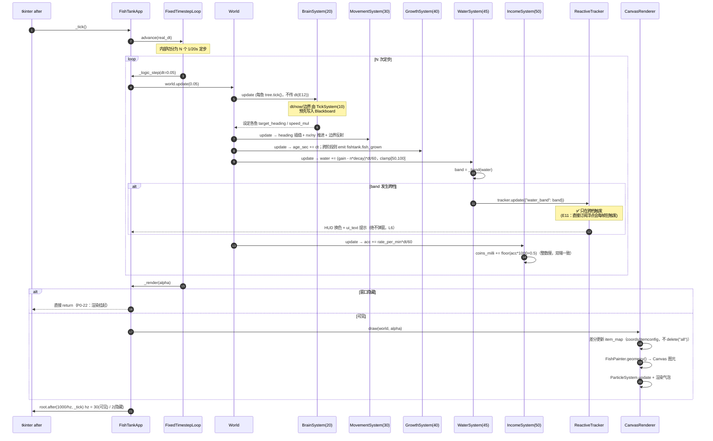

# 懒人桌面养鱼模拟器 — 系统架构设计（ARCHITECTURE）

| 项 | 内容 |
| --- | --- |
| 项目名 | `lazy_fish_tank` |
| 产出目录 | `<仓库根>` |
| 撰写人 | 高见远（架构师） |
| 版本 | v1.0 |
| 日期 | 2026-08-03 |
| 上游文档 | `docs/PRD.md`（许清楚）、`docs/FISH_CONTENT.md`（许清楚） |
| 下游文档 | `docs/TASKS.md`（任务分解，同一作者） |
| 本机环境（实测） | Python **3.14.4**（`C:\Users\13122\AppData\Local\Programs\Python\Python314\python.exe`）、Tk **8.6.15** |

> **本文档定位**：这是工程师的唯一实现依据。PRD 定义"做什么"，本文定义"怎么做"。
> **凡本文与 PRD 冲突之处，均在 §12「与上游文档的偏差」中逐条列出并给出裁决**，实现时以本文为准。

---

## 0. 技术侦察结论（先读这一节）

我在设计之前**实读**了两个资产的源码/头文件，并在本机做了可执行验证。以下结论直接推翻了 PRD 中若干映射假设，是本架构与 PRD 差异的根因。

### 0.1 allin_engine（仓内 `tools/allin_engine`）实读结论

| # | 结论 | 证据 | 对架构的影响 |
| --- | --- | --- | --- |
| E1 | `World / Entity / System / Component` API 与 PRD 描述**一致，可直接用** | `core/ecs.py`（462 行）：`World.create_entity/add_entity/add_system/get_system/remove_system/update(dt)/each(*types)`；`Entity.add/get/has/remove` 且用 `__slots__`；`System.update(world, dt)` + 类属性 `priority` + `enabled(world)` | ✅ P0-01 按 PRD 落地 |
| E2 | `FixedTimestepLoop.run_real_time()` 是**阻塞式**死循环 | `core/game_loop.py`：内部 `while True` + `time.monotonic()` | ❌ 不能与 tkinter `mainloop()` 共存。**必须改用 `root.after(33, tick)` 手动驱动 `loop.advance(real_dt)`** |
| E3 | `paths.get_save_dir()` 硬编码 `%APPDATA%/allin_engine/saves`，**但可被环境变量 `ALLIN_USER_DATA` 覆盖** | `core/paths.py`；覆盖值在**模块导入期求值** | ✅ Q7 有解。**必须在 `import allin_engine` 之前**设置环境变量，见 §3.1 |
| E4 | `SaveLoadManager.load()` 只返回 `state_data`，**外层信封的 `timestamp` 被丢弃** | `systems/save_load.py`（317 行）：信封为 `{version, timestamp, time_str, state_data}` | ⚠️ **离线结算的时间基准会丢失**。必须把 `saved_at_utc` 冗余写进我们自己的 state 内部，见 §6 |
| E5 | `world/game_state.py` 的 `GameState/PlayerState` 是**叙事 RPG 专用**（`hp/sanity/corruption/chapter/imagery_network`），**没有 `currency` 字段** | `world/game_state.py`（381 行） | ❌ PRD P0-08「扩展 `GameState.currency`」**不成立**。自建 `FishTankState`，见 §6 |
| E6 | `core/serializable.py` 的 `Serializable` 依赖 `dataclasses.fields(...).type`。若定义方文件含 `from __future__ import annotations`，`field.type` 退化为**字符串**，嵌套 dataclass 的 `from_dict` 会**静默返回 dict 而不是对象**（无异常的数据损坏） | 本机 Python 3.14.4 实测复现 | 🔴 **硬性规则：项目内所有 dataclass 所在文件禁止写 `from __future__ import annotations`**，见 §11 |
| E7 | `BaseWindow.__init__` **无条件执行 `tk.Tk()`**，且全类无 `overrideredirect` / `-transparentcolor` / `-topmost` 任何调用 | `render/gui_base.py` 第 429 行起（全文 904 行） | ❌ PRD P0-14「继承 `BaseWindow` 做桌宠窗口」**不成立**；两个窗口都继承会产生**双 Tk 根冲突**。桌宠窗口须自建，仅复用 `StatusPanel` / `Styles` / `TkUtil`，见 §7.2 |
| E8 | `TkUtil.create_scrollable_frame / make_button / show_popup_dialog` 位于 **`render/gui_base.py`**，不在 `render/widgets.py` | 同上 | PRD P0-20 的文件映射需更正 |
| E9 | `Styles.get_default_fonts()` 会构造 `tkfont.Font` | `render/gui_base.py` | ⚠️ **必须在 `tk.Tk()` 之后**才能实例化 `Styles`，否则抛异常 |
| E10 | `formula_engine.py` 的**纯 Python 回退分支用 `exec(code, ns)` 且未清空 `__builtins__`** | `render/formula_engine.py`（363 行） | 🔴 无 `asteval` 时**不安全**；且公式字符串**C++ 端没有求值器，无法同源**。裁决见 §5.4 |
| E11 | `ReactiveTracker.update()` 对**任意**数值变化都触发回调，不是阈值语义 | `ai/decision/difference_engine.py` | ⚠️ 水质是每 tick 变化的浮点，直接订阅会**每帧狂触发**。必须订阅**离散化的水质档位 `water_band`**，见 §5.3 |
| E12 | `BrainSystem.update()` 内调用 `brain.tree.tick()` **不传 dt**；`priority = 20` | `ai/decision/brain.py` | 行为树节点拿不到 dt，需从 `Blackboard` 取，见 §5.5 |
| E13 | 行为树 `build_behavior_tree(spec)` 的 JSON 内置 action **只支持 `set` / `increment` / `log`**，表达不了"鱼转向" | `ai/decision/behavior_tree.py`（427 行） | ❌ 行为树**不能纯 JSON 配置**，必须用 Python 自定义 `Action(func)` 节点组装 |
| E14 | 行为树节点**自身持有 RUNNING 状态** | 同上 | 🔴 **每条鱼必须拥有独立的树实例**，绝不可共享一棵树 |
| E15 | `core/config.py` 只有 `get_window_size() / get_grid_size()` + 一堆瓦片地图硬编码常量（墙/门/CELL/COLS），**不是通用配置加载器** | `core/config.py`（77 行） | ❌ PRD P0-13 的 `core/config.py` 映射不成立。改用 `core/data_library.py` + `utils/json_loader.py` |
| E16 | `ForceField(field_type="gravity", strength=...)` 返回 `(0, strength)` | `fx/particle.py`（949 行） | ✅ 气泡浮力 = `ForceField("gravity", strength=负值)`，PRD 假设成立 |
| E17 | `ParticleSystem.render(renderer)` 要求 renderer 实现 `render(particles)` | 同上 | 我们提供 `CanvasParticleRenderer` 适配器 |

**本机依赖实测**（`core/deps.py` 探测结果）：

```
numpy=True  scipy=True  pygame=True  asteval=True  PIL=True  tkinter=True
pystray=False   ← 未安装
```

> 结论：**Q4 的"优雅降级"不是理论分支，是当前真实生效路径**。工程师本机跑起来默认就是无托盘模式，降级逻辑必须第一天就正确。

**tkinter 桌宠能力实测**（Tk 8.6.15，全部通过）：`overrideredirect(True)`、`-transparentcolor`、`-topmost`、`-alpha`、`-toolwindow`、`-disabled`（鼠标穿透）均可用。

### 0.2 XJ380 SDK（`<PATH>`＝XJ380 SDK 根，需自行获取）实读结论

| # | 结论 | 证据 |
| --- | --- | --- |
| X1 | 🎉 **Q1 已解决：消息常量根本没缺失** | `XJ380_CPP_API_Depend_1_3/include/libsys.h` **第 266–274 行**：`MSG_CHAR=0, MSG_MOVE=1, MSG_LBUTTON=2, MSG_RBUTTON=3, MSG_MBUTTON=4, MSG_ROLLER=5, MSG_CRL=6, MSG_SPCHAR=7, MSG_RESIZE=8`。而 `xguiapi.h` 第 210 行恰好 `#include "libsys.h"`，就在 `SetMsgPrcor` 声明的上一行。PM 只搜了 `xapi.h`/`xguiapi.h` 才误判缺失 |
| X2 | `xapi_Button(CRLid, x, y, text)` **没有回调函数指针** | `xguiapi.h`。→ 按钮事件也走 `SetMsgPrcor`，以 `Type == MSG_CRL`、`hData == CRLid` 分发。**PM 设想的"降级为按钮交互以规避消息问题"这条退路本身就不存在**——幸好 X1 已解决 |
| X3 | `xapi_DrawCircle` / `DrawCircleFill` 的 **C 包装被注释**（`xguiapi.h` 137–144 行），但**系统调用号存在**：`XAPI_DRAW_CIRCLE=7400`、`XAPI_DRAW_CIRCLE_FILL=7401`（`libsys.h`） | 仍按 PRD 自实现中点画圆（不赌未文档化的 syscall），但保留一个可选探测开关 |
| X4 | `XAPI_GET_TIME=7412` 系列存在；`xposix/time.h` 提供 `time()` / `clock_gettime` / `gmtime_r` / `struct tm` | ✅ XJ 端**能拿到 UTC 时间戳**，离线结算前提成立 |
| X5 | 🎉 **Q6 已解决：XJ380 无音频 API** | 全 `include/`（含 `xposix/`）搜 `audio\|sound\|pcm\|wav\|beep\|speaker\|volume\|mixer\|play` **零匹配**。音频确定为 Python 端独占（P1-12 在 XJ 端标记为 N/A） |
| X6 | `xapi_ReadBufferA` 的 buffer 参数**类型写错**（`xguiapi.h` 第 238 行写成 `XCOLOR*`，语义应为 `XCOLORA*`） | 调用处需强制类型转换，并在 `xj_window.h` 里包一层纠正签名 |
| X7 | `algorithm/json.h` 只是 5 行转发壳（`#include "../../../../include/xapi_json.h"`），相对路径 4 层上跳，**易碎** | 不依赖它。XJ 端自带**极简 JSON 解析器**（只需支持我们自己的 schema 子集），见 §8.4 |
| X8 | `depend/include/stdio.h` **无 `fopen`/`fread`** | XJ 端文件读写须走 XAPI 文件接口，不能用标准 C IO |
| X9 | `BridgeEngine.h` 是空桩（`// pass`），`x4api.h` 引它 | **禁用 `x4api.h`，统一 `#include "x3api.h"` + `"xguiapi.h"`** |
| X10 | 8 个编译器变体真实存在 | `<PATH>\XJ380_XACT_2026v4_windows\bin\`：`xxcc.exe`、`xxcc--.exe`、`xxcc-elf.exe`、`xxcc-elf--.exe`、`xxccte.exe`、`xxccte--.exe`、`xxccte-elf.exe`、`xxccte-elf--.exe` |
| X11 | 🔴 **本机 `clang` 与 `ld` 均未安装** | `clang --version` / `ld --version` → `command not found`。**XJ380 端当前无法真编译** |
| X12 | 无 XJ380OS 镜像 | `<PATH>` 内无 `.img/.qcow2`。**QEMU 验证路径当前不可用** |

### 0.3 `xj380_builder.py` 复用判断（§5.1.4 的回答）

**结论：包一层，不直接用。** 理由如下（该文件 617 行，已全文实读）：

**可以复用的部分**（文件里明确标注为"纯逻辑函数（不依赖 GUI，便于无界面单元测试）"）：

| 函数 | 签名 | 我们的用途 |
| --- | --- | --- |
| `select_binary(mode, fmt, lang, ext)` | `"gui"/"tui"` × `"epf"/"elf"` × `"cpp"/"c"` → `xxcc.exe` 等 | 我们固定 `("gui","epf","cpp",".exe")` → `xxcc.exe` |
| `build_command(bin, sources, out, optimize, debug, extra)` | → `[bin, -O, -g, *sources, *extra, -o, out]` | 直接用 |
| `detect_sdk(explicit="")` | 自动在 `<PATH>` 找 `XJ380_XACT*windows` 且含 `bin/xxcc*` | 直接用 |
| `check_toolchain()` | 探测 `clang` / `ld` | 直接用（当前会返回两个"未找到"） |
| `ensure_toolchain(log)` | winget 或下载便携版 LLVM 18.1.8 + MinGW-w64 | 可选调用，需联网 + 数百 MB |
| `_decode(raw)` | UTF-8 → GBK 回退 | 直接用（中文 Windows 必需） |

**必须包一层的理由**：

1. **铁律不改源码**——`<PATH>\xj380_builder.py` 属于资产 B，只读。
2. **模块顶层 `import tkinter as tk`**——直接 `import xj380_builder` 会把 GUI 依赖拖进我们的 CI/构建脚本。
3. **XJ380 SDK 根（`<PATH>`）是本机绝对路径，不可移植**——包装层必须在找不到时**回退到项目内自带的等价实现**（三个函数不到 30 行，复制成本远低于硬依赖成本）。
4. **`_compile_bg()` 与 GUI 强耦合**（`self._log` / `self.after` / `self.var_*`），无法复用，编译执行逻辑必须自写。
5. **`subprocess.run(..., shell=True)` + 路径含空格**有隐患，包装层需自行规范化路径并改用 `shell=False`。

**包装设计**：`xj380/tools/xj_build.py`，用 `importlib.util.spec_from_file_location` 从 `<PATH>\xj380_builder.py` **动态加载**（不污染 `sys.path`），取上述纯函数；加载失败则用内置 fallback。对外只暴露 `build(config) -> BuildResult`。

**🔴 必须上报的风险**：因 X11 + X12，**XJ380 端的验收标准必须降级**——第一阶段只能做到"源码完成 + 构建脚本就绪 + 与 PY 端算法通过黄金用例一致性测试"，**做不到"编译通过"和"QEMU 跑起来"**。要真编译，需先执行 `ensure_toolchain()` 装 clang/ld（联网、约 1.5 GB）；要真运行，还需从官网获取 XJ380OS 镜像。这两件事都不在工程师可控范围内，请主理人决策。

---

## 1. 实现方案（Implementation Approach）

### 1.1 核心技术难点与对策

| # | 难点 | 对策 |
| --- | --- | --- |
| D1 | **双端数值必须完全同源**，但 PY 是解释型 + C++ 是 freestanding，浮点/舍入/取整极易漂移 | ① 金币内部用**整数厘**（milli-coin，1 金币 = 1000 厘）；② 所有取整统一 `floor(x + 0.5)`（**禁用** Python `round()` 与 C++ `std::round()`，二者的银行家舍入/半值行为不一致）；③ 时间统一**整数 UTC 秒**；④ 离线结算用**确定性定步长模拟**而非闭式积分；⑤ 一份 `tests/golden/offline_cases.json` 黄金用例，双端都必须逐字节对上 |
| D2 | **离线结算要同时满足"效率分段 + 水质连续衰减 + 成长离散跳变"三者交织**，闭式解要处理多重分段交叠，C++ 手工对齐几乎必错 | 改为**双层定步长模拟**：前 24 小时步长 60 秒（效率/水质/成长都在变），24 小时后步长 3600 秒（效率恒定 35%、水质基本触底）。规则确定 → 双端逐位一致；1 年离线仅约 1 万步，毫秒级。见 §5.2 |
| D3 | **`FixedTimestepLoop` 阻塞**，与 tkinter 事件循环互斥（E2） | 不用 `run_real_time()`。用 `root.after(interval, _tick)` 自驱：每次回调计算 `real_dt = now - last`，调 `loop.advance(real_dt)`，由 loop 内部切分为若干 20 Hz 逻辑步 + 一次渲染 |
| D4 | **桌宠窗口不能继承 `BaseWindow`**（E7），且需要透明/置顶/穿透/贴边 | 自建 `PetWindow`（持有唯一 `tk.Tk()` 根），管理面板用 `tk.Toplevel`。仅复用引擎的 `Styles` / `StatusPanel` / `TkUtil` 三个**无根依赖**的部件 |
| D5 | **零 PNG 全程序化绘制**（Q5），且两端视觉要像同一款游戏 | 抽出**平台无关的几何规范** `FishGeometry`（§7.4）：给定 `shape.length / height_ratio / tail` + 归一化坐标，输出一组图元指令（椭圆/多边形/圆）。PY 端翻译成 Canvas 图元，XJ 端翻译成 `SoftCanvas` 调用 |
| D6 | **XJ380 无画圆、无 Alpha、无浮点保证** | 自建 `SoftCanvas`：中点画圆/中点椭圆（纯整数，不依赖 `sqrt`）、逐像素 Alpha 混合、脏矩形累积，整帧 `xapi_WriteBufferA` + `xapi_RefreshPartWindow` 提交。见 §8.3 |
| D7 | **行为树不能 JSON 配置**（E13）且**不能共享实例**（E14） | 用 Python 代码组装树，工厂函数 `make_fish_brain(species_cfg) -> BehaviorTree`，**每条鱼调一次**。行为参数（速度、转向频率、发呆概率）仍从 JSON 读 → 满足"零硬编码" |
| D8 | **`pystray` 未安装**（实测），托盘是 P0-15 | `tray.py` 提供 `TrayController` 抽象：`PystrayTray`（有依赖时）与 `NullTray`（降级：右键菜单接管全部功能 + 关闭 = 隐藏窗口 + `Alt` 双击呼出）。用引擎 `core/deps.py` 探测 |
| D9 | **公式引擎不安全且 C++ 无法同源**（E10） | 核心经济算法**用普通 Python 函数 + 参数表**实现，绝不放公式字符串。`formula_engine` 仅作为**可选的策划调参沙盒**（`balance.json` 里 `"_experimental_formula"` 字段，默认关闭，仅 PY 端、仅 `asteval` 可用时启用） |
| D10 | **存档时间戳被引擎丢弃**（E4） | 我们自己的 `state_data` 内冗余 `saved_at_utc`（整数秒）+ `carry_sec`（不足一步的余秒，下次累加，保证收益不丢） |

### 1.2 架构模式

**分层 + ECS + 门面（Facade）**，四层严格单向依赖：

```
┌──────────────────────────────────────────────────────────────┐
│  L4 表现层    pyapp/ (tkinter)        xj380/src/render+platform│
│               PetWindow/Panel/Tray     SoftCanvas/XjWindow     │
├──────────────────────────────────────────────────────────────┤
│  L3 应用层    pyapp/app.py             xj380/src/app.cpp       │
│               装配 · 驱动 loop · 事件桥接                       │
├──────────────────────────────────────────────────────────────┤
│  L2 领域层    fishtank/  (纯 Python，零 GUI 依赖)               │
│               ECS 系统 · 行为树 · 状态 · 存档                    │
├──────────────────────────────────────────────────────────────┤
│  L1 内核层    fishtank/economy.py + offline.py  ★纯函数★        │
│               ←→ 与 xj380/src/core/economy.cpp 一一对应          │
├──────────────────────────────────────────────────────────────┤
│  L0 资产层    allin_engine（只读引用）   <PATH> SDK（只读引用）   │
└──────────────────────────────────────────────────────────────┘
                    data/*.json  ← 双端共享的唯一数值源
```

**铁律**：
- **L2 严禁 `import tkinter`**（保证可无头单测、可被 C++ 端对照移植）。
- **L1 严禁任何 I/O、随机数、全局状态**（纯函数，输入即输出）。
- L0 只被 `fishtank/engine_bootstrap.py` 一个模块 `import`，其余模块从它取符号（换引擎版本只改一处）。

### 1.3 框架选型与理由

| 选型 | 理由 |
| --- | --- |
| **allin_engine ECS**（`core/ecs.py`） | 资产复用铁律；且鱼/装饰/气泡天然是实体，`World.each()` 查询正好 |
| **allin_engine 行为树**（`ai/decision/`） | P0-02 要求"非机械直线运动"，Selector/Sequence 能表达"觅食 > 趋边转向 > 巡游 > 发呆"优先级 |
| **allin_engine 粒子**（`fx/particle.py`） | 气泡浮力用 `ForceField("gravity", strength<0)`，现成 |
| **allin_engine SaveLoadManager** | 自带信封 + 自动存档 + 原子写 |
| **tkinter**（标准库） | 零硬依赖铁律；且 `-transparentcolor` 是 Windows 桌宠透明的最省事方案（实测可用） |
| **不用 pygame** | 虽已安装，但它抢焦点、开独立窗口、不支持透明/置顶/穿透，与桌宠形态冲突 |
| **不用 MUI/React** | 本项目是本地桌面应用，非 Web |
| **C++11 + freestanding** | XACT 工具链约束（`-ffreestanding -fno-builtin -fno-exceptions -nostdinc`），**禁用 STL 容器与异常**，用定长数组 + 手写容器 |

---

## 2. 完整文件列表

> 图例：★ = 核心/高风险文件；◆ = 双端算法对偶文件（必须逐行对齐）

```
<仓库根>\
├── main.py                                 ★ PY 端入口（必须先 bootstrap 再 import 引擎）
├── requirements.txt                          可选依赖声明（全部 optional）
├── pytest.ini                                测试配置
├── README.md                                 运行说明 + SDK 获取说明（Q9 合规）
├── .gitignore
│
├── docs/
│   ├── PRD.md                                （已有，PM 产出）
│   ├── FISH_CONTENT.md                       （已有，PM 产出）
│   ├── ARCHITECTURE.md                       （本文件）
│   ├── TASKS.md                              任务分解
│   ├── class-diagram.mermaid                 类图（从本文抽出）
│   └── sequence-diagram.mermaid              时序图（从本文抽出）
│
├── data/                                   ★ 双端共享唯一数值源，禁止代码内硬编码
│   ├── balance.json                        ★ 全部平衡参数（§9.1）
│   ├── fish_data.json                      ★ 24 种鱼（灌 FISH_CONTENT.md §2）（§9.2）
│   ├── decor_data.json                       12 件装饰（灌 FISH_CONTENT.md §4）
│   └── ui_text.json                          UI 文案（灌 FISH_CONTENT.md §5，L6 合规）
│
├── fishtank/                               ── L1+L2 平台无关领域层（严禁 import tkinter）
│   ├── __init__.py
│   ├── engine_bootstrap.py                 ★ allin_engine 唯一接入点（§3.1）
│   ├── constants.py                          非数值常量（键名、枚举字符串）
│   ├── events.py                             自定义事件名常量 fishtank.*
│   ├── data_defs.py                          FishSpeciesDef / DecorDef / BalanceTable + DataLibrary 子类
│   ├── components.py                         ECS 组件 dataclass（🔴 禁 future annotations）
│   ├── state.py                            ★ FishTankState 存档模型 + 校验 + 迁移
│   ├── economy.py                          ★◆ 纯函数：产出率/水质/成长/加成/舍入
│   ├── offline.py                          ★◆ 纯函数：settle_offline() 离线结算（§5.2）
│   ├── behaviors.py                          行为树工厂（Python 自定义 Action，每鱼一棵）
│   ├── rng.py                                确定性随机（种子存档，双端同算法 LCG）
│   ├── save.py                               SaveLoadManager 包装 + saved_at_utc 冗余 + 原子写
│   ├── game.py                             ★ FishTankGame 门面（无 GUI，供 PY GUI 与测试共用）
│   └── systems/
│       ├── __init__.py
│       ├── movement.py                       MovementSystem   priority=30
│       ├── growth.py                         GrowthSystem     priority=40
│       ├── water.py                          WaterSystem      priority=45（含 band 离散化）
│       ├── income.py                         IncomeSystem     priority=50
│       ├── feeder.py                         AutoFeederSystem priority=47（P0-10）
│       ├── breeding.py                       BreedingSystem   priority=60（P1-05）
│       └── particles.py                      ParticleBridgeSystem priority=70
│
├── pyapp/                                  ── L3+L4 Python 端 GUI（唯一允许 import tkinter 处）
│   ├── __init__.py
│   ├── app.py                              ★ FishTankApp：装配 + root.after 驱动（§3.2）
│   ├── pet_window.py                       ★ PetWindow 自建桌宠窗口（不继承 BaseWindow）
│   ├── panel_window.py                       PanelWindow 管理面板（Toplevel，4 页签）
│   ├── canvas_render.py                      CanvasRenderer：World → Canvas 图元（差分更新）
│   ├── fish_painter.py                     ★ 程序化画鱼（FishGeometry → Canvas）
│   ├── decor_painter.py                      程序化画装饰
│   ├── hud.py                                HUD 条 + 淡出
│   ├── offline_card.py                       离线结算卡片（P0-19）
│   ├── fish_card.py                          点击鱼的信息小卡（P1-11）
│   ├── tray.py                             ★ TrayController / PystrayTray / NullTray（降级）
│   ├── win_native.py                         Windows 专有：贴边吸附、鼠标穿透、全屏让位
│   └── theme.py                              配色 + 字体（复用引擎 Styles/font）
│
├── xj380/                                  ── C++ 端（XJ380OS）
│   ├── src/
│   │   ├── main.cpp                          入口：CreateWindow + 消息循环
│   │   ├── app.cpp / app.h                   应用装配（对应 pyapp/app.py）
│   │   ├── core/
│   │   │   ├── economy.cpp / .h            ★◆ 对偶 fishtank/economy.py
│   │   │   ├── offline.cpp / .h            ★◆ 对偶 fishtank/offline.py
│   │   │   ├── state.cpp / .h              ◆ 对偶 fishtank/state.py
│   │   │   ├── data_defs.cpp / .h          ◆ 对偶 fishtank/data_defs.py
│   │   │   ├── fixed_loop.cpp / .h           固定步长（对偶引擎 FixedTimestepLoop）
│   │   │   └── json_min.cpp / .h             极简 JSON 解析（不用易碎的 algorithm/json.h）
│   │   ├── sim/
│   │   │   ├── tank.cpp / .h                 轻量实体表（定长数组，非 ECS）
│   │   │   └── swim.cpp / .h                 简化游动（对偶 behaviors.py 的降级版）
│   │   ├── render/
│   │   │   ├── softcanvas.cpp / .h         ★ 中点画圆/椭圆 + Alpha 混合 + 脏矩形（§8.3）
│   │   │   ├── fish_paint.cpp / .h         ◆ 对偶 fish_painter.py（同一套 FishGeometry）
│   │   │   └── hud_paint.cpp / .h            HUD（xapi_DrawText，WSTR）
│   │   └── platform/
│   │       ├── xj_msg.h                    ★ 固化 libsys.h 的 MSG_* 常量（附来源注释）
│   │       ├── xj_window.cpp / .h            窗口 + WriteBufferA/RefreshPartWindow 封装
│   │       │                                 （含 X6 的 ReadBufferA 签名纠正）
│   │       ├── xj_time.cpp / .h              UTC 时间戳（xposix time()）
│   │       └── xj_fs.cpp / .h                存档读写（走 XAPI，不用 stdio）
│   ├── include_shim/                         若干最小 shim（freestanding 缺失符号）
│   ├── tools/
│   │   └── xj_build.py                     ★ 包装 <PATH>\xj380_builder.py（§0.3）
│   └── README.md                             XJ 端构建说明 + 工具链前置条件
│
├── tests/
│   ├── conftest.py
│   ├── test_economy.py                       产出/水质/成长系数单测
│   ├── test_offline_golden.py              ★ P1-13 黄金用例（PY 侧）
│   ├── test_state_roundtrip.py               存档序列化往返 + E6 退化回归测试
│   ├── test_data_integrity.py                灌库校验（FISH_CONTENT.md §6 清单自动化）
│   ├── test_no_hardcoded_numbers.py          扫描 fishtank/ 禁止魔法数字（验收第 9 条）
│   ├── test_engine_untouched.py              校验 allin_engine 未被修改（验收第 10 条）
│   └── golden/
│       └── offline_cases.json              ★ 双端共用黄金数据（PY 生成，C++ 读同一份）
│
└── tools/
    ├── gen_golden.py                         生成/刷新黄金用例
    ├── gen_fish_data.py                      从 FISH_CONTENT.md 提取 → fish_data.json
    └── engine_hash.py                        计算 allin_engine 目录哈希（配合 test_engine_untouched）
```

**文件数统计**：Python 42 个、C++ 34 个（17 对 .cpp/.h）、JSON 5 个、文档 6 个。

---

## 3. allin_engine 接入方案

### 3.1 `fishtank/engine_bootstrap.py` — 唯一接入点

**这是整个项目最先要写、也最容易写错的文件。** 三条硬约束：

1. `ALLIN_USER_DATA` **必须在 `import allin_engine` 之前**设置（E3：导入期求值）。
2. `allin_engine` 不是 pip 包，在 `<仓库根>\tools\allin_engine`，需把**其父目录** `<仓库根>\tools` 加入 `sys.path`。
3. 全项目**只有这一个文件** `import allin_engine.*`，其余模块一律 `from fishtank.engine_bootstrap import World, System, ...`。

```python
# fishtank/engine_bootstrap.py   （🔴 禁止 from __future__ import annotations）
"""allin_engine 唯一接入点。任何其他模块都不得直接 import allin_engine。"""
import os, sys
from pathlib import Path

APP_NAME = "LazyFishTank"
_ENGINE_CANDIDATES = [
    os.environ.get("ALLIN_ENGINE_HOME"),        # ① 显式覆盖
    r"<仓库根>\tools\allin_engine",              # ② 项目内置（零外部依赖）
    str(Path(__file__).resolve().parents[2] / "tools" / "allin_engine"),  # ③ 相邻部署
]

_ready = False

def bootstrap(user_data_dir: str = "") -> None:
    """必须在任何引擎符号被使用前调用一次；幂等。"""
    global _ready
    if _ready:
        return
    # —— 步骤 1：先设环境变量（E3：paths.py 在导入期读取）——
    if not user_data_dir:
        base = os.environ.get("APPDATA") or str(Path.home())
        user_data_dir = str(Path(base) / APP_NAME)
    os.environ["ALLIN_USER_DATA"] = user_data_dir      # 覆盖引擎默认 %APPDATA%/allin_engine
    Path(user_data_dir, "saves").mkdir(parents=True, exist_ok=True)
    # —— 步骤 2：再挂 sys.path ——
    for cand in _ENGINE_CANDIDATES:
        if cand and Path(cand, "core", "ecs.py").is_file():
            parent = str(Path(cand).parent)
            if parent not in sys.path:
                sys.path.insert(0, parent)
            break
    else:
        raise RuntimeError("未找到 allin_engine，请设置环境变量 ALLIN_ENGINE_HOME")
    _ready = True

bootstrap()   # 模块被 import 时立即执行，保证顺序正确

# —— 步骤 3：统一再导出（换引擎版本只改这里）——
from allin_engine.core.ecs import World, Entity, Component, System           # noqa: E402
from allin_engine.core.game_loop import FixedTimestepLoop                    # noqa: E402
from allin_engine.core.event_bus import EventBus                             # noqa: E402
from allin_engine.core.data_library import DataLibrary                       # noqa: E402
from allin_engine.core.serializable import Serializable                      # noqa: E402
from allin_engine.core import deps                                           # noqa: E402
from allin_engine.systems.save_load import SaveLoadManager                   # noqa: E402
from allin_engine.systems.inventory import Inventory                         # noqa: E402
from allin_engine.ai.decision.behavior_tree import (                         # noqa: E402
    Status, Blackboard, Selector, Sequence, Condition, Action, BehaviorTree)
from allin_engine.ai.decision.brain import (                                 # noqa: E402
    BlackboardComponent, BrainComponent, BrainSystem)
from allin_engine.ai.decision.difference_engine import ReactiveTracker       # noqa: E402
from allin_engine.fx.particle import (                                       # noqa: E402
    Particle, ForceField, Emitter, ParticleSystem)
from allin_engine.utils.json_loader import JSONLoader                        # noqa: E402
from allin_engine.utils.logger import get_logger                             # noqa: E402

def gui_symbols():
    """延迟导入 GUI 相关符号（E9：Styles 必须在 tk.Tk() 之后才能实例化）。"""
    from allin_engine.render.gui_base import Styles, StatusPanel, TkUtil
    from allin_engine.render.color_system import hsv_to_rgb
    return Styles, StatusPanel, TkUtil, hsv_to_rgb
```

> `main.py` 第一行必须是 `import fishtank.engine_bootstrap`，早于任何其他项目模块。

### 3.2 主循环驱动（解决 E2）

```python
# pyapp/app.py 关键片段
LOGIC_HZ, RENDER_HZ_ACTIVE, RENDER_HZ_HIDDEN = 20, 30, 2

self.loop = FixedTimestepLoop(update_fn=self._logic_step,
                              render_fn=self._render,
                              fixed_dt=1.0 / LOGIC_HZ,
                              max_frame_time=0.25)   # 防"死亡螺旋"

def _tick(self):
    now = time.monotonic()
    self.loop.advance(now - self._last)   # 内部切分为若干 20Hz 逻辑步 + 一次 render(alpha)
    self._last = now
    hz = RENDER_HZ_HIDDEN if self.hidden else RENDER_HZ_ACTIVE
    self.root.after(int(1000 / hz), self._tick)      # ← 不用 loop.run_real_time()
```

**P0-22 性能**：窗口隐藏时 `hz` 降到 2，且 `_render` 直接 `return`（Canvas 不重绘），逻辑仍以 20 Hz 推进（`advance` 一次会补齐多步）。

### 3.3 引擎能力使用清单（更正 PRD §8 的映射错误）

| 能力 | PRD 原映射 | ✅ 实际方案 |
| --- | --- | --- |
| 全局状态 | `world/game_state.GameState` 扩展 `currency` | ❌ 该类是 RPG 专用无此字段（E5）→ **自建 `fishtank/state.py::FishTankState`** |
| 桌宠窗口 | 继承 `render/gui_base.BaseWindow` | ❌ 无条件建 `tk.Tk()` 且无桌宠 API（E7）→ **自建 `PetWindow`**，仅复用 `Styles`/`StatusPanel`/`TkUtil` |
| 面板控件 | `render/widgets.TkUtil` | ❌ `TkUtil` 在 `gui_base.py`（E8）→ 从 `gui_base` 导入 |
| 配置外置 | `core/config.py` | ❌ 那是瓦片地图常量（E15）→ **`core/data_library.py` + `utils/json_loader.py`** |
| 产出公式可配置 | `render/formula_engine.py` | ❌ 不安全 + C++ 无法同源（E10）→ **普通函数 + 参数表**；公式引擎降为可选调参沙盒 |
| 水质阈值响应 | `ReactiveTracker.subscribe("water")` | ⚠️ 会每帧狂触发（E11）→ **订阅离散档位 `water_band`** |
| 行为树配置 | `build_behavior_tree(json)` | ❌ 内置 action 表达不了转向（E13）→ **Python 自定义 `Action`**，参数仍来自 JSON |
| 行为树实例 | （未提及） | 🔴 节点持有 RUNNING 状态（E14）→ **每条鱼独立一棵树** |
| 存档时间戳 | `SaveLoadManager` 自带 | ⚠️ `load()` 丢弃 timestamp（E4）→ **`state_data` 内冗余 `saved_at_utc`** |
| 存档路径 | 程序目录（Q7 建议） | ✅ 改为 `%APPDATA%\LazyFishTank\saves`，经 `ALLIN_USER_DATA` 覆盖（E3，实测生效） |
| 粒子浮力 | `ForceField` 向上力场 | ✅ `ForceField("gravity", strength=-N)`（E16，成立） |
| 可选依赖探测 | `core/deps.py` | ✅ 成立；实测 `pystray=False` |

---

## 4. 数据结构与接口（类图）

```mermaid
classDiagram
    %% ============ L1 内核：纯函数模块（无状态，双端对偶）============
    class economy {
        <<module 纯函数>>
        +stage_of(age_sec, cycle_sec, thresholds) str
        +stage_coef(stage, coef_table) float
        +quality_factor(water, wmin, wmax) float
        +bonus_multiplier(decor_sum, group_sum, cap) float
        +income_rate_milli(fishes, species_tbl, bal, water) int
        +water_delta(fish_n, filter_lv, bal, minutes, offline) float
        +round_half_up(x) int
    }
    class offline {
        <<module 纯函数>>
        +efficiency_at(minute, segments) float
        +settle_offline(state, bal, species, now_utc) OfflineResult
        +_step_once(acc, minutes, bal, species) void
    }
    class OfflineResult {
        +int elapsed_sec
        +int earned_milli
        +int carry_sec
        +float water_after
        +list~FishDelta~ grown
        +list~int~ hatched_uids
        +dict new_state
    }
    economy <.. offline : 调用

    %% ============ L2 领域：状态与数据 ============
    class FishTankState {
        +int schema
        +int saved_at_utc
        +int carry_sec
        +int coins_milli
        +int next_uid
        +int rng_seed
        +TankInfo tank
        +list~FishRec~ fishes
        +list~DecorRec~ decors
        +CodexRec codex
        +SettingsRec settings
        +to_dict() dict
        +from_dict(d)$ FishTankState
        +validate() list~str~
        +migrate(d)$ dict
    }
    class TankInfo {
        +int capacity_level
        +int capacity
        +float water
        +int filter_level
        +bool feeder
    }
    class FishRec {
        +int uid
        +str species
        +int born_at_utc
        +int age_sec
        +float nx
        +float ny
        +float heading
        +str variant
    }
    class DecorRec {
        +str id
        +float nx
        +float ny
    }
    class CodexRec {
        +list~str~ unlocked
        +list~str~ groups_done
    }
    class SettingsRec {
        +bool topmost
        +bool click_through
        +bool sound
        +str mode
        +int win_x
        +int win_y
    }
    FishTankState *-- TankInfo
    FishTankState *-- "0..36" FishRec
    FishTankState *-- "0..12" DecorRec
    FishTankState *-- CodexRec
    FishTankState *-- SettingsRec

    class FishSpeciesDef {
        +str id
        +str name_zh
        +str name_la
        +str rarity
        +str group
        +dict color
        +dict shape
        +dict behavior
        +str science
        +str codex_unlock
    }
    class DecorDef {
        +str id
        +str name
        +float bonus
        +int price
        +str draw
    }
    class BalanceTable {
        +dict raw
        +get(path, default) any
        +base_income(rarity) float
        +growth_cycle_sec(rarity) int
        +offline_segments() list
        +validate()$ list~str~
    }
    class FishLibrary {
        +load_from_json(path)
        +get(id) FishSpeciesDef
        +by_rarity(r) list
        +by_group(g) list
    }
    FishLibrary o-- FishSpeciesDef
    economy ..> BalanceTable : 读参数
    offline ..> BalanceTable : 读参数

    %% ============ L2 领域：ECS ============
    class World {
        <<allin_engine 只读>>
        +create_entity() Entity
        +add_system(s)
        +each(*types) iter
        +update(dt)
    }
    class CFish {
        +int uid
        +str species
        +str rarity
    }
    class CGrowth {
        +int age_sec
        +str stage
    }
    class CTransform {
        +float nx
        +float ny
        +float heading
        +float speed
    }
    class CAppearance {
        +dict color
        +dict shape
        +float tail_phase
    }
    class CIncome {
        +float base_per_min
    }
    class CDecor {
        +str id
        +float bonus
    }
    CFish --|> Component
    CGrowth --|> Component
    CTransform --|> Component
    CAppearance --|> Component
    CIncome --|> Component
    CDecor --|> Component

    class MovementSystem {
        +int priority = 30
        +update(world, dt)
    }
    class GrowthSystem {
        +int priority = 40
        +update(world, dt)
    }
    class WaterSystem {
        +int priority = 45
        +ReactiveTracker tracker
        +update(world, dt)
        +_band(water) int
    }
    class IncomeSystem {
        +int priority = 50
        +float acc_sec
        +update(world, dt)
    }
    class AutoFeederSystem {
        +int priority = 47
        +update(world, dt)
    }
    class BreedingSystem {
        +int priority = 60
        +update(world, dt)
    }
    MovementSystem --|> System
    GrowthSystem --|> System
    WaterSystem --|> System
    IncomeSystem --|> System
    AutoFeederSystem --|> System
    BreedingSystem --|> System
    World o-- System

    %% ============ L2 门面 ============
    class FishTankGame {
        +World world
        +FishTankState state
        +BalanceTable balance
        +FishLibrary species
        +EventBus bus
        +SaveGateway save
        +load_or_new() OfflineResult
        +step(dt)
        +buy_fish(species_id) bool
        +buy_decor(id) bool
        +buy_upgrade(kind) bool
        +claim_offline(result)
        +snapshot() FishTankState
        +shutdown()
    }
    class SaveGateway {
        +SaveLoadManager mgr
        +save(state)
        +load() dict
        +_atomic_write(p, data)
    }
    FishTankGame *-- World
    FishTankGame *-- FishTankState
    FishTankGame *-- SaveGateway
    FishTankGame ..> offline : 启动时调用
    FishTankGame ..> FishLibrary
    FishTankGame ..> BalanceTable
    SaveGateway ..> SaveLoadManager : 包装

    %% ============ 行为树 ============
    class BrainFactory {
        +make_fish_brain(cfg)$ BehaviorTree
        +act_wander(bb)$ Status
        +act_seek_food(bb)$ Status
        +act_avoid_edge(bb)$ Status
        +act_idle(bb)$ Status
    }
    BrainFactory ..> BehaviorTree : 每鱼新建一棵
    BrainFactory ..> Blackboard

    %% ============ L4 Python GUI ============
    class FishTankApp {
        +Tk root
        +FishTankGame game
        +PetWindow pet
        +PanelWindow panel
        +TrayController tray
        +FixedTimestepLoop loop
        +run()
        +_tick()
        +_logic_step(dt)
        +_render(alpha)
    }
    class PetWindow {
        +Tk root
        +Canvas canvas
        +bool topmost
        +bool click_through
        +set_transparent()
        +enable_click_through(on)
        +snap_to_edge()
        +on_drag(e)
    }
    class PanelWindow {
        +Toplevel top
        +show(tab)
        +_build_codex()
        +_build_shop()
        +_build_upgrade()
        +_build_settings()
    }
    class CanvasRenderer {
        +dict item_map
        +draw(world, alpha)
        +_sync_items()
    }
    class FishPainter {
        +geometry(species, stage)$ list~Prim~
        +draw(canvas, fish, alpha)
    }
    class TrayController {
        <<interface>>
        +start()
        +stop()
        +set_menu(items)
    }
    class PystrayTray
    class NullTray
    PystrayTray ..|> TrayController
    NullTray ..|> TrayController
    FishTankApp *-- PetWindow
    FishTankApp *-- PanelWindow
    FishTankApp *-- TrayController
    FishTankApp *-- FishTankGame
    PetWindow *-- CanvasRenderer
    CanvasRenderer ..> FishPainter

    %% ============ L4 XJ380 C++ ============
    class SoftCanvas {
        <<C++>>
        +XCOLORA* buf
        +int w
        +int h
        +Rect dirty
        +clear(c)
        +blend_px(x, y, c)
        +fill_rect(r, c)
        +draw_line(x0,y0,x1,y1,c)
        +draw_circle(cx,cy,r,c)
        +fill_circle(cx,cy,r,c)
        +fill_ellipse(cx,cy,rx,ry,c)
        +fill_tri(p0,p1,p2,c)
        +mark_dirty(r)
        +present(XWINDOW*)
    }
    class XjWindow {
        <<C++>>
        +create(w,h,title)
        +on_msg(type,h,l)
        +read_buffer_a(...)
    }
    class XjApp {
        <<C++>>
        +SoftCanvas cv
        +TankSim sim
        +boot()
        +frame(dt)
    }
    XjApp *-- SoftCanvas
    XjApp *-- XjWindow
    XjApp ..> offline : 对偶实现 economy.cpp/offline.cpp
```



---

## 5. 核心算法规范（★ 双端必须逐位一致）

### 5.1 通用数值约定（违反即双端不一致）

| 约定 | 规定 | 反例（禁止） |
| --- | --- | --- |
| **金币** | 内部一律 `int coins_milli`，1 金币 = **1000 厘**。UI 显示 `coins_milli // 1000` | 用 float 存金币 |
| **取整** | 统一 `floor(x + 0.5)`。Python：`math.floor(x + 0.5)`；C++：`(long long)(x + 0.5)`（x ≥ 0 保证成立） | Python `round()`（银行家舍入）、C++ `std::round()` |
| **时间** | 一律 **UTC 整数秒**（`int(time.time())` / `xposix time()`） | 本地时间、浮点时间戳 |
| **坐标** | 存档与逻辑用**归一化** `nx, ny ∈ [0,1]`，渲染时乘各端缸尺寸 | 存像素坐标（PY 360×220 vs XJ 640×400 会不一致） |
| **随机** | 确定性 LCG（`seed = (seed * 6364136223846793005 + 1442695040888963407) mod 2^64`，取高 32 位），种子存档。双端同算法 | `random.random()` / `rand()` |
| **累加顺序** | 遍历鱼必须按 `uid` 升序（浮点加法不满足结合律） | 按字典/哈希顺序遍历 |
| **JSON 数值** | 存档内**只允许整数与最多 6 位小数的浮点**；水质写入前 `round(w, 4)` | 写入 `0.1+0.2` 这类原始浮点 |
| **🔴 C++ 浮点精度** | **C++ 端中间计算必须用 `double`**（64-bit），**禁止**使用 32-bit `float`。Python 端 `float` 是 64-bit double；离线结算 ≥1000 步后，32-bit `float` 的低位可能漂移，破坏黄金用例的逐位一致性 | C++ 端用 `float` 做累加器或中间变量 |

### 5.2 ★ 离线收益结算（P0-06，纯函数，本项目最核心算法）

**签名（无副作用，不修改入参）**：

```python
def settle_offline(state: dict, bal: BalanceTable, species: FishLibrary,
                   now_utc: int) -> OfflineResult
```

**完整算法（规范定义，C++ 端逐行对齐）**：

```
输入： state（含 saved_at_utc, carry_sec, coins_milli, tank.water, fishes[]）
       bal（balance.json）, species（fish_data.json）, now_utc

S0  时间量化
    elapsed = now_utc - state.saved_at_utc + state.carry_sec
    if elapsed <= 0:               # 系统时间回拨 → 不倒扣，不报错（准则 L2）
        return OfflineResult(elapsed_sec=0, earned_milli=0,
                             carry_sec=max(0, state.carry_sec), new_state=copy(state))
    elapsed = min(elapsed, bal.offline_hard_cap_sec)   # 默认 3650 天，仅防溢出，不是收益上限

S1  分块表（双层定步长，规则确定 → 双端一致）
    FINE_STEP   = bal.offline.fine_step_sec     # 默认 60
    FINE_LIMIT  = bal.offline.fine_limit_sec    # 默认 86400（24 小时）
    COARSE_STEP = bal.offline.coarse_step_sec   # 默认 3600
    构造块序列 blocks[]：
        t = 0
        while t < elapsed:
            step = FINE_STEP if t < FINE_LIMIT else COARSE_STEP
            step = min(step, elapsed - t)
            if step < FINE_STEP:            # 不足一个最小步 → 不结算，留给下次
                carry_sec = step ; break
            blocks.append((t, step)) ; t += step
        （若循环自然结束，carry_sec = 0）

S2  预备
    water   = state.tank.water
    coins   = 0                       # 本次结算新增，单位：厘
    ages    = { f.uid: f.age_sec for f in state.fishes }   # 按 uid 升序遍历
    n_fish  = len(state.fishes)
    filter_gain = bal.water.filter_gain[state.tank.filter_level]   # 点/分钟
    decay_per_fish = bal.water.decay_per_fish                      # 默认 0.03
    off_water_scale = bal.water.offline_scale                      # 默认 0.5（准则 L7）
    decor_sum = Σ decor_data[d.id].bonus for d in state.decors
    group_sum = Σ bal.codex.group_bonus for g in state.codex.groups_done
    bonus_mul = 1.0 + min(decor_sum + group_sum, bal.economy.bonus_cap)   # cap 默认 0.40

S3  逐块推进
    for (t0, step) in blocks:
        mins = step / 60.0
        # (a) 效率系数：用块【起点】所处分段（规则固定，不做块内插值）
        eff = efficiency_at(t0 / 60.0, bal.offline.segments)
        # (b) 水质推进（离线打 5 折；先水质后产出，顺序固定）
        water += (filter_gain - n_fish * decay_per_fish) * mins * off_water_scale
        water = clamp(water, bal.water.min, bal.water.max)     # [50, 100]
        qf = 0.5 + 0.5 * (water - bal.water.min) / (bal.water.max - bal.water.min)
        # (c) 成长推进（100%，绝不打折 —— PRD §7.4 约束 4）
        for uid in sorted(ages): ages[uid] += step
        # (d) 产出（按 uid 升序累加，保证浮点顺序一致）
        rate = 0.0                                             # 金币/分钟
        for uid in sorted(ages):
            sp    = species.get(fish[uid].species)
            base  = bal.economy.base_income[sp.rarity]
            cycle = bal.growth.cycle_sec[sp.rarity]
            stage = stage_of(ages[uid], cycle, bal.growth.thresholds)
            rate += base * bal.growth.stage_coef[stage]
        rate *= qf * bonus_mul * eff
        coins += floor(rate * mins * 1000.0 + 0.5)             # ★ 厘，round_half_up

S4  产出
    grown   = [uid for uid if stage_of(new) != stage_of(old)]
    hatched = BreedingSystem 的离线补算（P1-05，同样逐块，用确定性 LCG）
    return OfflineResult(elapsed_sec=elapsed - carry_sec,
                         earned_milli=coins, carry_sec=carry_sec,
                         water_after=round(water, 4), grown=grown,
                         hatched_uids=hatched, new_state=<深拷贝并写回>)
```

**分段效率函数**（PRD §7.4）：

```python
def efficiency_at(minute: float, segments) -> float:
    # segments = [[0, 480, 1.00], [480, 1440, 0.60], [1440, null, 0.35]]
    for lo, hi, k in segments:
        if minute >= lo and (hi is None or minute < hi):
            return k
    return segments[-1][2]
```

**边界条件（必须全部有测试）**：

| 场景 | 期望行为 |
| --- | --- |
| `now < saved_at`（用户改系统时间往回拨） | `elapsed ≤ 0` → 收益 0，**不倒扣金币、不清空存档、不报错**（准则 L2） |
| `elapsed < 60s` | 收益 0，全部秒数进 `carry_sec`，下次累加（**收益不丢**） |
| 缸内 0 条鱼 | `rate = 0`，水质只受过滤器影响（可回升），收益 0，文案走 `ui_text.空状态.离线收益为0` |
| 水质已触底 50 | `qf = 0.5`，**永不归零、永不死鱼**（准则 L4） |
| 离线 10 年 | 被 `offline_hard_cap_sec` 截断（防 int 溢出），**这不是收益封顶**——10 年内全额按 35% 计 |
| 全部鱼已熟成 | `stage_coef = 1.25` 恒定，无跳变 |
| 加成总和 > cap | `min(..., 0.40)` 截断 |
| 存档缺 `carry_sec` 字段（旧档） | `migrate()` 补 0 |

**性能实测预期**：36 条鱼 × 离线 7 天 = 1440（细）+ 144（粗）= 1584 块 × 36 = 5.7 万次浮点运算 → **< 30 ms**。离线 1 年 = 1440 + 8760 = 1.02 万块 → < 200 ms。启动时执行一次，可接受。

### 5.3 水质系统（P0-07）与 ReactiveTracker 正确用法

在线推进（`WaterSystem`，`priority=45`）：

```
water += (filter_gain[lv] - n_fish * decay_per_fish) * (dt/60)     # 在线不打折
water = clamp(water, 50, 100)
quality_factor = 0.5 + 0.5 * (water - 50) / (100 - 50)             # → [0.5, 1.0]
```

**E11 修正**——不订阅裸浮点，订阅**离散档位**：

```python
def _band(w: float) -> int:
    # bands = [50, 60, 70, 80, 90, 100] → 返回 0..4
    for i, up in enumerate(BANDS[1:]):
        if w < up: return i
    return len(BANDS) - 2

# 每 tick：
b = self._band(water)
if b != self._last_band:
    self.tracker.update({"water_band": b})   # ← 只有跨档才 update，真正的阈值语义
    self._last_band = b
```

订阅者：HUD 换色、`ui_text` 提示（"水质清澈，鱼儿状态很放松"）。**绝不弹窗**（准则 L6）。

### 5.4 产出公式（P0-08 / P0-13）

```
rate_per_min(金币) = Σ_鱼(按 uid 升序)( base_income[rarity] × stage_coef[stage] )
                    × quality_factor                       # [0.5, 1.0]
                    × (1 + min(decor_sum + group_sum, cap))  # cap = 0.40
                    × efficiency                            # 在线恒 1.0
```

**⚠️ 与 PRD 的差异**：PRD §7.4 写的是 `× (1+装饰) × (1+族群)` 相乘，本文改为**相加后统一 clamp**。理由：① FISH_CONTENT §4 明确要求"总加成上限"，相乘无法表达单一上限；② 12 件装饰加成总和 = 48%，已超 40% 上限，必须 clamp；③ 相加 + clamp 的 C++ 对齐成本远低于两次乘法后再反推上限。**已记入 §12 偏差表，请 PM 确认。**

**零硬编码保障**（验收第 9 条）：`tests/test_no_hardcoded_numbers.py` 用 AST 扫描 `fishtank/` 下所有 `.py`，除白名单（`0, 1, -1, 2, 0.0, 1.0, 100`、数组下标、`dt` 相关）外出现任何数字字面量即失败。

**关于 `formula_engine`（E10 裁决）**：核心算法**不得**使用公式字符串。`balance.json` 可选字段 `"_experimental_formula"` 仅在 **PY 端 + `deps.has("asteval")` 为真 + 显式开关打开**时生效，用于策划试参；一旦启用，`test_offline_golden.py` 会强制跳过并打印警告。**发布配置中该字段必须为 `null`。**

### 5.5 行为树（P0-02）

**E13/E14 修正**：Python 代码组装 + 每鱼独立实例。

```python
def make_fish_brain(cfg: dict) -> BehaviorTree:
    """cfg 来自 fish_data.json 的 behavior 段 + balance.json 的 ai 段。
    🔴 每条鱼调用一次，绝不可共享返回值（节点持有 RUNNING 状态）。"""
    return BehaviorTree(Selector([
        Sequence([Condition(has_food),        Action(act_seek_food)]),   # 觅食（最高优先级）
        Sequence([Condition(near_edge),       Action(act_avoid_edge)]),  # 趋边转向
        Sequence([Condition(has_interest),    Action(act_seek_point)]),  # 趋向鼠标（P1-11）
        Sequence([Condition(should_idle),     Action(act_idle, running=True)]),  # 发呆
        Action(act_wander, running=True),                                # 巡游（兜底）
    ]))
```

**E12 修正**：`BrainSystem.update()` 调 `tree.tick()` **不传 dt**。因此在 `MovementSystem`（`priority=30`，先于 `BrainSystem` 的 20？注意：引擎 `priority` 数字小的先执行，`BrainSystem=20` 会先跑）——**顺序确定为**：`BrainSystem(20)` → `MovementSystem(30)` → `GrowthSystem(40)` → `WaterSystem(45)` → `AutoFeederSystem(47)` → `IncomeSystem(50)` → `BreedingSystem(60)` → `ParticleBridgeSystem(70)`。

dt 通过 Blackboard 传递：在 `MovementSystem` 之前由一个轻量 `TickSystem(priority=10)` 写入 `bb.set("dt", dt)`、`bb.set("now", t)`、`bb.set("nx"/"ny", ...)`，行为树 Action 从 Blackboard 读。

**四种可辨识状态**（验收第 2 条）：
- **巡游**：目标点随机游走，速度 = `behavior.speed` 映射值，摆尾频率正常
- **觅食**：直冲食物点，速度 ×1.8，摆尾频率 ×2
- **发呆**：速度 ×0.15，原地小幅摆动，持续 `ai.idle_sec` 随机区间
- **转向**：`heading` 按 `ai.turn_rate` 插值（**不瞬转**），并触发 1–3 个气泡粒子

---

## 6. 存档 Schema（P0-04 / P0-05）

### 6.1 物理结构（引擎信封 + 我们的载荷）

```
%APPDATA%\LazyFishTank\saves\autosave.json
└── { "version": 1, "timestamp": <引擎写，load() 会丢弃>, "time_str": "...",
      "state_data": { ★ 以下是我们的 schema ★ } }
```

### 6.2 `state_data` 完整 Schema

```json
{
  "schema": 1,
  "saved_at_utc": 1754251200,
  "carry_sec": 37,
  "coins_milli": 12480000,
  "next_uid": 8,
  "rng_seed": 88172645463325252,

  "tank": {
    "capacity_level": 1,
    "capacity": 6,
    "water": 82.4137,
    "filter_level": 0,
    "feeder": true
  },

  "fishes": [
    { "uid": 1, "species": "neon_tetra", "born_at_utc": 1754140000,
      "age_sec": 5400, "nx": 0.42, "ny": 0.63, "heading": 1.87, "variant": null }
  ],

  "decors": [
    { "id": "water_plant", "nx": 0.20, "ny": 0.88 }
  ],

  "codex": {
    "unlocked": ["neon_tetra", "guppy", "zebra_danio"],
    "groups_done": []
  },

  "settings": {
    "topmost": true, "click_through": false, "sound": false,
    "mode": "tank", "win_x": 1420, "win_y": 720, "hud_fade": true
  },

  "stats": {
    "total_earned_milli": 40218000,
    "play_started_utc": 1754000000,
    "sessions": 12
  }
}
```

### 6.3 字段约束

| 字段 | 类型 | 约束 | 说明 |
| --- | --- | --- | --- |
| `schema` | int | = 1 | 载荷版本，与引擎信封 `version` 独立 |
| `saved_at_utc` | int | > 0，UTC 秒 | 🔴 **离线结算唯一时间基准**（因 E4 必须冗余于此） |
| `carry_sec` | int | `0 ≤ x < 60` | 上次不足一步的余秒，防收益丢失 |
| `coins_milli` | int | ≥ 0 | 金币 × 1000，**无上限**（准则 L2） |
| `next_uid` | int | ≥ 1 | 单调递增，不复用 |
| `rng_seed` | int | uint64 | 确定性 LCG 状态，双端同算法 |
| `tank.capacity` | int | ∈ {6,10,16,24,36} | 由 `capacity_level` 查 balance 得出，冗余存以便校验 |
| `tank.water` | float | `[50, 100]`，写前 `round(w,4)` | |
| `tank.filter_level` | int | `0..3` | 0 = 未购买 |
| `fishes[].uid` | int | 唯一，升序存储 | **遍历顺序依赖此升序** |
| `fishes[].species` | str | 必须存在于 `fish_data.json` | 未知 id → 迁移时丢弃并记 warning，**不崩溃** |
| `fishes[].age_sec` | int | ≥ 0 | 真实累计时长（在线 + 离线） |
| `fishes[].nx/ny` | float | `[0,1]` | 归一化坐标，双端通用 |
| `decors[].id` | str | 存在于 `decor_data.json` | |
| `codex.unlocked` | str[] | 去重，字典序存储 | |
| `settings.mode` | str | `tank`/`strip`/`panel` | P1-10 |

### 6.4 迁移与容错

```python
def migrate(d: dict) -> dict:
    v = d.get("schema", 0)
    if v == 0:                       # 无 schema 字段的早期档
        d.setdefault("carry_sec", 0)
        d.setdefault("rng_seed", DEFAULT_SEED)
        d["schema"] = 1
    return d
```

**容错原则**：任何字段缺失/类型错误 → 用默认值补齐 + `logger.warning`，**绝不抛异常、绝不清档**。`validate()` 返回问题列表供测试断言，运行时只记日志。

### 6.5 原子写（防断电损档）

`SaveGateway._atomic_write`：写 `autosave.json.tmp` → `os.replace()` 原子替换 → 保留 `autosave.json.bak`（上一份）。启动时若主档解析失败，自动回退 `.bak`。

**存档时机**：① 每 60 秒（`bal.save.autosave_sec`）；② 窗口隐藏时；③ 退出前（含托盘退出、`WM_DELETE_WINDOW`）；④ 任何购买行为后立即。

---

## 7. Python 端设计

### 7.1 装配与启动顺序（关键）

```
main.py
 ├─ import fishtank.engine_bootstrap          ← ★ 必须第一行（设 ALLIN_USER_DATA + sys.path）
 ├─ 解析 CLI（--no-tray / --safe / --data-dir）
 ├─ FishTankGame(load data/*.json)            ← L2，无 GUI
 │   └─ load_or_new() → OfflineResult         ← ★ 离线结算在建窗口之前完成
 ├─ tk.Tk()  → PetWindow                      ← ★ 此后才能构造 Styles（E9）
 ├─ Styles / StatusPanel / TkUtil ← gui_symbols()
 ├─ TrayController = PystrayTray if deps.has("pystray") and deps.has("PIL") else NullTray
 ├─ 若 OfflineResult.earned_milli > 0 → OfflineCard.show()   （P0-19，唯一主动弹出）
 └─ root.after(33, app._tick) ; root.mainloop()
```

### 7.2 PetWindow（P0-14，自建，不继承 `BaseWindow`）

```python
class PetWindow:
    def __init__(self, root, cfg):
        self.root = root                                  # 唯一 tk.Tk()
        root.overrideredirect(True)                       # 无边框
        root.attributes("-topmost", cfg.topmost)          # 置顶（可关，Q10）
        root.configure(bg=CHROMA)                         # 色键
        root.attributes("-transparentcolor", CHROMA)      # 透明抠图（实测可用）
        root.attributes("-alpha", 1.0)
        root.attributes("-toolwindow", True)              # 不进 Alt+Tab（不抢注意力，L8）
        self.canvas = tk.Canvas(root, bg=CHROMA, highlightthickness=0, bd=0)
```

| 特性 | 实现 |
| --- | --- |
| 拖拽 | `<Button-1>` 记录偏移 → `<B1-Motion>` `root.geometry(f"+{x}+{y}")` |
| 贴边吸附 | 拖拽结束时若距屏幕边 < `ui.snap_px`（默认 24）则吸附；多屏用 `root.winfo_screenwidth()` + Win32 回退 |
| 不抢焦点 | `-toolwindow` + 不调 `focus_force()`；点击不 `lift()` 其他窗口 |
| HUD 淡出 | `<Leave>` 后 2 秒把 HUD 图元 `itemconfig(fill=淡色)`（Canvas 无 per-item alpha，用**颜色混合模拟**） |
| 鼠标穿透（P1-14） | 首选 `root.attributes("-disabled", True)`（实测可用，纯 tk）；不生效时回退 `ctypes` 设 `WS_EX_TRANSPARENT | WS_EX_LAYERED`。**穿透时必须保留退出通道**：托盘菜单或全局热键 |
| 全屏让位（Q10） | 每 5 秒用 `ctypes` 查 `GetForegroundWindow` 的窗口矩形是否等于屏幕矩形 → 是则临时 `-topmost False`。此能力**放在 `win_native.py`，非 Windows 直接 no-op** |

> ⚠️ `-transparentcolor` 的已知限制：色键区域**同时失去鼠标命中**。因此鱼缸玻璃区域必须用一个**极接近但不等于色键**的背景色（如色键 `#010203`、水体 `#0A2A3A`），保证缸体可拖拽。

### 7.3 渲染（P0-16 / P0-17 / P0-22）

`CanvasRenderer` 用 **item 复用 + 差分更新**，不做全量 `delete("all")`：

```
item_map: {(entity_id, part): canvas_item_id}
每帧：对 world.each(CFish, CTransform, CAppearance)：
    若 item 不存在 → create_oval/create_polygon
    否则 → coords(item, ...) + itemconfig(item, fill=...)
消失的实体 → delete(item) 并从 map 移除
```

**P0-22 措施**：① 隐藏时 `_render` 直接 return；② 帧率 30 → 2；③ 粒子上限 `bal.fx.max_particles`（默认 60）；④ 气泡只在 `deps.has("numpy")` 时用 `particle_np`；⑤ 装饰是静态图元，只在布局变更时重画。

### 7.4 ★ FishGeometry — 双端共享的画鱼规范（Q5 零 PNG）

**这是双端视觉同源的关键。** 平台无关函数（放 `fishtank/` 还是 `pyapp/`？→ **放 `pyapp/fish_painter.py` 的纯函数区，并在 C++ `fish_paint.cpp` 逐条对齐**）：

```python
def geometry(shape: dict, stage: str, phase: float) -> list[Prim]:
    """输入 fish_data.json 的 shape 段 + 成长阶段 + 摆尾相位 [0,1)
    输出归一化图元列表，坐标以鱼中心为原点，单位 = 基准体长 BASE_LEN"""
```

| 部件 | 图元 | 参数 |
| --- | --- | --- |
| 身体 | `ELLIPSE` | `cx=0, cy=0, rx=L/2, ry=L/2*height_ratio`，`L = shape.length * BASE_LEN * stage_scale[stage]` |
| 腹部 | `ELLIPSE_HALF`（下半） | 同上，`ry*0.55`，`cy=+ry*0.35`，色 `belly` |
| 尾鳍 | `POLYGON` | 按 `tail` 分支：`fork`=双三角、`fan`=五点扇、`round`=半椭圆、`long`=四点飘带。根部锚在 `(-rx, 0)`，末端 y 偏移 `sin(2π·phase) * rx * 0.25`（摆尾） |
| 背鳍 | `POLYGON` | 三点三角，锚 `(0, -ry)` |
| 眼睛 | `CIRCLE` + `CIRCLE` | 位置 `(rx*0.55, -ry*0.25)`，半径 `ry*0.22` / 高光 `ry*0.08` |
| 花纹 | `STRIPES` / `SPOTS` | R3+ 才有，按 `rarity` 查 `balance.visual` |
| 描边 | `OUTLINE` | R4 = 1px 弱光，R5 = 2px + 外晕（XJ 端降级为加粗描边，不做外晕） |

`stage_scale`：鱼苗 0.45、幼鱼 0.7、成鱼 1.0、熟成 1.1（外置 `balance.json`）。

**PY 端**：`ELLIPSE→create_oval`、`POLYGON→create_polygon`、`CIRCLE→create_oval`。
**XJ 端**：`ELLIPSE→fill_ellipse`、`POLYGON→fill_tri` 扇形分解、`CIRCLE→fill_circle`。

### 7.5 托盘降级（P0-15 / Q4，实测 `pystray=False`）

```python
def make_tray(app):
    if deps.has("pystray") and deps.has("PIL"):
        return PystrayTray(app)
    logger.info("pystray/Pillow 未安装，启用无托盘降级模式")
    return NullTray(app)
```

| 能力 | PystrayTray | NullTray（当前生效） |
| --- | --- | --- |
| 单击切显隐 | 托盘图标单击 | 右键菜单「隐藏窗口」 |
| 右键菜单 | 托盘菜单 | **鱼缸窗口右键菜单**（同一份菜单项定义，共用） |
| 关闭 = 最小化 | 是 | 是（`WM_DELETE_WINDOW` → 隐藏） |
| 隐藏后如何恢复 | 托盘图标 | 🔴 **必须提供全局热键**（默认 `Ctrl+Alt+F`，`win_native.py` 注册；注册失败则**禁止完全隐藏**，改为缩为 48×48 迷你角标） |

> 降级模式下"隐藏后找不回来"是最严重的可用性事故，`NullTray` 必须保证**永远存在一条恢复路径**。

### 7.6 UI 文案（L6 合规）

全部文案从 `data/ui_text.json` 读取（灌 FISH_CONTENT §5），**代码内禁止中文字面量**。`tests/` 增加 L6 词表扫描：出现「快来」「别忘」「饿」「错过」「已经…没」「限时」等即失败。

---

## 8. XJ380 端设计（P1-01 ~ P1-04）

### 8.1 范围裁决（Q2）

采用 PM 建议的**精简版**，并因 X1 已解决而**上调一档**：

| 能力 | XJ 端首版 |
| --- | --- |
| 鱼缸渲染 + 鱼自主游动 | ✅（简化 FSM，非完整行为树） |
| HUD（金币/鱼数/水质） | ✅ `xapi_DrawText`（WSTR） |
| 读 PC 端存档 + 离线结算 + 一键领取 | ✅ **核心，必须与 PY 端逐位一致** |
| 图鉴浏览 | ✅ `xapi_Button` 翻页 |
| 商店 / 购买 / 繁殖 / 装饰摆放 | ❌ 后续版本 |
| 透明 / 置顶 / 托盘 / 穿透 / 音频 | ❌ 平台无此能力（X5：音频确认无 API） |

### 8.2 消息处理（P1-03，Q1 已解决）

`xj380/src/platform/xj_msg.h` —— 固化常量并附来源：

```cpp
// 来源：<PATH>\XJ380_CPP_API_Depend_1_3\include\libsys.h 第 266-274 行（实读核实）
// 之所以复制而非直接 include：libsys.h 相对路径易碎，且需在此附加语义注释。
#define FT_MSG_CHAR     0   // 字符输入，hData = 字符码
#define FT_MSG_MOVE     1   // 鼠标移动，hData = x, lData = y
#define FT_MSG_LBUTTON  2   // 左键
#define FT_MSG_RBUTTON  3   // 右键
#define FT_MSG_MBUTTON  4   // 中键
#define FT_MSG_ROLLER   5   // 滚轮
#define FT_MSG_CRL      6   // ★ 控件事件（按钮/右键菜单），hData = CRLid
#define FT_MSG_SPCHAR   7   // 特殊字符（F 键/ESC 等）
#define FT_MSG_RESIZE   8   // 窗口尺寸变化
```

分发：`SetMsgPrcor(win, on_msg)`，`on_msg(Type, hData, lData)` → switch。因 X2（`xapi_Button` 无回调），按钮点击统一走 `FT_MSG_CRL` + `hData == CRLid` 匹配。

### 8.3 ★ SoftCanvas 软渲染层（P1-02）

**约束**：freestanding、无 `sqrt`/无浮点库保证、无异常、无 STL。

| 功能 | 算法 | 要点 |
| --- | --- | --- |
| 后备缓冲 | `XCOLORA buf[W*H]`（静态分配，640×400 = 256000 × 4B = 1 MB） | 不用堆，避免 liballoc 不确定性 |
| Alpha 混合 | `dst.r = (src.r*a + dst.r*(255-a) + 127) / 255`（整数，+127 四舍五入） | 逐通道；`a=255` 走快速路径直接赋值 |
| 画圆 | **中点画圆（Bresenham）**，八分对称，纯整数 | `d = 1-r; while(x<=y){ 8 点; if(d<0) d+=2x+3; else {d+=2(x-y)+5; y--;} x++; }` |
| 填充圆 | 同上，但每层画**水平线段**而非点 | 用 `fill_hline` 减少函数调用 |
| 填充椭圆 | **中点椭圆算法**（两区段，纯整数，不用 `sqrt`） | 区段1：`2·ry²·x < 2·rx²·y`；每步画对称水平线 |
| 三角形 | 扫描线填充（按 y 排序三顶点，两边线性插值 x） | 鱼尾/鱼鳍主力图元 |
| 线段 | Bresenham | |
| 脏矩形 | 每次绘制调 `mark_dirty(x,y,w,h)` 并入 `dirty` 包围盒（单个矩形，不做多矩形合并——简单可靠） | |
| 提交 | `xapi_WriteBufferA(win, buf, ...)` 整帧 → `xapi_RefreshPartWindow(win, dirty)` 只刷脏区 | ⚠️ X6：`ReadBufferA` 头文件签名类型有误，`xj_window.h` 内包一层强转纠正 |

**帧节奏**：XJ 端目标 15 FPS（`fixed_loop.cpp` 逻辑 20 Hz / 渲染 15 Hz），软渲染 640×400 全帧混合约 25 万像素，脏矩形通常只覆盖鱼所在区域（< 20%）。

### 8.4 数据与存档（P1-04 变更）

**PRD P1-04 原方案作废**：因 Q5 拍板"零 PNG 全程序化绘制"，**不再需要图片资源加载与内存图集**。P1-04 改为：**启动时一次性解析 `data/*.json` 到静态结构体数组**，运行期零解析、零文件 IO。

- JSON 解析：`core/json_min.cpp` 自实现（只需支持 object/array/string/number/bool/null，无需完整 RFC）。**不用 X7 的易碎转发壳。**
- 文件读：`platform/xj_fs.cpp` 走 XAPI 文件接口（X8：无 `fopen`）。
- 存档路径：XJ 端待实测确定（列入 §13 待明确）。**首版可接受"存档文件与可执行文件同目录"**。

### 8.5 构建（P1-01）

`xj380/tools/xj_build.py`：

```python
def build(cfg) -> BuildResult:
    api = _load_builder_api()          # 动态加载 <PATH>\xj380_builder.py，失败则用内置 fallback
    sdk = api.detect_sdk(cfg.sdk_root)
    if not sdk["ok"]: return BuildResult(False, "未找到 XACT 工具链")
    miss = [n for n, _, s in api.check_toolchain() if s != "OK"]
    if miss: return BuildResult(False, f"缺少 {miss}；请先运行 --setup-toolchain 或手动安装 clang 18.1.8+ / GNU ld 2.42+")
    exe = os.path.join(sdk["bin_dir"], api.select_binary("gui", "epf", "cpp", sdk["bin_ext"]))  # → xxcc.exe
    cmd = api.build_command(exe, sources, out, optimize=True, debug=False, extra=EXTRA_FLAGS)
    ...  # shell=False 执行 + api._decode 解码（中文 Windows 必需）
```

- `EXTRA_FLAGS`：`-ffreestanding -fno-builtin -fno-exceptions -fno-rtti -nostdinc -std=c++11 -fshort-wchar`
- **Q9 合规**：仓库内**不包含 SDK 任何文件**，只通过本地路径引用；`README.md` 注明需自行获取 SDK。
- 🔴 **当前 `check_toolchain()` 必然返回缺失**（X11），所以 `build()` 的正常返回值就是"缺少工具链"。这**不是 bug**，工程师不要为此改代码。

---

## 9. 数据文件 Schema

### 9.1 `data/balance.json`（唯一数值源）

```json
{
  "_meta": { "version": 1, "note": "所有数值的唯一来源，双端共读。修改此文件无需改代码。" },

  "economy": {
    "base_income":  { "R1": 1.0, "R2": 3.5, "R3": 12.0, "R4": 40.0, "R5": 130.0 },
    "bonus_cap": 0.40,
    "coin_scale": 1000,
    "_experimental_formula": null
  },

  "growth": {
    "cycle_sec":  { "R1": 7200, "R2": 21600, "R3": 50400, "R4": 100800, "R5": 172800 },
    "thresholds": { "fry": 0.15, "juvenile": 0.45, "adult": 1.45 },
    "stage_coef": { "fry": 0.30, "juvenile": 0.60, "adult": 1.00, "mature": 1.25 },
    "stage_scale":{ "fry": 0.45, "juvenile": 0.70, "adult": 1.00, "mature": 1.10 }
  },

  "water": {
    "min": 50.0, "max": 100.0, "init": 100.0,
    "decay_per_fish": 0.03,
    "filter_gain": [0.0, 0.2, 0.5, 1.2],
    "offline_scale": 0.5,
    "bands": [50, 60, 70, 80, 90, 100]
  },

  "offline": {
    "segments": [[0, 480, 1.00], [480, 1440, 0.60], [1440, null, 0.35]],
    "fine_step_sec": 60,
    "fine_limit_sec": 86400,
    "coarse_step_sec": 3600,
    "hard_cap_sec": 315360000
  },

  "shop": {
    "fry_price":     { "R1": 50, "R2": 300, "R3": 2000, "R4": 15000, "R5": 100000 },
    "feeder_price": 300,
    "filter_price": [0, 800, 6000, 45000],
    "capacity":     [6, 10, 16, 24, 36],
    "capacity_price": [0, 1500, 12000, 80000, 400000]
  },

  "feeder": { "upkeep_per_fish_per_min": 0.05 },

  "codex": { "group_bonus": 0.08 },

  "breeding": {
    "same_species_cooldown_sec": 10800,
    "same_species_chance": 0.12,
    "cross_species_chance": 0.03,
    "rarity_up_chance": 0.15,
    "variant_chance": 0.05
  },

  "ai": {
    "speed": { "slow": 0.010, "normal": 0.018, "fast": 0.030 },
    "turn_rate": 2.2,
    "idle_chance": 0.06,
    "idle_sec": [1.5, 4.0],
    "edge_margin": 0.08,
    "tail_hz": { "slow": 1.2, "normal": 1.8, "fast": 2.6 }
  },

  "fx": { "max_particles": 60, "bubble_rate": 0.8, "bubble_force": -0.35 },

  "ui": {
    "tank_size": [360, 220], "strip_height": 120, "panel_size": [720, 480],
    "xj_size": [640, 400],
    "snap_px": 24, "hud_fade_sec": 2.0, "fish_card_sec": 3.0,
    "chroma": "#010203", "water_top": "#0A3A52", "water_bottom": "#062434"
  },

  "paint": {
    "base_len": 46.0,
    "belly_ry_ratio": 0.55,
    "belly_cy_ratio": 0.35,
    "tail_len_ratio": 0.46,
    "tail_spread_ratio": 1.05,
    "tail_wag_ratio": 0.25,
    "tail_fork_notch": 0.45,
    "tail_fan_points": 5,
    "tail_long_ratio": 1.7,
    "dorsal_h_ratio": 0.62,
    "dorsal_w_ratio": 0.52,
    "dorsal_x_ratio": -0.08,
    "eye_x_ratio": 0.55,
    "eye_y_ratio": -0.25,
    "eye_r_ratio": 0.22,
    "eye_hl_r_ratio": 0.08,
    "eye_hl_off_ratio": 0.30,
    "stripe_count": 3,
    "stripe_w_ratio": 0.13,
    "stripe_span_ratio": 0.62,
    "spot_count": 5,
    "spot_r_ratio": 0.13,
    "glow_ring_ratio": 1.22,
    "min_px": 1.0
  },

  "loop": { "logic_hz": 20, "render_hz": 30, "render_hz_hidden": 2, "xj_render_hz": 15 },

  "save": { "autosave_sec": 60, "keep_backups": 1 },

  "visual": {
    "R1": { "gradient": 0, "outline": 0, "pattern": "none" },
    "R2": { "gradient": 0, "outline": 0, "pattern": "none" },
    "R3": { "gradient": 1, "outline": 0, "pattern": "stripes" },
    "R4": { "gradient": 2, "outline": 1, "pattern": "stripes", "glow": 1 },
    "R5": { "gradient": 3, "outline": 2, "pattern": "spots",   "glow": 2 }
  }
}
```

**`BalanceTable.validate()` 必须检查**（启动即校验，失败则用内置默认值 + 大声告警）：
`base_income` 单调递增；`stage_coef` 各值 > 0；`water.min < water.max`；`offline.segments` 首段 lo=0、末段 hi=null、区间连续无缝；`bonus_cap ∈ [0,1]`；`capacity` 与 `capacity_price` 等长。

`paint` 段定义了程序化画鱼的 20+ 几何参数，双端 `FishGeometry` 共享读取。所有 `_ratio` 字段均为**相对于 `base_len` 的比例**（无单位），保证 PY 端 360×220 与 XJ 端 640×400 缩放后几何一致：

| 字段 | 含义 | 默认值 |
| --- | --- | --- |
| `base_len` | 鱼身基础长度（像素，归一化基准值） | 46.0 |
| `belly_ry_ratio` | 鱼腹椭圆 Y 轴半径比例（相对 `base_len`） | 0.55 |
| `belly_cy_ratio` | 鱼腹圆心 Y 偏移比例 | 0.35 |
| `tail_len_ratio` | 尾鳍长度比例 | 0.46 |
| `tail_spread_ratio` | 尾鳍展开宽度比例 | 1.05 |
| `tail_wag_ratio` | 尾鳍摆动幅度比例 | 0.25 |
| `tail_fork_notch` | 叉尾缺口深度 | 0.45 |
| `tail_fan_points` | 扇尾控制点数 | 5 |
| `tail_long_ratio` | 长尾长度比例 | 1.7 |
| `dorsal_h_ratio` | 背鳍高度比例 | 0.62 |
| `dorsal_w_ratio` | 背鳍宽度比例 | 0.52 |
| `dorsal_x_ratio` | 背鳍 X 偏移比例 | −0.08 |
| `eye_x_ratio` | 眼睛 X 位置比例 | 0.55 |
| `eye_y_ratio` | 眼睛 Y 位置比例 | −0.25 |
| `eye_r_ratio` | 眼睛半径比例 | 0.22 |
| `eye_hl_r_ratio` | 眼睛高光半径比例 | 0.08 |
| `eye_hl_off_ratio` | 眼睛高光偏移比例 | 0.30 |
| `stripe_count` | 条纹数量（R3+ 生效） | 3 |
| `stripe_w_ratio` | 条纹宽度比例 | 0.13 |
| `stripe_span_ratio` | 条纹跨度比例 | 0.62 |
| `spot_count` | 斑点数量（R5 生效） | 5 |
| `spot_r_ratio` | 斑点半径比例 | 0.13 |
| `glow_ring_ratio` | 光晕环比例（R4+ 描边外晕） | 1.22 |
| `min_px` | 最小像素尺寸（防除零和不可见） | 1.0 |

### 9.2 `data/fish_data.json`

数组，每项严格按 FISH_CONTENT.md §0 的 schema（`id/name_zh/name_la/rarity/group/color{body,belly,fin,pattern}/shape{length,height_ratio,tail}/behavior{speed,layer,schooling}/science/codex_unlock`）。24 条，由 `tools/gen_fish_data.py` 从 FISH_CONTENT.md §2 提取，`tests/test_data_integrity.py` 自动执行 FISH_CONTENT §6 的 10 条校验清单。

### 9.3 `data/decor_data.json`

```json
[{ "id": "pebble_substrate", "name": "鹅卵石底砂", "bonus": 0.02, "price": 80,
   "draw": "pebbles", "color": ["#8A8074", "#6E665C"], "anchor": "bottom" }]
```

`draw` 枚举驱动 `decor_painter.py` / `fish_paint.cpp` 的绘制分支（12 种：`pebbles/plants/driftwood/bubbler/bridge/lantern/coral/chest/castle/jellyfish/starsand/shrine`）。

### 9.4 `data/ui_text.json`

灌 FISH_CONTENT §5 全部文案，按 `buttons / tabs / hints / offline_card / empty_states` 分组。

---

## 10. 程序调用流程（时序图）

### 10.1 启动 + 离线结算 + 首帧（最关键路径）

```mermaid
sequenceDiagram
    autonumber
    participant U as 用户
    participant M as main.py
    participant BS as engine_bootstrap
    participant G as FishTankGame
    participant SG as SaveGateway
    participant SM as SaveLoadManager<br/>(allin_engine)
    participant OFF as offline.settle_offline<br/>(纯函数)
    participant W as World (ECS)
    participant APP as FishTankApp
    participant PW as PetWindow
    participant TR as TrayController

    U->>M: python main.py
    M->>BS: import (模块级自动 bootstrap)
    Note over BS: ① os.environ["ALLIN_USER_DATA"]=%APPDATA%\LazyFishTank<br/>② sys.path.insert(项目根\tools)<br/>③ 才 import allin_engine.*
    BS-->>M: 引擎符号就绪

    M->>G: FishTankGame(data_dir)
    G->>G: BalanceTable.load + validate
    G->>G: FishLibrary.load_from_json(fish_data.json)
    G->>G: DecorLibrary / UiText 载入

    M->>G: load_or_new()
    G->>SG: load()
    SG->>SM: load_auto()
    Note over SM: ⚠️ 只返回 state_data，<br/>信封 timestamp 被丢弃(E4)
    SM-->>SG: state_data | None
    alt 无存档（首次启动）
        SG-->>G: None
        G->>G: new_state(): 赠 3 条 R1，coins=0，water=100
        G-->>M: OfflineResult(earned=0)
    else 有存档
        SG->>SG: migrate() + validate()
        SG-->>G: state dict
        G->>OFF: settle_offline(state, bal, species, now_utc)
        Note over OFF: 纯函数，无副作用<br/>S0 时间量化 → S1 分块 →<br/>S3 逐块推进(水质→成长→产出)
        OFF-->>G: OfflineResult(earned_milli, grown, carry_sec, new_state)
        G->>G: 应用 new_state（金币先不入账，等用户领取）
    end

    G->>W: 重建 ECS：每条鱼 create_entity
    loop 每条鱼
        W->>W: add(CFish/CGrowth/CTransform/CAppearance/CIncome)
        W->>W: add(BrainComponent(make_fish_brain(cfg)))
        Note over W: 🔴 每鱼独立一棵行为树(E14)
    end
    G->>W: add_system × 8（priority 20→70）

    M->>APP: FishTankApp(game)
    APP->>PW: tk.Tk() + PetWindow
    Note over PW: overrideredirect / -transparentcolor<br/>/ -topmost / -toolwindow
    APP->>APP: Styles(...) ← 必须在 tk.Tk() 之后(E9)
    APP->>TR: make_tray()
    Note over TR: deps.has("pystray")==False(实测)<br/>→ NullTray 降级 + 全局热键兜底

    alt earned_milli > 0
        APP->>U: OfflineCard「欢迎回来…共积累 N 枚金币」
        U->>APP: 点击「收下，谢谢」
        APP->>G: claim_offline(result)
        G->>G: coins_milli += earned_milli
        G->>SG: save() 立即落盘
    end

    APP->>APP: root.after(33, _tick)  ← 不用阻塞的 run_real_time()(E2)
    APP->>U: 桌面出现鱼缸
```

### 10.2 每帧循环（逻辑 20 Hz / 渲染 30 FPS）



### 10.3 购买与存档

```mermaid
sequenceDiagram
    autonumber
    participant U as 用户
    participant P as PanelWindow(商店页)
    participant G as FishTankGame
    participant W as World
    participant BUS as EventBus
    participant SG as SaveGateway

    U->>P: 点击「购买 自动投喂器 300」
    P->>G: buy_upgrade("feeder")
    G->>G: price = balance.shop.feeder_price × 1000（厘）
    alt coins_milli < price
        G-->>P: False（按钮置灰，无弹窗、无红字斥责，L6）
    else 足够
        G->>G: coins_milli -= price ; state.tank.feeder = True
        G->>W: AutoFeederSystem.enabled → True
        G->>BUS: emit("fishtank.upgrade_bought", {"kind":"feeder"})
        BUS-->>P: HUD 刷新 + 按钮文案切「鱼儿自己会吃饱」
        G->>SG: save(state)  ← 购买后立即落盘
        SG->>SG: saved_at_utc = now ; carry_sec 保持
        SG->>SG: 写 .tmp → os.replace() 原子替换 → 保留 .bak
        SG-->>G: OK
        G-->>P: True
    end
    Note over U,SG: 此后用户永不需要手动喂食（准则 L3 / P0-10）
```

### 10.4 XJ380 端帧循环

```mermaid
sequenceDiagram
    autonumber
    participant OS as XJ380OS
    participant M as main.cpp
    participant XW as XjWindow
    participant APP as XjApp
    participant OFF as offline.cpp<br/>(◆ 对偶 PY)
    participant SIM as TankSim
    participant SC as SoftCanvas

    M->>XW: xapi_CreateWindow(XWINDOW{640,400,"懒鱼缸",XWIN_NORMAL})
    M->>XW: SetMsgPrcor(win, on_msg)
    Note over XW: MSG_* 常量来自 libsys.h:266-274<br/>固化于 xj_msg.h（Q1 已解决）
    M->>APP: boot()
    APP->>APP: json_min 解析 data/*.json → 静态数组（启动一次，运行期零 IO）
    APP->>APP: xj_fs 读存档 → state
    APP->>OFF: settle_offline(state, bal, species, xj_time_now())
    Note over OFF: 🔴 必须与 fishtank/offline.py 逐位一致<br/>整数厘 + floor(x+0.5) + uid 升序
    OFF-->>APP: earned_milli / grown / new_state
    APP->>SC: 绘制离线结算卡片 + xapi_Button("收下，谢谢", CRLid=101)

    loop 每帧（逻辑 20Hz / 渲染 15Hz）
        APP->>SIM: step(dt)  简化 FSM 游动 + 水质 + 产出
        APP->>SC: clear + fill_rect(水体渐变)
        APP->>SC: fill_ellipse/fill_tri/fill_circle 画鱼（同一份 FishGeometry）
        Note over SC: 中点画圆/椭圆纯整数实现<br/>（xapi_DrawCircle 被注释，X3）
        APP->>SC: mark_dirty(鱼所在包围盒)
        APP->>XW: present() → xapi_WriteBufferA(整帧)
        APP->>XW: xapi_RefreshPartWindow(dirty)  ← 只刷脏区
        APP->>XW: xapi_DrawText(HUD，WSTR 宽字符)
    end

    OS->>XW: on_msg(Type=MSG_CRL, hData=101, lData=0)
    XW->>APP: 按钮 101 = 领取离线收益
    Note over XW: xapi_Button 无回调指针(X2)，<br/>统一经 MSG_CRL + CRLid 分发
    APP->>APP: coins_milli += earned_milli ; xj_fs 落盘
```

---

## 11. 共享知识（工程师必读的跨模块约定）

1. **🔴 禁止 `from __future__ import annotations`** —— 任何含 dataclass 的文件都不许写。会导致引擎 `Serializable` 嵌套反序列化**静默返回 dict**（E6，Python 3.14 实测）。`tests/test_state_roundtrip.py` 有专门的回归断言。
2. **`import fishtank.engine_bootstrap` 必须最先执行** —— 早于任何其他项目模块，因为 `ALLIN_USER_DATA` 在引擎导入期求值（E3）。
3. **`fishtank/` 包内严禁 `import tkinter`** —— 保证可无头单测 + 可对照移植到 C++。CI 用 grep 检查。
4. **`allin_engine` 只读** —— 只 import、只继承，绝不修改一个字节。`tests/test_engine_untouched.py` 对整目录做哈希比对（基线由 `tools/engine_hash.py` 生成）。
5. **金币 = 整数厘**（`coins_milli`，×1000）。UI 显示才除。**任何地方不得用 float 存金币。**
6. **取整统一 `floor(x + 0.5)`** —— Python 禁用 `round()`（银行家舍入），C++ 禁用 `std::round()`。
7. **时间统一 UTC 整数秒**。存档内 `saved_at_utc` 是离线结算的**唯一**时间基准（引擎信封的 timestamp 拿不到，E4）。
8. **坐标归一化 `[0,1]`** —— 存档与逻辑层不出现像素值。PY 缸 360×220、XJ 缸 640×400，各自渲染时乘。
9. **遍历鱼必须按 `uid` 升序** —— 浮点加法不满足结合律，顺序变了双端就不一致。
10. **零硬编码数值** —— 所有数值走 `data/balance.json`。`tests/test_no_hardcoded_numbers.py` 用 AST 扫描强制执行（验收第 9 条）。
11. **零中文字面量** —— 所有面向用户的文案走 `data/ui_text.json`，并通过 L6 词表扫描（无 guilt/FOMO）。
12. **每条鱼一棵行为树** —— `make_fish_brain()` 每鱼调一次，绝不共享（E14，节点持有 RUNNING 状态）。
13. **System priority 固定表**：`TickSystem 10 → BrainSystem 20 → Movement 30 → Growth 40 → Water 45 → AutoFeeder 47 → Income 50 → Breeding 60 → ParticleBridge 70`。新增系统必须插进这张表并更新本文档。
14. **事件命名空间 `fishtank.*`**：`fishtank.fish_born` / `fish_grown` / `fish_hatched` / `codex_unlocked` / `group_completed` / `water_band_changed` / `upgrade_bought` / `offline_settled`。**任何事件都不得触发桌面通知或强制弹窗**（准则 L6 / 验收第 8 条）。
15. **异常策略**：领域层（`fishtank/`）对**数据问题**一律"记日志 + 用默认值继续"，绝不抛到 UI；只有**编程错误**（断言失败）才抛。**绝不因为存档损坏而清档**。
16. **可选依赖一律经 `deps.has()` 探测 + 降级**：`pystray`/`PIL`（托盘）、`numpy`（粒子加速/音频）、`scipy`（音频）、`asteval`（公式沙盒）。**缺任何一个都不许崩溃。**
17. **XJ 端 C++ 约束**：`-fno-exceptions -fno-rtti -nostdinc`，**禁用 STL 容器与异常**，用定长数组（鱼上限 36、装饰上限 12、粒子上限 64）；`#include "x3api.h"`，**禁用 `x4api.h`**（X9：引空桩 BridgeEngine）。
18. **双端对偶文件（◆）改动必须成对提交**：`economy.py↔economy.cpp`、`offline.py↔offline.cpp`、`state.py↔state.cpp`、`data_defs.py↔data_defs.cpp`、`fish_painter.py↔fish_paint.cpp`。改一边不改另一边 → `test_offline_golden` 必挂。
19. **黄金用例是双端契约**：`tests/golden/offline_cases.json` 由 PY 端生成，C++ 端读**同一份文件**验证。任何算法改动都要重新生成并 code review diff。
20. **准则 L1–L8 是宪法**：无失败态、收益不过期、可完全托管、水质不归零、无二次确认、零催促文案、离线不惩罚、不抢占注意力。**任何需求与之冲突，以准则为准并上报。**

---

## 12. 与上游文档的偏差（🔴 需 PM 确认）

| # | 项 | PRD / FISH_CONTENT 说法 | 本文裁决 | 影响 |
| --- | --- | --- | --- | --- |
| Δ1 | **P0 首批鱼数** | PRD P0-11：「**12** 种基础鱼（R1–R3）」；FISH_CONTENT §6：「P0 首批量 = R1–R3 共 **17** 条」 | 采用 **17 条**（FISH_CONTENT 更晚且给出了完整内容） | 图鉴网格布局需容纳 17；验收第 6 条"至少 12 种"仍满足 |
| Δ2 | **族群加成** | PRD P1-09：**+3%**；FISH_CONTENT §3：**+8%** | 采用 **+8%**，写入 `balance.codex.group_bonus`（改一个数即可切换） | 3 个族群全集齐 = +24%，配合 cap 0.40 不失控 |
| Δ3 | **装饰加成叠加方式** | PRD §7.4 公式：`×(1+装饰)×(1+族群)`；FISH_CONTENT §4：「可叠加，但总加成上限（建议 ≤+40%）」 | 改为**相加后 clamp**：`×(1 + min(装饰+族群, 0.40))` | 相乘无法表达单一上限；且 12 装饰总和 48% 已超限，必须 clamp。C++ 对齐更简单 |
| Δ4 | **装饰价格区间** | PRD §7.5：「装饰品 **200 ~ 20,000**」；FISH_CONTENT §4：实际 **80 ~ 900** | 采用 FISH_CONTENT 的**具体 12 条价格表** | 装饰变成早期就买得起的东西，与"懒人、无压力"更契合；但会拉低金币消耗曲线，请 PM 确认是否有意为之 |
| Δ5 | **鱼种举例不一致** | PRD §7.1 举例「血鹦鹉/白子金龙/星幕鲸/月华锦鲤」等虚构种；FISH_CONTENT §2 是 24 种**真实鱼种** | 一律以 **FISH_CONTENT.md 为准**（PRD §7.1 的鱼名视为占位示例） | 无实质影响，仅需 PM 知悉 PRD 该表已过时 |
| Δ6 | **"熟成"阶段阈值** | PRD §7.2 表格「成鱼 45–100%」+ 文字「熟成 = 达成鱼后再挂 100% 周期」，两者矛盾（1.0 还是 1.45？） | 裁决 **p ≥ 1.45**（进入成鱼 0.45 后再走 1.0 个周期），并外置为 `growth.thresholds.adult = 1.45` | 参数化后改一个数字即可调整。**请 PM 确认语义** |
| Δ7 | **P0-14 桌宠窗口实现** | PRD：「基于 `render/gui_base.BaseWindow` 扩展新子类」 | ❌ 不可行（E7：无条件 `tk.Tk()`、无任何桌宠 API、双窗口会双根冲突）→ **自建 `PetWindow`**，仅复用 `Styles/StatusPanel/TkUtil` | 不影响"真复用引擎"——ECS/行为树/粒子/存档/差分引擎/数据库/事件总线七大件仍全量复用 |
| Δ8 | **P0-08 金币字段** | PRD：「`world/game_state.py` 扩展 `currency` 字段」 | ❌ 该类是 RPG 专用无此字段（E5）→ **自建 `FishTankState`** | 同上 |
| Δ9 | **P0-13 配置加载** | PRD：「`core/config.py` + `render/formula_engine.py`」 | ❌ `config.py` 是瓦片地图常量（E15）；`formula_engine` 不安全且 C++ 无法同源（E10）→ 改用 `data_library` + `json_loader` + 普通函数 | 公式引擎降级为可选调参沙盒 |
| Δ10 | **P1-04 资源加载** | PRD：「启动期 `GetPicSize`+`DrawPicture`+`ReadBufferA` 缓存内存图集」 | ❌ Q5 已拍板"零 PNG 全程序化绘制"，**图集方案作废** → P1-04 改为"启动时一次性解析 JSON 到静态结构体" | 工作量下降，且规避了 X6 的 `ReadBufferA` 签名缺陷 |
| Δ11 | **Q1 消息常量** | PRD：「⚠️ 未在头文件定义，需从 OpenXJ380 反查或 QEMU 实测」 | ✅ **已解决**：`libsys.h` 第 266–274 行就有全部 `MSG_*`（PM 只搜了 `xapi.h`/`xguiapi.h`） | P1-03 解除阻塞，无需联网反查 |
| Δ12 | **Q6 音频** | PRD：「需确认 `x3api.h`/`x4api.h`」 | ✅ **已解决**：全 `include/`（含 `xposix/`）零匹配 → **XJ380 无音频 API**，P1-12 在 XJ 端标记 N/A | Python 端独占，符合预期 |
| Δ13 | **Q7 存档位置** | PRD 建议：「Python 端默认**程序目录**（便携）」 | 改为 **`%APPDATA%\LazyFishTank\saves`** | 因 E3：引擎 `get_save_dir()` 只能经 `ALLIN_USER_DATA` 重定向到目录，改成程序目录反而要绕过引擎存档器。如需便携模式，`--data-dir` 参数支持 |
| Δ14 | **P1-01 QEMU 验收** | PRD P1-01：「`xxcc` 编译出 ELF/EPF，**QEMU 中可运行**」 | 🔴 **当前不可达**：X11 本机无 clang/ld；X12 无 XJ380OS 镜像 → XJ 端验收降级为"源码完成 + 构建脚本就绪 + 黄金用例双端一致" | **需主理人决策**：是否投入装工具链（联网 ~1.5 GB）+ 获取 OS 镜像 |

---

## 13. 尚不明确的事项（Anything UNCLEAR）

| # | 事项 | 当前假设（不阻塞开发） | 何时必须澄清 |
| --- | --- | --- | --- |
| U1 | **XJ380OS 的可写路径规范**（存档放哪） | 假设"与可执行文件同目录"，封装在 `xj_fs.cpp` 一个函数内 | 拿到 OS 镜像做真机/QEMU 验证时 |
| U2 | **是否投入构建工具链**（clang 18.1.8 + GNU ld 2.42，联网约 1.5 GB） | 假设**暂不投入**，XJ 端交付源码 + 构建脚本 | 主理人决策；决定 P1-01 能否真正 Done |
| U3 | **XJ380 端能否读 PC 端存档** | 两端 schema 完全一致，但**跨设备文件传输方式未定**（U 盘？共享目录？） | XJ 端进入联调阶段前 |
| U4 | **`xapi_DrawText` 的中文支持程度** | 假设 `WSTR` 宽字符可显示中文；若字库缺失，HUD 降级为数字 + 图标 | 首次真机运行 |
| U5 | **`XAPI_DRAW_CIRCLE=7400` 系统调用是否真的可用** | 假设不可用，坚持自实现中点画圆（不赌未文档化行为） | 可选优化，非阻塞 |
| U6 | **Δ6 熟成阈值语义** | 假设 p ≥ 1.45，已参数化 | PM 一句话确认即可 |
| U7 | **Δ4 装饰价格下调是否有意** | 假设采用 FISH_CONTENT 的 80–900 | PM 确认；影响金币消耗曲线与 §7.6 节奏基线 |
| U8 | **交付形态（Q3）** | 假设**源码 + `python main.py`**，PyInstaller 打包列为收尾可选任务 | 首轮验收前 |
| U9 | **多显示器下的贴边吸附** | 假设只处理主屏（`winfo_screenwidth`）；多屏为 P2-05 | P2 阶段 |
| U10 | **繁殖的离线补算精度**（P1-05） | 假设按块用确定性 LCG 逐块判定，与在线同规则 | P1-05 开工前 |

---

## 14. 依赖清单

### 14.1 Python 端

| 依赖 | 版本 | 性质 | 用途 | 本机实测 |
| --- | --- | --- | --- | --- |
| Python | **3.14.4**（PRD 要求 ≥3.10） | 必需 | 运行时 | ✅ |
| `tkinter` | 标准库（Tk 8.6.15） | 必需 | 全部 GUI | ✅ |
| `allin_engine` | 1.0.0，仓内 `tools/allin_engine` | 必需（**本地路径，非 pip**） | ECS / 行为树 / 粒子 / 存档 / 差分引擎 / 事件总线 / 数据库 | ✅ 导入通过 |
| `pystray` | ≥0.19 | **可选** | 系统托盘（P0-15） | ❌ **未安装 → 走 NullTray 降级** |
| `Pillow` | ≥10 | **可选** | 托盘图标位图 | ✅ 已装 |
| `numpy` | ≥1.24 | **可选** | 粒子向量化（`fx/particle_np.py`）、音频合成 | ✅ 已装 |
| `scipy` | ≥1.10 | **可选** | 音频滤波（P1-12） | ✅ 已装 |
| `asteval` | ≥0.9 | **可选** | 公式沙盒（仅调参，默认关闭） | ✅ 已装 |
| `pytest` | ≥7 | 开发 | 测试 | 需确认 |

`requirements.txt`（全部标注 optional，**主程序不得因缺失而崩溃**）：

```
# 主程序零硬依赖，以下全部可选
pystray>=0.19 ; extra == "tray"
Pillow>=10    ; extra == "tray"
numpy>=1.24   ; extra == "perf"
scipy>=1.10   ; extra == "audio"
asteval>=0.9  ; extra == "tuning"
pytest>=7     ; extra == "dev"
```

### 14.2 XJ380 端

| 依赖 | 来源 | 状态 |
| --- | --- | --- |
| XACT 2026v4 工具链（`xxcc.exe` 等 8 变体） | `<PATH>\XJ380_XACT_2026v4_windows\bin\` | ✅ 存在 |
| C++ API 头文件 + 预编译对象 | `<PATH>\XJ380_CPP_API_Depend_1_3\` | ✅ 存在 |
| **clang ≥ 18.1.8** | 需安装 | 🔴 **未安装** |
| **GNU ld ≥ 2.42** | 需安装 | 🔴 **未安装** |
| XJ380OS 镜像 + QEMU | 需从官网获取 | 🔴 **无** |
| `xj380_builder.py` 纯逻辑函数 | `<PATH>\xj380_builder.py` | ✅ 动态加载复用（§0.3） |

> **Q9 合规**：仓库内不得包含 XJ380 SDK（`<PATH>`）的任何文件（SDK 无 LICENSE，EULA 专有）。构建脚本以本地路径引用，`README.md` 注明需自行获取。

---

## 15. 验收对照表

| PRD 验收项 | 本架构的落地保障 | 自动化测试 |
| --- | --- | --- |
| 1. `python main.py` 出现无边框透明置顶可拖拽窗口 | §7.2 `PetWindow`（tkinter 能力已实测通过） | 手动 |
| 2. 行为树驱动，巡游/觅食/发呆可辨识，非直线 | §5.5 五分支 Selector + 每鱼独立树 | 手动 + `test_behaviors` 状态覆盖 |
| 3. 改系统时间 +2h 重启 → 离线卡片符合分段效率 | §5.2 `settle_offline` | `test_offline_golden.py` |
| 4. 1 小时内可购自动投喂器，此后无需喂食 | `balance.shop.feeder_price=300`；`AutoFeederSystem` | `test_economy::test_feeder_affordable_in_1h` |
| 5. 水质降至 50 后不再降，产出 50% 且无死鱼 | §5.3 `clamp(50,100)`；**代码中不存在任何死亡逻辑** | `test_economy::test_water_floor` |
| 6. 图鉴 ≥12 种带科普，随存档持久化 | 17 种（Δ1）；`codex.unlocked` | `test_data_integrity.py` |
| 7. 空闲 CPU<2%、内存<120MB、隐藏时渲染挂起 | §7.3 差分渲染 + 隐藏降至 2 FPS + 粒子上限 | 手动 profiling |
| 8. 全程无通知/红点/强制弹窗/音效 | 约定 14；`sound` 默认 false；仅离线卡片一次主动弹出 | `test_ui_text_l6.py` 词表扫描 |
| 9. 玩法逻辑零硬编码数值 | `data/balance.json` 唯一源 | `test_no_hardcoded_numbers.py`（AST 扫描） |
| 10. `allin_engine` 未被修改 | 只 import 不改；`engine_bootstrap` 单点接入 | `test_engine_untouched.py`（目录哈希） |

---

*文档结束 · 配套任务分解见 `docs/TASKS.md`*
