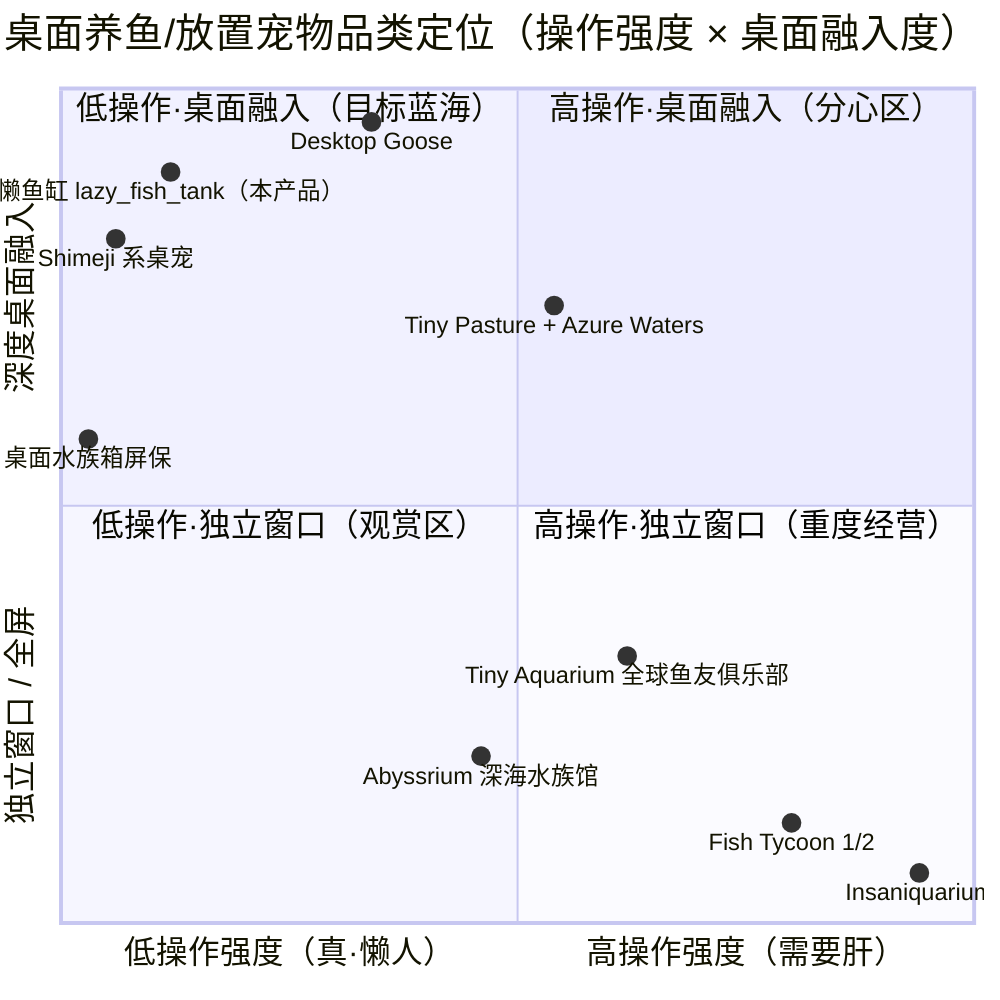

# 懒人桌面养鱼模拟器 — 产品需求文档（PRD）

| 项 | 内容 |
| --- | --- |
| 文档语言 | 简体中文 |
| 项目名称 | `lazy_fish_tank` |
| 编程语言 | **P0 端**：Python 3.10+（复用仓内 `tools/allin_engine`，GUI 用 tkinter，零硬依赖）<br>**P1 端**：C++11（XJ380OS XACT 2026v4，`xguiapi.h`，产物 ELF/EPF） |
| 产出目录 | `<仓库根>` |
| 撰写人 | 许清楚（产品经理） |
| 版本 | v1.0 |
| 日期 | 2026-08-03 |

## 0. 原始需求复述

> 「帮我开发一个懒人桌面养鱼模拟器游戏（联网搜索完成信息调研；`G:\soft`、`G:\tools\allin_engine` 结合这两个项目），成果输出到 `G:\fish`」

拆解为三条可执行约束：

1. **品类**：懒人 + 桌面 + 养鱼模拟器 —— 桌宠形态的放置类养成游戏，而非需要天天肝的重度经营。
2. **资产复用**：必须真正复用 `allin_engine`（Python 游戏内核）与 XJ380OS C++ SDK（`<PATH>`＝SDK 根，需自行获取），双端交付。
3. **调研先行**：品类机制、桌宠交互范式、目标平台可行性均需有据可查。

---

## 1. 调研纪要

### 1.1 信息来源

| # | 来源 | URL | 用途 |
| --- | --- | --- | --- |
| S1 | Tiny Pasture — Steam 商店页 | https://store.steampowered.com/app/3167550/Tiny_Pasture | 头部桌面挂件放置游戏基线 |
| S2 | Tiny Pasture 数据（销量/收入/评分） | https://steamdata.ai/game/3167550 | 品类商业体量 |
| S3 | Tiny Pasture 玩家长评（190h / 84h / 68h） | http://www.wasdland.com/game/tiny-pasture-3167550/ | **反面教训来源：伪懒人差评** |
| S4 | GamesRadar《Tiny Pasture 是为养不活电子宠物的人做的放置游戏》 | https://www.gamesradar.com/games/simulation/tiny-pasture-is-the-perfect-idle-game-for-people-who-cant-keep-their-tamagotchi-alive/ | 懒人设计理念论证 |
| S5 | Tiny Pasture 页面（含 Azure Waters 水族箱 DLC） | https://everygame.gg/game/tiny-pasture | 桌面水族箱直接竞品 |
| S6 | Fish Tycoon Wiki — Breeding | https://fishtycoon.fandom.com/wiki/Breeding | 遗传育种机制 |
| S7 | Fish Tycoon 2 — Breeding Charts | https://fishtycoon.fandom.com/wiki/Breeding_Charts_(Fish_Tycoon_2) | 育种矩阵规模 |
| S8 | IGN — Fish Tycoon Walkthrough | https://s.ign.com/articles/2006/04/05/fish-tycoon-walkthrough-700226 | 生长阶段/疾病/死亡惩罚 |
| S9 | Tiny Aquarium《全球鱼友俱乐部》 | https://www.5577game.com/az/49450.html | 图鉴+科普+离线收益 |
| S10 | 同上（机制细节版） | https://m.crsky.com/mip/soft/1097522.html | 离线繁殖、悬浮窗模式 |
| S11 | Tamagotchi 词条（生命周期与死亡） | http://wikiwand.dev/en/Mametchi | 强惩罚反面教材 |
| S12 | DesktopGoose 技术拆解（分层窗口实现） | https://wenku.csdn.net/doc/2vvn750bkr | 桌宠窗口范式 |
| S13 | Shimeji Desktop Pet | https://shimeji-desktop-pet.en.uptodown.com/android | 桌宠交互范式 |
| S14 | XINGJI 工作室官网 | http://www.xingjisoft.top | XJ380OS 现状核实 |
| S15 | **OpenXJ380 官方开源仓库**（2026-08 首次公开） | https://github.com/xingji-studio/OpenXJ380 | GUI 可行性边界、文档缺口的补救途径 |
| S16 | XINGJI Studios GitHub 组织 | http://github.org/xingji-studio | BridgeEngine / StardustUI 状态 |

> 本地一手资料（非网络）：`<PATH>\XJ380_XACT_2026v4_windows\depend\include\xguiapi.h`（v1.2.0，304 行，已逐行核对）、`<PATH>\XJ380_SDK_项目评估报告.md`、仓内 `tools/allin_engine` 源码。

### 1.2 关键发现

#### 发现 A：品类有真实商业验证，且「桌面水族箱」已被验证为可行细分

Tiny Pasture（CaveLiquid 开发 / Gamersky Games 发行，2025-02-17 上线，Godot 引擎，$5.99）截至调研日累计 **7,150 条评价、好评率 92%、销量约 46.9 万份、分成后收入约 173 万美元**，历史最高在线 19,674 人（S1/S2）。其 **Azure Waters DLC 正是「桌面水族箱」**——把牧场换成鱼缸，鱼在屏幕底部游动（S5）。这直接证明了本项目的品类假设成立，且桌面水族箱是被市场认可的形态。

#### 发现 B：头部产品最大的差评点是「不够懒」——这是我们的核心差异化机会

S3 中 190 小时时长的玩家长评原文要点：

> "this is not as idle of a game as it at first appears. You have to manually collect coins from your pets (**if they overflow they will disappear after a while**), clean up after them, feed them every now and then, and give them meds when they get sick... if trying to run this game while studying, **you may end up getting distracted a lot**."

拆出四条明确的反模式：

| 反模式 | 后果 | 我们的对策 |
| --- | --- | --- |
| 金币溢出后**消失** | 惩罚不在线，制造上线焦虑 | **收益永不溢出、永不消失** |
| 手动清洁 / 手动喂食 / 手动喂药 | 把游戏变成家务 | 自动化设施**前置到开局即可获得** |
| 自动化设施是**后期奖励** | 前期最劝退时反而最累 | 自动投喂器列为 P0 且首小时可解锁 |
| 会干扰工作注意力 | 与「边工作边陪伴」定位矛盾 | 零弹窗、零红点、零音效默认、不抢焦点 |

该玩家补充："After you get past the initial grind... you can in fact keep it idly running in the background, **as long as you have auto-facilities**" —— 印证了自动化设施前置的正确性。

#### 发现 C：Tamagotchi 式强惩罚是明确的反面教材

Tamagotchi 的核心循环是「疏于照料 → 生病 → 死亡 → game over 需重置」，其 care mistakes 机制甚至被玩家用作刻意操作（S11）。GamesRadar 对 Tiny Pasture 的评价直指要害（S4）：

> "even a total of 15 pasture pets aren't nearly as demanding as a single Tamagotchi... **I can care for them whenever I want... but I don't have to do it.** ...nothing will happen if I choose to ignore it all."

Fish Tycoon 同样带强惩罚：真实时间流逝（关机也走），鱼会生病、"Fragile Species" 会在长成前死亡，需手动扔掉死鱼（S8）。**「可照料但不必照料」是懒人游戏的分水岭**。

#### 发现 D：育种/图鉴是长线留存的主力，但复杂度必须大幅裁剪

- Fish Tycoon：body 与 fin 各分 3 级、21 种鳍型、400+ 物种、需 5 代交叉育种才能凑齐一条主线的全部鳍型（S6/S7）。深度足够，但**心智负担远超懒人定位**。
- Tiny Aquarium：120–200+ 种鱼图鉴，**每种鱼附真实原型科普小知识**，被多个渠道列为核心卖点（S9/S10）。这是低成本高感知的设计。

结论：保留「稀有度爬升 + 变异色」两维育种，砍掉基因矩阵；图鉴规模控制在 24 种并全部配科普文案。

#### 发现 E：桌宠窗口范式已有成熟解法

DesktopGoose 的实现路径（S12）：以 `WS_EX_TOOLWINDOW + WS_EX_TRANSPARENT` 创建**始终置顶但不干扰其他应用焦点**的透明渲染层，定时器驱动 30–60 FPS 精灵动画，空闲时伪随机游走。Shimeji 系产品的共性参数是：尺寸/移动速度/透明度可调、低资源占用、不遮挡关键界面（S13）。

对应到 Python/tkinter 的等价能力：`overrideredirect(True)`（无边框）+ `-transparentcolor`（Windows 色键透明）+ `-topmost`（置顶）+ `-alpha`（整体不透明度）。**无需引入 Qt/pygame 等重依赖即可实现桌宠形态**。

#### 发现 F：XJ380OS 侧的可行性边界（逐行核对 `xguiapi.h` v1.2.0 得出）

**可用的能力：**

| 类别 | 可用 API |
| --- | --- |
| 窗口 | `xapi_CreateWindow`（`XWINDOW{width,height,title,sets}`）、`SetWindowTitle`、`CloseWindow`、`SetIcon`、`GetWindowSize` |
| 窗口样式 | `XWIN_NORMAL` / `XWIN_FRAME_OFF`（**无边框**）/ `XWIN_FULL_SCR` / `XWIN_SUPPORT_RESIZEABLE` |
| 基础绘图 | `DrawPoint` / `DrawLine` / `DrawRect(fill)` / `DrawSvg` / `DrawFA`(FontAwesome 图标) |
| 文字 | `DrawText` / `DrawTextl` / `DrawSWText` / `CalcTextWidth`（均为 `WSTR` 宽字符） |
| 图片 | `DrawBMP` / `DrawPNG` / `DrawPicture` / `GetPicSize`（**按文件路径加载**） |
| 帧缓冲 | `ReadBuffer`/`WriteBuffer`（`XCOLOR*` RGB24）、`ReadBufferA`/`WriteBufferA`（`XCOLORA*` RGBA）、`RefreshWindow` / `RefreshPartWindow` |
| 控件 | `xapi_Button` / `xapi_ButtonEmp` / `xapi_DeleteButton` / `xapi_RegisterRightButtonMenu`（`RightMenuItem{CRLid,text}`） |
| 消息 | `SetMsgPrcor(handle, void(*)(UINT64 Type, UINT64 hData, UINT64 lData))` |

**明确的限制与坑（必须让架构师提前知道）：**

1. **`xapi_DrawCircle` 在头文件中被整段注释掉了**（`xguiapi.h` 第 137–144 行）——圆形/椭圆必须自绘。鱼身、气泡、圆角一律不能依赖它。
2. **没有透明窗口 / 置顶 / 托盘 / 窗口级 Alpha 混合 API**。→ **XJ380 端做不了桌宠形态**，只能是普通（可选无边框）窗口应用。这是硬边界，玩法必须能在普通窗口下自洽。
3. **图片 API 只接受文件路径**，无内存位图/图集句柄。每帧调用 `DrawPNG` 等于每帧读盘，不可接受。→ 正解是**离屏软渲染 + `WriteBufferA` 整帧提交 + `RefreshPartWindow` 局部刷新**。
4. **头文件疑似 Bug**：`xapi_ReadBufferA` 的 `buffer` 参数类型写成了 `XCOLOR*`，而按语义应为 `XCOLORA*`（对比 `xapi_WriteBufferA`）。调用处需强制转换并加注释。
5. **消息类型常量 `Type` 未在任何头文件中定义**。`xapi.h` 中 `#define` 数量为 0；`XJ380_API_Spec_CPP_1_3.pdf` 第 4-4 节提及 `SetMsgPrcor()` 与 `CHAR`/`F12`/`ESC`/`BACKSPACE` 等键盘消息，但常量值未落到头文件。→ 需从 OpenXJ380 开源仓库 `user/xapi/` 反查，或 QEMU 实测枚举。**列为 P1 端第一风险项**。
6. `BridgeEngine.h` 为空桩，`StardustUI` 在开源仓库中目录为空（S15/S16）——**不可依赖**。
7. 文档 v1.3 与头文件 v1.0.0/1.2.0 存在版本漂移，**一律以头文件为准**。

**新增的有利情报：** XINGJI 已于 2026-08-01 起开源 **OpenXJ380**（S15），仓库含 `graphics/`、`font/`、`user/`（用户态应用 + XAPI 运行时 + 浏览器）、`include/` ABI 头文件，构建为 Ninja + QEMU 流程（`ninja -f build.ninja run`）。这为「文档缺口」提供了权威补救途径——**消息常量、绘图语义、字体行为都可以直接读源码确认**，可行性风险显著下降。

### 1.3 「懒人友好」设计准则（本项目的宪法级约束）

> 以下 8 条为硬性准则，任何需求与准则冲突时，**准则优先**。

| # | 准则 | 具体判定标准 |
| --- | --- | --- |
| L1 | **无失败态** | 鱼永不死亡、永不消失、永不患病需喂药。最差状态只是「产出降速」。 |
| L2 | **收益永不丢失** | 离线收益不溢出、不过期、不清零。无「未及时领取则消失」的设计。 |
| L3 | **自动化前置** | 自动投喂器在首个游戏小时内可获得；自动清洁在第一天内可获得。自动化是**起点**，不是终点奖励。 |
| L4 | **负反馈只减速，不倒退** | 水质差 → 产出系数下降至下限 0.5×，绝不扣金币、不减鱼、不回退进度。 |
| L5 | **单次会话 ≤ 3 次点击 / ≤ 60 秒** | 上线的完整例行操作为：领收益 → （可选）买鱼/升级 → 关闭。 |
| L6 | **零催促** | 无每日任务、无限时活动、无体力值、无登录奖励断签惩罚、无红点、无桌面通知弹窗、音效默认关闭。 |
| L7 | **长离线不惩罚** | 离线 7 天回来的收益必须显著高于离线 1 天，且水质不会归零。离线越久边际效率递减，但**绝不封顶为 0**。 |
| L8 | **不抢占注意力** | 桌宠窗口不抢焦点、不遮挡工作区、可一键隐藏、鼠标穿透可选。 |

---

## 2. 竞品分析

### 2.1 竞品对比表

| # | 产品 | 形态 | 核心循环 | 优点 | 缺点 / 对我们的启示 |
| --- | --- | --- | --- | --- | --- |
| 1 | **Tiny Pasture + Azure Waters DLC**<br>(CaveLiquid, 2025, $5.99) | 屏幕底部条带 overlay | 养动物 → 产金币 → 手动收 → 买更多 | 桌面融入度高；美术讨喜；55 个成就；46.9 万销量验证品类 | **金币溢出会消失**、需手动清洁/喂食/喂药，被长评玩家点名"不够 idle"、"会分散注意力"（S3）→ 我们的正面靶子 |
| 2 | **Tiny Aquarium 全球鱼友俱乐部**<br>(Lunheim Studios) | 手机全屏 App（有悬浮窗模式） | 钓鱼 → 入缸 → 繁殖 → 图鉴 → 装饰 | 120–200+ 鱼种图鉴 + **真实科普文案**；离线持续繁殖产币；无硬性日常 | 需联网社交；钓鱼小游戏需要主动操作；移动端形态，桌面缺位 |
| 3 | **Fish Tycoon 1/2**<br>(Last Day of Work) | 独立窗口 | 杂交育种 → 发现新种 → 卖鱼 → 买科技 | 遗传系统极深（body×fin 三级、400+ 种、7 条魔法鱼）；真实时间流逝有代入感 | **鱼会生病死亡**、Fragile Species 长不大就死、需手动扔死鱼（S8）；育种矩阵心智负担重 → 只取「稀有度爬升」骨架 |
| 4 | **Abyssrium / Tap Tap Fish** | 手机全屏 App | 点击巨石 → 攒生命值 → 解锁珊瑚与鱼 | 治愈氛围拉满；放置产出清晰；纯单机 | 核心是**重复点击**，与「懒」冲突；内购与广告较重 |
| 5 | **Insaniquarium** (PopCap) | 独立窗口 | 喂鱼 → 捡金币 → 买宠物 → 打外星人 | 反馈密集、爽感强；宠物组合有策略 | 操作强度极高，鱼会饿死、外星人会吃鱼；**完全是懒人的反面** |
| 6 | **Shimeji / PixelShimeji 系桌宠** | 透明分层窗口 | 无玩法，纯陪伴与随机行为 | 桌面融入度天花板；资源占用极低；尺寸/速度/透明度可调；不遮挡关键界面（S13） | **无养成、无长线目标**，新鲜感衰减快 → 我们要把桌宠形态与养成循环缝合 |
| 7 | **Desktop Goose** | 透明置顶层（`WS_EX_TOOLWINDOW + WS_EX_TRANSPARENT`） | 主动骚扰用户 | 技术范式教科书：置顶不抢焦点、伪随机游走、鼠标事件感知（S12） | 设计意图是**干扰**用户，与 L8 相悖 → 只取技术范式，不取行为设计 |
| 8 | **传统桌面水族箱屏保** | 全屏屏保 / 壁纸 | 无 | 观赏性好、零操作 | 无养成无目标；屏保态无法边工作边看 |
| 9 | **Tamagotchi** | 实体掌机 | 喂食/清洁/管教 → 进化 | 情感联结强（Tamagotchi Effect） | 疏于照料即死亡、game over 需重置（S11）→ **本项目明令禁止的设计** |

### 2.2 竞品象限图



**读图结论**：右上「高操作 × 高融入」是分心区（Desktop Goose、Tiny Pasture 部分体验落入此处）；右下是重度经营红海。**左上「低操作 × 深度桌面融入」目前只有无养成的纯桌宠（Shimeji）占位——有养成深度的产品在此处缺席，即本产品的目标蓝海。**

---

## 3. 产品定位与目标

### 3.1 一句话定位

**一个待在你桌面角落、你不管它也活得很好的鱼缸。** 它替代的不是「一款游戏」，而是「工作间隙看一眼窗外」这个动作。

### 3.2 产品目标（Product Goals）

| # | 目标 | 衡量口径 |
| --- | --- | --- |
| **G1** | **零负担陪伴**：用户离线任意时长回来都不受惩罚，单次上线例行操作 ≤ 3 次点击、≤ 60 秒 | 无失败态；离线 7 天收益 ≥ 离线 1 天收益的 3 倍；例行操作点击数可被自动化测试统计 |
| **G2** | **有长线目标的桌宠**：以图鉴收集与稀有度爬升提供 30 天以上的目标感，而非纯观赏 | 24 种鱼图鉴；从 R1 到解锁 R5 的自然周期约 3–4 周（纯挂机，不加速） |
| **G3** | **双端同源**：Python 桌面端与 XJ380OS C++ 端共享同一套玩法数值与存档语义，玩法逻辑与渲染层解耦 | 数值全部外置为 JSON；同一份 `fish_data.json` / `balance.json` 双端可读；核心结算逻辑有跨端一致性测试 |

### 3.3 非目标（明确不做）

- 不做联网、账号、社交、排行榜、好友互访。
- 不做内购、广告、赛季、限时活动。
- 不做钓鱼/清洁/喂药等需要主动操作的小游戏。
- 不做 Fish Tycoon 式的多基因矩阵育种。
- 不做 3D、不做粒子级流体模拟。

---

## 4. 用户故事

| # | 用户故事 | 验收要点 |
| --- | --- | --- |
| **US1** | 作为一名**长时间伏案的上班族**，我希望鱼缸静静待在屏幕角落自己游动，这样我在写代码的间隙抬眼就能放松几秒，而不用切换窗口。 | 无边框透明置顶窗口；不抢焦点；可拖拽 + 贴边吸附；可一键隐藏 |
| **US2** | 作为一个**记性不好的玩家**，我希望出差一周回来鱼还全都活着、金币一分没少，这样我不会因为愧疚而卸载游戏。 | 无死亡、无疾病；离线收益不封顶不清零；水质离线衰减半速且有下限 |
| **US3** | 作为一名**收集控**，我希望通过繁殖不断开出没见过的新鱼并解锁图鉴条目，这样我有持续几周的追求目标。 | 24 种鱼图鉴；稀有度爬升 + 变异色；每种鱼配一条真实科普；族群集齐给永久加成 |
| **US4** | 作为一名**碎片时间玩家**，我希望上线后一眼看到攒了多少金币、一键领取、顺手买条鱼就能关掉，这样整个过程不超过一分钟。 | 上线弹「离线结算卡片」；一键领取；商店 ≤ 2 层菜单；无二次确认弹窗 |
| **US5** | 作为一名**会开会/录屏的用户**，我希望能一键把鱼缸藏进托盘，并且它绝不会弹通知打断我，这样我不担心它出现在共享画面里。 | 托盘常驻；单击托盘图标切换显隐；全局无桌面通知；音效默认关闭 |
| **US6** | 作为一个**喜欢布置的玩家**，我希望能用金币买水草、沉木、灯光来装饰鱼缸并获得一点产出加成，这样我的鱼缸和别人不一样。 | ≥ 12 件装饰；可自由摆放；提供 +2%~+8% 产出加成；布局随存档持久化 |
| **US7** | 作为一名 **XJ380OS 用户**，我希望能在我的系统上跑同一款养鱼游戏并继续我的进度，这样我不必因为换系统而重头再来。 | C++ 端能编译出 ELF/EPF 并在 QEMU 中运行；读取同格式存档；玩法数值与 PC 端一致 |
| **US8** | 作为一名**在意性能的用户**，我希望这个鱼缸挂一整天也不会让我的风扇转起来，这样我愿意让它常驻。 | 空闲态 CPU 占用 < 2%（单核）；内存 < 120 MB；窗口不可见时降帧至 ≤ 2 FPS 或挂起渲染 |

---

## 5. 需求池（P0 / P1 / P2）

> **端标注说明**：`双端` = Python 端与 XJ380 端共有；`PY` = Python 端独占（XJ380 平台能力不支持）；`XJ` = XJ380 端特有适配。
> **优先级**：P0 = 必须有（首个可玩版本）；P1 = 应该有；P2 = 锦上添花。

### 5.1 P0 — 必须有（MVP 可玩闭环）

#### 核心模拟

| ID | 端 | 需求 | 实现要点 / 引擎映射 |
| --- | --- | --- | --- |
| P0-01 | 双端 | **鱼缸世界与实体管理**：鱼、装饰、气泡等均为实体，可增删查改 | `core/ecs.py` 的 `World` / `Entity` / `Component`；组件拆为 `FishSpecies`、`Growth`、`Position`、`Velocity`、`Income`、`Appearance` |
| P0-02 | 双端 | **鱼的自主游动**：鱼在缸内自然游弋，有巡游 / 觅食 / 发呆 / 转向四种状态，不做机械直线运动 | `ai/decision/behavior_tree.py`：`Selector`→`Sequence`；条件节点读 `Blackboard`（是否有食物、是否靠近边界）。挂载方式用 `ai/decision/brain.py` 的 `BrainComponent` + `BrainSystem` 接入 ECS |
| P0-03 | 双端 | **固定步长主循环**：模拟与渲染解耦，逻辑固定 20 Hz，渲染最高 30 FPS | `core/game_loop.py` 的 `FixedTimestepLoop` |
| P0-04 | 双端 | **游戏状态与序列化**：鱼缸全量状态可存可读 | `world/game_state.py` + `core/serializable.py` + `core/world_serial.py` |
| P0-05 | 双端 | **存档与自动存档**：每 60 秒自动存档，退出时强制存档，存档含 UTC 时间戳 | `systems/save_load.py` 的 `SaveLoadManager.save/auto_save/load_auto/get_latest_state` |
| P0-06 | 双端 | **离线收益结算**：启动时用「当前时间 − 存档时间戳」按分钟结算金币与成长，**不封顶、不清零**（准则 L2/L7） | 存档时间戳 + 分段效率函数（见 §7.4）；结算逻辑必须为纯函数以便双端一致性测试 |
| P0-07 | 双端 | **水质系统**：水质随鱼的数量连续衰减，影响产出系数（下限 0.5×，**绝不归零**，准则 L4） | `ai/decision/difference_engine.py` 的 `ReactiveTracker.subscribe` 订阅水质阈值跨越事件；`FiniteDifference` 做衰减曲线离散推进 |
| P0-08 | 双端 | **金币经济**：产出、结余、消费三条链路闭环；金币无上限、无溢出丢失 | `world/game_state.py` 扩展 `currency` 字段 |
| P0-09 | 双端 | **鱼的成长阶段**：鱼苗 → 幼鱼 → 成鱼 → 熟成，四阶段影响外观与产出系数，按真实时间推进（离线也推进） | 组件 `Growth{born_at, stage}`，结算与离线共用同一时间基准 |
| P0-10 | 双端 | **自动投喂器（准则 L3，P0 且首小时可得）**：购买后自动维持饱食度，用户永不需要手动喂食 | 一个 `System`，每 tick 消耗少量金币维持 `Satiety` |
| P0-11 | 双端 | **12 种基础鱼（R1–R3）+ 图鉴**：每种含名称、稀有度、基准产出、外观参数、**一条真实科普文案** | 数据外置 `data/fish_data.json`，用 `utils/json_loader.py` + `core/data_library.py` 加载 |
| P0-12 | 双端 | **商店与购买**：买鱼苗、买鱼缸扩容、买过滤器、买自动投喂器 | `systems/inventory.py` / `stackable_inventory.py` 管理已购设施 |
| P0-13 | 双端 | **数值全外置**：所有平衡参数在 `data/balance.json`，代码内不得硬编码数值 | `core/config.py` + `render/formula_engine.py`（安全公式求值，支持策划改公式不改代码） |

#### 表现与交互

| ID | 端 | 需求 | 实现要点 / 引擎映射 |
| --- | --- | --- | --- |
| P0-14 | **PY** | **桌宠窗口形态**：无边框、背景透明、置顶（可关）、可拖拽、贴边吸附、不抢焦点 | tkinter：`overrideredirect(True)` + `-transparentcolor` + `-topmost`；基于 `render/gui_base.py` 的 `BaseWindow` 扩展新子类，不改引擎原有代码 |
| P0-15 | **PY** | **托盘常驻**：托盘图标，单击切换显隐，右键菜单（显示/隐藏、置顶开关、打开面板、退出）。关闭按钮 = 最小化到托盘而非退出 | 可选依赖 `pystray` + `Pillow`；**依赖缺失时必须优雅降级**为「无托盘 + 右键菜单」模式，不得崩溃（对齐引擎零硬依赖原则，参考 `core/deps.py`） |
| P0-16 | 双端 | **鱼缸渲染**：水体背景、鱼精灵、装饰、气泡；Python 端用 tkinter Canvas，XJ380 端用离屏缓冲 | Python：Canvas + `render/color_system.py` 调色；XJ380：软渲染到 `XCOLORA` 缓冲，`xapi_WriteBufferA` + `xapi_RefreshPartWindow` 提交 |
| P0-17 | 双端 | **喂食气泡与水花粒子**：投喂、鱼吃食、鱼转向时产生气泡/涟漪 | `fx/particle.py` 的 `ParticleSystem` + `Emitter` + `ForceField`（浮力用向上的力场）；numpy 可用时自动切 `fx/particle_np.py` |
| P0-18 | 双端 | **HUD**：金币数、鱼数量/容量、水质条。常驻但极简，不遮挡鱼 | `render/gui_base.py` 的 `StatusPanel` 复用 |
| P0-19 | 双端 | **离线结算卡片**：启动时展示「离开了 X 小时，赚了 Y 金币，Z 条鱼长大了」，一键领取 | 一次性卡片，无二次确认（准则 L5） |
| P0-20 | 双端 | **管理面板**：图鉴 / 商店 / 升级 / 设置四个页签，从鱼缸点击展开 | `render/widgets.py` + `TkUtil.create_scrollable_frame` |
| P0-21 | 双端 | **中文字体**：界面与科普文案正确显示中文 | `utils/font.py` 的本地字体加载（引擎自带中文手写体 TTF）；XJ380 端注意 `WSTR` 宽字符编码 |
| P0-22 | **PY** | **性能约束**：空闲 CPU < 2%（单核）、内存 < 120 MB；窗口隐藏时渲染降至 ≤ 2 FPS | 隐藏时挂起 Canvas 重绘，仅保留逻辑 tick |
| P0-23 | 双端 | **零打扰**：无桌面通知、无红点、无强制弹窗；音效默认关闭 | 准则 L6 |

### 5.2 P1 — 应该有

| ID | 端 | 需求 | 实现要点 / 引擎映射 |
| --- | --- | --- | --- |
| P1-01 | **XJ** | **XJ380OS 移植端**：`xxcc` 编译出 ELF/EPF，QEMU 中可运行，玩法与数值同源 | 复用 `<PATH>\xj380_builder.py` 作为构建前端；编译参数 `-ffreestanding -fno-builtin -fno-exceptions -nostdinc` |
| P1-02 | **XJ** | **软渲染层**：自实现画圆/椭圆（`xapi_DrawCircle` 已被注释不可用）、Alpha 混合、精灵绘制，输出到离屏 `XCOLORA` 缓冲 | 中点画圆算法自写；整帧 `xapi_WriteBufferA` 提交；用 `xapi_RefreshPartWindow` 做脏矩形优化 |
| P1-03 | **XJ** | **输入与消息**：接管 `SetMsgPrcor` 回调，识别鼠标点击与键盘事件 | ⚠️ **消息 `Type` 常量未在头文件定义**，需先从 OpenXJ380 `user/xapi/` 源码反查或 QEMU 实测枚举，再固化为项目内 `xj_msg.h` |
| P1-04 | **XJ** | **资源加载**：鱼与装饰的图片资源在**启动时一次性**载入内存缓冲，杜绝每帧读盘 | 启动期 `xapi_GetPicSize` + `xapi_DrawPicture` 到离屏窗口再 `xapi_ReadBufferA` 回读，缓存为内存图集 |
| P1-05 | 双端 | **繁殖系统**：同种成鱼共存达时长后按概率产卵；跨种低概率产出杂交蛋，可能爬升一档稀有度或产出变异色 | 一个 `BreedingSystem`；概率与冷却外置到 `balance.json`；**不引入 Fish Tycoon 式基因矩阵** |
| P1-06 | 双端 | **扩充至 24 种鱼（新增 R4/R5 与变异色）** | 追加 `fish_data.json` 条目 |
| P1-07 | 双端 | **装饰系统**：≥ 12 件装饰，可自由摆放，提供 +2%~+8% 产出加成，布局持久化 | ECS 实体 + `Decoration` 组件；加成汇总进产出公式 |
| P1-08 | 双端 | **自动清洁设施**：购买后水质自动维持在阈值以上（准则 L3） | 过滤器等级抵消水质衰减 |
| P1-09 | 双端 | **图鉴族群加成**：集齐某生态族群（淡水/热带/深海）给永久 +3% 产出 | 图鉴完成度驱动 |
| P1-10 | **PY** | **多形态切换**：「缸模式」（角落小窗）↔「条带模式」（屏幕底部通栏，对标 Tiny Pasture）↔「面板模式」 | 同一渲染数据，三套布局 |
| P1-11 | 双端 | **点击互动**：点击鱼会显示名字与科普卡片；鱼会短暂游向鼠标 | 行为树增加「趋向兴趣点」分支 |
| P1-12 | 双端 | **环境音与水声**：轻柔气泡音，**默认关闭**，可在设置中开启 | `audio/synth.py` + `audio/audio_system.py`（numpy/scipy 可选依赖，缺失时静默降级） |
| P1-13 | 双端 | **跨端存档一致性测试**：同一份存档 + 同一段离线时长，双端结算结果必须一致 | 纯函数结算 + 黄金用例（golden test） |
| P1-14 | **PY** | **鼠标穿透模式**：开启后鼠标点击直接穿透鱼缸窗口作用于下层应用（准则 L8） | Windows 下 `WS_EX_TRANSPARENT` 等价设置 |

### 5.3 P2 — 锦上添花

| ID | 端 | 需求 | 备注 |
| --- | --- | --- | --- |
| P2-01 | 双端 | **昼夜光照**：随系统时间改变水体色调与灯光 | `render/color_system.py` 插值 |
| P2-02 | 双端 | **成就系统**：约 20 个静默成就，仅在图鉴页可见，**不弹窗**（准则 L6） | |
| P2-03 | 双端 | **主题鱼缸皮肤**：沉船、珊瑚礁、极简白 等 | |
| P2-04 | 双端 | **Mod / 自定义鱼种**：用户放入 JSON + PNG 即可加入新鱼 | `systems/mod_loader.py` 现成能力 |
| P2-05 | **PY** | **多显示器支持与位置记忆** | |
| P2-06 | 双端 | **摄影模式**：一键截取鱼缸图片保存 | |
| P2-07 | 双端 | **稀有鱼出现的静默庆祝动画**：仅粒子表现，无弹窗无音效 | `fx/particle.py` 的 `create_explosion` 改配色 |
| P2-08 | **PY** | **开机自启选项** | 默认关闭 |

### 5.4 双端能力差异总表（架构必读）

| 能力 | Python 端 | XJ380 端 | 处理策略 |
| --- | --- | --- | --- |
| 透明窗口 / 色键抠图 | ✅ tkinter `-transparentcolor` | ❌ 无 API | **Python 独占**；XJ 端用不透明窗口 + 绘制完整背景 |
| 窗口置顶 | ✅ `-topmost` | ❌ 无 API | Python 独占 |
| 无边框 | ✅ `overrideredirect` | ✅ `XWIN_FRAME_OFF` | 双端可用 |
| 系统托盘 | ✅ pystray（可选依赖，可降级） | ❌ 无 API | Python 独占 |
| 鼠标穿透 | ✅ | ❌ | Python 独占 |
| 画圆 | ✅ Canvas `create_oval` | ❌ **`xapi_DrawCircle` 被注释** | XJ 端自实现中点画圆 |
| Alpha 混合 | ✅ | ⚠️ 仅 `WriteBufferA` 提供 RGBA 缓冲，混合需自算 | XJ 端软件混合 |
| 图片资源 | ✅ Canvas 图元 | ⚠️ 仅路径加载，需启动期缓存为内存图集 | 见 P1-04 |
| 音频 | ✅ 可选（numpy/scipy） | ❓ 未在 `xguiapi.h` 中，需查 `x3api.h`/`x4api.h` | 列入待确认问题 Q6 |
| 按钮控件 | ✅ tkinter | ✅ `xapi_Button` / `ButtonEmp` | 双端可用 |
| 右键菜单 | ✅ | ✅ `xapi_RegisterRightButtonMenu` | 双端可用 |
| 玩法逻辑 / 数值 / 存档 | ✅ | ✅ | **必须完全同源** |

---

## 6. UI 设计稿

### 6.1 形态一：缸模式（默认，桌面角落）

窗口尺寸 360×220，无边框，背景透明（仅鱼缸玻璃区域可见），默认置顶，可拖拽。

```
        ╭──────────────────────────────────────────────╮  ← 圆角，半透明玻璃质感
        │  🪙 12,480      🐟 7/10      💧 ████████░░  │  ← HUD 条（高 22px，鼠标移出后淡出至 30% 不透明度）
        ├──────────────────────────────────────────────┤
        │   ·  °                                  °    │
        │      ~~~~~~<°))))><~~~                   ·   │  ← 鱼精灵（行为树驱动）
        │   °                        ><(((°>           │
        │        ·        ○                        °   │  ← 气泡粒子（fx.particle 上升力场）
        │    ><(((°>            ·        ~~<°)))><     │
        │  ░░🪸░░      ░🌿░░░              ░░🪨░░      │  ← 装饰层
        │ ▒▒▒▒▒▒▒▒▒▒▒▒▒▒▒▒▒▒▒▒▒▒▒▒▒▒▒▒▒▒▒▒▒▒▒▒▒▒▒▒▒▒ │  ← 底砂
        ╰──────────────────────────────────────────────╯
                        ◦ ◦ ◦                             ← 悬停时才出现的抓手（拖拽区）
```

**交互约定**
- 左键拖拽：移动窗口，靠近屏幕边缘时贴边吸附。
- 左键单击某条鱼：弹出该鱼的信息小卡（名字 / 稀有度 / 成长阶段 / 科普一句话），3 秒后自动消失。
- 双击空白水域：展开管理面板。
- 右键：菜单（打开面板 / 切换形态 / 置顶开关 / 鼠标穿透 / 隐藏 / 退出）。
- 鼠标移出窗口 2 秒后，HUD 淡出至 30% 不透明度（准则 L8）。

### 6.2 形态二：条带模式（屏幕底部通栏，P1）

宽度 = 屏幕宽，高度 120px，吸附于任务栏正上方。

```
────────────────────────────────────────────────────────────────────────────────
   ·      ~~<°)))><          °          ><(((°>       ·        ~~~~<°))))><
 ○        ·          ><(((°>        ·       ○              ·           °
  ░🌿░       ░░🪸░░         ░🪨░        ░░🌿░░        ░🪸░       ░░🪨░░
▒▒▒▒▒▒▒▒▒▒▒▒▒▒▒▒▒▒▒▒▒▒▒▒▒▒▒▒▒▒▒▒▒▒▒▒▒▒▒▒▒▒▒▒▒▒▒▒▒▒▒▒▒▒▒▒▒▒▒▒▒▒▒▒▒▒▒▒▒▒▒▒▒▒▒▒
────────────────────────────────────────────────────────────────────────────────
 🪙 12,480   🐟 7/10   💧 82%                                        [面板] [—]
```

### 6.3 形态三：管理面板（720×480，居中普通窗口）

```
╔══════════════════════════════════════════════════════════════════════════════╗
║  懒鱼缸                                                        [ — ] [ × ]  ║
╠══════════════════════════════════════════════════════════════════════════════╣
║ ┌────────┬────────┬────────┬────────┐                                        ║
║ │ 鱼 缸  │ 图 鉴  │ 商 店  │ 设 置  │            🪙 12,480    💧 82%        ║
║ └────────┴────────┴────────┴────────┘                                        ║
║ ┌──────────────────────────────────────────────────────────────────────────┐ ║
║ │                                                                          │ ║
║ │   【图鉴】  已解锁 9 / 24        淡水 5/8  热带 3/8  深海 1/8            │ ║
║ │                                                                          │ ║
║ │   ┌──────────┐ ┌──────────┐ ┌──────────┐ ┌──────────┐                   │ ║
║ │   │ ><(((°>  │ │ <°)))><  │ │  ~~<°>   │ │    ?     │                   │ ║
║ │   │ 霓虹灯鱼 │ │  孔雀鱼  │ │  神仙鱼  │ │  未解锁  │                   │ ║
║ │   │ ★☆☆☆☆   │ │ ★☆☆☆☆   │ │ ★★☆☆☆   │ │          │                   │ ║
║ │   │ 1.0 金/分│ │ 1.0 金/分│ │ 3.5 金/分│ │          │                   │ ║
║ │   └──────────┘ └──────────┘ └──────────┘ └──────────┘                   │ ║
║ │                                                                          │ ║
║ │   ┌──────────┐ ┌──────────┐ ┌──────────┐ ┌──────────┐                   │ ║
║ │   │  <><     │ │    ?     │ │    ?     │ │    ?     │                   │ ║
║ │   │  斑马鱼  │ │  未解锁  │ │  未解锁  │ │  未解锁  │                   │ ║
║ │   │ ★☆☆☆☆   │ │          │ │          │ │          │                   │ ║
║ │   └──────────┘ └──────────┘ └──────────┘ └──────────┘                   │ ║
║ │                                                                          │ ║
║ │   ── 选中「霓虹灯鱼」 ─────────────────────────────────────────────────  │ ║
║ │   稀有度：普通    基准产出：1.0 金币/分    成长周期：约 2 小时           │ ║
║ │   📖 霓虹灯鱼原产南美洲亚马逊河流域，体侧的蓝色荧光带其实并不发光，      │ ║
║ │      而是鳞片结构对光的反射，属于典型的结构色。                          │ ║
║ └──────────────────────────────────────────────────────────────────────────┘ ║
╚══════════════════════════════════════════════════════════════════════════════╝
```

### 6.4 离线结算卡片（启动时唯一的主动弹出，一键关闭）

```
        ╭────────────────────────────────────────╮
        │        欢迎回来 · 你离开了 2 天 6 小时  │
        │                                        │
        │   🪙  离线收益          + 48,320       │
        │   🐟  长大的鱼               3 条       │
        │   🥚  新孵化的鱼             1 条       │
        │   💧  当前水质              76%        │
        │                                        │
        │            [  一 键 领 取  ]           │
        ╰────────────────────────────────────────╯
```

> 注意：**没有「过期未领取」提示，因为收益永远不会过期**（准则 L2）。

### 6.5 XJ380OS 端布局（受平台能力约束的降级版）

由于 XJ380OS 无透明窗口 / 无置顶 / 无托盘，该端为**普通窗口应用**，采用 640×400 固定窗口，一屏内整合鱼缸与操作区：

```
┌──────────────────────────────────────────────────────────────┐
│ 懒鱼缸 (XJ380)                                               │  ← 标准窗口标题栏
├──────────────────────────────────────────────────────────────┤
│ 🪙 12480    鱼 7/10    水质 82%                              │  ← xapi_DrawText
├──────────────────────────────────────────────────────────────┤
│                                                              │
│      ~~<°)))><            °          ><(((°>          ·      │
│   ○           ·                 ○              ~~~<°))><     │  ← 离屏软渲染
│         ><(((°>          ·                                   │     WriteBufferA 整帧提交
│    ░🌿░        ░░🪸░░           ░🪨░         ░░🌿░░          │     RefreshPartWindow 局部刷新
│  ▒▒▒▒▒▒▒▒▒▒▒▒▒▒▒▒▒▒▒▒▒▒▒▒▒▒▒▒▒▒▒▒▒▒▒▒▒▒▒▒▒▒▒▒▒▒▒▒▒▒▒▒▒▒▒▒   │
├──────────────────────────────────────────────────────────────┤
│  [ 图鉴 ]   [ 商店 ]   [ 升级 ]   [ 设置 ]                   │  ← xapi_Button
└──────────────────────────────────────────────────────────────┘
                                        右键 → xapi_RegisterRightButtonMenu
```

---

## 7. 数值设计初稿

> **说明**：以下给出**设计意图、量级与梯度关系**。精确公式与调参留给架构师，但必须满足此处标注的约束条件。所有数值外置于 `data/balance.json`（P0-13）。

### 7.1 稀有度梯度与基准产出

| 稀有度 | 代号 | 示例鱼种 | 基准产出（金币/分钟） | 相邻档倍率 | 首次获取途径 |
| --- | --- | --- | --- | --- | --- |
| 普通 | R1 | 霓虹灯鱼、孔雀鱼、斑马鱼 | 1.0 | — | 开局赠送 / 商店 |
| 优良 | R2 | 神仙鱼、玛丽鱼、月光鱼 | 3.5 | ×3.5 | 商店 / 同种繁殖 |
| 稀有 | R3 | 血鹦鹉、七彩神仙、龙鱼幼体 | 12 | ×3.4 | 商店 / 跨种繁殖爬升 |
| 史诗 | R4 | 白子金龙、蓝曼龙王 | 40 | ×3.3 | 仅繁殖爬升 |
| 传说 | R5 | 星幕鲸、月华锦鲤 | 130 | ×3.25 | 仅繁殖爬升（低概率） |

**设计意图**：相邻档约 3.3–3.5 倍，五档跨度 130 倍。倍率刻意小于售价倍率（见 7.5），保证「升级需要积累」而不是「换一条鱼就通关」。

### 7.2 成长阶段

| 阶段 | 产出系数 | 占总成长周期 |
| --- | --- | --- |
| 鱼苗 | 0.30 | 0–15% |
| 幼鱼 | 0.60 | 15–45% |
| 成鱼 | 1.00 | 45–100% |
| 熟成 | 1.25 | 达成鱼后再挂 100% 周期 |

**总成长周期**（真实时间，离线同样推进）：R1 ≈ 2 小时，R2 ≈ 6 小时，R3 ≈ 14 小时，R4 ≈ 28 小时，R5 ≈ 48 小时。

**设计意图**：R1 让新手在首次会话内就看到「鱼长大了」的正反馈；R5 的 48 小时确保稀有鱼有仪式感，但不超过两天——避免"养了一周还没长成"的挫败。**熟成阶段（1.25×）是给长期挂机玩家的隐性奖励**，不需要任何操作即可获得。

### 7.3 水质系统

- 水质取值 `[50, 100]`，初始 100。
- **衰减**：每条鱼每分钟贡献约 −0.03 点（20 条鱼 ≈ −0.6/分钟）。
- **过滤器**：Lv1 +0.2/分钟，Lv2 +0.5/分钟，Lv3 +1.2/分钟（Lv3 可完全抵消 36 条鱼）。
- **产出系数**：`quality_factor = 0.5 + 0.5 × (water − 50) / 50`，即水质 100 → 1.0×，水质 50 → 0.5×。
- **硬下限 0.5×，绝不归零**（准则 L4）。
- **离线期间水质衰减速率打 5 折**（准则 L7）：无过滤器时，从 100 掉到下限 50 需要约 55 小时在线 / 约 110 小时离线。

**设计意图**：水质是「你可以管，也可以不管」的软性维度。不管它，最差损失一半产出；花 800 金币买个过滤器，就再也不用管了。它的存在是为了给「升级设施」提供动机，而不是为了惩罚玩家。

### 7.4 离线收益公式的设计意图

**目标**：同时满足两个看似矛盾的要求 —— (a) 不惩罚长时间不登录；(b) 保持在线仍有边际价值。

**采用分段效率衰减，不设收益上限**：

| 离线时长区间 | 效率系数 | 意图 |
| --- | --- | --- |
| 0 – 8 小时 | 100% | 覆盖一个完整工作日 / 一夜睡眠，全额收益 |
| 8 – 24 小时 | 60% | 温和递减 |
| 24 小时以上 | 35% | **永久 35%，不封顶、不归零** |

**必须满足的约束条件（供架构师验算）**：

1. `offline_income(7天) ≥ 3 × offline_income(1天)` —— 保证长离线不亏（准则 L7）。
   - 校验：1 天 = 8×1.0 + 16×0.6 = 17.6 等效小时；7 天 = 8×1.0 + 16×0.6 + 144×0.35 = 68.0 等效小时。**68.0 / 17.6 ≈ 3.86 ✓**
2. `offline_income(24h) < 24 × online_income_per_hour` —— 保证在线仍略优（避免"故意不上线"最优解）。
   - 校验：24 小时离线 = 17.6 等效小时 < 24 ✓（离线效率约为在线的 73%，惩罚温和）
3. **无任何形式的收益上限或过期机制**（准则 L2）。
4. 离线期间成长与繁殖**按 100% 推进**（只有金币产出打折，成长不打折）——这样「离开一周回来发现鱼全长大了、还多了几条」的惊喜感最强。

**产出总公式（意图层）**：

```
每分钟金币 = Σ_每条鱼( 品种基准产出 × 成长阶段系数 )
             × 水质系数(0.5 ~ 1.0)
             × (1 + 装饰加成总和)          // 0 ~ +0.5
             × (1 + 图鉴族群加成总和)      // 0 ~ +0.09
             × 离线效率系数(离线时为 1.0/0.6/0.35，在线时为 1.0)
```

> 建议用 `render/formula_engine.py` 的安全公式求值承载该公式，使其可在 `balance.json` 中被调整而无需改代码。

### 7.5 消费端定价

| 项目 | 价格（金币） | 说明 |
| --- | --- | --- |
| R1 鱼苗 | 50 | |
| R2 鱼苗 | 300 | ×6 |
| R3 鱼苗 | 2,000 | ×6.7 |
| R4 鱼苗 | 15,000 | ×7.5（仅图鉴解锁后可购） |
| R5 鱼苗 | 100,000 | ×6.7（仅图鉴解锁后可购） |
| 自动投喂器 | **300** | **P0 且开局第一小时内即可负担**（准则 L3） |
| 过滤器 Lv1 / Lv2 / Lv3 | 800 / 6,000 / 45,000 | |
| 鱼缸扩容 Lv2(10位) / Lv3(16位) / Lv4(24位) / Lv5(36位) | 1,500 / 12,000 / 80,000 / 400,000 | 初始 Lv1 = 6 位 |
| 装饰品 | 200 ~ 20,000 | 提供 +2% ~ +8% 产出加成 |

**设计意图**：
- **鱼苗售价倍率（≈6.7×）刻意高于产出倍率（≈3.4×）**，使得「买高级鱼」的回本周期随档位递增，从而让**繁殖**（免费获得高级鱼）成为比购买更划算的路径 —— 这把玩家推向图鉴与繁殖这条长线，而非单纯堆金币。
- 自动投喂器定价 300，约等于 6 条 R1 鱼苗，**开局挂机约 1 小时即可购得**。这是全局最重要的一个数字：它决定了游戏从「需要照顾」切换到「可以不管」的时间点。

### 7.6 节奏基线（纯挂机、不加速）

| 时间点 | 预期状态 |
| --- | --- |
| 首次会话（约 3 分钟） | 拿到 3 条 R1 鱼；看到第一条鱼长大；买下自动投喂器 |
| 第 1 天 | 6 位鱼缸满员；买下过滤器 Lv1；解锁 3–4 种图鉴 |
| 第 3 天 | 扩容至 10 位；出现第一条 R3；解锁 8 种图鉴 |
| 第 7 天 | 扩容至 16 位；繁殖出第一条 R4；解锁 14 种图鉴 |
| 第 21–30 天 | 繁殖出第一条 R5；图鉴接近集齐；进入纯观赏与布置阶段 |

**日均预期主动时长：60–90 秒。** 若测试中该值超过 3 分钟，说明设计跑偏，需回退。

---

## 8. 引擎能力映射总表（"结合两个项目"的落地清单）

> 以下映射均已对照仓内 `tools/allin_engine` 实际源码核实（类名与方法名为实际存在的符号）。

| 玩法能力 | 映射到 allin_engine | 已核实的可用符号 |
| --- | --- | --- |
| 鱼缸世界 / 实体管理 | `core/ecs.py` | `World.create_entity / add_entity / add_system / get_system`，`Entity.add/get/has/remove`，`Component`，`System.update(world, dt)` |
| 鱼的自主游动与觅食 | `ai/decision/behavior_tree.py` + `ai/decision/brain.py` | `Status`、`Blackboard.get/set/update/snapshot`、`Node.tick/attach`、`Sequence`、`Selector`、`Parallel`、`Inverter`、`Succeeder`；`BrainComponent` / `BlackboardComponent` / `BrainSystem` |
| 鱼的情绪 / 状态切换（巡游·觅食·发呆） | `ai/decision/state_machine.py` / `hierarchical_state_machine.py` | FSM / HSM |
| 水质连续衰减与阈值响应 | `ai/decision/difference_engine.py` | `FiniteDifference.step/generate`、`StateDiff.diff/summary`、`ReactiveTracker.subscribe/update/set` |
| 固定步长主循环 | `core/game_loop.py` | `FixedTimestepLoop` |
| 事件解耦（鱼出生 / 升级 / 图鉴解锁） | `core/event_bus.py` | `EventBus` |
| 存档 / 自动存档 / 离线时间戳 | `systems/save_load.py` | `SaveLoadManager.save/auto_save/load/load_auto/list_saves/get_latest_state`、`SaveSlotInfo` |
| 全局游戏状态 | `world/game_state.py` + `core/serializable.py` + `core/world_serial.py` | `GameState`、`Serializable` |
| 设施 / 道具持有 | `systems/inventory.py`、`systems/stackable_inventory.py` | `Inventory`、`StackableInventory` |
| 喂食气泡 / 水花 / 涟漪 | `fx/particle.py`（949 行）+ `fx/particle_np.py` | `Particle`、`ForceField`（浮力）、`Emitter.emit`、`ParticleSystem.add_emitter/add_force_field/update/render`、`create_explosion` |
| 鱼的游动动画 / 摆尾 | `render/animation.py` | 补间与帧动画 |
| 水体配色 / 昼夜色调 | `render/color_system.py` | 调色与插值 |
| 产出公式可配置化 | `render/formula_engine.py` | 安全公式求值（无 `eval` 风险） |
| 桌宠窗口 / 面板 / HUD | `render/gui_base.py` + `render/widgets.py` | `BaseWindow`、`StatusPanel.set_fields/update`、`Styles.switch_theme`、`TkUtil.create_scrollable_frame/make_button/show_popup_dialog` |
| 中文字体（含手写体 TTF） | `utils/font.py` + `fonts/` | 本地字体加载 |
| 鱼种 / 装饰 / 平衡数值数据表 | `utils/json_loader.py` + `core/data_library.py` + `core/config.py` | 外置 JSON 加载 |
| 自定义鱼种 Mod（P2） | `systems/mod_loader.py` | `ModLoader` |
| 可选音频（默认关闭） | `audio/synth.py`、`audio/audio_system.py` | 依赖 numpy/scipy，缺失时降级 |
| 可选依赖优雅降级 | `core/deps.py` | 与引擎"零硬依赖"原则一致 |
| 日志 | `utils/logger.py` | |

| XJ380 端能力 | 映射到 XJ380 SDK（`<PATH>`） | 已核实 |
| --- | --- | --- |
| 窗口创建 / 无边框 | `xguiapi.h` `xapi_CreateWindow` + `XWIN_FRAME_OFF` | ✅ |
| 离屏软渲染提交 | `xapi_WriteBufferA` + `xapi_RefreshPartWindow` | ✅（**主渲染路径**） |
| 文字 / HUD | `xapi_DrawText` / `xapi_DrawTextl` / `xapi_CalcTextWidth` | ✅（`WSTR` 宽字符） |
| 按钮 / 右键菜单 | `xapi_Button` / `xapi_RegisterRightButtonMenu` | ✅ |
| 输入事件 | `SetMsgPrcor` | ⚠️ 消息 `Type` 常量缺失，需反查 |
| 画圆 | — | ❌ **`xapi_DrawCircle` 被注释，需自实现** |
| 构建前端 | `<PATH>\xj380_builder.py`（26 KB，随 SDK 获取） | ✅ 复用 |
| 文档缺口补救 | OpenXJ380 开源仓库 `user/xapi/` | ✅ 新增途径 |

---

## 9. 待确认问题

| # | 问题 | 影响 | 建议默认值 / 处理方式 |
| --- | --- | --- | --- |
| **Q1** | **XJ380 消息 `Type` 常量从何而来？** 头文件中 `#define` 数量为 0，PDF 仅提及 `CHAR`/`F12`/`ESC`/`BACKSPACE` 等名称但值未落地。 | **阻塞 P1-03**，无输入则 C++ 端只能做纯观赏 | 建议先从 OpenXJ380 开源仓库 `user/xapi/` 读源码确认；若一周内无法确认，C++ 端首版降级为「只读观赏 + 按钮控件交互」，不依赖原始消息 |
| **Q2** | **XJ380 端首版范围**：是完整玩法移植，还是「观赏 + 图鉴 + 领取收益」的精简版？ | 影响 P1 工作量约 2–3 倍 | 建议**精简版**：渲染鱼缸 + 显示 HUD + 读取 PC 端存档 + 一键领取离线收益。繁殖/商店等留到后续 |
| **Q3** | **交付形态**：是给用户一个 `.exe`（PyInstaller 打包），还是源码 + `python main.py` 运行？ | 影响是否需要引入打包链路与图标/签名 | 建议先做**源码可运行**，打包列为收尾任务 |
| **Q4** | **托盘依赖**：是否接受引入 `pystray` + `Pillow` 两个可选依赖？ | 影响 P0-15 | 建议**接受，但必须优雅降级**（缺失时退化为无托盘模式，不崩溃），与引擎零硬依赖原则一致 |
| **Q5** | **美术资源从哪来**？鱼的精灵图是程序化绘制（Canvas 矢量 / 像素点阵）还是需要 PNG 素材？ | 影响 P0-16 的实现路径与工期 | 建议**首版全部程序化绘制**（椭圆身体 + 三角尾鳍 + 配色表驱动），零素材依赖，也天然规避 XJ380 端的图片加载难题 |
| **Q6** | **XJ380 是否有音频 API**？`xguiapi.h` 中没有，需确认 `x3api.h` / `x4api.h` / `xapi.h` 是否提供。 | 影响 P1-12 在 XJ 端的可行性 | 若无，则音频标记为 Python 端独占 |
| **Q7** | **存档位置**：Python 端存 `%APPDATA%` 还是程序目录？XJ380 端的可写路径规范是什么？ | 影响双端存档互通（US7） | 建议 Python 端默认程序目录（便携），提供配置项；XJ380 端待确认后对齐 |
| **Q8** | **鱼种科普文案**是否需要严格考证？24 条文案需要事实准确性把关。 | 影响内容工作量与可信度 | 建议由我（产品）负责撰写并逐条核对，不占用工程工期 |
| **Q9** | **SDK 分发法律风险**：XJ380 SDK（`<PATH>`）自身无 LICENSE 文件。若产物需要分发，是否只分发我方源码而不打包 SDK？ | 合规风险 | 建议**仓库内不包含 SDK 任何文件**，构建脚本从本地 `<PATH>` 路径引用；README 注明需自行获取 SDK |
| **Q10** | **窗口默认置顶开还是关**？置顶更像桌宠，但可能干扰全屏应用。 | 影响首次体验 | 建议**默认开启置顶，但检测到前台全屏应用时自动让位**；若实现成本高，则默认关闭置顶 |

---

## 10. 附：验收标准（Definition of Done · MVP）

一个 MVP 版本被认为完成，当且仅当以下全部成立：

1. `python main.py` 可在 Windows 上启动，桌面出现无边框透明置顶鱼缸窗口，可拖拽。
2. 鱼在缸内以行为树驱动自然游动，有巡游/觅食/发呆的可辨识差异，**非直线往返**。
3. 关闭程序，修改系统时间前进 2 小时，重新启动 → 弹出离线结算卡片，金币与成长增量符合 §7.4 的分段效率。
4. 挂机 1 小时内可购得自动投喂器，购得后**再不需要任何手动喂食操作**。
5. 水质从 100 衰减至 50 后不再下降，产出降至 50% 但**未归零，无鱼死亡**。
6. 图鉴至少 12 种鱼，每种带科普文案，解锁状态随存档持久化。
7. 空闲态 CPU 占用 < 2%（单核），内存 < 120 MB；窗口隐藏时渲染挂起。
8. 整个游玩过程中**没有出现过任何一次桌面通知、红点、强制弹窗或音效**。
9. 玩法逻辑中**没有任何硬编码数值**，全部来自 `data/balance.json` 与 `data/fish_data.json`。
10. `allin_engine` 源码**未被修改**（只被 import 与继承扩展）。

---

*文档结束 · 如需完整 PRD 之外的市场研究报告或竞品深度拆解，请另行提出。*
