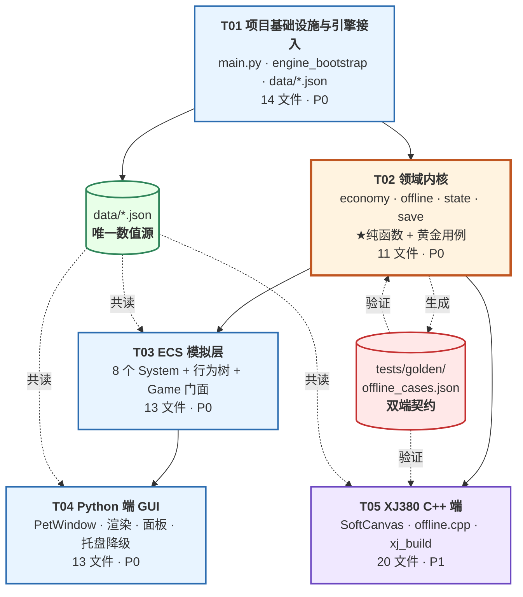

# 懒人桌面养鱼模拟器 — 任务分解（TASKS）

| 项 | 内容 |
| --- | --- |
| 项目名 | `lazy_fish_tank` |
| 撰写人 | 高见远（架构师） |
| 版本 | v1.0 |
| 日期 | 2026-08-03 |
| 依据 | `docs/ARCHITECTURE.md`（同一作者）、`docs/PRD.md`、`docs/FISH_CONTENT.md` |
| 任务总数 | **5 个**（按模块/层次分组，非按文件拆分） |

> **给工程师的话**：请先完整读一遍 `ARCHITECTURE.md`，特别是 **§0 技术侦察结论** 与 **§11 共享知识**。
> 那里列了 17 条 allin_engine 的真实行为与 12 条 XJ380 SDK 的真实约束，其中至少 8 条与 PRD 的假设不符。
> **不读那两节直接开工，一定会踩坑。**

---

## 0. 首轮交付范围（建议）

| 范围 | 需求 ID | 说明 |
| --- | --- | --- |
| ✅ **全量交付** | **P0-01 ~ P0-23** | MVP 全部，对应 PRD §10 验收 10 条 |
| ✅ **纳入首轮** | **P1-01 ~ P1-05** | XJ380 端（移植/软渲染/输入/数据加载）+ 繁殖系统 |
| ✅ **纳入首轮** | **P1-13** | 跨端存档一致性测试（黄金用例）——**这是双端同源的唯一保障，不能推迟** |
| ⏭ 下一轮 | P1-06 ~ P1-12、P1-14 | R4/R5 扩充、装饰系统、自动清洁、族群加成、多形态、点击互动、音频、鼠标穿透 |
| ⏭ 暂不做 | P2-01 ~ P2-08 | 昼夜/成就/皮肤/Mod/多屏/摄影/庆祝/自启 |

> **例外说明**：`data/fish_data.json` 首轮就灌**全部 24 条**（R4/R5 也写进去），只是**商店不上架、图鉴显示为未解锁**。理由：内容已由 PM 备齐，灌库成本几乎为零，而后期追加会引发存档迁移。P1-06 因此只剩"商店上架 + 繁殖爬升路径"这点工作量。
>
> **P1-01 验收降级**：因本机**无 clang/ld、无 XJ380OS 镜像**（ARCHITECTURE §0.2 X11/X12），P1-01 首轮的 Done 定义为「源码完成 + 构建脚本就绪 + 黄金用例双端一致」，**不含"编译通过"和"QEMU 运行"**。见 U2，需主理人决策是否投入工具链。

---

## 1. 任务总览

| ID | 任务 | 依赖 | 优先级 | 文件数 | 覆盖需求 |
| --- | --- | --- | --- | --- | --- |
| **T01** | 项目基础设施与引擎接入 | — | **P0** | 14 | P0-13(部分)、P0-21、Q7、Q9 |
| **T02** | 领域内核：数据层 + 纯函数经济 + 存档 | T01 | **P0** | 11 | P0-04~09、P0-11(数据)、P0-13、P1-13 |
| **T03** | ECS 模拟层：系统 + 行为树 + 门面 | T02 | **P0** | 13 | P0-01~03、P0-07、P0-10、P0-12、P1-05 |
| **T04** | Python 端 GUI：桌宠窗口 + 渲染 + 面板 + 托盘 | T03 | **P0** | 13 | P0-14~20、P0-22、P0-23 |
| **T05** | XJ380 C++ 端 + 双端一致性验证 | T02 | **P1** | 20 | P1-01~04、P1-13 |

**关键路径**：`T01 → T02 → T03 → T04`。
**可并行**：`T05` 只依赖 T02（共享 `data/*.json` 与黄金用例），**可与 T03/T04 完全并行**。

---

## 2. 任务详情

---

### T01 · 项目基础设施与引擎接入

| 项 | 内容 |
| --- | --- |
| **优先级** | P0（阻塞全部） |
| **依赖** | 无 |
| **覆盖需求** | P0-13（数值外置基础）、P0-21（中文字体）、Q7（存档路径）、Q9（SDK 合规） |
| **预计难点** | ★★★（`engine_bootstrap` 的导入顺序是全项目最易错的地方） |

#### 交付文件

```
main.py                          ★ 入口（第一行必须 import engine_bootstrap）
requirements.txt                   全部标注 optional
pytest.ini
README.md                          运行说明 + SDK 需自行获取（Q9）
.gitignore
fishtank/__init__.py
fishtank/engine_bootstrap.py     ★ allin_engine 唯一接入点
fishtank/constants.py              非数值常量（键名、枚举字符串）
fishtank/events.py                 fishtank.* 事件名
data/balance.json                ★ 全部平衡参数（照 ARCHITECTURE §9.1 逐字段落地）
data/fish_data.json              ★ 24 条鱼（灌 FISH_CONTENT §2）
data/decor_data.json               12 件装饰（灌 FISH_CONTENT §4）
data/ui_text.json                  UI 文案（灌 FISH_CONTENT §5）
tools/gen_fish_data.py             从 FISH_CONTENT.md 提取生成 fish_data.json
```

#### 子任务清单

- [ ] **1.1** `engine_bootstrap.py` 严格照 ARCHITECTURE §3.1 实现。**验证点**：`python -c "import fishtank.engine_bootstrap as b; from allin_engine.core.paths import get_save_dir; print(get_save_dir())"` 必须打印 `...\LazyFishTank\saves`，而**不是** `...\allin_engine\saves`。若打印后者，说明环境变量设晚了。
- [ ] **1.2** 三条引擎根定位策略（`ALLIN_ENGINE_HOME` → `G:\tools\allin_engine` → 相邻目录），找不到时抛清晰错误。
- [ ] **1.3** 统一再导出全部引擎符号；`gui_symbols()` 延迟导入（E9：`Styles` 必须在 `tk.Tk()` 之后）。
- [ ] **1.4** `main.py`：CLI 参数 `--no-tray` / `--safe`（禁用可选依赖）/ `--data-dir`（便携模式）。
- [ ] **1.5** `data/balance.json` 按 §9.1 **逐字段**写全（含 `offline.segments`、`growth.thresholds`、`water.filter_gain` 等）。
- [ ] **1.6** `tools/gen_fish_data.py` 解析 FISH_CONTENT.md §2 的 24 个条目 → `fish_data.json`。**注意 `id` 必须与文档逐字一致**。
- [ ] **1.7** `decor_data.json` 12 件（用 FISH_CONTENT §4 的价格 80–900，见 Δ4）；`ui_text.json` 全量文案。
- [ ] **1.8** `README.md` 写明：需 Python ≥3.10、`allin_engine` 路径、**SDK 需用户自行获取（仓库不含 `G:\soft` 任何文件）**。
- [ ] **1.9** 中文字体（P0-21）：优先引擎 `utils/font.py` 的自带 TTF，回退 `Microsoft YaHei`，再回退 `TkDefaultFont`。

#### Done 定义

`python main.py --safe` 能启动到"引擎已就绪、数据已加载"并正常退出（此时还没有窗口）；`get_save_dir()` 指向 `%APPDATA%\LazyFishTank\saves`；四个 JSON 均能被 `json.load` 解析。

---

### T02 · 领域内核：数据层 + 纯函数经济 + 存档

| 项 | 内容 |
| --- | --- |
| **优先级** | P0 |
| **依赖** | T01 |
| **覆盖需求** | P0-04、P0-05、P0-06、P0-07(算法)、P0-08、P0-09、P0-11(数据层)、P0-13、**P1-13** |
| **预计难点** | ★★★★★（`settle_offline` 是全项目最核心、最不容出错的算法） |

#### 交付文件

```
fishtank/data_defs.py              FishSpeciesDef / DecorDef / BalanceTable / FishLibrary
fishtank/components.py             ECS 组件 dataclass（🔴 禁 future annotations）
fishtank/state.py                ★ FishTankState + validate + migrate
fishtank/economy.py              ★◆ 纯函数：stage_of / stage_coef / quality_factor / income_rate_milli / round_half_up
fishtank/offline.py              ★◆ 纯函数：efficiency_at / settle_offline
fishtank/rng.py                    确定性 LCG（双端同算法）
fishtank/save.py                   SaveGateway：SaveLoadManager 包装 + saved_at_utc 冗余 + 原子写
tests/conftest.py
tests/test_economy.py
tests/test_offline_golden.py     ★ P1-13 黄金用例
tests/test_state_roundtrip.py      含 E6 退化回归断言
tests/golden/offline_cases.json  ★ 双端契约数据
tools/gen_golden.py                生成黄金用例
```

#### 子任务清单

- [ ] **2.1** `BalanceTable`：`get(path, default)` 点号路径访问 + `validate()`（§9.1 末尾 6 条检查）；校验失败用内置默认值 + `logger.error`，**不崩溃**。
- [ ] **2.2** `FishLibrary` 继承引擎 `DataLibrary`，提供 `item_key="id"` + `factory`；补 `by_rarity()` / `by_group()`。
- [ ] **2.3** `components.py` / `state.py` 全部 dataclass。🔴 **文件顶部禁止 `from __future__ import annotations`**（E6）。
- [ ] **2.4** `economy.py` 五个纯函数，签名照 ARCHITECTURE §4 类图。`round_half_up(x) = math.floor(x + 0.5)`（**禁用内置 `round()`**）。
- [ ] **2.5** ★ `settle_offline()` **严格照 ARCHITECTURE §5.2 的 S0→S4 五步伪代码逐行实现**。特别注意：
  - 双层步长（前 24h 用 60s，之后用 3600s）
  - 效率按**块起点**取，不做块内插值
  - 块内顺序固定：**水质 → 成长 → 产出**
  - 遍历鱼**按 uid 升序**
  - 每块 `coins += floor(rate * mins * 1000 + 0.5)`
  - **无副作用**：不修改入参 `state`，返回深拷贝
- [ ] **2.6** 覆盖 §5.2 表格全部 8 个边界条件的单测（时间回拨、<60s、0 条鱼、水质触底、离线 10 年、全熟成、加成超 cap、旧档缺字段）。
- [ ] **2.7** `SaveGateway`：包装 `SaveLoadManager`；**写入时把 `saved_at_utc` 冗余进 `state_data`**（E4）；原子写 `.tmp → os.replace → .bak`；主档损坏时自动回退 `.bak`。
- [ ] **2.8** `test_state_roundtrip.py` 必须含**一条专门的 E6 回归断言**：构造嵌套 dataclass 存档 → `to_dict` → `from_dict` → 断言嵌套字段是**对象而非 dict**。
- [ ] **2.9** `tools/gen_golden.py` 生成 ≥12 组黄金用例，覆盖：离线 1min / 30min / 8h / 8h1s / 24h / 24h1s / 3d / 7d / 30d × （有/无过滤器）×（0/1/6/36 条鱼）。每组记录输入 state + `now_utc` + 期望 `earned_milli` / `water_after` / `carry_sec`。
- [ ] **2.10** 验算 PRD §7.4 的两条约束并写成断言：`offline(7d) ≥ 3 × offline(1d)`；`offline(24h) < 24 × online_1h`。

#### Done 定义

`pytest tests/` 全绿；`offline_cases.json` 生成完毕并 code review；离线 7 天结算耗时 < 50 ms。

---

### T03 · ECS 模拟层：系统 + 行为树 + 门面

| 项 | 内容 |
| --- | --- |
| **优先级** | P0 |
| **依赖** | T02 |
| **覆盖需求** | P0-01、P0-02、P0-03、P0-07（在线部分）、P0-09、P0-10、P0-12、P1-05 |
| **预计难点** | ★★★★（行为树的每鱼独立实例 + dt 传递是两个隐坑） |

#### 交付文件

```
fishtank/behaviors.py            ★ 行为树工厂（Python 自定义 Action）
fishtank/game.py                 ★ FishTankGame 门面（无 GUI）
fishtank/systems/__init__.py
fishtank/systems/tick.py           TickSystem      priority=10（写 dt/now 到 Blackboard）
fishtank/systems/movement.py       MovementSystem  priority=30
fishtank/systems/growth.py         GrowthSystem    priority=40
fishtank/systems/water.py          WaterSystem     priority=45（含 band 离散化）
fishtank/systems/income.py         IncomeSystem    priority=50
fishtank/systems/feeder.py         AutoFeederSystem priority=55
fishtank/systems/breeding.py       BreedingSystem  priority=60（P1-05）
fishtank/systems/particles.py      ParticleBridgeSystem priority=70
tests/test_systems.py
tests/test_behaviors.py
```

#### 子任务清单

- [ ] **3.1** `TickSystem(priority=10)`：每 tick 把 `dt` / `now` / 缸边界 / 食物点写入每条鱼的 `BlackboardComponent`。**这是必需的**——因 E12，`BrainSystem` 调 `tree.tick()` 不传 dt。
- [ ] **3.2** ★ `make_fish_brain(cfg)` 按 ARCHITECTURE §5.5 五分支 Selector 组装。🔴 **每条鱼调用一次，绝不共享返回值**（E14：节点持有 RUNNING 状态）。
- [ ] **3.3** 四种可辨识状态（巡游/觅食/发呆/转向）参数全部从 `balance.ai` 读；`heading` 用 `turn_rate` **插值**，禁止瞬转。
- [ ] **3.4** `MovementSystem`：归一化坐标推进 + 边界软反射（不是硬夹取，要有转向过程）+ 水层偏好（`behavior.layer`）+ 群游倾向（`behavior.schooling` 高的鱼向同种邻居弱吸引）。
- [ ] **3.5** `GrowthSystem`：`age_sec += dt`；跨阶段 `emit("fishtank.fish_grown")`；调用 `economy.stage_of`（**与离线结算共用同一函数**）。
- [ ] **3.6** `WaterSystem`：在线推进（不打 5 折）+ `clamp(50,100)`；**`_band()` 离散化后才 `tracker.update()`**（E11，绝不订阅裸浮点）。
- [ ] **3.7** `IncomeSystem`：累加到整数厘；调用 `economy.income_rate_milli`（**与离线结算共用**）。
- [ ] **3.8** `AutoFeederSystem`（P0-10）：`enabled(world)` 返回 `state.tank.feeder`；每 tick 按 `feeder.upkeep_per_fish_per_min` 扣少量金币。**未购买时鱼也绝不会饿死**（准则 L1/L4）——饱食度只影响很小的产出系数，且下限不为 0。
- [ ] **3.9** `BreedingSystem`（P1-05）：同种成鱼共存冷却 + 概率产卵；跨种低概率杂交（可爬升一档稀有度 / 出变异色）；**用 `rng.py` 的确定性 LCG**，种子存档。**不引入基因矩阵**。
- [ ] **3.10** `ParticleBridgeSystem`：把引擎 `ParticleSystem` 接入 ECS；气泡浮力 `ForceField("gravity", strength=balance.fx.bubble_force)`（负值，E16 已验证）；粒子数上限 `balance.fx.max_particles`。
- [ ] **3.11** ★ `FishTankGame` 门面：`load_or_new()` / `step(dt)` / `buy_fish` / `buy_decor` / `buy_upgrade` / `claim_offline` / `snapshot()` / `shutdown()`。**严禁 import tkinter**（约定 3）。
- [ ] **3.12** `buy_*` 系列：钱不够时**静默返回 False**（按钮置灰），**不弹窗、不红字斥责**（准则 L6）；购买成功后立即存档。
- [ ] **3.13** 图鉴解锁：新鱼入缸时 `codex.unlocked` 追加 + `emit("fishtank.codex_unlocked")`；族群集齐时 `emit("fishtank.group_completed")`。**两者都不得弹窗**。

#### Done 定义

无头运行 `FishTankGame` 60 秒（`step(0.05)` × 1200），金币增长符合公式、水质单调下降至下限即止、鱼位置有非直线轨迹、无异常。`pytest tests/test_systems.py test_behaviors.py` 全绿。

---

### T04 · Python 端 GUI：桌宠窗口 + 渲染 + 面板 + 托盘

| 项 | 内容 |
| --- | --- |
| **优先级** | P0 |
| **依赖** | T03 |
| **覆盖需求** | P0-14 ~ P0-20、P0-22、P0-23 |
| **预计难点** | ★★★★（桌宠窗口自建 + `pystray` 缺失降级 + 性能约束） |

#### 交付文件

```
pyapp/__init__.py
pyapp/app.py                     ★ 装配 + root.after 驱动（不用 run_real_time）
pyapp/pet_window.py              ★ 自建桌宠窗口（不继承 BaseWindow）
pyapp/panel_window.py              管理面板（Toplevel，4 页签）
pyapp/canvas_render.py             差分渲染器
pyapp/fish_painter.py            ★ 程序化画鱼（FishGeometry）
pyapp/decor_painter.py             程序化画装饰
pyapp/hud.py                       HUD + 淡出
pyapp/offline_card.py              离线结算卡片
pyapp/fish_card.py                 点击鱼的信息小卡
pyapp/tray.py                    ★ TrayController / PystrayTray / NullTray
pyapp/win_native.py                贴边吸附 / 鼠标穿透 / 全屏让位（非 Windows 为 no-op）
pyapp/theme.py                     配色 + 字体
```

#### 子任务清单

- [ ] **4.1** ★ `app.py` 启动顺序严格照 ARCHITECTURE §7.1：**离线结算必须在建窗口之前完成**；`Styles` 必须在 `tk.Tk()` 之后构造（E9）。
- [ ] **4.2** ★ 主循环用 `root.after(1000/hz, _tick)` + `loop.advance(real_dt)`。🔴 **绝不调用 `loop.run_real_time()`**（E2：阻塞，会冻死 tkinter）。
- [ ] **4.3** ★ `PetWindow` 自建（**不继承 `BaseWindow`**，E7）：`overrideredirect` + `-transparentcolor` + `-topmost` + `-toolwindow`。注意色键区域会失去鼠标命中，**水体颜色必须与色键不同**（§7.2 末尾警告）。
- [ ] **4.4** 拖拽 + 贴边吸附（`balance.ui.snap_px`）+ 不抢焦点（不调 `focus_force`）。
- [ ] **4.5** `CanvasRenderer` **差分更新**（`item_map` + `coords`/`itemconfig`），🔴 **禁止每帧 `delete("all")`**（P0-22 性能）。
- [ ] **4.6** ★ `fish_painter.geometry()` 按 ARCHITECTURE §7.4 的部件表实现（身体/腹部/尾鳍4型/背鳍/眼睛/花纹/描边）。**这套几何规范 T05 要照抄到 C++**，请写成纯函数并加详细注释。
- [ ] **4.7** 稀有度视觉分级按 `balance.visual`（FISH_CONTENT §1）：R1 单色 → R5 双端渐变 + 2px 发光描边 + 柔光粒子。
- [ ] **4.8** `decor_painter.py` 12 种 `draw` 分支（`pebbles/plants/driftwood/bubbler/bridge/lantern/coral/chest/castle/jellyfish/starsand/shrine`）；装饰是**静态图元**，只在布局变更时重画。
- [ ] **4.9** HUD（P0-18）：金币 / 鱼数 / 水质条；鼠标移出 2 秒淡出至 30%（Canvas 无 per-item alpha，用**颜色混合模拟**）。
- [ ] **4.10** 离线卡片（P0-19）：文案用 `ui_text.offline_card`；**一键领取，无二次确认**（准则 L5）；收益为 0 时走空状态文案。
- [ ] **4.11** 管理面板（P0-20）：`Toplevel` + 4 页签（鱼缸/图鉴/商店/设置），复用引擎 `TkUtil.create_scrollable_frame`（**从 `gui_base` 导入，不是 `widgets`**，E8）与 `StatusPanel`。
- [ ] **4.12** ★ 托盘（P0-15）：`deps.has("pystray") and deps.has("PIL")` 判断。🔴 **本机实测 `pystray=False`，`NullTray` 是当前默认路径，必须第一天就正确。** `NullTray` 必须保证**永远有恢复路径**（全局热键 `Ctrl+Alt+F`；注册失败则禁止完全隐藏，改缩为 48×48 迷你角标）。
- [ ] **4.13** 关闭按钮 = 最小化到托盘/隐藏，**不退出**（P0-15）。
- [ ] **4.14** P0-22 性能：隐藏时 `_render` 直接 return + 帧率降至 2；实测空闲 CPU < 2%、内存 < 120 MB。
- [ ] **4.15** P0-23 零打扰：**代码中不得出现任何桌面通知 API**；`sound` 默认 false；全程只有离线卡片一次主动弹出。
- [ ] **4.16** `tests/test_ui_text_l6.py`：扫描 `ui_text.json` 与全部 `.py`，命中「快来/别忘/饿/错过/限时/已经…天没」等 guilt/FOMO 词即失败。

#### Done 定义

PRD §10 验收 10 条中的第 1、2、4、5、7、8 条手动通过；`pystray` 未安装时能正常隐藏并恢复；`pytest` 全绿。

---

### T05 · XJ380 C++ 端 + 双端一致性验证

| 项 | 内容 |
| --- | --- |
| **优先级** | P1 |
| **依赖** | T02（**不依赖 T03/T04，可完全并行**） |
| **覆盖需求** | P1-01、P1-02、P1-03、P1-04、**P1-13** |
| **预计难点** | ★★★★★（freestanding 环境 + 软渲染 + 双端逐位一致） |

#### 交付文件

```
xj380/src/main.cpp
xj380/src/app.cpp / app.h
xj380/src/core/economy.cpp/.h            ◆ 对偶 fishtank/economy.py
xj380/src/core/offline.cpp/.h            ◆ 对偶 fishtank/offline.py
xj380/src/core/state.cpp/.h              ◆ 对偶 fishtank/state.py
xj380/src/core/data_defs.cpp/.h          ◆ 对偶 fishtank/data_defs.py
xj380/src/core/fixed_loop.cpp/.h
xj380/src/core/json_min.cpp/.h             极简 JSON（不用易碎的 algorithm/json.h）
xj380/src/sim/tank.cpp/.h                  定长数组实体表
xj380/src/sim/swim.cpp/.h                  简化 FSM 游动
xj380/src/render/softcanvas.cpp/.h       ★ 中点画圆/椭圆 + Alpha + 脏矩形
xj380/src/render/fish_paint.cpp/.h       ◆ 对偶 pyapp/fish_painter.py
xj380/src/render/hud_paint.cpp/.h
xj380/src/platform/xj_msg.h              ★ 固化 libsys.h MSG_* 常量
xj380/src/platform/xj_window.cpp/.h        含 ReadBufferA 签名纠正（X6）
xj380/src/platform/xj_time.cpp/.h
xj380/src/platform/xj_fs.cpp/.h
xj380/tools/xj_build.py                  ★ 包装 G:\soft\xj380_builder.py
xj380/README.md
```

#### 子任务清单

- [ ] **5.1** `xj_msg.h`：照抄 `libsys.h` 第 266–274 行的 9 个 `MSG_*` 常量，**必须附来源注释**（ARCHITECTURE §8.2 已给出完整代码）。🎉 Q1 已解决，无需联网反查。
- [ ] **5.2** `xj_window.cpp`：`xapi_CreateWindow(XWINDOW{640,400,"懒鱼缸",XWIN_NORMAL})` + `SetMsgPrcor`；按钮事件走 `MSG_CRL` + `hData==CRLid` 分发（X2：`xapi_Button` 无回调指针）；`ReadBufferA` 包一层修正签名（X6）。
- [ ] **5.3** ★ `softcanvas.cpp` 照 ARCHITECTURE §8.3 表格实现：静态 1 MB 缓冲、整数 Alpha 混合、**中点画圆**、**中点椭圆**（两区段，纯整数，**不用 `sqrt`**）、扫描线三角形、Bresenham 线段、单矩形脏区累积、`WriteBufferA` + `RefreshPartWindow` 提交。
- [ ] **5.4** ★★ `offline.cpp` / `economy.cpp` **逐行对齐** Python 版。关键点：
  - `long long coins_milli`（整数厘）
  - `(long long)(x + 0.5)` 取整（**禁用 `std::round`**）
  - 遍历鱼**按 uid 升序**
  - 双层步长常量从 `balance.json` 读，**不得写死**
- [ ] **5.5** `json_min.cpp`：极简 JSON 解析（object/array/string/number/bool/null）。**不用 X7 的 4 层相对路径转发壳。**
- [ ] **5.6** `xj_fs.cpp`：走 XAPI 文件接口（X8：`stdio.h` 无 `fopen`）。存档路径首版用"与可执行文件同目录"（U1 待澄清）。
- [ ] **5.7** `data_defs.cpp`：启动时一次性解析 `data/*.json` 到**静态结构体数组**，运行期零 IO。**这是修订后的 P1-04**（原图集方案因 Q5 零 PNG 已作废，Δ10）。
- [ ] **5.8** `fish_paint.cpp`：照抄 `pyapp/fish_painter.py` 的 `geometry()` 几何规范，翻译成 `SoftCanvas` 调用。**双端必须看起来是同一款游戏。**
- [ ] **5.9** `hud_paint.cpp`：`xapi_DrawText` + `WSTR` 宽字符（U4：若中文字库缺失，降级为数字 + 图标）。
- [ ] **5.10** ★ `xj_build.py` 照 ARCHITECTURE §8.5：`importlib` 动态加载 `G:\soft\xj380_builder.py` 取 5 个纯函数（`select_binary`/`build_command`/`detect_sdk`/`check_toolchain`/`_decode`），加载失败用内置 fallback；`shell=False`；编译参数 `-ffreestanding -fno-builtin -fno-exceptions -fno-rtti -nostdinc -std=c++11 -fshort-wchar`。
  - 🔴 **本机 `check_toolchain()` 必然返回"缺少 clang/ld"（X11），这不是 bug，不要为此改代码。**
- [ ] **5.11** ★★ **P1-13 双端一致性**：写一个 `xj380/tests/golden_runner.cpp`（可用宿主 clang 编译成普通 exe，**不需要 XACT 工具链**），读 `tests/golden/offline_cases.json` 逐例跑 `settle_offline`，与期望值比对。**这是首轮唯一能真正验证 XJ 端算法正确性的手段**（因为跑不了真机）。
- [ ] **5.12** `xj380/README.md`：构建前置条件（clang 18.1.8+ / GNU ld 2.42+）、SDK 需自行获取（Q9）、当前无法真编译的原因与解法。
- [ ] **5.13** **禁用 `x4api.h`**（X9：引空桩 `BridgeEngine.h`），统一 `#include "x3api.h"` + `"xguiapi.h"`。

#### Done 定义（首轮，已降级）

- 全部源码完成且**逻辑自洽**；
- `golden_runner` 用宿主编译器跑通，**12 组黄金用例与 Python 端逐位一致**；
- `xj_build.py --check` 能正确探测 SDK 并明确报告"缺少 clang/ld"；
- ⏸ **不要求**：`xxcc` 编译通过、QEMU 运行（U2 待主理人决策）。

---

## 3. 任务依赖图



**关键路径**：T01 → T02 → T03 → T04（串行，共 51 个文件）
**并行机会**：T05（20 文件）在 T02 完成后即可与 T03/T04 并行开工

---

## 4. 风险登记

| # | 风险 | 概率 | 影响 | 缓解措施 | 负责任务 |
| --- | --- | --- | --- | --- | --- |
| R1 | **`engine_bootstrap` 导入顺序写错** → 存档写到 `%APPDATA%\allin_engine\` | 高 | 中 | T01 子任务 1.1 的验证命令必须执行并贴出输出 | T01 |
| R2 | **双端离线结算结果不一致** | 高 | **致命**（P1-13 是核心卖点） | 整数厘 + `floor(x+0.5)` + uid 升序 + 黄金用例；对偶文件成对提交 | T02 / T05 |
| R3 | **E6 dataclass 退化** 导致存档静默损坏 | 中 | **高**（无异常，很难发现） | 全项目禁 `from __future__ import annotations` + T02 子任务 2.8 专项回归断言 | T02 |
| R4 | **行为树共享实例** 导致所有鱼动作同步 | 中 | 中 | `make_fish_brain` 每鱼调一次；code review 重点检查 | T03 |
| R5 | **`pystray` 缺失时隐藏后找不回窗口** | **高（实测已缺失）** | 高 | `NullTray` 必须保证恢复路径；注册热键失败则禁止完全隐藏 | T04 |
| R6 | **`-transparentcolor` 导致鱼缸点不中** | 中 | 中 | 水体颜色与色键必须不同；拖拽区用实色 | T04 |
| R7 | **XJ 端 freestanding 缺符号**（无 STL / 无 `sqrt` / 无 `fopen`） | 高 | 中 | 定长数组 + 中点算法（纯整数）+ XAPI 文件接口；`include_shim/` 兜底 | T05 |
| R8 | **无 clang/ld/OS 镜像** → P1-01 无法真验证 | **确定（已发生）** | 中 | 首轮验收降级为黄金用例一致性；U2 上报主理人决策 | T05 |
| R9 | **性能不达标**（CPU<2% / 内存<120MB） | 中 | 中 | 差分渲染 + 隐藏降频 + 粒子上限；T04 子任务 4.14 实测 | T04 |
| R10 | **Δ1~Δ6 的偏差 PM 不认可** → 返工 | 中 | 低 | 全部偏差已参数化到 `balance.json`，改数字即可 | 全部 |

---

## 5. 给工程师的开工检查单

开工前请逐条确认：

- [ ] 已完整读过 `ARCHITECTURE.md` **§0（技术侦察）** 与 **§11（共享知识 20 条）**
- [ ] 理解为什么**不能**继承 `BaseWindow`（E7）
- [ ] 理解为什么**不能**用 `GameState.currency`（E5）
- [ ] 理解为什么**不能**写 `from __future__ import annotations`（E6）
- [ ] 理解为什么**不能**调 `loop.run_real_time()`（E2）
- [ ] 理解为什么**每条鱼要一棵独立行为树**（E14）
- [ ] 理解为什么**金币要用整数厘**、**取整要用 `floor(x+0.5)`**（双端一致性）
- [ ] 知道 `pystray` **当前没装**，降级路径是默认路径
- [ ] 知道 XJ380 端**当前编译不了**，这不是 bug
- [ ] 知道 `allin_engine` 与 `G:\soft` **一个字节都不能改**

---

*文档结束 · 架构设计见 `docs/ARCHITECTURE.md`*
